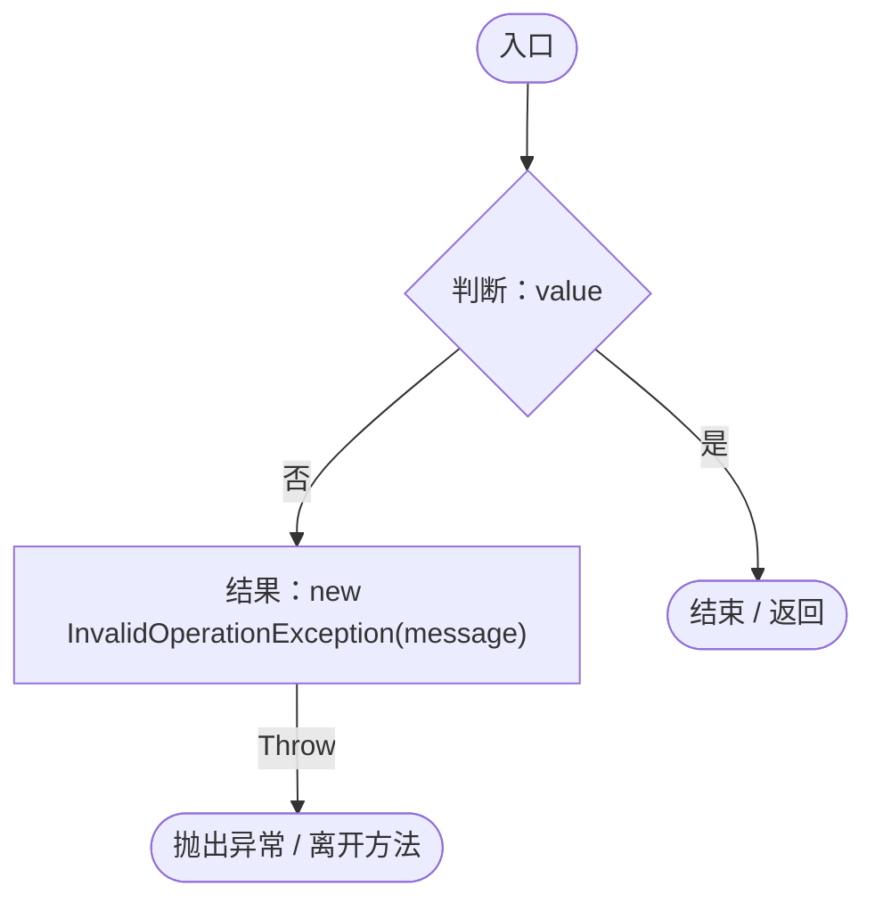
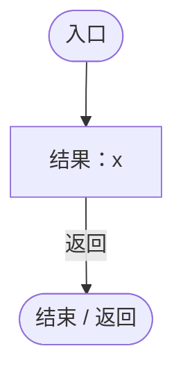

# GeneTreeWorkbenchRegression.cs

[返回总索引](../README.md) · `Editor` · `Assets/DarwinPark/Editor/GeneTreeWorkbenchRegression.cs`

[源文件](../../../Assets/DarwinPark/Editor/GeneTreeWorkbenchRegression.cs) · 源码校验：`f7796a122068defc4c84048044b25f33a080ee9f69f268d6ba3b0047f659d1ba`

方法按源文件位置排列。事件/回调引用不表示立即执行；分支与异常说明见总索引。完整源码与可点击关系图请打开离线手册。

## Check · L16

`private static void Check(bool value,string message)`

### Editor · Roslyn编译器控制流

## Validate · L17

`[MenuItem("Tools/Darwin Park/Validate First Person and Gene Tree")] public static void Validate()`

### Editor · Roslyn编译器控制流

```mermaid
flowchart TD
  b0(["入口"])
  b1["Check(Application.isPlaying,&quot;请先播放并等待星球生成&quot;);<br/>menu=UnityEngine.Object.FindFirstObjectByType&lt;GameMainMenu&gt;()<br/>typeof(GameMainMenu).GetMethod(&quot;Resume&quot;,BindingFlags.Instance&#124;BindingFlags.NonPublic).Invoke(menu,null);<br/>Check(!GameInputGate.Block…"]
  b2{"判断：formExport.id==ids[0]"}
  b3["formExport.attributeCurves.Count==JsonUtility.FromJson&lt;GeneDefinitionJson&gt;(catalog[ids[0]]).attributeCurves.Count"]
  b4["formExport.id==ids[0]"]
  b5["Check(formExport.id==ids[0]&amp;&amp;formExport.attributeCurves.Count==JsonUtility.FromJson&lt;GeneDefinitionJson&gt;(catalog[ids[0]]).attributeCurves.Count,&quot;数值表单丢失基因属性&quot;);"]
  b6["doc=new GeneTreeDocument()"]
  b7["i=0"]
  b8{"判断：i&lt;3"}
  b9["doc.nodes<br/>new GeneTreeNode{id=ids[i],position=new Vector2(i*200,100),error=i==2}<br/>id=ids[i]<br/>position=new Vector2(i*200,100)<br/>error=i==2<br/>doc.nodes.Add(new GeneTreeNode{id=ids[i],position=new Vector2(i*200,100),error=i==2});"]
  b10["i++"]
  b11["doc.edges<br/>new GeneTreeEdge{from=ids[0],to=ids[1],kind=&quot;evolution&quot;,value=10}<br/>from=ids[0]<br/>to=ids[1]<br/>kind=&quot;evolution&quot;<br/>value=10<br/>doc.edges.Add(new GeneTreeEdge{from=ids[0],to=ids[1],kind=&quot;evolution&quot;,value=10});"]
  b12["doc.edges<br/>new GeneTreeEdge{from=ids[0],to=ids[2],kind=&quot;error&quot;,value=20}<br/>from=ids[0]<br/>to=ids[2]<br/>kind=&quot;error&quot;<br/>value=20<br/>doc.edges.Add(new GeneTreeEdge{from=ids[0],to=ids[2],kind=&quot;error&quot;,value=20});"]
  b13["doc.edges<br/>new GeneTreeEdge{from=ids[1],to=ids[2],kind=&quot;suppress&quot;,value=300}<br/>from=ids[1]<br/>to=ids[2]<br/>kind=&quot;suppress&quot;<br/>value=300<br/>doc.edges.Add(new GeneTreeEdge{from=ids[1],to=ids[2],kind=&quot;suppress&quot;,value=300});"]
  b14["doc.edges<br/>new GeneTreeEdge{from=ids[2],to=ids[1],kind=&quot;promote&quot;,value=100}<br/>from=ids[2]<br/>to=ids[1]<br/>kind=&quot;promote&quot;<br/>value=100<br/>doc.edges.Add(new GeneTreeEdge{from=ids[2],to=ids[1],kind=&quot;promote&quot;,value=100});"]
  b15["folder=Path.GetFullPath(&quot;Artifacts/GeneTreeReview/RoundTrip&quot;)<br/>GeneTreeStorage.SaveTo(folder,doc,catalog);<br/>loaded=GeneTreeStorage.LoadFrom(folder)<br/>Check(JsonUtility.ToJson(doc)==JsonUtility.ToJson(loaded),&quot;基因树读写不一致&quot;);<br/>Check(GeneTreeStorag…"]
  b16["doc.edges<br/>new GeneTreeEdge{from=ids[1],to=ids[0],kind=&quot;evolution&quot;}<br/>from=ids[1]<br/>to=ids[0]<br/>kind=&quot;evolution&quot;<br/>doc.edges.Add(new GeneTreeEdge{from=ids[1],to=ids[0],kind=&quot;evolution&quot;});"]
  b17["rejected=false"]
  b18["GeneTreeStorage.Validate(doc,catalog);"]
  b19["rejected=true;"]
  b20["Check(rejected,&quot;未拒绝进化环&quot;);<br/>doc.edges.RemoveAt(doc.edges.Count-1);<br/>active=GeneTreeStorage.Active<br/>old=JsonUtility.ToJson(active)"]
  b21["JsonUtility.FromJsonOverwrite(JsonUtility.ToJson(doc),active);"]
  b22["new GeneDefinition{Id=ids[1]}<br/>Id=ids[1]<br/>def=new GeneDefinition{Id=ids[1]}"]
  b23["GeneTreeStorage.ApplyInfluences(def);<br/>Check(def.SuppressionRules.Single().Coefficient==300,&quot;红线抑制映射失败&quot;);"]
  b24["def<br/>new GeneDefinition{Id=ids[2]}<br/>Id=ids[2]<br/>def=new GeneDefinition{Id=ids[2]};"]
  b25["GeneTreeStorage.ApplyInfluences(def);<br/>Check(def.SuppressionRules.Single().Coefficient==-100,&quot;绿线促进映射失败&quot;);"]
  b26{"判断：GeneTreeStorage.Successor(ids[0],&quot;evolution&quot;)==ids[1]"}
  b27["GeneTreeStorage.Successor(ids[0],&quot;error&quot;)==ids[2]"]
  b28["GeneTreeStorage.Successor(ids[0],&quot;evolution&quot;)==ids[1]"]
  b29["Check(GeneTreeStorage.Successor(ids[0],&quot;evolution&quot;)==ids[1]&amp;&amp;GeneTreeStorage.Successor(ids[0],&quot;error&quot;)==ids[2],&quot;进化/出错目标未读取&quot;);"]
  b30["JsonUtility.FromJsonOverwrite(old,active);"]
  b31["LifeCycleCombatRegression.Validate();<br/>File.WriteAllText(&quot;Artifacts/GeneTreeReview/runtime-checks.txt&quot;,&quot;PASS: graph and JSON folder round trip; all four edge types retained; cycle rejected; red/green coefficients mapped; evolution/error r…"]
  b32(["结束 / 返回"])
  b0 --> b1
  b1 --> b2
  b2 -->|"是"| b3
  b2 -->|"否"| b4
  b3 --> b5
  b4 --> b5
  b5 --> b6
  b6 --> b7
  b7 --> b8
  b8 -->|"是"| b9
  b8 -->|"否"| b11
  b9 --> b10
  b10 --> b8
  b11 --> b12
  b12 --> b13
  b13 --> b14
  b14 --> b15
  b15 --> b16
  b16 --> b17
  b17 --> b18
  b18 --> b20
  b19 --> b20
  b20 --> b21
  b21 --> b22
  b22 --> b23
  b23 --> b24
  b24 --> b25
  b25 --> b26
  b26 -->|"是"| b27
  b26 -->|"否"| b28
  b27 --> b29
  b28 --> b29
  b29 -->|"经过finally 30"| b31
  b31 --> b32
  b18 -. "保护区可能异常（示意）" .-> b19
  b21 -. "退出保护区时 finally（示意）" .-> b30

```

项目内调用/回调引用：

- [GeneTreeWorkbenchRegression.Check · L16](b594bef24a5dce2b.md#m76fa7ea70c148b6d)（方法）
- [GameInputGate.Blocked.get · L8](52955daae7e592ab.md#m765763b665829633)（访问器）
- [GeneTreeStorage.ReadCatalog · L27](a885bad0d7dedee8.md#m89083f320ec287c0)（方法）
- [GeneValueForm.Load · L16](1a57b2a63a2f76d5.md#m3e1d8f0799dda5fd)（方法）
- [GeneValueForm.Export · L38](1a57b2a63a2f76d5.md#m733739ea591391d9)（方法）
- [GeneTreeStorage.SaveTo · L96](a885bad0d7dedee8.md#m44f80bc754af0f5a)（方法）
- [GeneTreeStorage.LoadFrom · L54](a885bad0d7dedee8.md#mc2371aed207c1d6a)（方法）
- [GeneTreeStorage.Validate · L67](a885bad0d7dedee8.md#m3371bf1e3c5ae267)（方法）
- [GeneTreeStorage.Active.get · L26](a885bad0d7dedee8.md#mcd6b1d82c9cf8f5c)（访问器）
- [GeneTreeStorage.ApplyInfluences · L117](a885bad0d7dedee8.md#ma58a13a0fae63ad6)（方法）
- [GeneTreeStorage.Successor · L122](a885bad0d7dedee8.md#m5b6c0b3324290975)（方法）
- [LifeCycleCombatRegression.Validate · L40](92ed3746ce41b5f8.md#m4d72ef5ac3e2247d)（方法）
- [GeneTreeWorkbenchRegression.回调@24 · L24](b594bef24a5dce2b.md#m06f837fd616a41e6)（回调/委托）

## 回调@24 · L24

`x … => 回调`

### Editor · Roslyn编译器控制流

