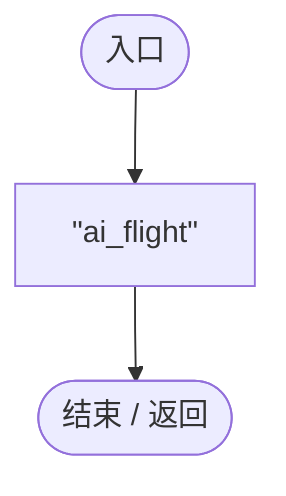
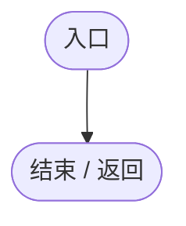
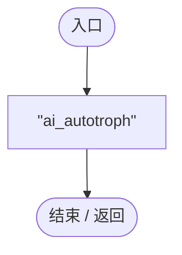

# BuiltinAIModules.cs

[返回总索引](../README.md) · `Runtime` · `Assets/DarwinPark/AI/Modules/BuiltinAIModules.cs`

[源文件](../../../Assets/DarwinPark/AI/Modules/BuiltinAIModules.cs) · 源码校验：`54b2dfe5e85fd90e015847d35679c6801d1333ac5965df016cecca3977d27a15`

方法按源文件位置排列。事件/回调引用不表示立即执行；分支与异常说明见总索引。完整源码与可点击关系图请打开离线手册。

## ModuleId.get · L6

`public string ModuleId`

### Editor / Player · 语法控制结构 / 声明（非CFG）

## Initialize · L7

`public void Initialize(EntityAIContext context)`

### Editor / Player · Roslyn编译器控制流

## Tick · L8

`public void Tick(float deltaTime)`

### Editor / Player · Roslyn编译器控制流

## OnDisable · L9

`public void OnDisable()`

### Editor / Player · Roslyn编译器控制流

## ModuleId.get · L13

`public string ModuleId`

### Editor / Player · 语法控制结构 / 声明（非CFG）

## Initialize · L14

`public void Initialize(EntityAIContext context)`

### Editor / Player · Roslyn编译器控制流

## Tick · L15

`public void Tick(float deltaTime)`

### Editor / Player · Roslyn编译器控制流

## OnDisable · L16

`public void OnDisable()`

### Editor / Player · Roslyn编译器控制流

