# EntityFavoritesManager.cs

[返回总索引](../README.md) · `Runtime` · `Assets/DarwinPark/UI/EntityFavoritesManager.cs`

[源文件](../../../Assets/DarwinPark/UI/EntityFavoritesManager.cs) · 源码校验：`7c8f51e35bb30f41dc3cff8f395e2e48aa16e8bc047c0418ff133ee8bca62764`

方法按源文件位置排列。事件/回调引用不表示立即执行；分支与异常说明见总索引。完整源码与可点击关系图请打开离线手册。

## Instance.get · L10

`get`

### Editor / Player · 语法控制结构 / 声明（非CFG）

## Instance.set · L10

`private set`

### Editor / Player · 语法控制结构 / 声明（非CFG）

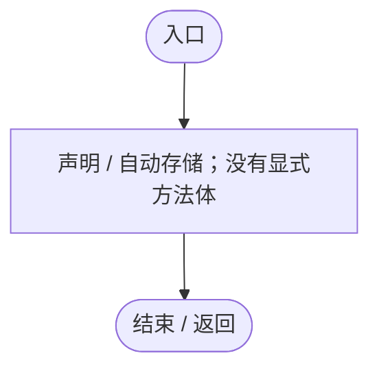

## Awake · L16

`private void Awake()`

### Editor / Player · Roslyn编译器控制流

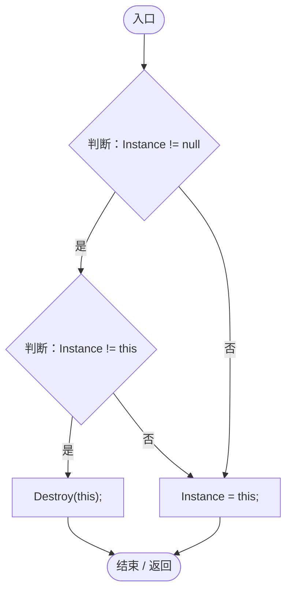

项目内调用/回调引用：

- [EntityFavoritesManager.Instance.get · L10](b60fb973e9d3815a.md#m0dac2feb106bac97)（访问器）
- [EntityFavoritesManager.Instance.set · L10](b60fb973e9d3815a.md#me8c0398e19c78246)（访问器）

## OnDestroy · L26

`private void OnDestroy()`

### Editor / Player · Roslyn编译器控制流

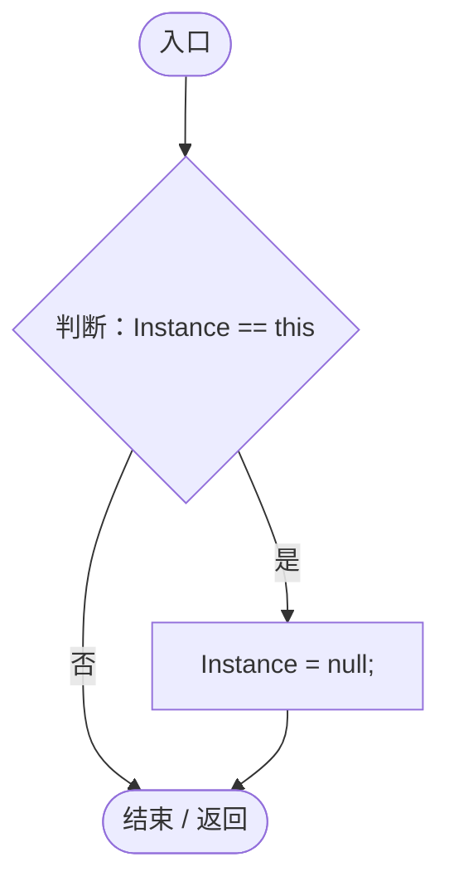

项目内调用/回调引用：

- [EntityFavoritesManager.Instance.get · L10](b60fb973e9d3815a.md#m0dac2feb106bac97)（访问器）
- [EntityFavoritesManager.Instance.set · L10](b60fb973e9d3815a.md#me8c0398e19c78246)（访问器）

## Start · L28

`private void Start()`

### Editor / Player · Roslyn编译器控制流

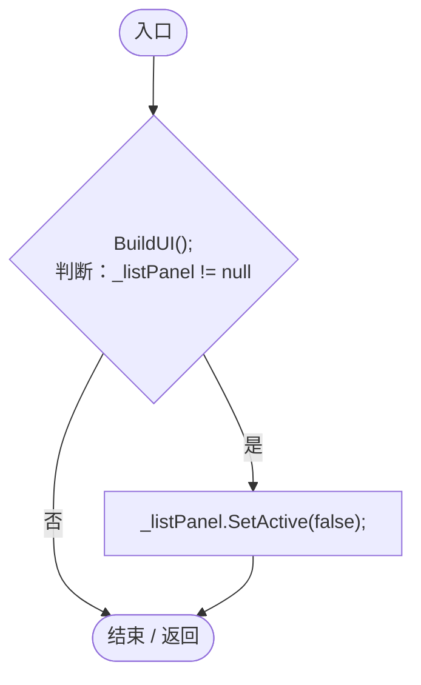

项目内调用/回调引用：

- [EntityFavoritesManager.BuildUI · L84](b60fb973e9d3815a.md#mac5b828059ced1d0)（方法）

## TogglePanel · L36

`public void TogglePanel()`

★ 新增：供按钮调用的显隐切换

### Editor / Player · Roslyn编译器控制流

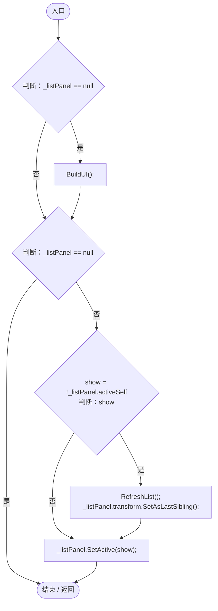

项目内调用/回调引用：

- [EntityFavoritesManager.BuildUI · L84](b60fb973e9d3815a.md#mac5b828059ced1d0)（方法）
- [EntityFavoritesManager.RefreshList · L128](b60fb973e9d3815a.md#m991f1395ef54cb58)（方法）

## IsFavorite · L46

`public bool IsFavorite(DarwinEntity entity)`

### Editor / Player · Roslyn编译器控制流

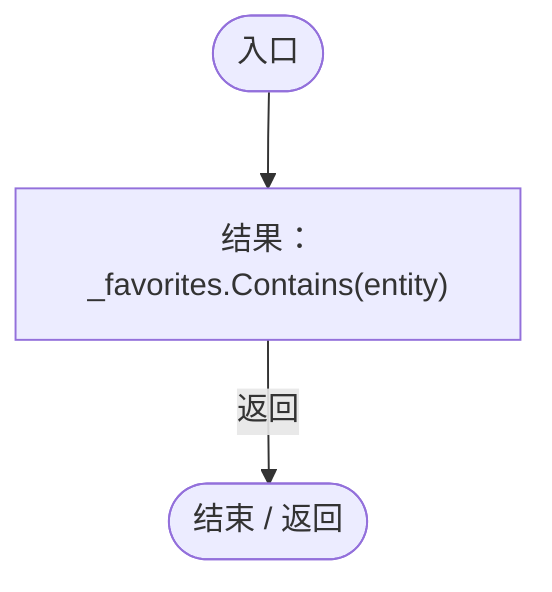

## ClearWorld · L49

`public void ClearWorld()`

★ 适配：离开世界清除引用和旧列表，避免下一世界继承失效收藏。

### Editor / Player · Roslyn编译器控制流

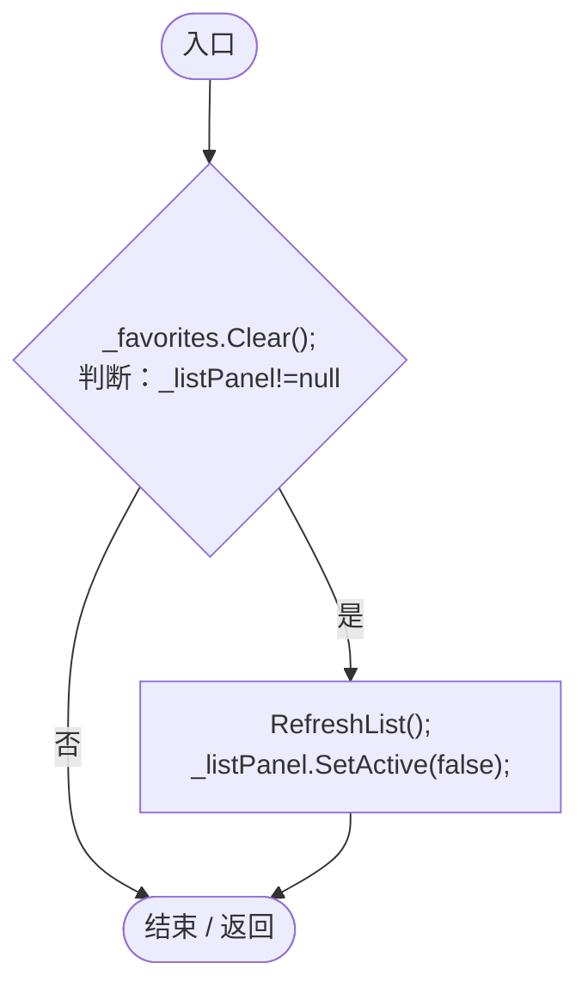

项目内调用/回调引用：

- [EntityFavoritesManager.RefreshList · L128](b60fb973e9d3815a.md#m991f1395ef54cb58)（方法）

## ToggleFavorite · L55

`public void ToggleFavorite(DarwinEntity entity)`

### Editor / Player · Roslyn编译器控制流

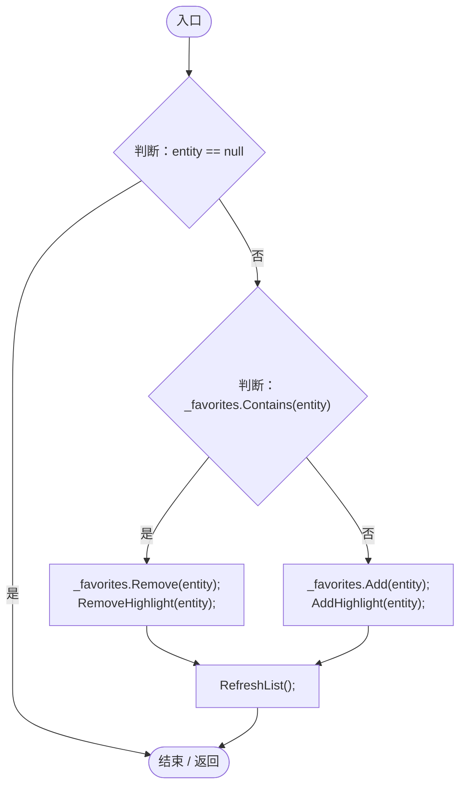

项目内调用/回调引用：

- [EntityFavoritesManager.RemoveHighlight · L79](b60fb973e9d3815a.md#m525709da9e9ca690)（方法）
- [EntityFavoritesManager.AddHighlight · L73](b60fb973e9d3815a.md#m80358a348b4b4c8b)（方法）
- [EntityFavoritesManager.RefreshList · L128](b60fb973e9d3815a.md#m991f1395ef54cb58)（方法）

## AddHighlight · L73

`private void AddHighlight(DarwinEntity entity)`

### Editor / Player · Roslyn编译器控制流

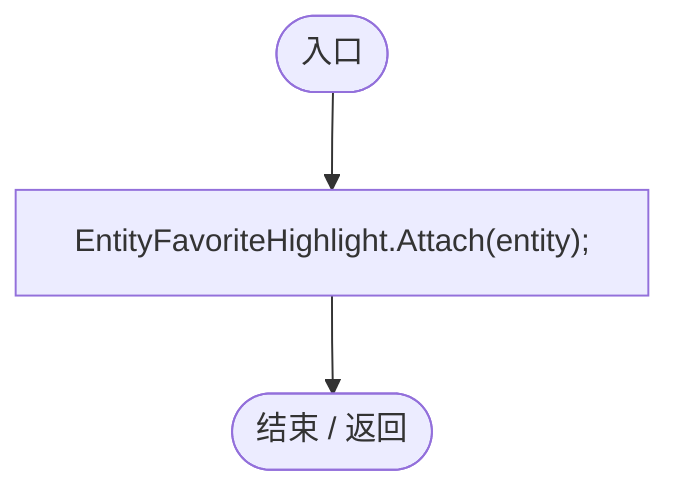

项目内调用/回调引用：

- [EntityFavoriteHighlight.Attach · L124](2af216812259d790.md#mc7e5796d8de1cd0f)（方法）

## RemoveHighlight · L79

`private void RemoveHighlight(DarwinEntity entity)`

### Editor / Player · Roslyn编译器控制流

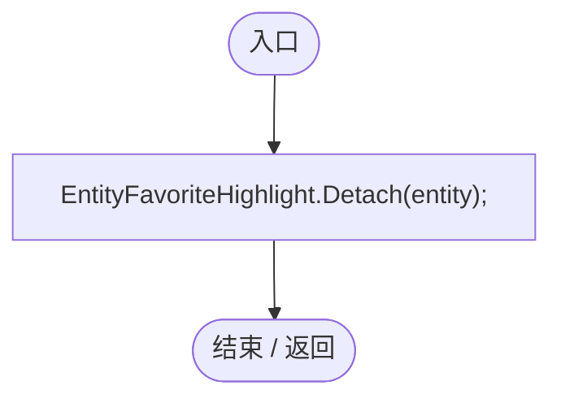

项目内调用/回调引用：

- [EntityFavoriteHighlight.Detach · L133](2af216812259d790.md#mb93210152772aff3)（方法）

## BuildUI · L84

`private void BuildUI()`

### Editor / Player · Roslyn编译器控制流

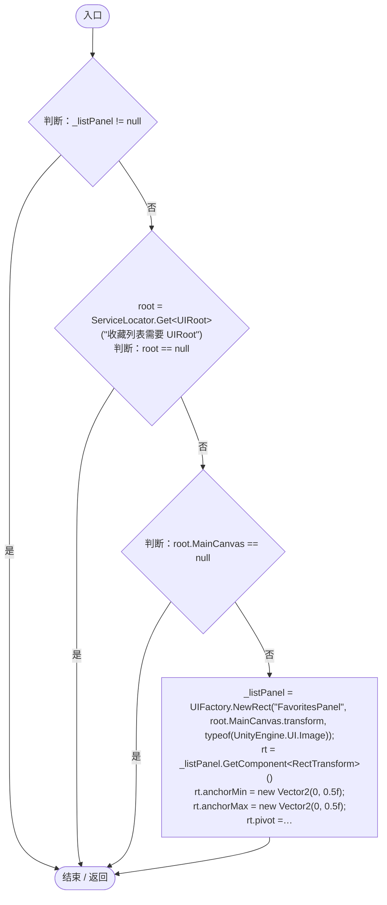

项目内调用/回调引用：

- [ServiceLocator.Get · L33](f2fdbe9f9ccd93cb.md#m2ae625299520c56d)（方法）
- [UIRoot.MainCanvas.get · L14](9c1421378791f0e0.md#maa2cc9baf1248477)（访问器）
- [UIFactory.NewRect · L33](dd1096a6995423db.md#med612116f3152344)（方法）
- [UIVisualTheme.Paint · L58](ca525a798a08f966.md#m2d61a6b26ab24980)（方法）
- [UIFactory.NewText · L57](dd1096a6995423db.md#m9dbccb5f0c38189e)（方法）
- [UIVisualTheme.AddIcon · L79](ca525a798a08f966.md#mcae965e84a38acc6)（方法）

## NotifyEntityRenamed · L126

`public void NotifyEntityRenamed()`

★ 适配：实体改名后，已经打开的收藏列表不能保留旧标签。

### Editor / Player · Roslyn编译器控制流

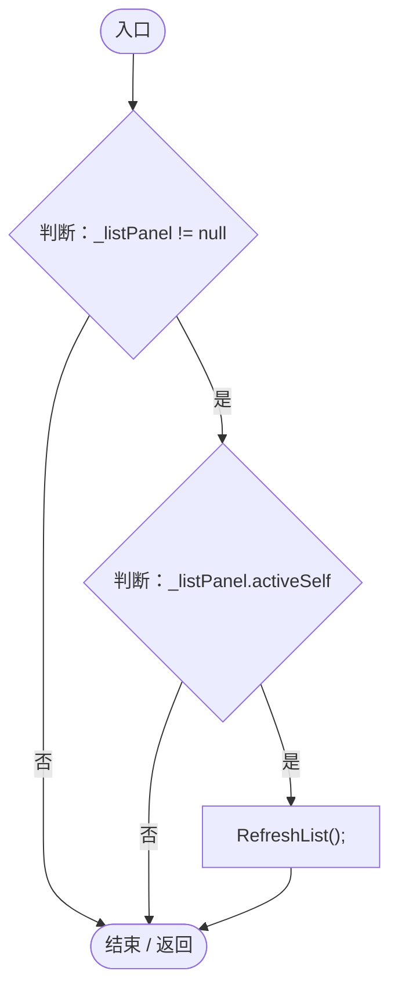

项目内调用/回调引用：

- [EntityFavoritesManager.RefreshList · L128](b60fb973e9d3815a.md#m991f1395ef54cb58)（方法）

## RefreshList · L128

`private void RefreshList()`

### Editor / Player · Roslyn编译器控制流

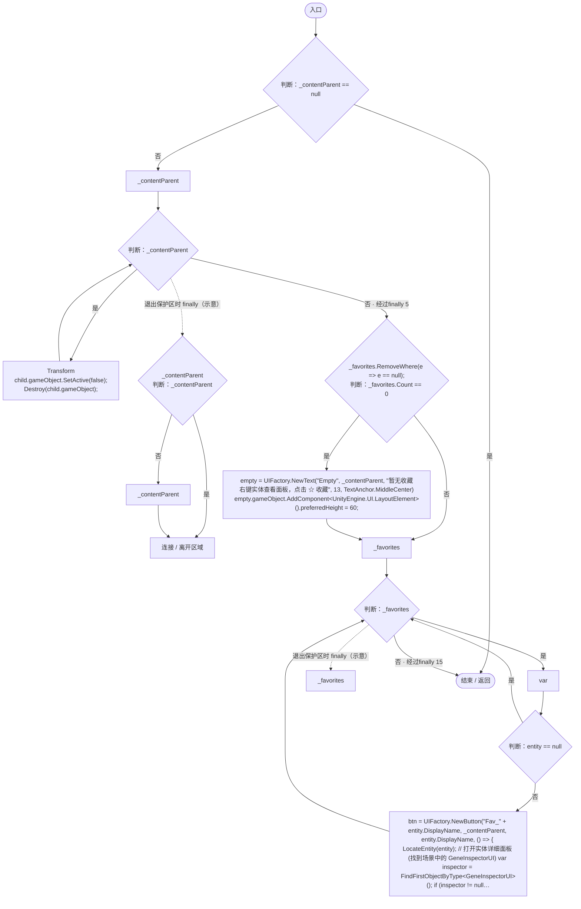

项目内调用/回调引用：

- [UIFactory.NewText · L57](dd1096a6995423db.md#m9dbccb5f0c38189e)（方法）
- [UIFactory.NewButton · L73](dd1096a6995423db.md#m5896f1b097c8bdde)（方法）
- [EntityFavoritesManager.回调@137 · L137](b60fb973e9d3815a.md#m459d61efe091036a)（回调/委托）
- [EntityFavoritesManager.回调@150 · L150](b60fb973e9d3815a.md#m9f8a6af8139ca968)（回调/委托）
- [EntityFavoritesManager.回调@163 · L163](b60fb973e9d3815a.md#m605ef005887876f6)（回调/委托）

## 回调@137 · L137

`e … => 回调`

### Editor / Player · Roslyn编译器控制流

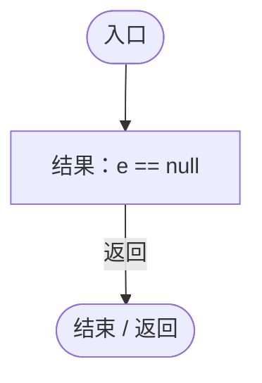

## 回调@150 · L150

`( … => 回调`

### Editor / Player · Roslyn编译器控制流

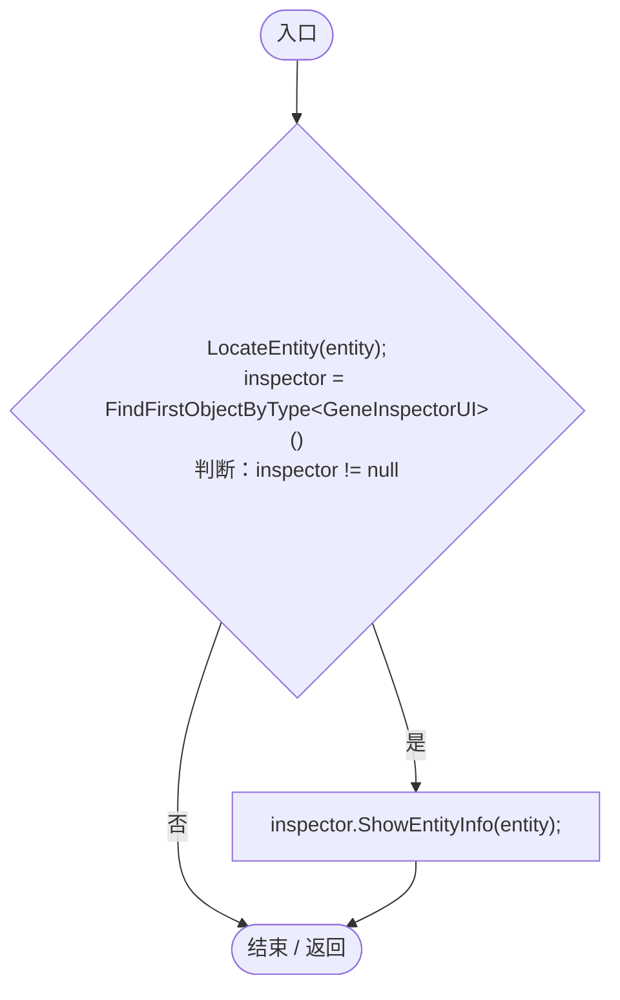

项目内调用/回调引用：

- [EntityFavoritesManager.LocateEntity · L171](b60fb973e9d3815a.md#m7e796ac1f8f26878)（方法）
- [GeneInspectorUI.ShowEntityInfo · L385](924e27c34e7b1f0a.md#mea69a0457b885287)（方法）

## 回调@163 · L163

`( … => 回调`

### Editor / Player · Roslyn编译器控制流

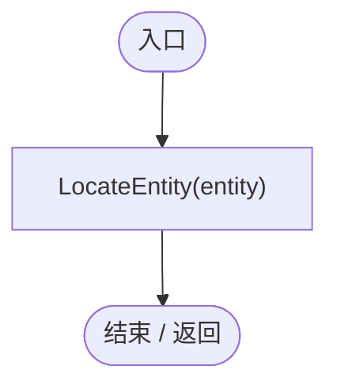

项目内调用/回调引用：

- [EntityFavoritesManager.LocateEntity · L171](b60fb973e9d3815a.md#m7e796ac1f8f26878)（方法）

## LocateEntity · L171

`private void LocateEntity(DarwinEntity entity)`

  ★ 修复：定位实体时把相机放到实体所在球面法线方向，  旧版 OrbitCamera.FocusOn 计算到了球心背面，且固定 180 距离会钻进星球内部。  

### Editor / Player · Roslyn编译器控制流

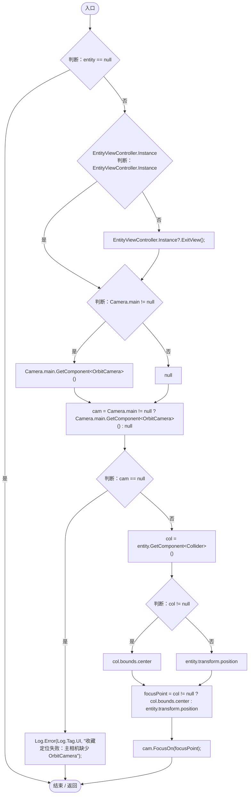

项目内调用/回调引用：

- [EntityViewController.Instance.get · L15](0ad0345f83229ef0.md#mb3b8144b56e80842)（访问器）
- [EntityViewController.ExitView · L105](0ad0345f83229ef0.md#mca8619c7f27942c9)（方法）
- [Log.Error · L43](735e5abf0df2bddc.md#m2addd5e1d74b000d)（方法）
- [OrbitCamera.FocusOn · L170](42eb429559b42bcb.md#m90f6d4818e064f1d)（方法）
