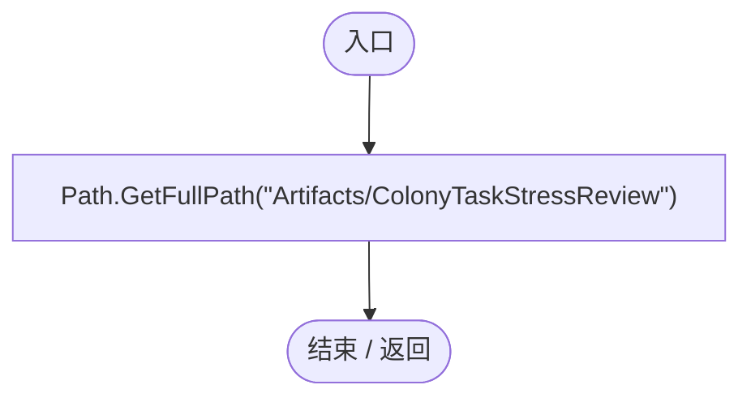
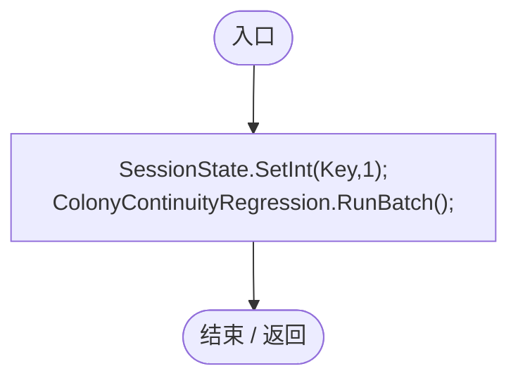
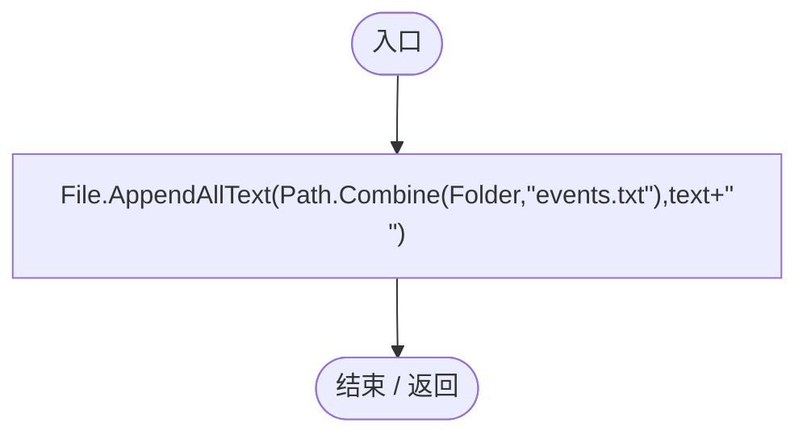
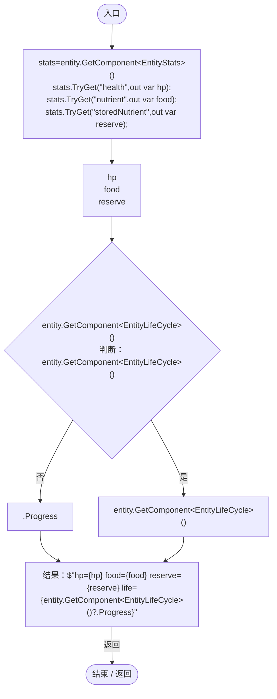
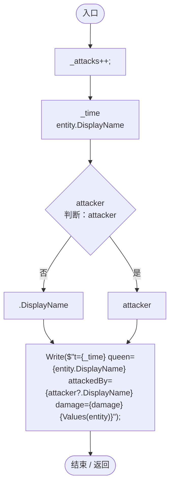
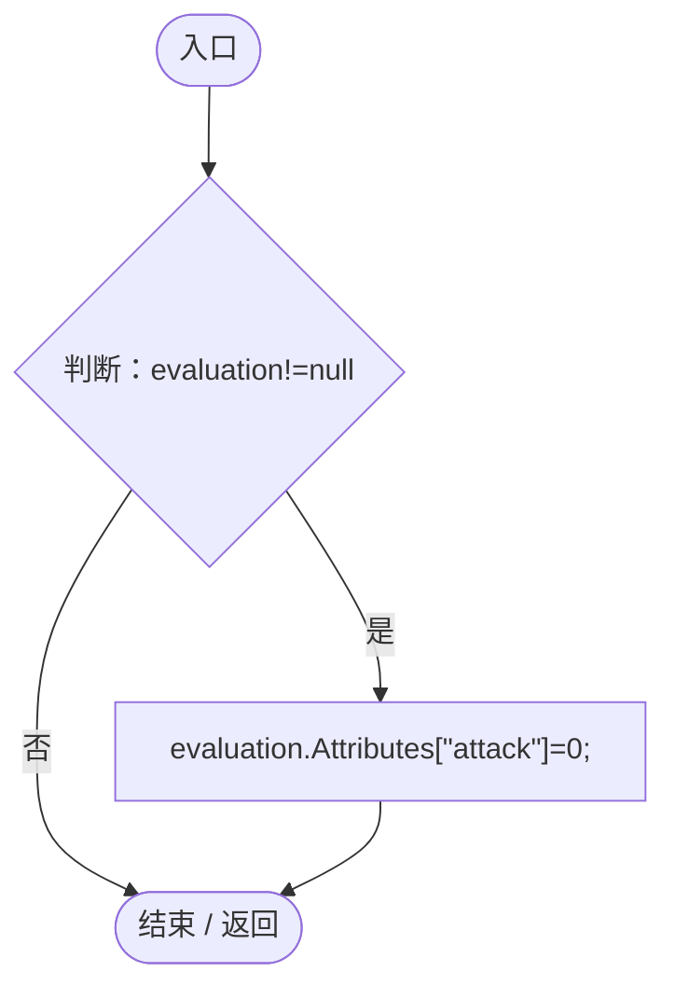
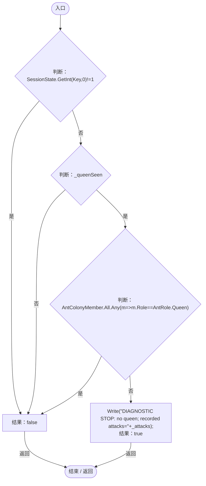
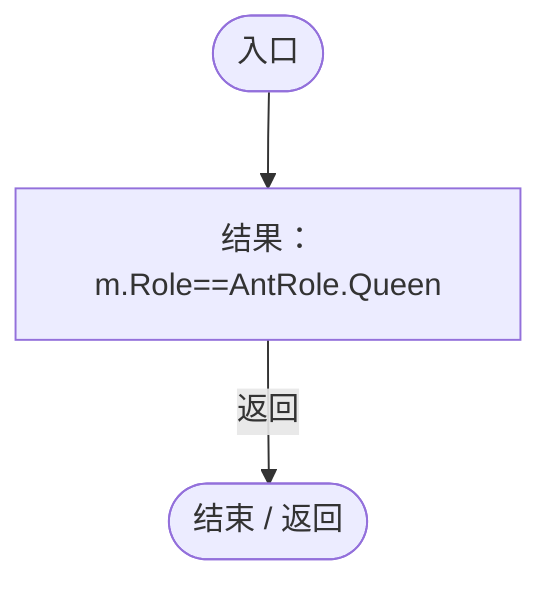
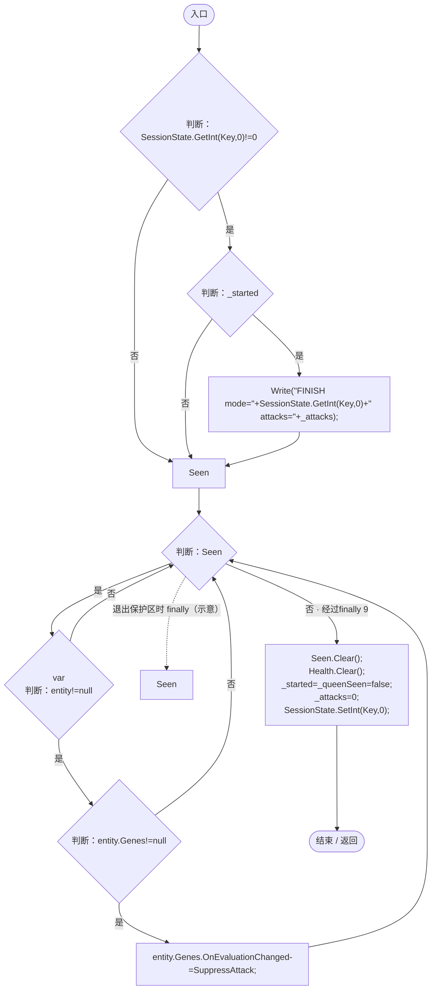

```mermaid
flowchart TD
  b0(["入口"])
  b1{"mode=SessionState.GetInt(Key,0)<br/>判断：mode==0"}
  b2{"_time=time;<br/>判断：_started"}
  b3["_started=true;<br/>Directory.CreateDirectory(Folder);<br/>File.WriteAllText(Path.Combine(Folder,&quot;events.txt&quot;),&quot;mode=&quot;+mode+&quot;\n&quot;);"]
  b4{"判断：Seen.Add(entity)"}
  b5{"判断：mode==2"}
  b6["entity.Genes.OnEvaluationChanged+=SuppressAttack;"]
  b7{"member=entity.GetComponent&lt;AntColonyMember&gt;()<br/>判断：member!=null"}
  b8{"判断：member.Active"}
  b9{"判断：member.Role==AntRole.Queen"}
  b10["_queenSeen=true;<br/>EntityCombat.Ensure(entity.gameObject).Attacked+=(attacker,damage)=&gt;{_attacks++;Write($&quot;t={_time} queen={entity.DisplayName} attackedBy={attacker?.DisplayName} damage={damage} {Values(entity)}&quot;);};"]
  b11{"判断：mode==2"}
  b12["SuppressAttack(entity.Genes.Evaluation);"]
  b13{"queen=entity.GetComponent&lt;AntColonyMember&gt;()<br/>判断：queen==null"}
  b14{"判断：queen.Active"}
  b15{"判断：queen.Role!=AntRole.Queen"}
  b16{"stats=entity.GetComponent&lt;EntityStats&gt;()<br/>stats.TryGet(&quot;health&quot;,out var hp);<br/>判断：Health.TryGetValue(entity,out var previous)"}
  b17{"判断：hp&lt;previous"}
  b18["Write($&quot;t={time} queenHealthDrop={previous}-&gt;{hp} {Values(entity)}&quot;);"]
  b19["Health[entity]=hp;"]
  b20(["结束 / 返回"])
  b0 --> b1
  b1 -->|"是"| b20
  b1 -->|"否"| b2
  b2 -->|"否"| b3
  b2 -->|"是"| b4
  b3 --> b4
  b4 -->|"是"| b5
  b4 -->|"否"| b11
  b5 -->|"是"| b6
  b5 -->|"否"| b7
  b6 --> b7
  b7 -->|"是"| b8
  b7 -->|"否"| b11
  b8 -->|"是"| b9
  b8 -->|"否"| b11
  b9 -->|"是"| b10
  b9 -->|"否"| b11
  b10 --> b11
  b11 -->|"是"| b12
  b11 -->|"否"| b13
  b12 --> b13
  b13 -->|"否"| b14
  b13 -->|"是"| b20
  b14 -->|"是"| b15
  b14 -->|"否"| b20
  b15 -->|"是"| b20
  b15 -->|"否"| b16
  b16 -->|"是"| b17
  b16 -->|"否"| b19
  b17 -->|"是"| b18
  b17 -->|"否"| b19
  b18 --> b19
  b19 --> b20

```

# ColonyTaskStressAudit.cs

[返回总索引](../README.md) · `Editor` · `Assets/DarwinPark/Editor/ColonyTaskStressAudit.cs`

[源文件](../../../Assets/DarwinPark/Editor/ColonyTaskStressAudit.cs) · 源码校验：`340e70753a38e32eacdb98a9ffdc87c1f32a245c6bb40db8044c365c0b530be7`

方法按源文件位置排列。事件/回调引用不表示立即执行；分支与异常说明见总索引。完整源码与可点击关系图请打开离线手册。

## Folder.get · L20

`private static string Folder`

### Editor · 语法控制结构 / 声明（非CFG）

## RunDiagnosticBatch · L21

`public static void RunDiagnosticBatch()`

### Editor · Roslyn编译器控制流

项目内调用/回调引用：

- [ColonyContinuityRegression.RunBatch · L31](9386360ce717a3bf.md#m7d60c78e39fdcef4)（方法）

## RunFeedingBatch · L22

`public static void RunFeedingBatch()`

### Editor · Roslyn编译器控制流

项目内调用/回调引用：

- [ColonyContinuityRegression.RunBatch · L31](9386360ce717a3bf.md#m7d60c78e39fdcef4)（方法）

## Write · L23

`private static void Write(string text)`

### Editor · Roslyn编译器控制流

## Values · L24

`private static string Values(DarwinEntity entity)`

### Editor · Roslyn编译器控制流

项目内调用/回调引用：

- [EntityStats.TryGet · L93](75aa86a368efdf24.md#m03cef847022eee28)（方法）
- [EntityLifeCycle.Progress.get · L12](9f4138bfbae654b7.md#md607c90b6934f95f)（访问器）

## BeforeTick · L25

`public static void BeforeTick(DarwinEntity entity,float time)`

### Editor · Roslyn编译器控制流

项目内调用/回调引用：

- [DarwinEntity.Genes.get · L14](70798dde169f2e8b.md#m622eb1adf401d431)（访问器）
- [AntColonyMember.Role.get · L40](baebd85c05598377.md#m382545c3d4092bf1)（访问器）
- [EntityCombat.Ensure · L12](a5b5b46ac6c197ae.md#me21fe8f31497e62f)（方法）
- [ColonyTaskStressAudit.SuppressAttack · L43](b670f82196406694.md#mf45f1b1050c15def)（方法）
- [EntityGeneController.Evaluation.get · L20](7494d53178552f0e.md#mf275f100ea21601a)（访问器）
- [EntityStats.TryGet · L93](75aa86a368efdf24.md#m03cef847022eee28)（方法）
- [ColonyTaskStressAudit.Write · L23](b670f82196406694.md#mca2f85db7e7df66e)（方法）
- [ColonyTaskStressAudit.Values · L24](b670f82196406694.md#m7abc133474ff3c44)（方法）
- [ColonyTaskStressAudit.回调@35 · L35](b670f82196406694.md#m29712f552562cb3a)（回调/委托）

## 回调@35 · L35

`( … => 回调`

### Editor · Roslyn编译器控制流

项目内调用/回调引用：

- [ColonyTaskStressAudit.Write · L23](b670f82196406694.md#mca2f85db7e7df66e)（方法）
- [ColonyTaskStressAudit.Values · L24](b670f82196406694.md#m7abc133474ff3c44)（方法）

## SuppressAttack · L43

`private static void SuppressAttack(GenomeEvaluation evaluation)`

### Editor · Roslyn编译器控制流

## StopRequested · L44

`public static bool StopRequested()`

### Editor · Roslyn编译器控制流

项目内调用/回调引用：

- [ColonyTaskStressAudit.Write · L23](b670f82196406694.md#mca2f85db7e7df66e)（方法）
- [ColonyTaskStressAudit.回调@46 · L46](b670f82196406694.md#m1cda6821d3d6320b)（回调/委托）

## 回调@46 · L46

`m … => 回调`

### Editor · Roslyn编译器控制流

项目内调用/回调引用：

- [AntColonyMember.Role.get · L40](baebd85c05598377.md#m382545c3d4092bf1)（访问器）

## Finish · L49

`public static void Finish()`

### Editor · Roslyn编译器控制流

项目内调用/回调引用：

- [ColonyTaskStressAudit.Write · L23](b670f82196406694.md#mca2f85db7e7df66e)（方法）
- [DarwinEntity.Genes.get · L14](70798dde169f2e8b.md#m622eb1adf401d431)（访问器）
- [ColonyTaskStressAudit.SuppressAttack · L43](b670f82196406694.md#mf45f1b1050c15def)（方法）
