# ControlBindings.cs

[返回总索引](../README.md) · `Runtime` · `Assets/DarwinPark/Core/ControlBindings.cs`

[源文件](../../../Assets/DarwinPark/Core/ControlBindings.cs) · 源码校验：`eabcac286cbc163b82cd256c87c6f9691e38ca0f398c317c8f3ecbcea73436fa`

方法按源文件位置排列。事件/回调引用不表示立即执行；分支与异常说明见总索引。完整源码与可点击关系图请打开离线手册。

## Defaults · L16

`private static Dictionary<ControlAction,KeyCode> Defaults()`

### Editor / Player · Roslyn编译器控制流

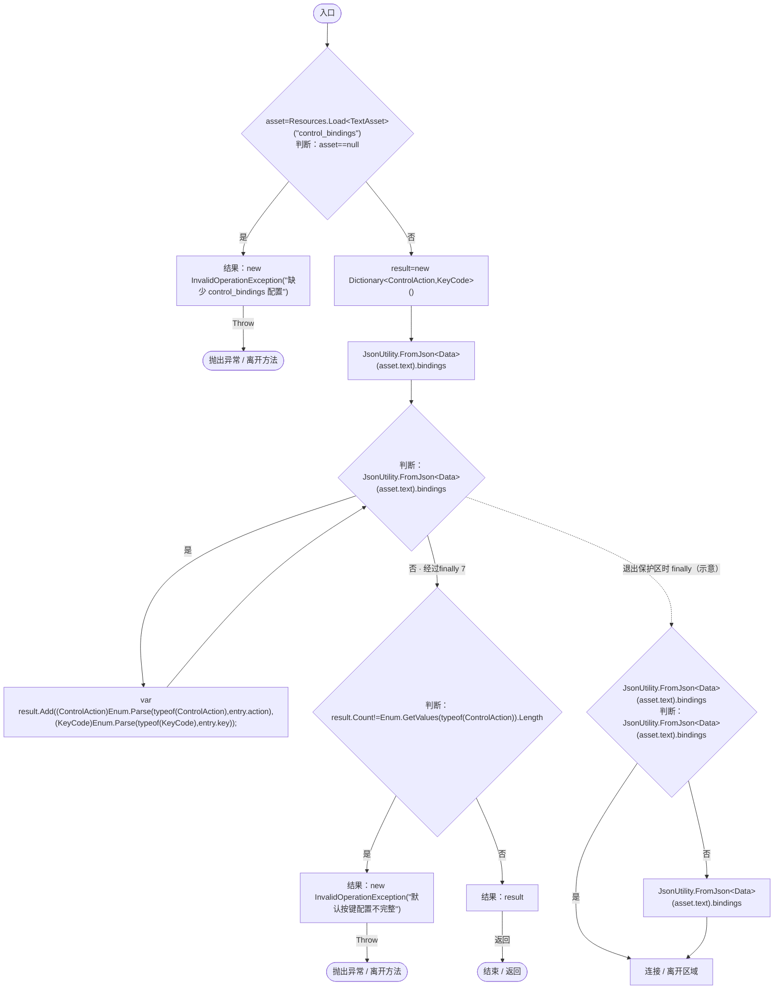

## Ensure · L26

`private static void Ensure()`

### Editor / Player · Roslyn编译器控制流

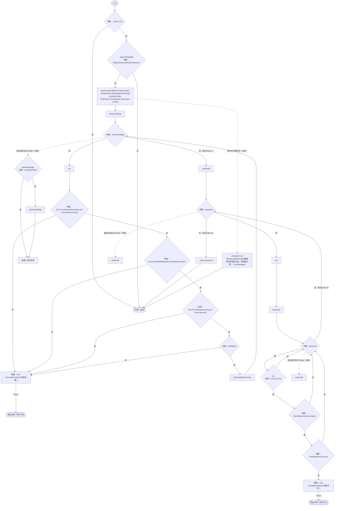

项目内调用/回调引用：

- [ControlBindings.Defaults · L16](b6735f8f133ee3f4.md#mde9cff359920e6da)（方法）
- [ControlBindings.Valid · L54](b6735f8f133ee3f4.md#m31d44dcc7e341ab0)（方法）
- [ControlBindings.SameKey · L53](b6735f8f133ee3f4.md#mb080f2a12cfb9826)（方法）
- [ControlBindings.Overlaps · L52](b6735f8f133ee3f4.md#m7742410f0f298220)（方法）

## Get · L45

`public static KeyCode Get(ControlAction action)`

### Editor / Player · Roslyn编译器控制流

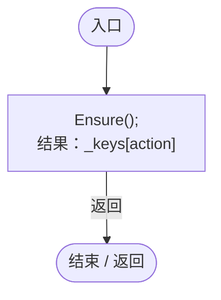

项目内调用/回调引用：

- [ControlBindings.Ensure · L26](b6735f8f133ee3f4.md#me8fe96de4e871833)（方法）

## Held · L46

`public static bool Held(ControlAction action)`

### Editor / Player · Roslyn编译器控制流

```mermaid
flowchart TD
  b0(["入口"])
  b1["key=Get(action)"]
  b2{"判断：Input.GetKey(key)"}
  b3{"判断：key==KeyCode.LeftAlt"}
  b4["Input.GetKey(KeyCode.RightAlt)"]
  b5["key==KeyCode.LeftAlt"]
  b6["Input.GetKey(key)"]
  b7["结果：Input.GetKey(key)&#124;&#124;key==KeyCode.LeftAlt&amp;&amp;Input.GetKey(KeyCode.RightAlt)"]
  b8(["结束 / 返回"])
  b0 --> b1
  b1 --> b2
  b2 -->|"否"| b3
  b2 -->|"是"| b6
  b3 -->|"是"| b4
  b3 -->|"否"| b5
  b4 --> b7
  b5 --> b7
  b6 --> b7
  b7 -->|"返回"| b8

```

项目内调用/回调引用：

- [ControlBindings.Get · L45](b6735f8f133ee3f4.md#mb5707e6e63a56689)（方法）

## Down · L50

`public static bool Down(ControlAction action)`

### Editor / Player · Roslyn编译器控制流

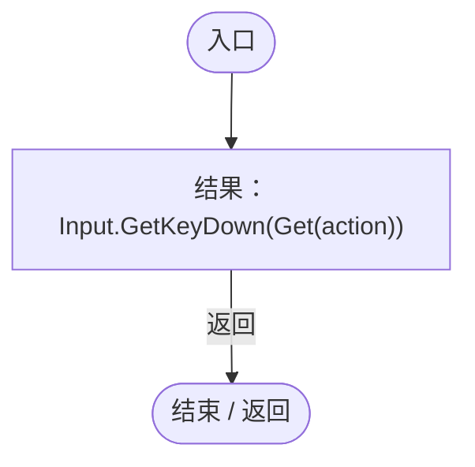

项目内调用/回调引用：

- [ControlBindings.Get · L45](b6735f8f133ee3f4.md#mb5707e6e63a56689)（方法）

## Overlaps · L52

`private static bool Overlaps(ControlAction a,ControlAction b)`

空格可分别承担星球暂停和实体跳跃；其他同时生效的操作不能绑定同一个键。

### Editor / Player · Roslyn编译器控制流

```mermaid
flowchart TD
  b0(["入口"])
  b1{"判断：a!=ControlAction.WorldPause"}
  b2{"判断：b!=ControlAction.WorldPause"}
  b3{"判断：a&gt;=ControlAction.Rts"}
  b4{"判断：b&gt;=ControlAction.Rts"}
  b5{"判断：a==ControlAction.Pause"}
  b6["b==ControlAction.Pause"]
  b7["a!=ControlAction.WorldPause&amp;&amp;b!=ControlAction.WorldPause&#124;&#124;a&gt;=ControlAction.Rts&#124;&#124;b&gt;=ControlAction.Rts&#124;&#124;a==ControlAction.Pause&#124;&#124;b==ControlAction.Pause"]
  b8["结果：a!=ControlAction.WorldPause&amp;&amp;b!=ControlAction.WorldPause&#124;&#124;a&gt;=ControlAction.Rts&#124;&#124;b&gt;=ControlAction.Rts&#124;&#124;a==ControlAction.Pause&#124;&#124;b==ControlAction.Pause"]
  b9(["结束 / 返回"])
  b0 --> b1
  b1 -->|"是"| b2
  b1 -->|"否"| b3
  b2 -->|"否"| b3
  b2 -->|"是"| b7
  b3 -->|"否"| b4
  b3 -->|"是"| b7
  b4 -->|"否"| b5
  b4 -->|"是"| b7
  b5 -->|"否"| b6
  b5 -->|"是"| b7
  b6 --> b8
  b7 --> b8
  b8 -->|"返回"| b9

```

## SameKey · L53

`private static bool SameKey(KeyCode a,KeyCode b)`

### Editor / Player · Roslyn编译器控制流

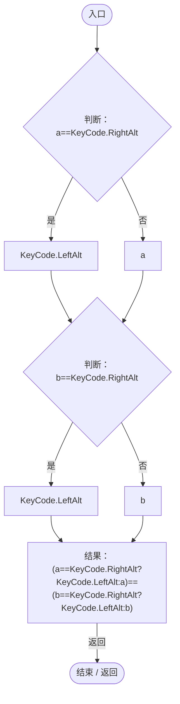

## Valid · L54

`private static bool Valid(KeyCode key)`

### Editor / Player · Roslyn编译器控制流

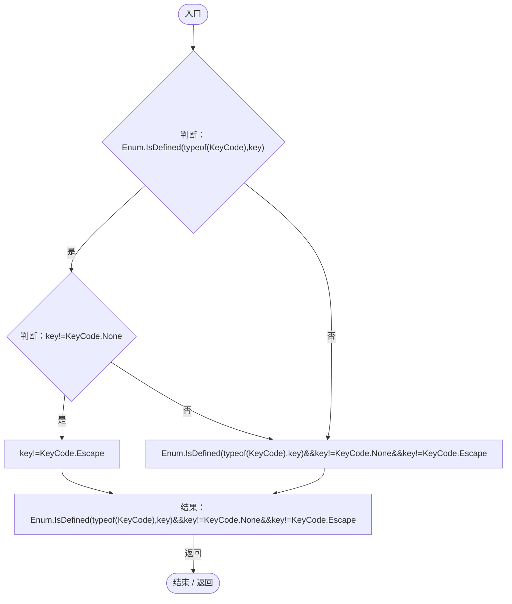

## TryBind · L55

`public static bool TryBind(ControlAction action,KeyCode key,out string message)`

### Editor / Player · Roslyn编译器控制流

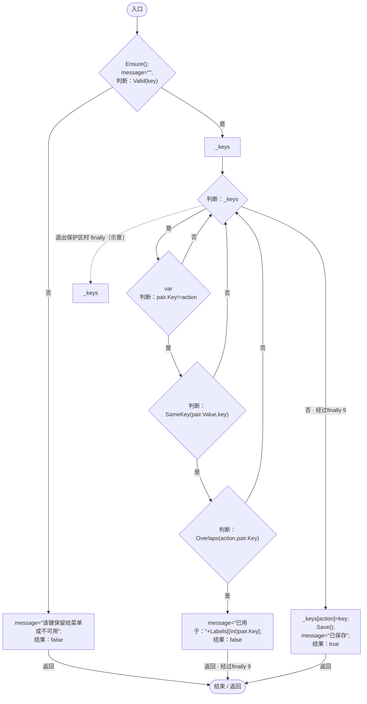

项目内调用/回调引用：

- [ControlBindings.Ensure · L26](b6735f8f133ee3f4.md#me8fe96de4e871833)（方法）
- [ControlBindings.Valid · L54](b6735f8f133ee3f4.md#m31d44dcc7e341ab0)（方法）
- [ControlBindings.SameKey · L53](b6735f8f133ee3f4.md#mb080f2a12cfb9826)（方法）
- [ControlBindings.Overlaps · L52](b6735f8f133ee3f4.md#m7742410f0f298220)（方法）
- [ControlBindings.Save · L62](b6735f8f133ee3f4.md#me3ddbbf0d2471961)（方法）

## Save · L62

`public static void Save()`

### Editor / Player · Roslyn编译器控制流

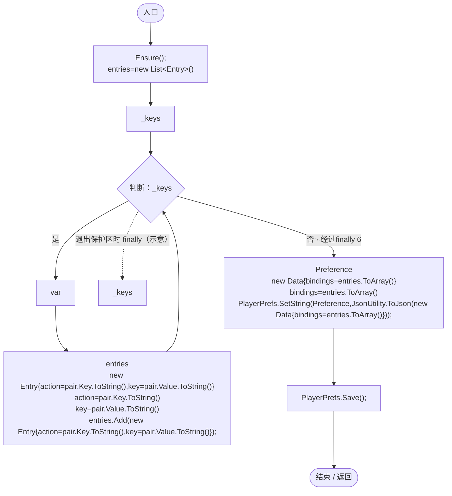

项目内调用/回调引用：

- [ControlBindings.Ensure · L26](b6735f8f133ee3f4.md#me8fe96de4e871833)（方法）

## RestoreDefaults · L67

`public static void RestoreDefaults()`

### Editor / Player · Roslyn编译器控制流

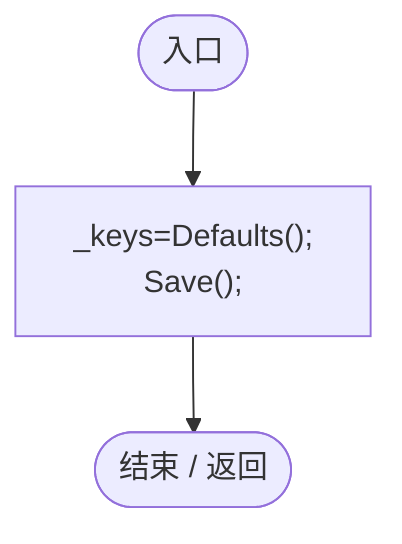

项目内调用/回调引用：

- [ControlBindings.Defaults · L16](b6735f8f133ee3f4.md#mde9cff359920e6da)（方法）
- [ControlBindings.Save · L62](b6735f8f133ee3f4.md#me3ddbbf0d2471961)（方法）

## Display · L68

`public static string Display(ControlAction action)`

### Editor / Player · Roslyn编译器控制流

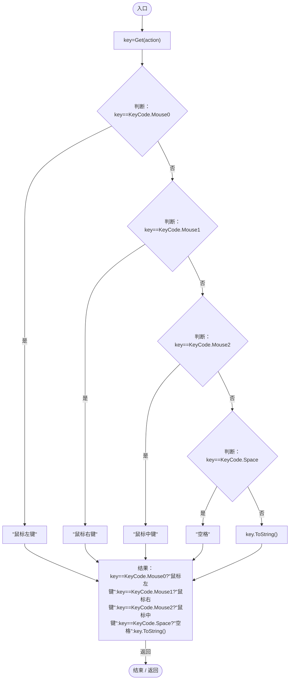

项目内调用/回调引用：

- [ControlBindings.Get · L45](b6735f8f133ee3f4.md#mb5707e6e63a56689)（方法）

## ClearCache · L72

`[RuntimeInitializeOnLoadMethod(RuntimeInitializeLoadType.SubsystemRegistration)] public static void ClearCache()`

### Editor / Player · Roslyn编译器控制流

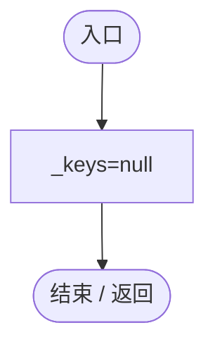
