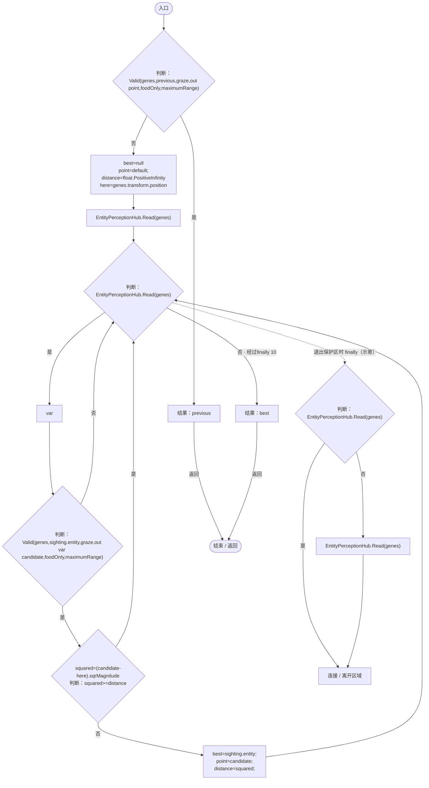

```mermaid
flowchart TD
  b0(["入口"])
  b1["point=default;"]
  b2{"判断：target!=null"}
  b3{"判断：target.gameObject!=genes.gameObject"}
  b4{"判断：EcologyQueries.Alive(target)"}
  b5{"判断：EntityPerceptionHub.TryLocate(genes,target,out point,maximumRange)"}
  b6{"判断：graze"}
  b7{"判断：target.Genes.GetAttribute(&quot;moveSpeed&quot;)&lt;=0"}
  b8{"判断：foodOnly"}
  b9{"判断：NutritionTransfer.FoodTargetAllowed(genes,target)"}
  b10["EcologyMotion.CanHunt(genes,target)"]
  b11["target!=null&amp;&amp;target.gameObject!=genes.gameObject&amp;&amp;EcologyQueries.Alive(target)&amp;&amp;EntityPerceptionHub.TryLocate(genes,target,out point,maximumRange)&amp;&amp;(!graze&#124;&#124;target.Genes.GetAttribute(&quot;moveSpeed&quot;)&lt;=0)&amp;&amp;(!foodOnly&#124;&#124;NutritionTransfer.FoodT…"]
  b12["结果：target!=null&amp;&amp;target.gameObject!=genes.gameObject&amp;&amp;EcologyQueries.Alive(target)&amp;&amp;EntityPerceptionHub.TryLocate(genes,target,out point,maximumRange)&amp;&amp;(!graze&#124;&#124;target.Genes.GetAttribute(&quot;moveSpeed&quot;)&lt;=0)&amp;&amp;(!foodOnly&#124;&#124;NutritionTransfer.Fo…"]
  b13(["结束 / 返回"])
  b0 --> b1
  b1 --> b2
  b2 -->|"是"| b3
  b2 -->|"否"| b11
  b3 -->|"是"| b4
  b3 -->|"否"| b11
  b4 -->|"是"| b5
  b4 -->|"否"| b11
  b5 -->|"是"| b6
  b5 -->|"否"| b11
  b6 -->|"是"| b7
  b6 -->|"否"| b8
  b7 -->|"是"| b8
  b7 -->|"否"| b11
  b8 -->|"是"| b9
  b8 -->|"否"| b10
  b9 -->|"是"| b10
  b9 -->|"否"| b11
  b10 --> b12
  b11 --> b12
  b12 -->|"返回"| b13

```

# PerceivedTargets.cs

[返回总索引](../README.md) · `Runtime` · `Assets/DarwinPark/Entities/Ecology/PerceivedTargets.cs`

[源文件](../../../Assets/DarwinPark/Entities/Ecology/PerceivedTargets.cs) · 源码校验：`219a5dc75e97b11a472051eac4352fc8b7db761042ffc6572107a3933fa6bc07`

方法按源文件位置排列。事件/回调引用不表示立即执行；分支与异常说明见总索引。完整源码与可点击关系图请打开离线手册。

## Valid · L7

`public static bool Valid(EntityGeneController genes,DarwinEntity target,bool graze,out Vector3 point,bool foodOnly=false,float maximumRange=float.PositiveInfinity)`

### Editor / Player · Roslyn编译器控制流

项目内调用/回调引用：

- [EcologyQueries.Alive · L39](bdf7ccc2c9c0452f.md#m8352bfacbe2996a8)（方法）
- [EntityPerceptionHub.TryLocate · L57](aeecc36cb2c3cc24.md#m2cd96337ffd40bb4)（方法）
- [EntityGeneController.GetAttribute · L286](7494d53178552f0e.md#m18bff2b38f95b556)（方法）
- [DarwinEntity.Genes.get · L14](70798dde169f2e8b.md#m622eb1adf401d431)（访问器）
- [NutritionTransfer.FoodTargetAllowed · L32](081d3b8ff683e442.md#mff201b6bc4939ead)（方法）
- [EcologyMotion.CanHunt · L41](6ed9d0eedb456d32.md#mdf70cee5e3f23adf)（方法）

## Nearest · L11

`public static DarwinEntity Nearest(EntityGeneController genes,bool graze,DarwinEntity previous,out Vector3 point,bool foodOnly=false,float maximumRange=float.PositiveInfinity)`

### Editor / Player · Roslyn编译器控制流

项目内调用/回调引用：

- [PerceivedTargets.Valid · L7](b78759d0d0a172e4.md#m1aa909943d40ed9f)（方法）
- [EntityPerceptionHub.Read · L42](aeecc36cb2c3cc24.md#mbe2216b46b71081b)（方法）
