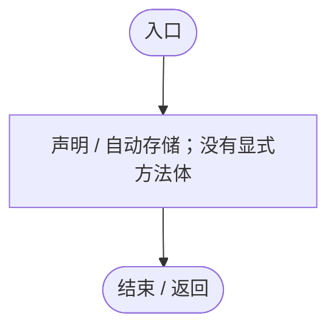
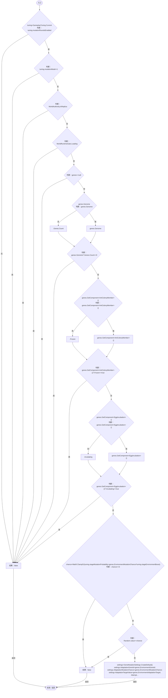
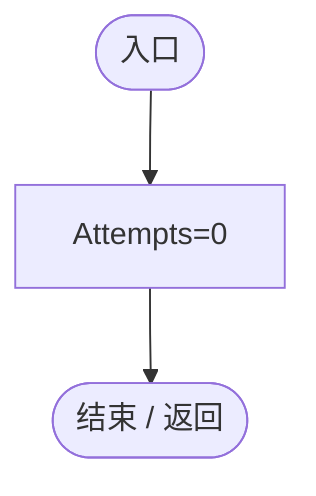

# StageMutationPolicy.cs

[返回总索引](../README.md) · `Runtime` · `Assets/DarwinPark/Entities/Simulation/StageMutationPolicy.cs`

[源文件](../../../Assets/DarwinPark/Entities/Simulation/StageMutationPolicy.cs) · 源码校验：`19eeedbdb1cddab24b42abb43768861f1c5ec70e41233367791c4b3828954f68`

方法按源文件位置排列。事件/回调引用不表示立即执行；分支与异常说明见总索引。完整源码与可点击关系图请打开离线手册。

## Attempts.get · L10

`get`

### Editor / Player · 语法控制结构 / 声明（非CFG）

## Attempts.set · L10

`private set`

### Editor / Player · 语法控制结构 / 声明（非CFG）

## TryMutate · L11

`public static bool TryMutate(EntityGeneController genes)`

### Editor / Player · Roslyn编译器控制流

项目内调用/回调引用：

- [GameplayTuning.Current.get · L44](db546e5713b32d53.md#m5713e7f86902b6fa)（访问器）
- [GeneMutationSettings.CreateDefault · L14](202f10318a181ae1.md#mf2c33daa013981eb)（方法）
- [StageMutationPolicy.Attempts.set · L10](b7aaf6698cbc6b40.md#mcfaa3ce53d16cd04)（访问器）
- [StageMutationPolicy.Attempts.get · L10](b7aaf6698cbc6b40.md#m2f33d8906a7fee45)（访问器）
- [GeneMutator.Mutate · L18](f297edbfb98ef475.md#m4444eb9ce9b6a55a)（方法）

## Reset · L20

`[RuntimeInitializeOnLoadMethod(RuntimeInitializeLoadType.SubsystemRegistration)]private static void Reset()`

### Editor / Player · Roslyn编译器控制流

项目内调用/回调引用：

- [StageMutationPolicy.Attempts.set · L10](b7aaf6698cbc6b40.md#mcfaa3ce53d16cd04)（访问器）
