# RuntimeCrashDiagnostics.cs

[返回总索引](../README.md) · `Runtime` · `Assets/DarwinPark/Core/Logging/RuntimeCrashDiagnostics.cs`

[源文件](../../../Assets/DarwinPark/Core/Logging/RuntimeCrashDiagnostics.cs) · 源码校验：`21eacaa897348c39ef9d0554ed5e83731831148f4dd0034a7b588a61810af64c`

方法按源文件位置排列。事件/回调引用不表示立即执行；分支与异常说明见总索引。完整源码与可点击关系图请打开离线手册。

## DirectoryPath.get · L19

`public static string DirectoryPath`

### Editor / Player · 语法控制结构 / 声明（非CFG）

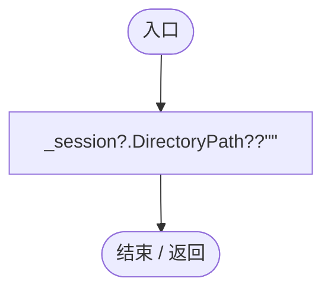

项目内调用/回调引用：

- [RuntimeDiagnosticSession.DirectoryPath.get · L23](cdf29a3aa679d2b9.md#m508bb212a239179f)（访问器）

## Failure.get · L20

`public static string Failure`

### Editor / Player · 语法控制结构 / 声明（非CFG）

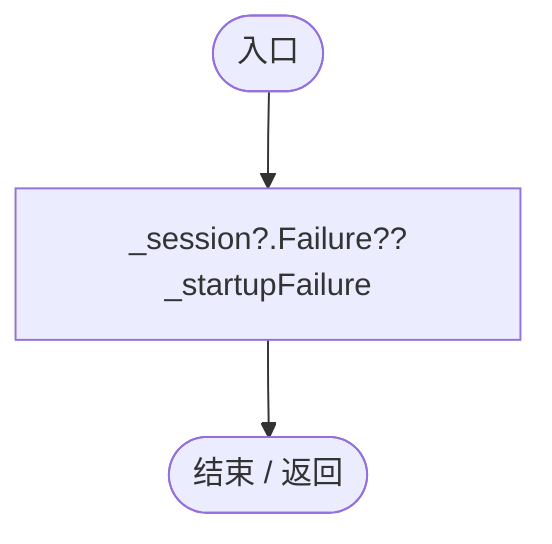

## PreviousAbnormalSessions.get · L21

`public static int PreviousAbnormalSessions`

### Editor / Player · 语法控制结构 / 声明（非CFG）

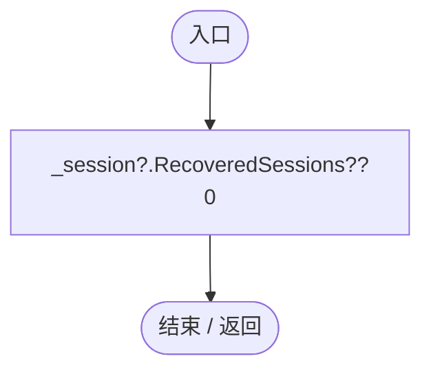

项目内调用/回调引用：

- [RuntimeDiagnosticSession.RecoveredSessions.get · L25](cdf29a3aa679d2b9.md#mbe77d8a7bf1f913f)（访问器）

## Start · L31

`public static void Start(Func<string> logFile=null)`

### Editor · Roslyn编译器控制流

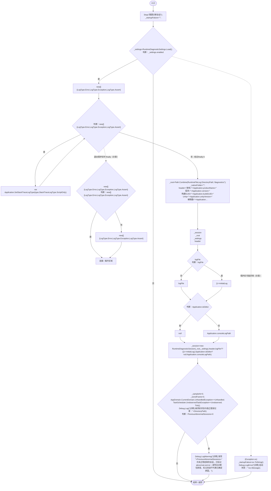

### Player · Roslyn编译器控制流

项目内调用/回调引用：

- [RuntimeCrashDiagnostics.Stop · L92](b7eea720e09afd0b.md#m48cf06f118b9c8f2)（方法）
- [RuntimeDiagnosticSettings.Load · L23](e1f8672949291bee.md#md976fd935d55dddb)（方法）
- [RuntimeDiagnosticSession.RuntimeDiagnosticSession.ctor · L26](cdf29a3aa679d2b9.md#m43040cbe148dc332)（构造函数）
- [RuntimeCrashDiagnostics.Tick · L59](b7eea720e09afd0b.md#mc5afab299d0c34ce)（方法）
- [RuntimeCrashDiagnostics.回调@48 · L48](b7eea720e09afd0b.md#m8a1d877b3e1589f9)（回调/委托）
- [RuntimeCrashDiagnostics.Unhandled · L76](b7eea720e09afd0b.md#m0ea6c9f2b8efa2cc)（方法）
- [RuntimeCrashDiagnostics.Unobserved · L81](b7eea720e09afd0b.md#m9256f674fdbd9d9d)（方法）

## 回调@48 · L48

`( … => 回调`

### Editor / Player · Roslyn编译器控制流

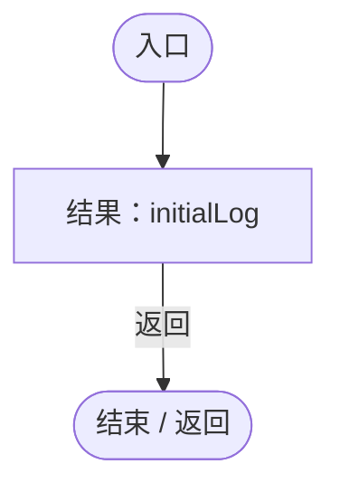

## Receive · L57

`public static void Receive(string message,string stack,LogType type)`

### Editor / Player · Roslyn编译器控制流

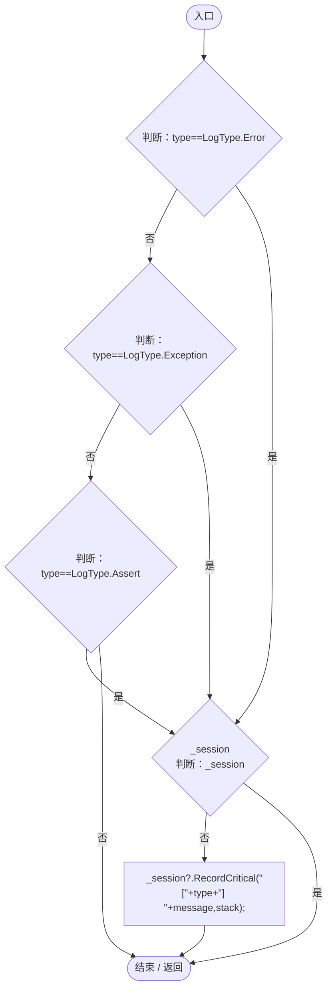

项目内调用/回调引用：

- [RuntimeDiagnosticSession.RecordCritical · L51](cdf29a3aa679d2b9.md#m1afdc9615cb1482b)（方法）

## Tick · L59

`public static void Tick()`

### Editor / Player · Roslyn编译器控制流

```mermaid
flowchart TD
  b0(["入口"])
  b1{"session=_session<br/>判断：session==null"}
  b2{"session.Pulse();<br/>_worstFrame=Mathf.Max(_worstFrame,Time.unscaledDeltaTime*1000);<br/>now=Time.realtimeSinceStartupAsDouble<br/>判断：now&lt;_sampleAt"}
  b3["_sampleAt=now+_settings.sampleMilliseconds/1000.0;<br/>ServiceLocator.TryGet&lt;SimulationClock&gt;(out var clock);"]
  b4{"SampleState<br/>判断：SampleState"}
  b5[".Invoke()"]
  b6["SampleState"]
  b7{"判断：SampleState?.Invoke()"}
  b8["SampleState?.Invoke()"]
  b9["new Snapshot()"]
  b10["state=SampleState?.Invoke()??new Snapshot()"]
  b11["state.utc=DateTime.UtcNow.ToString(&quot;O&quot;);<br/>state.scene=SceneManager.GetActiveScene().name;<br/>state.frame=Time.frameCount;<br/>state.fileLogFailure=RuntimeFileLog.Failure;<br/>state.ready=WorldRuntimeGate.Ready;<br/>state.loading&#124;=WorldRuntimeGate.Loading;"]
  b12{"state.running<br/>判断：clock!=null"}
  b13["clock.IsRunning"]
  b14["clock!=null"]
  b15["state.running=clock!=null&amp;&amp;clock.IsRunning;"]
  b16["state.focused=Application.isFocused;<br/>state.lastFrameMilliseconds=Time.unscaledDeltaTime*1000;<br/>state.worstFrameMilliseconds=_worstFrame;"]
  b17["state.configuredSpeed"]
  b18{"clock<br/>判断：clock"}
  b19[".ConfiguredTimeScale"]
  b20["clock"]
  b21{"判断：clock?.ConfiguredTimeScale"}
  b22["clock?.ConfiguredTimeScale"]
  b23["0"]
  b24["state.configuredSpeed=clock?.ConfiguredTimeScale??0;"]
  b25["state.actualSpeed"]
  b26{"clock<br/>判断：clock"}
  b27[".MotionTimeScale"]
  b28["clock"]
  b29{"判断：clock?.MotionTimeScale"}
  b30["clock?.MotionTimeScale"]
  b31["0"]
  b32["state.actualSpeed=clock?.MotionTimeScale??0;"]
  b33["state.gameTime"]
  b34{"clock<br/>判断：clock"}
  b35[".GameTime"]
  b36["clock"]
  b37{"判断：clock?.GameTime"}
  b38["clock?.GameTime"]
  b39["0"]
  b40["state.gameTime=clock?.GameTime??0;"]
  b41["state.pendingSimulationSeconds"]
  b42{"clock<br/>判断：clock"}
  b43[".PendingGameTime"]
  b44["clock"]
  b45{"判断：clock?.PendingGameTime"}
  b46["clock?.PendingGameTime"]
  b47["0"]
  b48["state.pendingSimulationSeconds=clock?.PendingGameTime??0;"]
  b49["state.unityAllocatedBytes=UnityEngine.Profiling.Profiler.GetTotalAllocatedMemoryLong();<br/>state.unityReservedBytes=UnityEngine.Profiling.Profiler.GetTotalReservedMemoryLong();<br/>session.Pulse(JsonUtility.ToJson(state,true));<br/>_worstFrame=0;"]
  b50(["结束 / 返回"])
  b0 --> b1
  b1 -->|"是"| b50
  b1 -->|"否"| b2
  b2 -->|"是"| b50
  b2 -->|"否"| b3
  b3 --> b4
  b4 -->|"否"| b5
  b4 -->|"是"| b6
  b5 --> b7
  b6 --> b7
  b7 -->|"否"| b8
  b7 -->|"是"| b9
  b8 --> b10
  b9 --> b10
  b10 --> b11
  b11 --> b12
  b12 -->|"是"| b13
  b12 -->|"否"| b14
  b13 --> b15
  b14 --> b15
  b15 --> b16
  b16 --> b17
  b17 --> b18
  b18 -->|"否"| b19
  b18 -->|"是"| b20
  b19 --> b21
  b20 --> b21
  b21 -->|"否"| b22
  b21 -->|"是"| b23
  b22 --> b24
  b23 --> b24
  b24 --> b25
  b25 --> b26
  b26 -->|"否"| b27
  b26 -->|"是"| b28
  b27 --> b29
  b28 --> b29
  b29 -->|"否"| b30
  b29 -->|"是"| b31
  b30 --> b32
  b31 --> b32
  b32 --> b33
  b33 --> b34
  b34 -->|"否"| b35
  b34 -->|"是"| b36
  b35 --> b37
  b36 --> b37
  b37 -->|"否"| b38
  b37 -->|"是"| b39
  b38 --> b40
  b39 --> b40
  b40 --> b41
  b41 --> b42
  b42 -->|"否"| b43
  b42 -->|"是"| b44
  b43 --> b45
  b44 --> b45
  b45 -->|"否"| b46
  b45 -->|"是"| b47
  b46 --> b48
  b47 --> b48
  b48 --> b49
  b49 --> b50

```

项目内调用/回调引用：

- [RuntimeDiagnosticSession.Pulse · L46](cdf29a3aa679d2b9.md#mdfcc32a6347856c8)（方法）
- [ServiceLocator.TryGet · L26](f2fdbe9f9ccd93cb.md#m143b24e6d58471b0)（方法）
- [SimulationClock.IsRunning.get · L22](a8f444aec9614b0a.md#m10f4fe307faca0f0)（访问器）
- [SimulationClock.GameTime.get · L23](a8f444aec9614b0a.md#m74adfa39a896652f)（访问器）

## Unhandled · L76

`private static void Unhandled(object sender,UnhandledExceptionEventArgs args)`

### Editor / Player · Roslyn编译器控制流

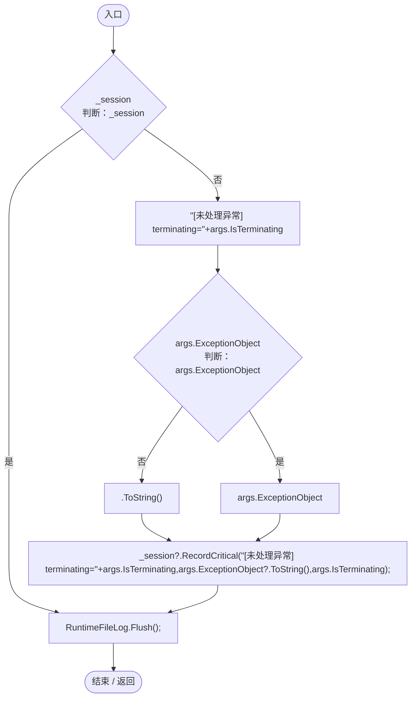

项目内调用/回调引用：

- [RuntimeDiagnosticSession.RecordCritical · L51](cdf29a3aa679d2b9.md#m1afdc9615cb1482b)（方法）
- [RuntimeFileLog.Flush · L48](8080b38a7e1c5585.md#mf8cac7c8613ec3d6)（方法）

## Unobserved · L81

`private static void Unobserved(object sender,UnobservedTaskExceptionEventArgs args)`

### Editor / Player · Roslyn编译器控制流

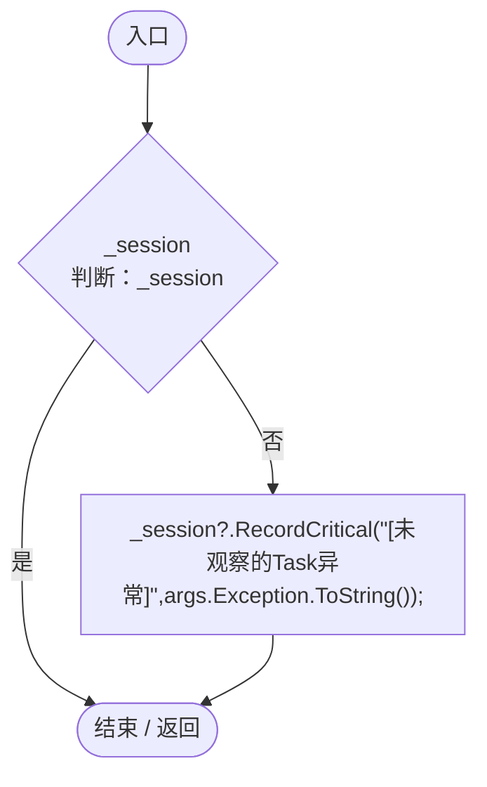

项目内调用/回调引用：

- [RuntimeDiagnosticSession.RecordCritical · L51](cdf29a3aa679d2b9.md#m1afdc9615cb1482b)（方法）

## ExportAsync · L86

`public static Task<string> ExportAsync()`

### Editor / Player · Roslyn编译器控制流

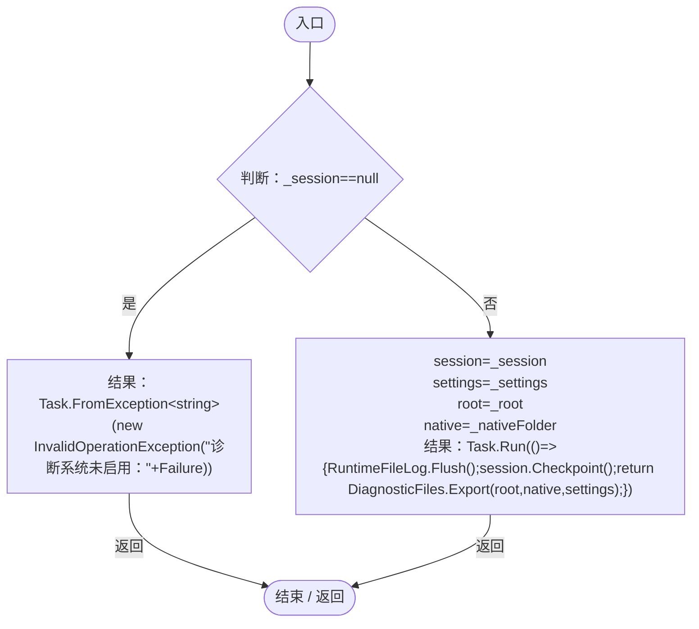

项目内调用/回调引用：

- [RuntimeCrashDiagnostics.回调@90 · L90](b7eea720e09afd0b.md#m8cc8065e44065f42)（回调/委托）

## 回调@90 · L90

`( … => 回调`

### Editor / Player · Roslyn编译器控制流

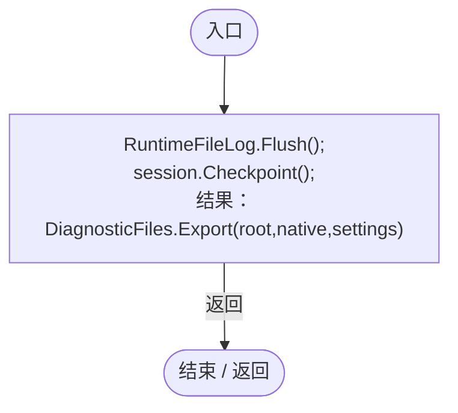

项目内调用/回调引用：

- [RuntimeFileLog.Flush · L48](8080b38a7e1c5585.md#mf8cac7c8613ec3d6)（方法）
- [RuntimeDiagnosticSession.Checkpoint · L75](cdf29a3aa679d2b9.md#m5da3345844dd040e)（方法）
- [DiagnosticFiles.Export · L45](d8a018f478416f7b.md#m18f8fc11749c1aab)（方法）

## Stop · L92

`public static void Stop(string reason)`

### Editor / Player · Roslyn编译器控制流

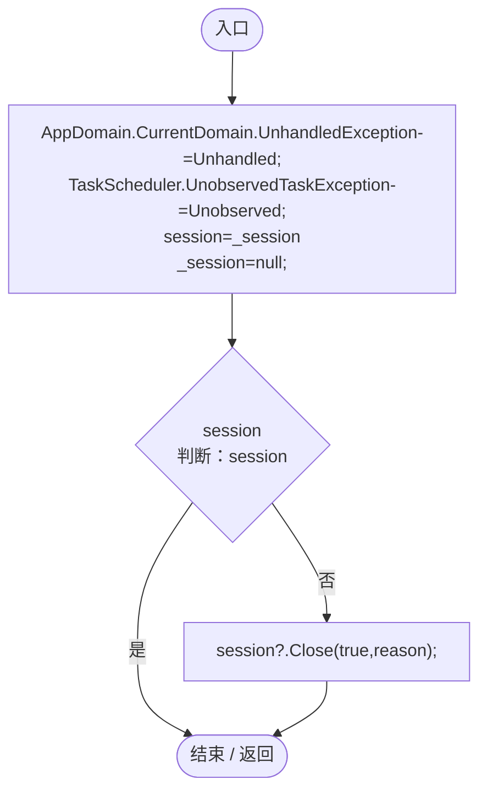

项目内调用/回调引用：

- [RuntimeDiagnosticSession.Close · L108](cdf29a3aa679d2b9.md#m7bdcb9aef7062799)（方法）
- [RuntimeCrashDiagnostics.Unhandled · L76](b7eea720e09afd0b.md#m0ea6c9f2b8efa2cc)（方法）
- [RuntimeCrashDiagnostics.Unobserved · L81](b7eea720e09afd0b.md#m9256f674fdbd9d9d)（方法）
