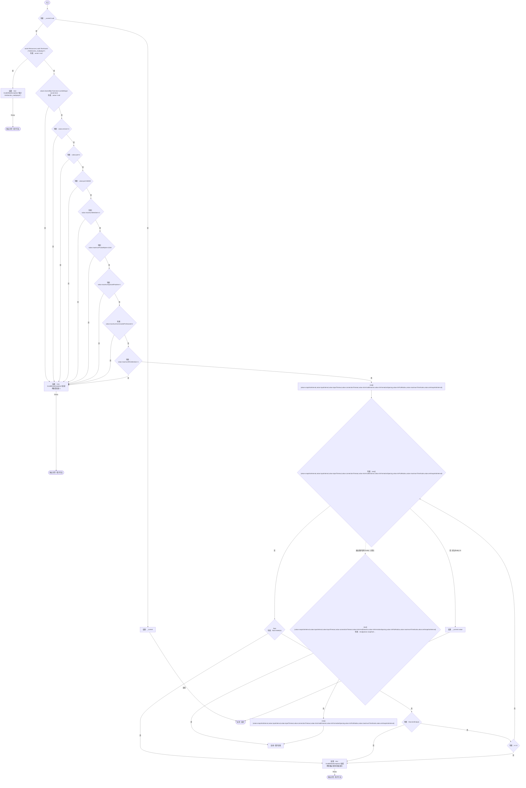

# LanSettings.cs

[返回总索引](../README.md) · `Runtime` · `Assets/DarwinPark/UI/LanSettings.cs`

[源文件](../../../Assets/DarwinPark/UI/LanSettings.cs) · 源码校验：`9ec3f044e5fdeca3598377d123f34ddec1e45fa1712a5c5e0920e6d9419ee85f`

方法按源文件位置排列。事件/回调引用不表示立即执行；分支与异常说明见总索引。完整源码与可点击关系图请打开离线手册。

## Current.get · L15

`get`

### Editor / Player · Roslyn编译器控制流

