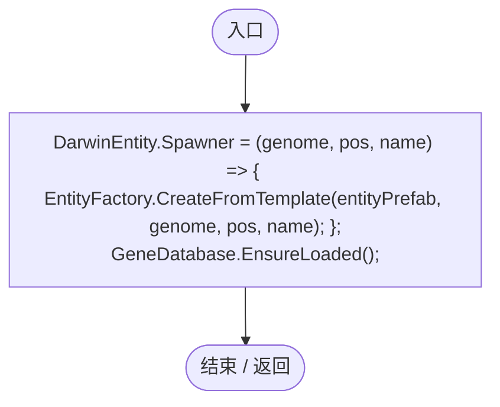
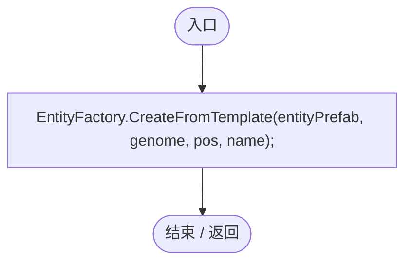
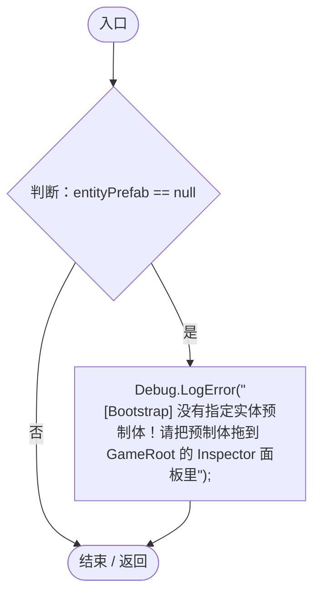
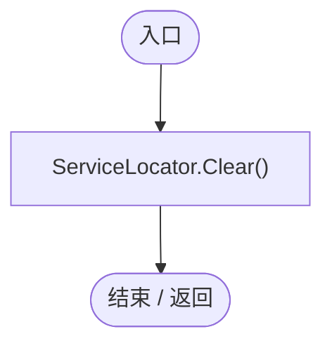

# GameBootstrap.cs

[返回总索引](../README.md) · `Runtime` · `Assets/DarwinPark/GameRoot/GameBootstrap.cs`

[源文件](../../../Assets/DarwinPark/GameRoot/GameBootstrap.cs) · 源码校验：`b99bd93fca42716cec790e9efbee4b71d703b183a59ca45a65dbfb46de1e0218`

方法按源文件位置排列。事件/回调引用不表示立即执行；分支与异常说明见总索引。完整源码与可点击关系图请打开离线手册。

## Awake · L14

`private void Awake()`

### Editor / Player · Roslyn编译器控制流

项目内调用/回调引用：

- [GeneDatabase.EnsureLoaded · L12](ec0a03483435a863.md#mc3e6357b9ca440f5)（方法）
- [GameBootstrap.回调@19 · L19](b97bb0ddbd6571c6.md#mfa8ee0a55fc3046b)（回调/委托）

## 回调@19 · L19

`( … => 回调`

### Editor / Player · Roslyn编译器控制流

项目内调用/回调引用：

- [EntityFactory.CreateFromTemplate · L22](54fcd89ef79d04f6.md#mbe8d73397453244c)（方法）

## Start · L27

`private void Start()`

### Editor / Player · Roslyn编译器控制流

## OnDestroy · L36

`private void OnDestroy()`

### Editor / Player · Roslyn编译器控制流

项目内调用/回调引用：

- [ServiceLocator.Clear · L41](f2fdbe9f9ccd93cb.md#mc1c97e0c05315803)（方法）
