# ControlAtmosphereAudit.cs

[返回总索引](../README.md) · `Editor` · `Assets/DarwinPark/Editor/ControlAtmosphereAudit.cs`

[源文件](../../../Assets/DarwinPark/Editor/ControlAtmosphereAudit.cs) · 源码校验：`1462cc6467ad059553b5931bd1229455d4d5d8e387cb122d65725d9acb0c35d1`

方法按源文件位置排列。事件/回调引用不表示立即执行；分支与异常说明见总索引。完整源码与可点击关系图请打开离线手册。

## Folder.get · L22

`private static string Folder`

### Editor · 语法控制结构 / 声明（非CFG）

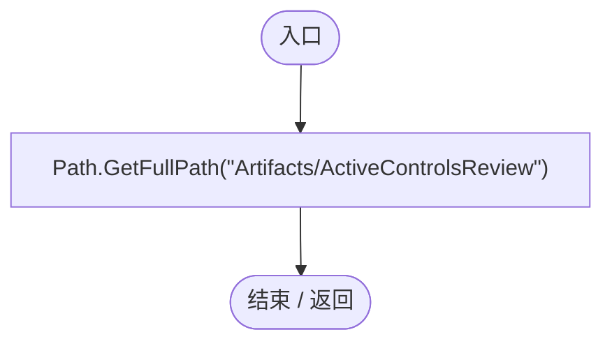

## ControlAtmosphereAudit.ctor · L23

`static ControlAtmosphereAudit()`

### Editor · Roslyn编译器控制流

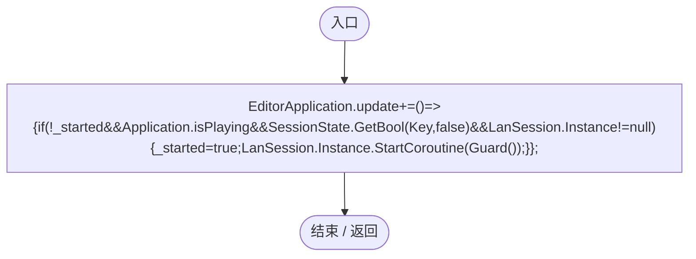

项目内调用/回调引用：

- [ControlAtmosphereAudit.回调@23 · L23](b9c6afb844d2af68.md#m356ca773cacc845e)（回调/委托）

## 回调@23 · L23

`( … => 回调`

### Editor · Roslyn编译器控制流

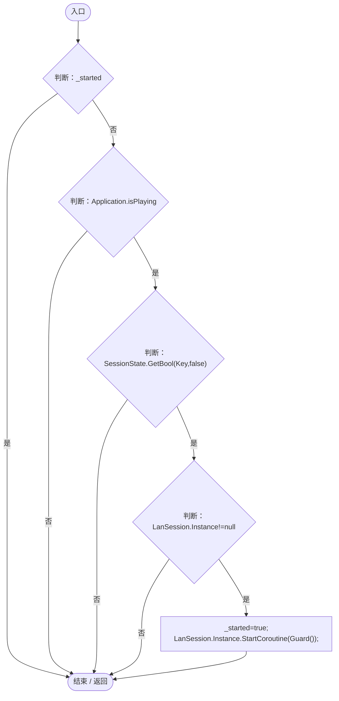

项目内调用/回调引用：

- [LanSession.Instance.get · L23](9fb633eebffe669c.md#mbf83306994878383)（访问器）
- [ControlAtmosphereAudit.Guard · L25](b9c6afb844d2af68.md#mdacffcf3099d8b5c)（方法）

## RunBatch · L24

`public static void RunBatch()`

### Editor · Roslyn编译器控制流

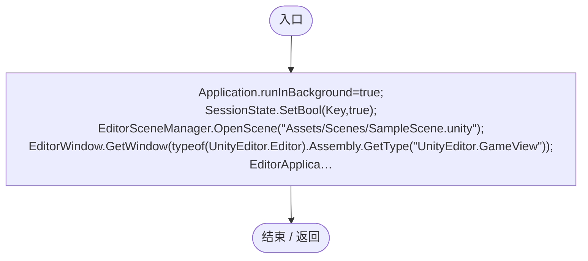

## Guard · L25

`private static IEnumerator Guard()`

### Editor · Roslyn编译器控制流

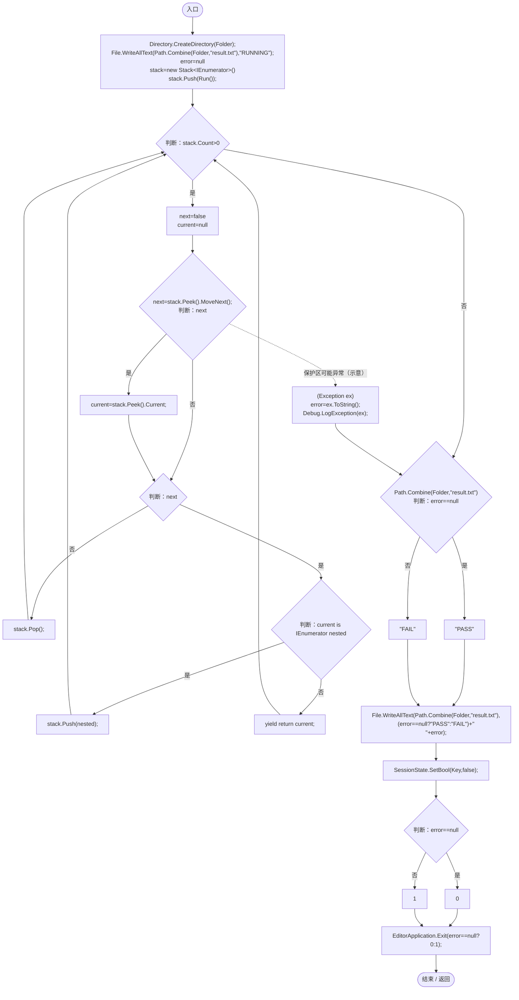

项目内调用/回调引用：

- [ControlAtmosphereAudit.Run · L31](b9c6afb844d2af68.md#mc06a9d461fc36562)（方法）

## Run · L31

`private static IEnumerator Run()`

### Editor · Roslyn编译器控制流

```mermaid
flowchart TD
  b0(["入口"])
  b1["session=Object.FindFirstObjectByType&lt;WorldSessionManager&gt;()<br/>session.autoSaveInterval=36000;<br/>planet=Object.FindFirstObjectByType&lt;PlanetTerrainMeshBuilder&gt;()<br/>planet.subdivisions=32;<br/>typeof(WorldSessionManager).GetField(&quot;_initialTerrain&quot;,Bi…"]
  b2{"判断：session.Busy"}
  b3["yield return null;"]
  b4["clock=ServiceLocator.Get&lt;SimulationClock&gt;()<br/>clock.Pause();<br/>Object.FindFirstObjectByType&lt;RandomPlanetSpawner&gt;().enabled=false;<br/>PopulationMaintenance.Restore(null);<br/>GameplayTuning.Current.mutationRoundsEnabled=false;"]
  b5["EntityRegistry.All.ToArray()"]
  b6{"判断：EntityRegistry.All.ToArray()"}
  b7["var<br/>Object.DestroyImmediate(e.gameObject);"]
  b8{"EntityRegistry.All.ToArray()<br/>判断：EntityRegistry.All.ToArray()"}
  b9["EntityRegistry.All.ToArray()"]
  b10["连接 / 离开区域"]
  b11["light=Object.FindFirstObjectByType&lt;SunSystem&gt;().GetComponent&lt;Light&gt;()<br/>direction=-light.transform.forward<br/>land=planet.Data.Vertices.Where(v=&gt;v.magnitude&gt;planet.WaterRadius+3&amp;&amp;Vector3.Dot(v.normalized,direction)&gt;.25f).OrderByDescending(v=&gt;…"]
  b12["DarwinEntity.Spawner(genome,hit.point+up,&quot;控制模式大气验证&quot;);"]
  b13["EntityRegistry.OnRegistered-=Added;"]
  b14{"yield return null;<br/>actor.GetComponent&lt;Rigidbody&gt;().isKinematic=true;<br/>view=Object.FindFirstObjectByType&lt;EntityViewController&gt;()<br/>判断：view.EnterView(actor)"}
  b15["结果：new InvalidOperationException(&quot;cannot enter view&quot;)"]
  x15(["抛出异常 / 离开方法"])
  b16["input=view.GetComponent&lt;EntityPossessionInput&gt;()<br/>typeof(EntityPossessionInput).GetField(&quot;_pitch&quot;,BindingFlags.Instance&#124;BindingFlags.NonPublic).SetValue(input,-25f);<br/>weather=planet.GetComponent&lt;PlanetWeatherVisuals&gt;()<br/>weather.cloudSpeed=0…"]
  b17["y=on.height/2"]
  b18{"判断：y&lt;on.height*9/10"}
  b19["x=on.width/4"]
  b20{"判断：x&lt;on.width*3/4"}
  b21["a=on.GetPixel(x,y)<br/>b=off.GetPixel(x,y)<br/>difference+=Math.Abs(a.r-b.r)+Math.Abs(a.g-b.g)+Math.Abs(a.b-b.b);<br/>count++;"]
  b22["x+=4"]
  b23["y+=4"]
  b24{"File.WriteAllText(Path.Combine(Folder,&quot;atmosphere-pixels.txt&quot;),$&quot;difference={difference/count:R} altitude={Vector3.Distance(Camera.main.transform.position,planet.transform.position)-planet.WaterRadius:R} outer={atmosphere.sharedMaterial.…"}
  b25{"判断：atmosphere.sharedMaterial.GetFloat(&quot;_EntitySkyDensity&quot;)!=SimulationOptimization.Current.entitySkyDensityMultiplier"}
  b26["结果：new InvalidOperationException(&quot;实体天空增强未应用&quot;)"]
  x26(["抛出异常 / 离开方法"])
  b27{"sun=light.GetComponent&lt;SunSystem&gt;()<br/>sun.enabled=false;<br/>light.transform.rotation=Quaternion.LookRotation(-light.transform.forward,light.transform.up);<br/>yield return null;<br/>yield return new WaitForEndOfFrame();<br/>night=ScreenCapture.CaptureScr…"}
  b28["结果：new InvalidOperationException(&quot;夜晚天空应保持比白天暗&quot;)"]
  x28(["抛出异常 / 离开方法"])
  b29{"sun.enabled=true;<br/>typeof(EntityPossessionInput).GetField(&quot;_pitch&quot;,BindingFlags.Instance&#124;BindingFlags.NonPublic).SetValue(input,65f);<br/>yield return null;<br/>yield return new WaitForEndOfFrame();<br/>boosted=ScreenCapture.CaptureScreenshotAsTextur…"}
  b30["结果：new InvalidOperationException(&quot;天空倍率改变了近处地形：&quot;+terrain)"]
  x30(["抛出异常 / 离开方法"])
  b31{"view.ExitView();<br/>yield return null;<br/>yield return new WaitForEndOfFrame();<br/>判断：atmosphere.sharedMaterial.GetFloat(&quot;_EntitySkyDensity&quot;)!=1"}
  b32["结果：new InvalidOperationException(&quot;退出实体视角未恢复原天空&quot;)"]
  x32(["抛出异常 / 离开方法"])
  b33["File.WriteAllText(Path.Combine(Folder,&quot;atmosphere-boundaries.txt&quot;),$&quot;PASS\nday={day:R} night={dark:R} terrainDelta={terrain:R} exitDensity=1&quot;);"]
  b34["view.ExitView();"]
  b35(["结束 / 返回"])
  b0 --> b1
  b1 --> b2
  b2 -->|"是"| b3
  b2 -->|"否"| b4
  b3 --> b2
  b4 --> b5
  b5 --> b6
  b6 -->|"是"| b7
  b6 -->|"否 · 经过finally 8"| b11
  b7 --> b6
  b8 -->|"否"| b9
  b8 -->|"是"| b10
  b9 --> b10
  b11 --> b12
  b12 -->|"经过finally 13"| b14
  b14 -->|"否"| b15
  b14 -->|"是"| b16
  b15 -->|"Throw"| x15
  b16 --> b17
  b17 --> b18
  b18 -->|"是"| b19
  b18 -->|"否"| b24
  b19 --> b20
  b20 -->|"是"| b21
  b20 -->|"否"| b23
  b21 --> b22
  b22 --> b20
  b23 --> b18
  b24 -->|"是"| b25
  b24 -->|"否"| b34
  b25 -->|"是"| b26
  b25 -->|"否"| b27
  b26 -->|"Throw"| x26
  b27 -->|"是"| b28
  b27 -->|"否"| b29
  b28 -->|"Throw"| x28
  b29 -->|"是"| b30
  b29 -->|"否"| b31
  b30 -->|"Throw"| x30
  b31 -->|"是"| b32
  b31 -->|"否"| b33
  b32 -->|"Throw"| x32
  b33 --> b35
  b34 --> b35
  b6 -. "退出保护区时 finally（示意）" .-> b8
  b12 -. "退出保护区时 finally（示意）" .-> b13

```

项目内调用/回调引用：

- [PlanetClimateMap.Instance.get · L16](b4e9726c1bcf4c37.md#m3add54a419aeef9f)（访问器）
- [PlanetOreSystem.Instance.get · L8](86b3fbb4d9436121.md#m53f6a6af4b6dc252)（访问器）
- [WorldSessionManager.Create · L41](08741c7b7b9d9344.md#m6aadfeee8b90aacd)（方法）
- [WorldSessionManager.Busy.get · L24](08741c7b7b9d9344.md#m4483e2e4f28f7c85)（访问器）
- [ServiceLocator.Get · L33](f2fdbe9f9ccd93cb.md#m2ae625299520c56d)（方法）
- [SimulationClock.Pause · L79](a8f444aec9614b0a.md#m30929d45a885d0f1)（方法）
- [PopulationMaintenance.Restore · L155](923ccc4e86c4786c.md#m239f01f9bc44dc27)（方法）
- [GameplayTuning.Current.get · L44](db546e5713b32d53.md#m5713e7f86902b6fa)（访问器）
- [PlanetTerrainMeshBuilder.Data.get · L78](415285cf043354a9.md#m8382f579717fbc6d)（访问器）
- [Genome.Add · L19](a2ef23f865bc7ee8.md#md9cfdc94b8b8d40f)（方法）
- [GeneInstance.Create · L20](f82e1498d67f5afd.md#m72e94c278de3cf8b)（方法）
- [EntityViewController.EnterView · L73](0ad0345f83229ef0.md#mbd7be6d2bbd0ec83)（方法）
- [PlanetTerrainMeshBuilder.WaterRadius.get · L96](415285cf043354a9.md#md3a3867afb75f981)（访问器）
- [ControlAtmosphereAudit.Brightness · L55](b9c6afb844d2af68.md#m87213620e077d9a6)（方法）
- [SimulationOptimization.Current.get · L23](11c9091e70893352.md#m354909aa8678017c)（访问器）
- [ControlAtmosphereAudit.Difference · L57](b9c6afb844d2af68.md#mf88ef92948a711c6)（方法）
- [EntityViewController.ExitView · L105](0ad0345f83229ef0.md#mca8619c7f27942c9)（方法）
- [ControlAtmosphereAudit.回调@35 · L35](b9c6afb844d2af68.md#md38ad5b53c1422bf)（回调/委托）
- [ControlAtmosphereAudit.回调@35 · L35](b9c6afb844d2af68.md#m3c2a39625fa03779)（回调/委托）
- [ControlAtmosphereAudit.Added · L36](b9c6afb844d2af68.md#m3cef7b46e25d578c)（局部函数）

## 回调@35 · L35

`v … => 回调`

### Editor · Roslyn编译器控制流

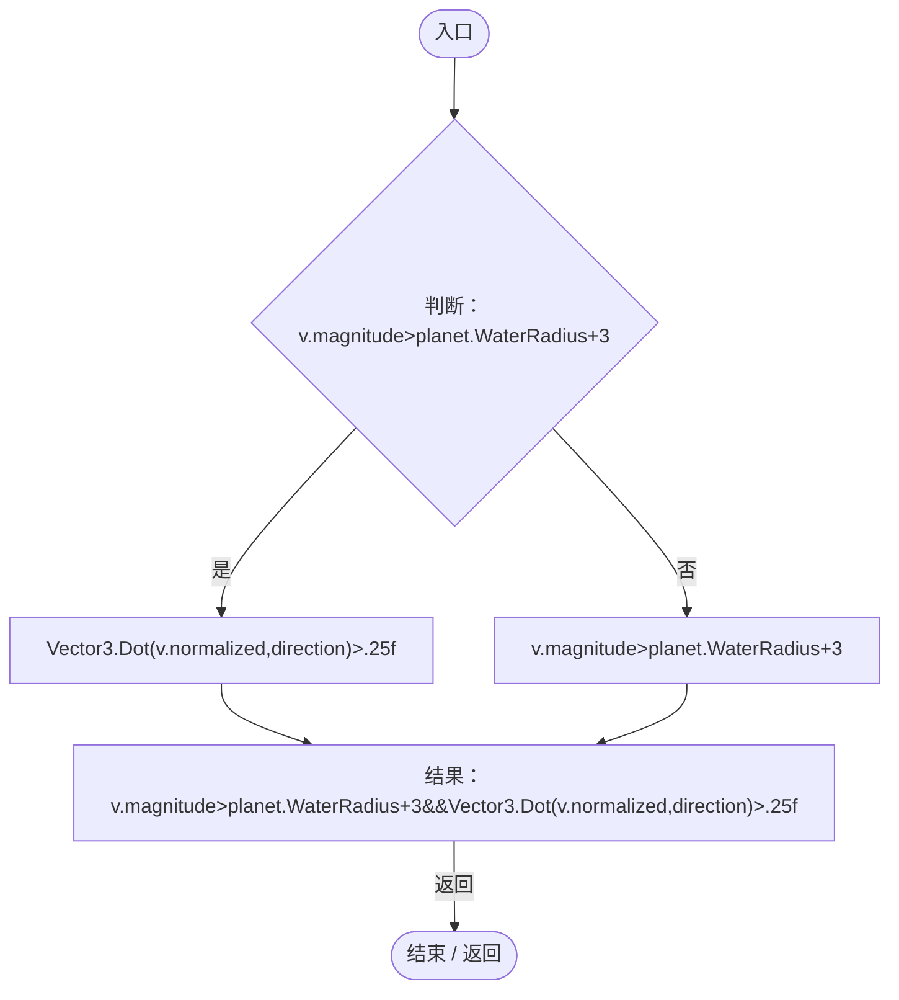

项目内调用/回调引用：

- [PlanetTerrainMeshBuilder.WaterRadius.get · L96](415285cf043354a9.md#md3a3867afb75f981)（访问器）

## 回调@35 · L35

`v … => 回调`

### Editor · Roslyn编译器控制流

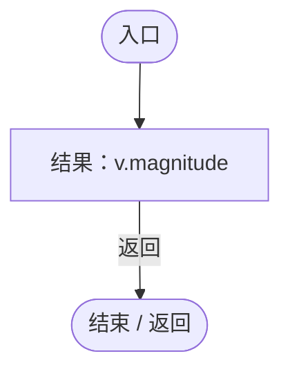

## Added · L36

`void Added(DarwinEntity e)`

### Editor · Roslyn编译器控制流

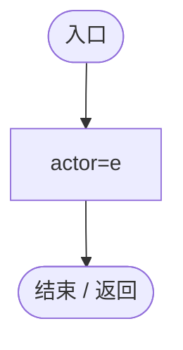

## Brightness · L55

`private static double Brightness(Texture2D image)`

### Editor · Roslyn编译器控制流

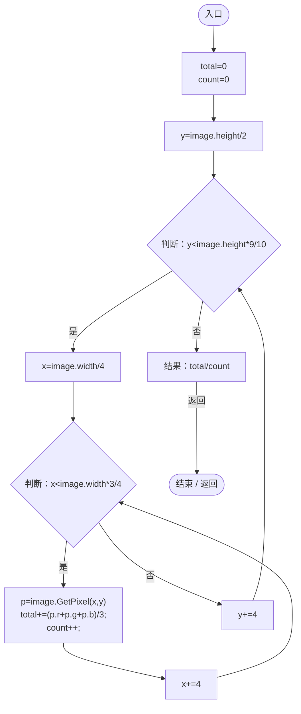

## Difference · L57

`private static double Difference(Texture2D a,Texture2D b,float x0,float x1,float y0,float y1)`

### Editor · Roslyn编译器控制流

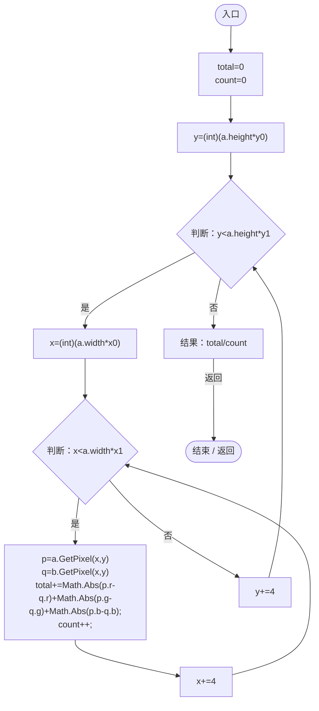
