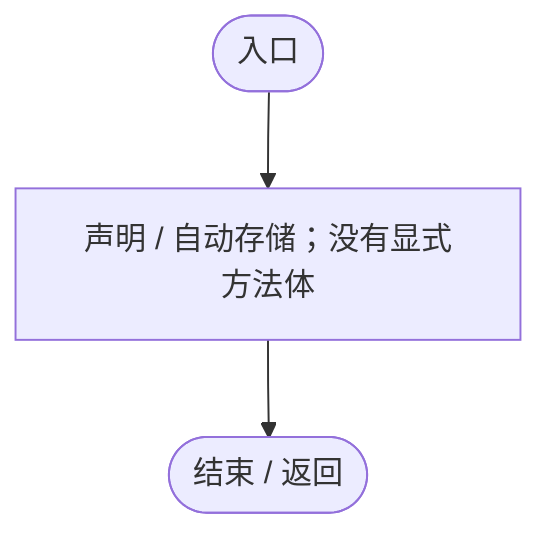
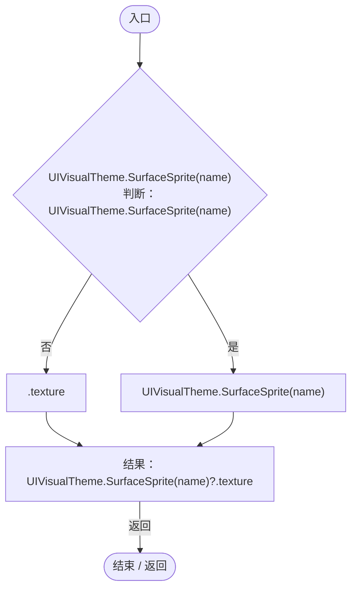
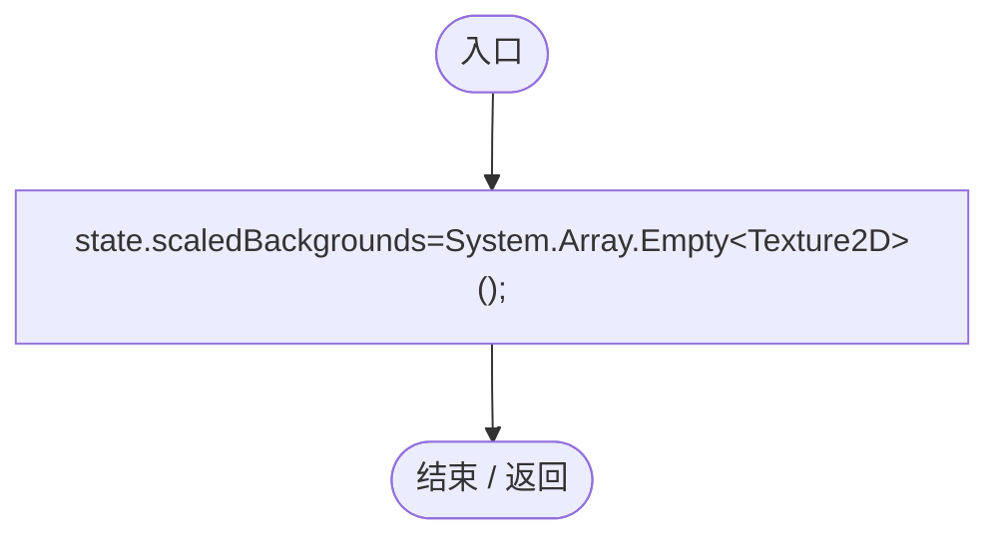
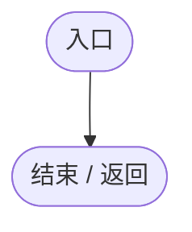
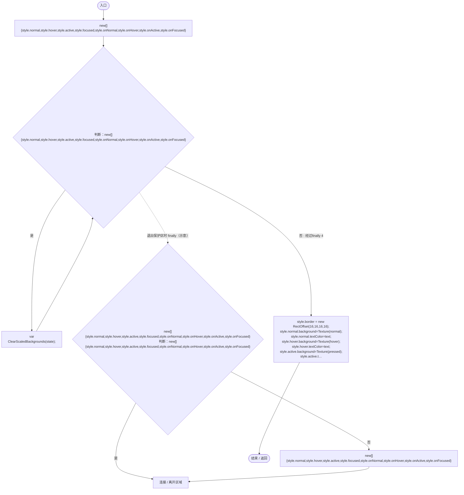
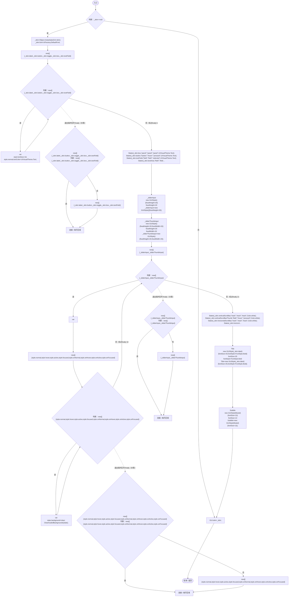
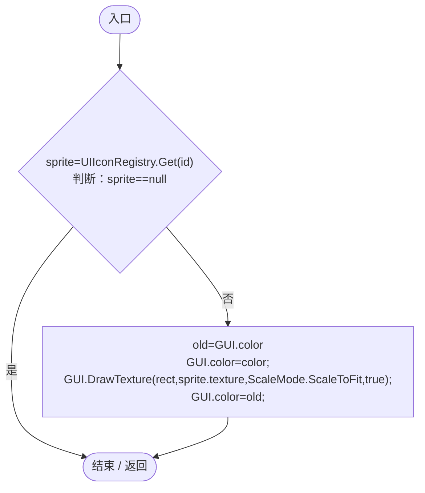
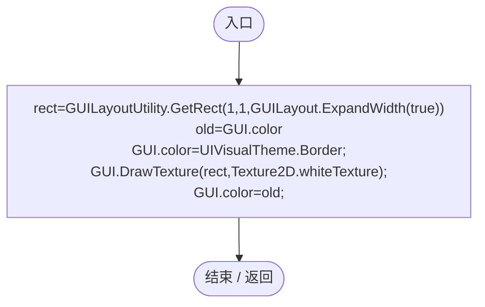
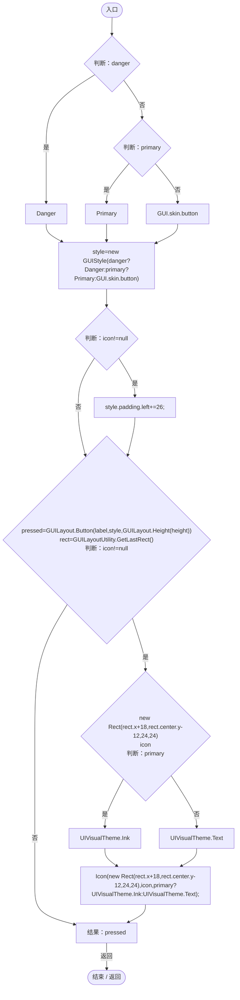

# RuntimeMenuTheme.cs

[返回总索引](../README.md) · `Runtime` · `Assets/DarwinPark/UI/RuntimeMenuTheme.cs`

[源文件](../../../Assets/DarwinPark/UI/RuntimeMenuTheme.cs) · 源码校验：`ee9312c88a994b4182577251329d126e07b0b4dfe1c0e11c2006777edce7a687`

方法按源文件位置排列。事件/回调引用不表示立即执行；分支与异常说明见总索引。完整源码与可点击关系图请打开离线手册。

<a id="med9b3baaef6ef78a"></a>

## Primary.get · L10

`get`


### Editor / Player · 语法控制结构 / 声明（非CFG）


<a id="m99328e74744c48a4"></a>

## Primary.set · L10

`private set`


### Editor / Player · 语法控制结构 / 声明（非CFG）


<a id="m4d55235287611e83"></a>

## Danger.get · L11

`get`


### Editor / Player · 语法控制结构 / 声明（非CFG）


<a id="mc3bb3dd1eb6b1df9"></a>

## Danger.set · L11

`private set`


### Editor / Player · 语法控制结构 / 声明（非CFG）


<a id="m0db940502f53ec10"></a>

## Selected.get · L12

`get`


### Editor / Player · 语法控制结构 / 声明（非CFG）


<a id="mdf6bcb11fc9cb1ed"></a>

## Selected.set · L12

`private set`


### Editor / Player · 语法控制结构 / 声明（非CFG）


<a id="meeaba271eb4ad2ed"></a>

## Muted.get · L13

`get`


### Editor / Player · 语法控制结构 / 声明（非CFG）


<a id="m4ab50f77a4b125a2"></a>

## Muted.set · L13

`private set`


### Editor / Player · 语法控制结构 / 声明（非CFG）



<a id="m0b3a4a9f7e8e69ae"></a>

## Title.get · L14

`get`


### Editor / Player · 语法控制结构 / 声明（非CFG）


<a id="mab4863c15bf97b7d"></a>

## Title.set · L14

`private set`


### Editor / Player · 语法控制结构 / 声明（非CFG）


<a id="mbece40912303446f"></a>

## Subtitle.get · L15

`get`


### Editor / Player · 语法控制结构 / 声明（非CFG）


<a id="mfdb26e4a05f0747a"></a>

## Subtitle.set · L15

`private set`


### Editor / Player · 语法控制结构 / 声明（非CFG）


<a id="m62a01591cebdcf25"></a>

## Texture · L16

`private static Texture2D Texture(string name)`


### Editor / Player · Roslyn编译器控制流



项目内调用/回调引用：

- [UIVisualTheme.SurfaceSprite · L45](ca525a798a08f966.md#md3ae1d7fd207ae2f)（方法）

<a id="m179b83dbe7298372"></a>

## ClearScaledBackgrounds · L17

`private static void ClearScaledBackgrounds(GUIStyleState state)`


### Editor · Roslyn编译器控制流



### Player · Roslyn编译器控制流



<a id="mc9b2e718a575e4b5"></a>

## States · L24

`private static void States(GUIStyle style, string normal, string hover, string pressed, Color text)`


### Editor / Player · Roslyn编译器控制流



项目内调用/回调引用：

- [RuntimeMenuTheme.ClearScaledBackgrounds · L17](b9d8455882f2a532.md#m179b83dbe7298372)（方法）
- [RuntimeMenuTheme.Texture · L16](b9d8455882f2a532.md#m62a01591cebdcf25)（方法）

<a id="m587a63eff5a85605"></a>

## Apply · L39

`public static void Apply()`


### Editor / Player · Roslyn编译器控制流



项目内调用/回调引用：

- [UIFactory.DefaultFont.get · L17](dd1096a6995423db.md#m89af6843ae7629d3)（访问器）
- [RuntimeMenuTheme.States · L24](b9d8455882f2a532.md#mc9b2e718a575e4b5)（方法）
- [RuntimeMenuTheme.ClearScaledBackgrounds · L17](b9d8455882f2a532.md#m179b83dbe7298372)（方法）
- [RuntimeMenuTheme.Primary.set · L10](b9d8455882f2a532.md#m99328e74744c48a4)（访问器）
- [RuntimeMenuTheme.Primary.get · L10](b9d8455882f2a532.md#med9b3baaef6ef78a)（访问器）
- [RuntimeMenuTheme.Danger.set · L11](b9d8455882f2a532.md#mc3bb3dd1eb6b1df9)（访问器）
- [RuntimeMenuTheme.Danger.get · L11](b9d8455882f2a532.md#m4d55235287611e83)（访问器）
- [RuntimeMenuTheme.Selected.set · L12](b9d8455882f2a532.md#mdf6bcb11fc9cb1ed)（访问器）
- [RuntimeMenuTheme.Selected.get · L12](b9d8455882f2a532.md#m0db940502f53ec10)（访问器）
- [RuntimeMenuTheme.Muted.set · L13](b9d8455882f2a532.md#m4ab50f77a4b125a2)（访问器）
- [RuntimeMenuTheme.Muted.get · L13](b9d8455882f2a532.md#meeaba271eb4ad2ed)（访问器）
- [RuntimeMenuTheme.Title.set · L14](b9d8455882f2a532.md#mab4863c15bf97b7d)（访问器）
- [RuntimeMenuTheme.Subtitle.set · L15](b9d8455882f2a532.md#mfdb26e4a05f0747a)（访问器）

<a id="m6ea7a21a603b9da6"></a>

## Icon · L80

`public static void Icon(Rect rect,string id,Color color)`


### Editor / Player · Roslyn编译器控制流



项目内调用/回调引用：

- [UIIconRegistry.Get · L38](5e97f4545b48cac2.md#m95da89c0db2bbab9)（方法）

<a id="mf1a5b86a52f398ef"></a>

## Divider · L85

`public static void Divider()`


### Editor / Player · Roslyn编译器控制流



<a id="mc7e1580ab0f51b0b"></a>

## Button · L90

`public static bool Button(string label,string icon=null,bool primary=false,float height=48,bool danger=false)`


### Editor / Player · Roslyn编译器控制流



项目内调用/回调引用：

- [RuntimeMenuTheme.Danger.get · L11](b9d8455882f2a532.md#m4d55235287611e83)（访问器）
- [RuntimeMenuTheme.Primary.get · L10](b9d8455882f2a532.md#med9b3baaef6ef78a)（访问器）
- [RuntimeMenuTheme.Icon · L80](b9d8455882f2a532.md#m6ea7a21a603b9da6)（方法）

<a id="m9465db18272cdf01"></a>

## MenuButton · L99

`public static bool MenuButton(string label,string icon,bool primary=false,string badge=null)`


### Editor / Player · Roslyn编译器控制流

```mermaid
flowchart TD
  b0(["入口"])
  b1{"判断：primary"}
  b2["Primary"]
  b3["GUI.skin.button"]
  b4["new GUIStyle(primary?Primary:GUI.skin.button){alignment=TextAnchor.MiddleLeft,padding=new RectOffset(64,38,6,6)}"]
  b5["alignment=TextAnchor.MiddleLeft<br/>padding=new RectOffset(64,38,6,6)<br/>style=new GUIStyle(primary?Primary:GUI.skin.button){alignment=TextAnchor.MiddleLeft,padding=new RectOffset(64,38,6,6)}"]
  b6["pressed=GUILayout.Button(label,style,GUILayout.Height(58))<br/>rect=GUILayoutUtility.GetLastRect()"]
  b7{"判断：primary"}
  b8["UIVisualTheme.Ink"]
  b9["UIVisualTheme.Text"]
  b10["color=primary?UIVisualTheme.Ink:UIVisualTheme.Text"]
  b11{"Icon(new Rect(rect.x+18,rect.center.y-13,26,26),icon,color);<br/>Icon(new Rect(rect.xMax-30,rect.center.y-9,18,18),&quot;ui_icon_next&quot;,color);<br/>判断：badge!=null"}
  b12["new GUIStyle(GUI.skin.box){fontSize=12,alignment=TextAnchor.MiddleCenter,padding=new RectOffset()}<br/>fontSize=12<br/>alignment=TextAnchor.MiddleCenter<br/>padding=new RectOffset()<br/>badgeStyle=new GUIStyle(GUI.skin.box){fontSize=12,alignment=TextAnc…"]
  b13["badgeStyle.normal.textColor=UIVisualTheme.Muted;<br/>GUI.Label(new Rect(rect.xMax-112,rect.center.y-12,72,24),badge,badgeStyle);"]
  b14["结果：pressed"]
  b15(["结束 / 返回"])
  b0 --> b1
  b1 -->|"是"| b2
  b1 -->|"否"| b3
  b2 --> b4
  b3 --> b4
  b4 --> b5
  b5 --> b6
  b6 --> b7
  b7 -->|"是"| b8
  b7 -->|"否"| b9
  b8 --> b10
  b9 --> b10
  b10 --> b11
  b11 -->|"是"| b12
  b11 -->|"否"| b14
  b12 --> b13
  b13 --> b14
  b14 -->|"返回"| b15

```

项目内调用/回调引用：

- [RuntimeMenuTheme.Primary.get · L10](b9d8455882f2a532.md#med9b3baaef6ef78a)（访问器）
- [RuntimeMenuTheme.Icon · L80](b9d8455882f2a532.md#m6ea7a21a603b9da6)（方法）

<a id="mbc2a4caeeee89962"></a>

## Slider · L115

`public static float Slider(float value,float min,float max)`


### Editor / Player · Roslyn编译器控制流

```mermaid
flowchart TD
  b0(["入口"])
  b1["rect=GUILayoutUtility.GetRect(80,26,GUILayout.ExpandWidth(true))<br/>结果：Slider(rect,value,min,max)"]
  b2(["结束 / 返回"])
  b0 --> b1
  b1 -->|"返回"| b2

```

项目内调用/回调引用：

- [RuntimeMenuTheme.Slider · L121](b9d8455882f2a532.md#mec012d95679dc843)（方法）

<a id="mec012d95679dc843"></a>

## Slider · L121

`public static float Slider(Rect rect,float value,float min,float max)`


### Editor / Player · Roslyn编译器控制流

```mermaid
flowchart TD
  b0(["入口"])
  b1["结果：Slider(rect,value,min,max,null)"]
  b2(["结束 / 返回"])
  b0 --> b1
  b1 -->|"返回"| b2

```

项目内调用/回调引用：

- [RuntimeMenuTheme.Slider · L126](b9d8455882f2a532.md#m8e7bb1e6f9ffd061)（方法）

<a id="m98477b7083bc6af0"></a>

## Slider · L124

`public static float Slider(float value,float min,float max,Color color)`

★ 新增：通道滑条用纯白底按颜色绘制，避免青绿色主题贴图乘色后把红/蓝通道染黑。

### Editor / Player · Roslyn编译器控制流

```mermaid
flowchart TD
  b0(["入口"])
  b1["结果：Slider(GUILayoutUtility.GetRect(80,26,GUILayout.ExpandWidth(true)),value,min,max,color)"]
  b2(["结束 / 返回"])
  b0 --> b1
  b1 -->|"返回"| b2

```

项目内调用/回调引用：

- [RuntimeMenuTheme.Slider · L126](b9d8455882f2a532.md#m8e7bb1e6f9ffd061)（方法）

<a id="m8e7bb1e6f9ffd061"></a>

## Slider · L126

`private static float Slider(Rect rect,float value,float min,float max,Color? color)`


### Editor / Player · Roslyn编译器控制流

```mermaid
flowchart TD
  b0(["入口"])
  b1{"value=GUI.HorizontalSlider(new Rect(rect.x,rect.center.y-10,rect.width,20),value,min,max,_sliderInput,_sliderThumbInput);<br/>bar=new Rect(rect.x,rect.center.y-4,rect.width,8)<br/>GUI.DrawTexture(bar,Texture(&quot;track&quot;),ScaleMode.StretchToFill,true…"}
  b2["new Rect(bar.x,bar.y,bar.width*fraction,bar.height)"]
  b3{"判断：color.HasValue"}
  b4["Texture2D.whiteTexture"]
  b5["Texture(&quot;fill&quot;)"]
  b6["color.HasValue?Texture2D.whiteTexture:Texture(&quot;fill&quot;)"]
  b7["ScaleMode.StretchToFill<br/>true<br/>0"]
  b8{"color<br/>判断：color"}
  b9["color"]
  b10["Color.white"]
  b11["GUI.DrawTexture(new Rect(bar.x,bar.y,bar.width*fraction,bar.height),color.HasValue?Texture2D.whiteTexture:Texture(&quot;fill&quot;),ScaleMode.StretchToFill,true,0,color??Color.white,0,4);"]
  b12["GUI.DrawTexture(new Rect(rect.x+(rect.width-20)*fraction,rect.center.y-10,20,20),Texture(&quot;thumb&quot;));<br/>结果：value"]
  b13(["结束 / 返回"])
  b0 --> b1
  b1 -->|"是"| b2
  b1 -->|"否"| b12
  b2 --> b3
  b3 -->|"是"| b4
  b3 -->|"否"| b5
  b4 --> b6
  b5 --> b6
  b6 --> b7
  b7 --> b8
  b8 -->|"否"| b9
  b8 -->|"是"| b10
  b9 --> b11
  b10 --> b11
  b11 --> b12
  b12 -->|"返回"| b13

```

项目内调用/回调引用：

- [RuntimeMenuTheme.Texture · L16](b9d8455882f2a532.md#m62a01591cebdcf25)（方法）
