# GameplayHudRegression.cs

[返回总索引](../README.md) · `Editor` · `Assets/DarwinPark/Editor/GameplayHudRegression.cs`

[源文件](../../../Assets/DarwinPark/Editor/GameplayHudRegression.cs) · 源码校验：`44fb1059fa7c2573cc0e6815a5e75ceb19f49becc227997161931213499bc7d0`

方法按源文件位置排列。事件/回调引用不表示立即执行；分支与异常说明见总索引。完整源码与可点击关系图请打开离线手册。

## Folder.get · L26

`private static string Folder`

### Editor · 语法控制结构 / 声明（非CFG）

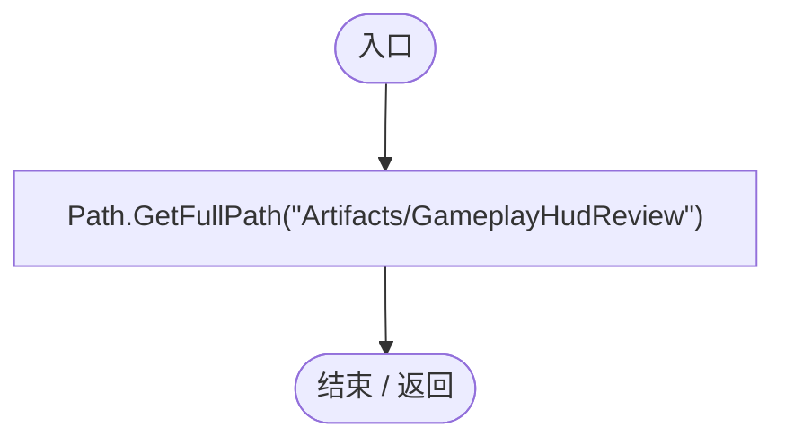

## GameplayHudRegression.ctor · L27

`static GameplayHudRegression()`

### Editor · Roslyn编译器控制流

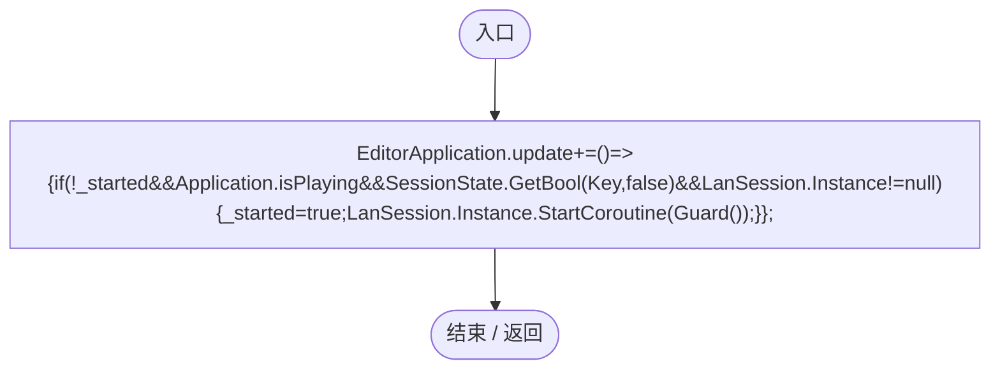

项目内调用/回调引用：

- [GameplayHudRegression.回调@27 · L27](b9dfefd1ee0945a8.md#m26738dd749030d35)（回调/委托）

## 回调@27 · L27

`( … => 回调`

### Editor · Roslyn编译器控制流

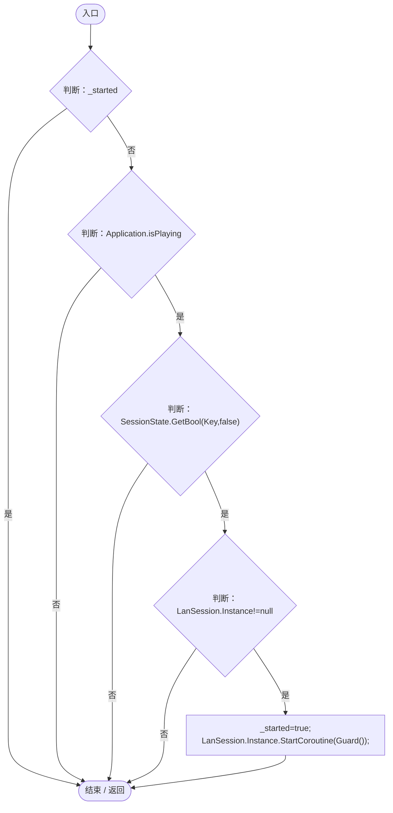

项目内调用/回调引用：

- [LanSession.Instance.get · L23](9fb633eebffe669c.md#mbf83306994878383)（访问器）
- [GameplayHudRegression.Guard · L30](b9dfefd1ee0945a8.md#m14eda56c6c0acc3f)（方法）

## RunBatch · L28

`public static void RunBatch()`

### Editor · Roslyn编译器控制流

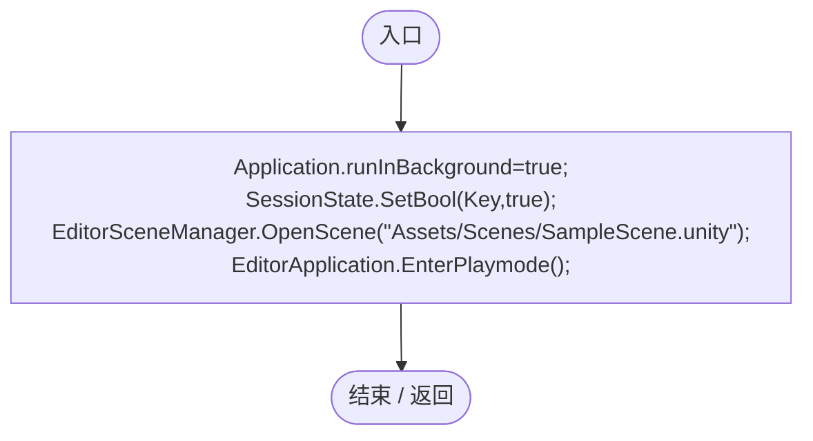

## Check · L29

`private static void Check(bool condition,string text)`

### Editor · Roslyn编译器控制流

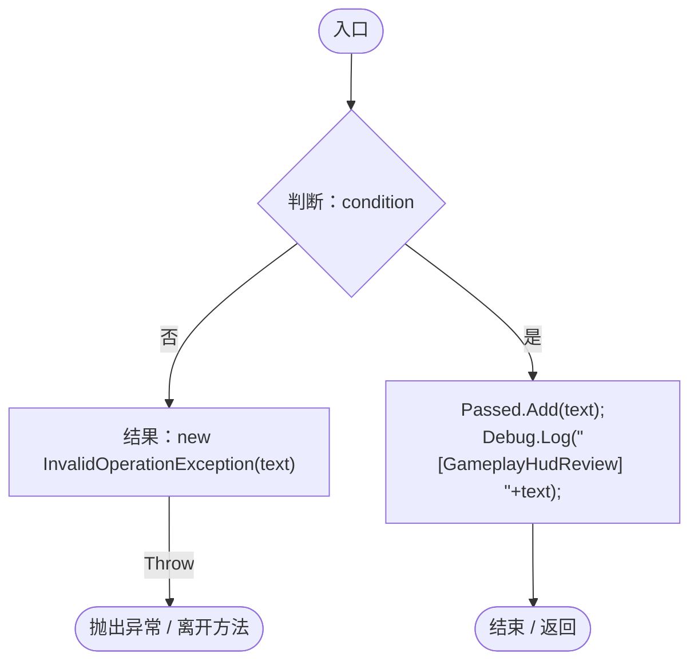

## Guard · L30

`private static IEnumerator Guard()`

### Editor · Roslyn编译器控制流

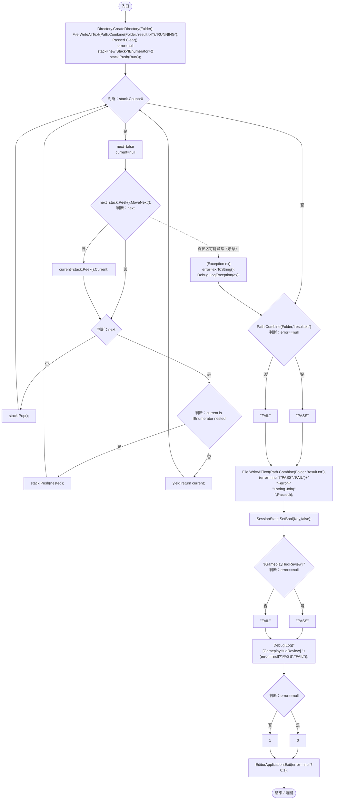

项目内调用/回调引用：

- [GameplayHudRegression.Run · L51](b9dfefd1ee0945a8.md#m5b1c9be2d44a1884)（方法）

## Spawn · L40

`private static DarwinEntity Spawn(bool movement,bool disabled,AgeState age)`

### Editor · Roslyn编译器控制流

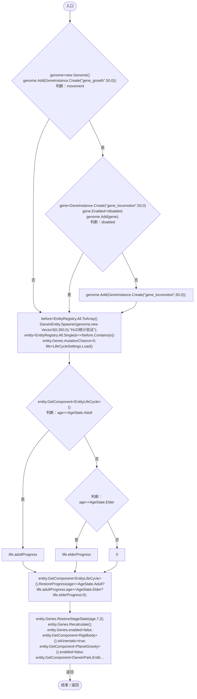

项目内调用/回调引用：

- [Genome.Add · L19](a2ef23f865bc7ee8.md#md9cfdc94b8b8d40f)（方法）
- [GeneInstance.Create · L20](f82e1498d67f5afd.md#m72e94c278de3cf8b)（方法）
- [DarwinEntity.Genes.get · L14](70798dde169f2e8b.md#m622eb1adf401d431)（访问器）
- [LifeCycleSettings.Load · L16](ace76969fe8f61de.md#mbd2925785484f343)（方法）
- [EntityLifeCycle.RestoreProgress · L48](9f4138bfbae654b7.md#mfc75121476d49679)（方法）
- [EntityGeneController.RestoreStageState · L51](7494d53178552f0e.md#m6264213de2a5ca6f)（方法）
- [EntityGeneController.Recalculate · L97](7494d53178552f0e.md#m65ea735c1e0e37a1)（方法）
- [GameplayHudRegression.回调@44 · L44](b9dfefd1ee0945a8.md#m7c105fb695ba3b55)（回调/委托）

## 回调@44 · L44

`e … => 回调`

### Editor · Roslyn编译器控制流

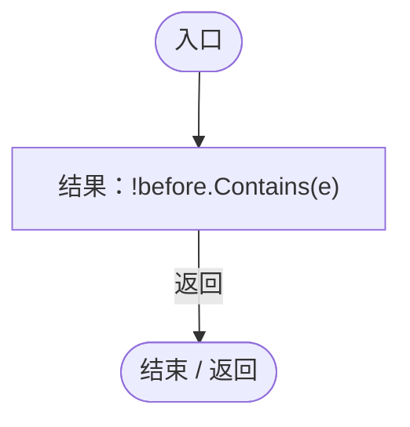

## ScreenRect · L49

`private static Rect ScreenRect(RectTransform transform)`

### Editor · Roslyn编译器控制流

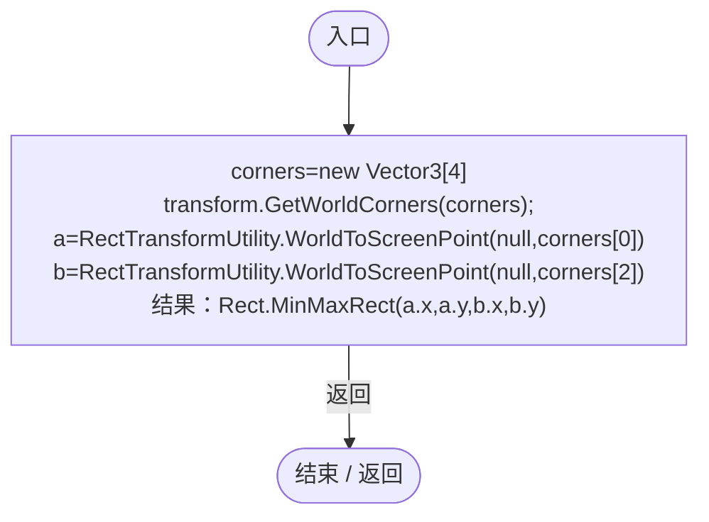

## Run · L51

`private static IEnumerator Run()`

### Editor · Roslyn编译器控制流

```mermaid
flowchart TD
  b0(["入口"])
  b1["Application.runInBackground=true;<br/>yield return null;<br/>root=ServiceLocator.Get&lt;UIRoot&gt;()<br/>control=Object.FindFirstObjectByType&lt;SimulationControlPanel&gt;()<br/>stats=Object.FindFirstObjectByType&lt;MapEntityStatisticsUI&gt;(FindObjectsInactive.Include)<br/>…"]
  b2{"判断：stats!=null"}
  b3{"判断：fps!=null"}
  b4["RtsSelectionInput.Instance!=null"]
  b5["stats!=null&amp;&amp;fps!=null&amp;&amp;RtsSelectionInput.Instance!=null"]
  b6["Check(stats!=null&amp;&amp;fps!=null&amp;&amp;RtsSelectionInput.Instance!=null,&quot;新增统计、FPS和RTS组件真实挂载&quot;);"]
  b7["WorldRuntimeGate.Ready=true;<br/>typeof(GameMainMenu).GetMethod(&quot;Resume&quot;,BindingFlags.NonPublic&#124;BindingFlags.Instance).Invoke(Object.FindFirstObjectByType&lt;GameMainMenu&gt;(),null);<br/>clock.Pause();<br/>typeof(SimulationControlPanel).GetMethod(&quot;Switch…"]
  b8["EntityRegistry.All.ToArray()"]
  b9{"判断：EntityRegistry.All.ToArray()"}
  b10["var<br/>Object.DestroyImmediate(entity.gameObject);"]
  b11{"EntityRegistry.All.ToArray()<br/>判断：EntityRegistry.All.ToArray()"}
  b12["EntityRegistry.All.ToArray()"]
  b13["连接 / 离开区域"]
  b14["adult=Spawn(true,false,AgeState.Adult)<br/>young=Spawn(true,true,AgeState.Infant)<br/>elder=Spawn(false,false,AgeState.Elder)<br/>inactive=Spawn(true,false,AgeState.Adult)<br/>inactive.gameObject.SetActive(false);<br/>yield return null;<br/>stats.RefreshNow();"]
  b15{"判断：stats.Total==3"}
  b16{"判断：stats.Infants==1"}
  b17{"判断：stats.Adults==1"}
  b18["stats.Elders==1"]
  b19["stats.Total==3&amp;&amp;stats.Infants==1&amp;&amp;stats.Adults==1&amp;&amp;stats.Elders==1"]
  b20["Check(stats.Total==3&amp;&amp;stats.Infants==1&amp;&amp;stats.Adults==1&amp;&amp;stats.Elders==1,&quot;统计全地图存活个体和年龄阶段，排除停用实体&quot;);"]
  b21{"判断：stats.SelectGene(&quot;gene_locomotion&quot;)"}
  b22{"判断：stats.Carriers==2"}
  b23["stats.Expressed==1"]
  b24["stats.SelectGene(&quot;gene_locomotion&quot;)&amp;&amp;stats.Carriers==2&amp;&amp;stats.Expressed==1"]
  b25["Check(stats.SelectGene(&quot;gene_locomotion&quot;)&amp;&amp;stats.Carriers==2&amp;&amp;stats.Expressed==1,&quot;筛选基因按实体去重，携带数量与当前生效数量分开&quot;);"]
  b26["inspector=Object.FindFirstObjectByType&lt;GeneInspectorUI&gt;()<br/>inspector.ShowEntityInfo(elder);<br/>stats.RefreshNow();"]
  b27{"判断：stats.Total==3"}
  b28["stats.Carriers==2"]
  b29["stats.Total==3"]
  b30["Check(stats.Total==3&amp;&amp;stats.Carriers==2,&quot;全地图统计不随当前查看实体改变&quot;);"]
  b31["WorldAuthority.CanEdit=false;<br/>stats.SelectGene(&quot;gene_growth&quot;);"]
  b32{"判断：stats.Carriers==3"}
  b33{"判断：stats.Expressed==3"}
  b34["stats.transform.Find(&quot;GeneFilter&quot;).GetComponent&lt;Dropdown&gt;().interactable"]
  b35["stats.Carriers==3&amp;&amp;stats.Expressed==3&amp;&amp;stats.transform.Find(&quot;GeneFilter&quot;).GetComponent&lt;Dropdown&gt;().interactable"]
  b36["Check(stats.Carriers==3&amp;&amp;stats.Expressed==3&amp;&amp;stats.transform.Find(&quot;GeneFilter&quot;).GetComponent&lt;Dropdown&gt;().interactable,&quot;普通成员也能筛选只读地图数据&quot;);"]
  b37["WorldAuthority.CanEdit=true;<br/>page=typeof(SimulationControlPanel).GetMethod(&quot;SwitchPage&quot;,BindingFlags.NonPublic&#124;BindingFlags.Instance)<br/>page.Invoke(control,new object[]{0});<br/>yield return null;"]
  b38{"判断：stats.gameObject.activeInHierarchy"}
  b39["stats.Total==3"]
  b40["stats.gameObject.activeInHierarchy"]
  b41["Check(stats.gameObject.activeInHierarchy&amp;&amp;stats.Total==3,&quot;第一页显示地图统计&quot;);"]
  b42["page.Invoke(control,new object[]{1});<br/>Check(!stats.gameObject.activeInHierarchy,&quot;第二页隐藏地图统计&quot;);<br/>page.Invoke(control,new object[]{0});<br/>elder.GetComponent&lt;EntityStats&gt;().Modify(&quot;health&quot;,-100,false);<br/>stats.RefreshNow();"]
  b43{"判断：stats.Total==2"}
  b44["stats.Elders==0"]
  b45["stats.Total==2"]
  b46["Check(stats.Total==2&amp;&amp;stats.Elders==0,&quot;生命归零的实体不计入存活数量&quot;);"]
  b47["young.gameObject.SetActive(false);<br/>stats.RefreshNow();<br/>Check(stats.Total==1,&quot;成员移除后实时更新数量&quot;);<br/>young.gameObject.SetActive(true);<br/>stats.SelectGene(null);"]
  b48{"判断：stats.FilterGeneId==null"}
  b49["stats.Total==2"]
  b50["stats.FilterGeneId==null"]
  b51["Check(stats.FilterGeneId==null&amp;&amp;stats.Total==2,&quot;全部实体筛选可恢复&quot;);"]
  b52["newborn=Spawn(false,false,AgeState.Infant)<br/>yield return new WaitForSecondsRealtime(.6f);<br/>Check(stats.Total==3,&quot;新实体自动进入统计，无需手动刷新&quot;);<br/>Object.DestroyImmediate(newborn.gameObject);<br/>Check(stats.Total==2,&quot;销毁后自动减少数量&quot;);<br/>stats.SelectGene(&quot;gene_loc…"]
  b53["adult.Genes.Genome.Genes.Where(g=&gt;g.DefinitionId==&quot;gene_locomotion&quot;)"]
  b54{"判断：adult.Genes.Genome.Genes.Where(g=&gt;g.DefinitionId==&quot;gene_locomotion&quot;)"}
  b55["var<br/>gene.Enabled=false;"]
  b56{"判断：adult.Genes.Genome.Genes.Where(g=&gt;g.DefinitionId==&quot;gene_locomotion&quot;)"}
  b57["adult.Genes.Genome.Genes.Where(g=&gt;g.DefinitionId==&quot;gene_locomotion&quot;)"]
  b58["连接 / 离开区域"]
  b59["adult.Genes.Recalculate();<br/>yield return new WaitForSecondsRealtime(.6f);"]
  b60{"判断：stats.Carriers==2"}
  b61["stats.Expressed==0"]
  b62["stats.Carriers==2"]
  b63["Check(stats.Carriers==2&amp;&amp;stats.Expressed==0,&quot;基因禁用自动改变生效数，携带数保持正确&quot;);"]
  b64["adult.Genes.Genome.Genes.Where(g=&gt;g.DefinitionId==&quot;gene_locomotion&quot;)"]
  b65{"判断：adult.Genes.Genome.Genes.Where(g=&gt;g.DefinitionId==&quot;gene_locomotion&quot;)"}
  b66["var<br/>gene.Enabled=true;"]
  b67{"判断：adult.Genes.Genome.Genes.Where(g=&gt;g.DefinitionId==&quot;gene_locomotion&quot;)"}
  b68["adult.Genes.Genome.Genes.Where(g=&gt;g.DefinitionId==&quot;gene_locomotion&quot;)"]
  b69["连接 / 离开区域"]
  b70["adult.Genes.Recalculate();<br/>stats.RefreshNow();<br/>scaler=root.MainCanvas.GetComponent&lt;CanvasScaler&gt;()<br/>mode=scaler.uiScaleMode<br/>original=scaler.scaleFactor<br/>scaler.uiScaleMode=CanvasScaler.ScaleMode.ConstantPixelSize;<br/>LanSession.Instance.SetRt…"]
  b71["new[]{.7f,1f,1.4f}"]
  b72{"判断：new[]{.7f,1f,1.4f}"}
  b73["float"]
  b74["scaler.scaleFactor=scale;<br/>yield return null;<br/>Canvas.ForceUpdateCanvases();<br/>Check(control.TryGetScreenRect(out var bottom),&quot;底栏实际边界可读取 scale=&quot;+scale);<br/>bar=RtsSelectionInput.CommandBarRect<br/>Check(bar.yMax&lt;=Screen.height-bottom.yMax-RtsSelect…"]
  b75{"判断：RtsSelectionInput.IsOverCommandBar(new Vector2(bar.center.x,Screen.height-bar.center.y))"}
  b76["!RtsSelectionInput.IsOverCommandBar(bottom.center)"]
  b77["RtsSelectionInput.IsOverCommandBar(new Vector2(bar.center.x,Screen.height-bar.center.y))"]
  b78["Check(RtsSelectionInput.IsOverCommandBar(new Vector2(bar.center.x,Screen.height-bar.center.y))&amp;&amp;!RtsSelectionInput.IsOverCommandBar(bottom.center),&quot;RTS命中范围跟随位置且不覆盖权能栏 scale=&quot;+scale);"]
  b79["section=root.MainCanvas.transform.Find(&quot;BottomPanel/ContentArea/Page1/ParamSec&quot;) as RectTransform<br/>card=ScreenRect((RectTransform)stats.transform)<br/>parameters=ScreenRect(section)"]
  b80{"判断：card.xMin&gt;parameters.xMax"}
  b81{"判断：card.yMin&gt;=bottom.yMin"}
  b82["card.yMax&lt;=bottom.yMax"]
  b83["card.xMin&gt;parameters.xMax&amp;&amp;card.yMin&gt;=bottom.yMin&amp;&amp;card.yMax&lt;=bottom.yMax"]
  b84["Check(card.xMin&gt;parameters.xMax&amp;&amp;card.yMin&gt;=bottom.yMin&amp;&amp;card.yMax&lt;=bottom.yMax,&quot;地图统计位于指定右侧并留在底栏内 scale=&quot;+scale);"]
  b85["Check(card.width&lt;=stats.preferredWidth*scale+.5f,&quot;统计栏宽度受260逻辑单位限制，不拉伸填满屏幕 scale=&quot;+scale);<br/>Check(card.height&lt;=stats.preferredHeight*scale+.5f,&quot;统计卡片高度受164逻辑单位限制 scale=&quot;+scale);"]
  b86{"new[]{.7f,1f,1.4f}<br/>判断：new[]{.7f,1f,1.4f}"}
  b87["new[]{.7f,1f,1.4f}"]
  b88["连接 / 离开区域"]
  b89["scaler.uiScaleMode=mode;<br/>scaler.scaleFactor=original;<br/>yield return null;<br/>Canvas.ForceUpdateCanvases();<br/>inspector.ShowEntityInfo(adult);<br/>genePanel=root.MainCanvas.transform.Find(&quot;GenePanel&quot;) as RectTransform<br/>Check(Screen.height-ScreenRect…"]
  b90{"判断：fps.SampleCount&gt;samples"}
  b91{"判断：fps.CurrentFps&gt;0"}
  b92["clock.GameTime==time"]
  b93["fps.SampleCount&gt;samples&amp;&amp;fps.CurrentFps&gt;0&amp;&amp;clock.GameTime==time"]
  b94["Check(fps.SampleCount&gt;samples&amp;&amp;fps.CurrentFps&gt;0&amp;&amp;clock.GameTime==time,&quot;暂停模拟仍刷新真实FPS&quot;);"]
  b95["clock.SetTimeScale(16);<br/>clock.Play();<br/>samples=fps.SampleCount;<br/>yield return new WaitForSecondsRealtime(.7f);"]
  b96{"判断：fps.SampleCount&gt;samples"}
  b97["fps.CurrentFps&gt;0"]
  b98["fps.SampleCount&gt;samples"]
  b99["Check(fps.SampleCount&gt;samples&amp;&amp;fps.CurrentFps&gt;0,&quot;16倍模拟仍按真实帧采样&quot;);"]
  b100["clock.Pause();<br/>clock.RestoreState(clock.GameTime,16);<br/>budget=(SimulationStepBudget)typeof(SimulationClock).GetField(&quot;_budget&quot;,BindingFlags.NonPublic&#124;BindingFlags.Instance).GetValue(clock)<br/>budget.Consume(10,16,.5f);<br/>clock.Play();<br/>yield re…"]
  b101{"判断：clock.PendingGameTime&gt;0"}
  b102["fps.DisplayRect.height&gt;=fps.size.y+fps.simulationLineHeight"]
  b103["clock.PendingGameTime&gt;0"]
  b104["Check(clock.PendingGameTime&gt;0&amp;&amp;fps.DisplayRect.height&gt;=fps.size.y+fps.simulationLineHeight,&quot;过载时显示实际模拟倍率和待算时间&quot;);"]
  b105["yield return new WaitForEndOfFrame();<br/>ScreenCapture.CaptureScreenshot(Path.Combine(Folder,&quot;simulation-budget.png&quot;));<br/>yield return null;<br/>clock.Pause();<br/>clock.RestoreState(clock.GameTime,1);<br/>yield return new WaitForSecondsRealtime(.6f);<br/>Ch…"]
  b106{"判断：stats.Total==0"}
  b107["stats.Carriers==0"]
  b108["stats.Total==0"]
  b109["Check(stats.Total==0&amp;&amp;stats.Carriers==0,&quot;离开世界清空地图统计&quot;);"]
  b110(["结束 / 返回"])
  b0 --> b1
  b1 --> b2
  b2 -->|"是"| b3
  b2 -->|"否"| b5
  b3 -->|"是"| b4
  b3 -->|"否"| b5
  b4 --> b6
  b5 --> b6
  b6 --> b7
  b7 --> b8
  b8 --> b9
  b9 -->|"是"| b10
  b9 -->|"否 · 经过finally 11"| b14
  b10 --> b9
  b11 -->|"否"| b12
  b11 -->|"是"| b13
  b12 --> b13
  b14 --> b15
  b15 -->|"是"| b16
  b15 -->|"否"| b19
  b16 -->|"是"| b17
  b16 -->|"否"| b19
  b17 -->|"是"| b18
  b17 -->|"否"| b19
  b18 --> b20
  b19 --> b20
  b20 --> b21
  b21 -->|"是"| b22
  b21 -->|"否"| b24
  b22 -->|"是"| b23
  b22 -->|"否"| b24
  b23 --> b25
  b24 --> b25
  b25 --> b26
  b26 --> b27
  b27 -->|"是"| b28
  b27 -->|"否"| b29
  b28 --> b30
  b29 --> b30
  b30 --> b31
  b31 --> b32
  b32 -->|"是"| b33
  b32 -->|"否"| b35
  b33 -->|"是"| b34
  b33 -->|"否"| b35
  b34 --> b36
  b35 --> b36
  b36 --> b37
  b37 --> b38
  b38 -->|"是"| b39
  b38 -->|"否"| b40
  b39 --> b41
  b40 --> b41
  b41 --> b42
  b42 --> b43
  b43 -->|"是"| b44
  b43 -->|"否"| b45
  b44 --> b46
  b45 --> b46
  b46 --> b47
  b47 --> b48
  b48 -->|"是"| b49
  b48 -->|"否"| b50
  b49 --> b51
  b50 --> b51
  b51 --> b52
  b52 --> b53
  b53 --> b54
  b54 -->|"是"| b55
  b54 -->|"否 · 经过finally 56"| b59
  b55 --> b54
  b56 -->|"否"| b57
  b56 -->|"是"| b58
  b57 --> b58
  b59 --> b60
  b60 -->|"是"| b61
  b60 -->|"否"| b62
  b61 --> b63
  b62 --> b63
  b63 --> b64
  b64 --> b65
  b65 -->|"是"| b66
  b65 -->|"否 · 经过finally 67"| b70
  b66 --> b65
  b67 -->|"否"| b68
  b67 -->|"是"| b69
  b68 --> b69
  b70 --> b71
  b71 --> b72
  b72 -->|"是"| b73
  b72 -->|"否 · 经过finally 86"| b89
  b73 --> b74
  b74 --> b75
  b75 -->|"是"| b76
  b75 -->|"否"| b77
  b76 --> b78
  b77 --> b78
  b78 --> b79
  b79 --> b80
  b80 -->|"是"| b81
  b80 -->|"否"| b83
  b81 -->|"是"| b82
  b81 -->|"否"| b83
  b82 --> b84
  b83 --> b84
  b84 --> b85
  b85 --> b72
  b86 -->|"否"| b87
  b86 -->|"是"| b88
  b87 --> b88
  b89 --> b90
  b90 -->|"是"| b91
  b90 -->|"否"| b93
  b91 -->|"是"| b92
  b91 -->|"否"| b93
  b92 --> b94
  b93 --> b94
  b94 --> b95
  b95 --> b96
  b96 -->|"是"| b97
  b96 -->|"否"| b98
  b97 --> b99
  b98 --> b99
  b99 --> b100
  b100 --> b101
  b101 -->|"是"| b102
  b101 -->|"否"| b103
  b102 --> b104
  b103 --> b104
  b104 --> b105
  b105 --> b106
  b106 -->|"是"| b107
  b106 -->|"否"| b108
  b107 --> b109
  b108 --> b109
  b109 --> b110
  b9 -. "退出保护区时 finally（示意）" .-> b11
  b54 -. "退出保护区时 finally（示意）" .-> b56
  b65 -. "退出保护区时 finally（示意）" .-> b67
  b72 -. "退出保护区时 finally（示意）" .-> b86

```

项目内调用/回调引用：

- [ServiceLocator.Get · L33](f2fdbe9f9ccd93cb.md#m2ae625299520c56d)（方法）
- [FrameRateDisplay.Instance.get · L13](4e898f3c11cb4578.md#m7dff03e4b726493b)（访问器）
- [GameplayHudRegression.Check · L29](b9dfefd1ee0945a8.md#m10eab5f02a76865e)（方法）
- [RtsSelectionInput.Instance.get · L20](3c8b37f7bbd7a10f.md#m8ea2edabb2816aec)（访问器）
- [SimulationClock.Pause · L79](a8f444aec9614b0a.md#m30929d45a885d0f1)（方法）
- [GameplayHudRegression.Spawn · L40](b9dfefd1ee0945a8.md#m1235af20834e51a8)（方法）
- [MapEntityStatisticsUI.RefreshNow · L74](da03211264cb6014.md#ma30ab70fe8c10f4f)（方法）
- [MapEntityStatisticsUI.Total.get · L16](da03211264cb6014.md#m2b470c44fd65b06c)（访问器）
- [MapEntityStatisticsUI.Infants.get · L19](da03211264cb6014.md#mfe12709c5b2225b8)（访问器）
- [MapEntityStatisticsUI.Adults.get · L20](da03211264cb6014.md#md976fc4d6329ac17)（访问器）
- [MapEntityStatisticsUI.Elders.get · L21](da03211264cb6014.md#m8c693bbebb13bd6e)（访问器）
- [MapEntityStatisticsUI.SelectGene · L69](da03211264cb6014.md#me708d870d6cec0dd)（方法）
- [MapEntityStatisticsUI.Carriers.get · L17](da03211264cb6014.md#m3360c926666cd49d)（访问器）
- [MapEntityStatisticsUI.Expressed.get · L18](da03211264cb6014.md#m3a1b8654b32e9613)（访问器）
- [GeneInspectorUI.ShowEntityInfo · L385](924e27c34e7b1f0a.md#mea69a0457b885287)（方法）
- [EntityStats.Modify · L111](75aa86a368efdf24.md#m9c837be197158240)（方法）
- [DarwinEntity.Genes.get · L14](70798dde169f2e8b.md#m622eb1adf401d431)（访问器）
- [EntityGeneController.Recalculate · L97](7494d53178552f0e.md#m65ea735c1e0e37a1)（方法）
- [UIRoot.MainCanvas.get · L14](9c1421378791f0e0.md#maa2cc9baf1248477)（访问器）
- [LanSession.SetRtsMode · L113](9fb633eebffe669c.md#md00374cca68a1203)（方法）
- [LanSession.Instance.get · L23](9fb633eebffe669c.md#mbf83306994878383)（访问器）
- [SimulationControlPanel.TryGetScreenRect · L33](76bc7add9187fd1f.md#m03c1c859770476c8)（方法）
- [RtsSelectionInput.IsOverCommandBar · L35](3c8b37f7bbd7a10f.md#m35be0e064805f3ff)（方法）
- [GameplayHudRegression.ScreenRect · L49](b9dfefd1ee0945a8.md#me1b81f7f4994ef7e)（方法）
- [FrameRateDisplay.SampleCount.get · L15](4e898f3c11cb4578.md#m900f6e2616872b85)（访问器）
- [SimulationClock.GameTime.get · L23](a8f444aec9614b0a.md#m74adfa39a896652f)（访问器）
- [FrameRateDisplay.CurrentFps.get · L14](4e898f3c11cb4578.md#mc5ef3bb75f8cc8f8)（访问器）
- [SimulationClock.SetTimeScale · L81](a8f444aec9614b0a.md#mecaa463a0561aca3)（方法）
- [SimulationClock.Play · L78](a8f444aec9614b0a.md#m7aa9e64b7de60ed0)（方法）
- [SimulationClock.RestoreState · L74](a8f444aec9614b0a.md#m8f617e95e1282846)（方法）
- [SimulationStepBudget.Consume · L9](0ec4b354aeb329c1.md#me5418cddb06e3e3b)（方法）
- [EntityPlacementUtility.IsPointerOverUI · L16](6d2c32e632b9c147.md#m126e7f8ff0d0a893)（方法）
- [GeneInspectorUI.HideEntityInfo · L316](924e27c34e7b1f0a.md#m11944eddcac871c2)（方法）
- [GameplayHudRegression.回调@70 · L70](b9dfefd1ee0945a8.md#m9229cc43566e39ea)（回调/委托）
- [GameplayHudRegression.回调@72 · L72](b9dfefd1ee0945a8.md#mf9b8f1b162acb042)（回调/委托）

## 回调@70 · L70

`g … => 回调`

### Editor · Roslyn编译器控制流

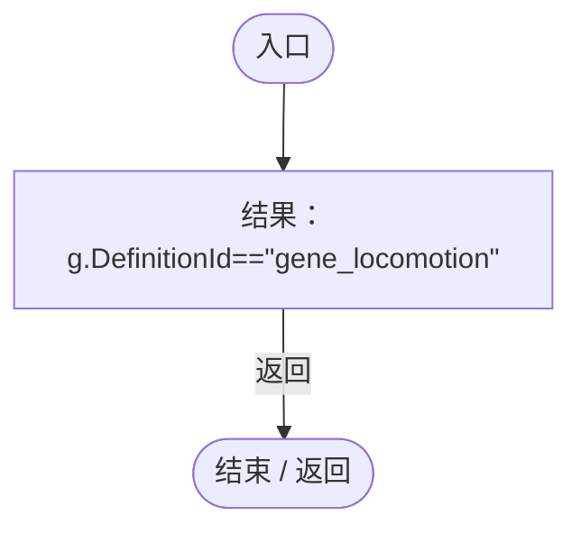

## 回调@72 · L72

`g … => 回调`

### Editor · Roslyn编译器控制流

