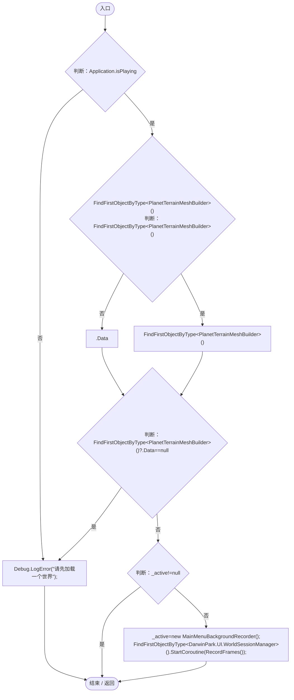
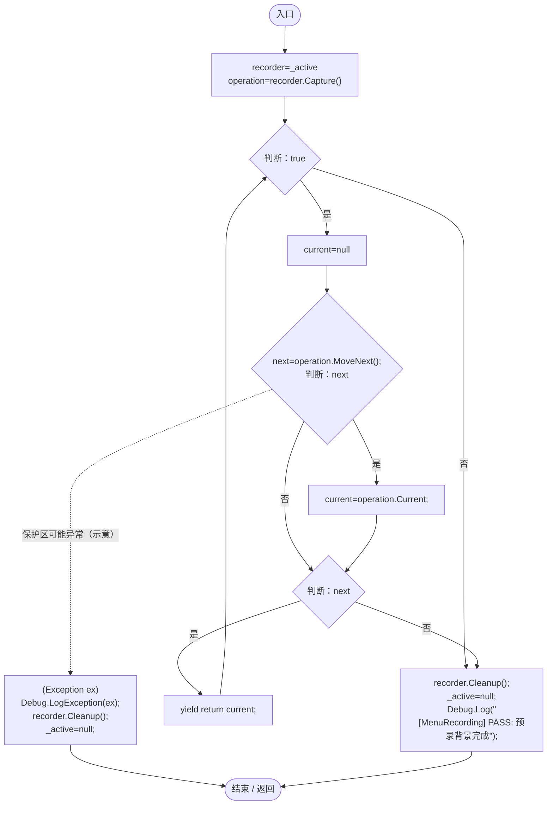
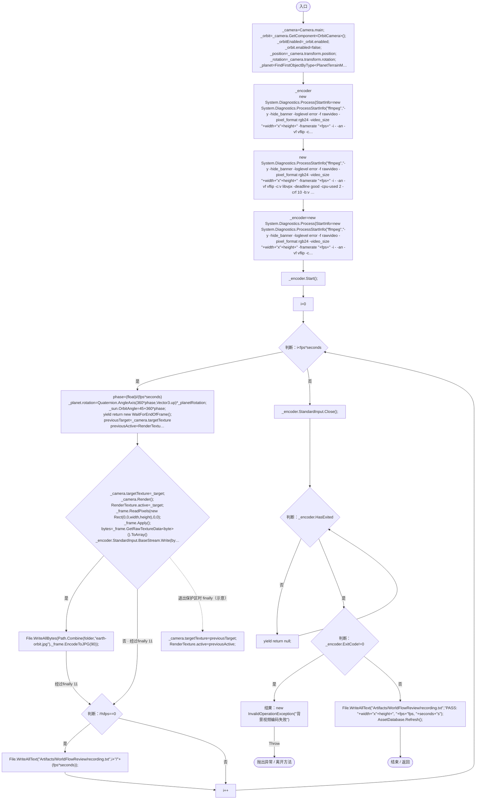
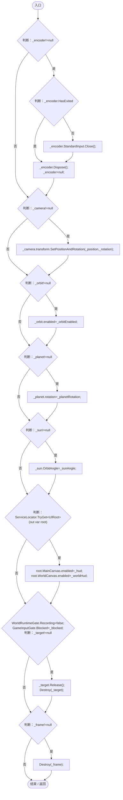

# MainMenuBackgroundRecorder.cs

[返回总索引](../README.md) · `Editor` · `Assets/DarwinPark/Editor/MainMenuBackgroundRecorder.cs`

[源文件](../../../Assets/DarwinPark/Editor/MainMenuBackgroundRecorder.cs) · 源码校验：`79ca364000e4c925fbbb054d7bff655caf3266170e43b330a3697cd4da2b12b4`

方法按源文件位置排列。事件/回调引用不表示立即执行；分支与异常说明见总索引。完整源码与可点击关系图请打开离线手册。

## Record · L20

`[MenuItem("Tools/Darwin Park/Record Menu Background %&F7")] public static void Record()`

### Editor · Roslyn编译器控制流

项目内调用/回调引用：

- [PlanetTerrainMeshBuilder.Data.get · L78](415285cf043354a9.md#m8382f579717fbc6d)（访问器）
- [MainMenuBackgroundRecorder.RecordFrames · L28](ba405663a24f549a.md#m3d169ed2c3f3db10)（方法）

## RecordFrames · L28

`private static IEnumerator RecordFrames()`

### Editor · Roslyn编译器控制流

项目内调用/回调引用：

- [MainMenuBackgroundRecorder.Capture · L41](ba405663a24f549a.md#m2a742495d8b8e38c)（方法）
- [MainMenuBackgroundRecorder.Cleanup · L76](ba405663a24f549a.md#m8b0b5b49f02cbf38)（方法）

## Capture · L41

`private IEnumerator Capture()`

### Editor · Roslyn编译器控制流

项目内调用/回调引用：

- [SunSystem.OrbitAngle.get · L27](15af8ca97f781b7f.md#m4e38e717885434fc)（访问器）
- [ServiceLocator.Get · L33](f2fdbe9f9ccd93cb.md#m2ae625299520c56d)（方法）
- [UIRoot.MainCanvas.get · L14](9c1421378791f0e0.md#maa2cc9baf1248477)（访问器）
- [UIRoot.WorldCanvas.get · L15](9c1421378791f0e0.md#mf389c1a94092ec8a)（访问器）
- [GameInputGate.Blocked.get · L8](52955daae7e592ab.md#m765763b665829633)（访问器）
- [GameInputGate.Blocked.set · L8](52955daae7e592ab.md#m578697f6379686f4)（访问器）
- [SimulationClock.Pause · L79](a8f444aec9614b0a.md#m30929d45a885d0f1)（方法）
- [SunSystem.OrbitAngle.set · L27](15af8ca97f781b7f.md#mdfb5515951cbcd65)（访问器）

## Cleanup · L76

`private void Cleanup()`

### Editor · Roslyn编译器控制流

项目内调用/回调引用：

- [SunSystem.OrbitAngle.set · L27](15af8ca97f781b7f.md#mdfb5515951cbcd65)（访问器）
- [ServiceLocator.TryGet · L26](f2fdbe9f9ccd93cb.md#m143b24e6d58471b0)（方法）
- [UIRoot.MainCanvas.get · L14](9c1421378791f0e0.md#maa2cc9baf1248477)（访问器）
- [UIRoot.WorldCanvas.get · L15](9c1421378791f0e0.md#mf389c1a94092ec8a)（访问器）
- [GameInputGate.Blocked.set · L8](52955daae7e592ab.md#m578697f6379686f4)（访问器）
