# PlayerBuildLogRegression.cs

[返回总索引](../README.md) · `Editor` · `Assets/DarwinPark/Editor/PlayerBuildLogRegression.cs`

[源文件](../../../Assets/DarwinPark/Editor/PlayerBuildLogRegression.cs) · 源码校验：`20fe96213d8240063b48ef4415a76610273d025068b1226ea5e0b46aa2995a30`

方法按源文件位置排列。事件/回调引用不表示立即执行；分支与异常说明见总索引。完整源码与可点击关系图请打开离线手册。

## Folder.get · L18

`private static string Folder`

### Editor · 语法控制结构 / 声明（非CFG）

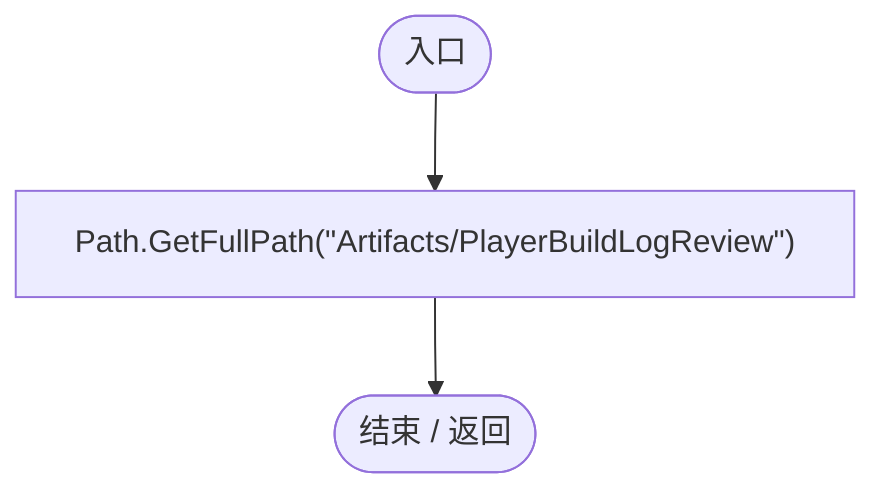

## Check · L19

`private static void Check(bool value,string text)`

### Editor · Roslyn编译器控制流

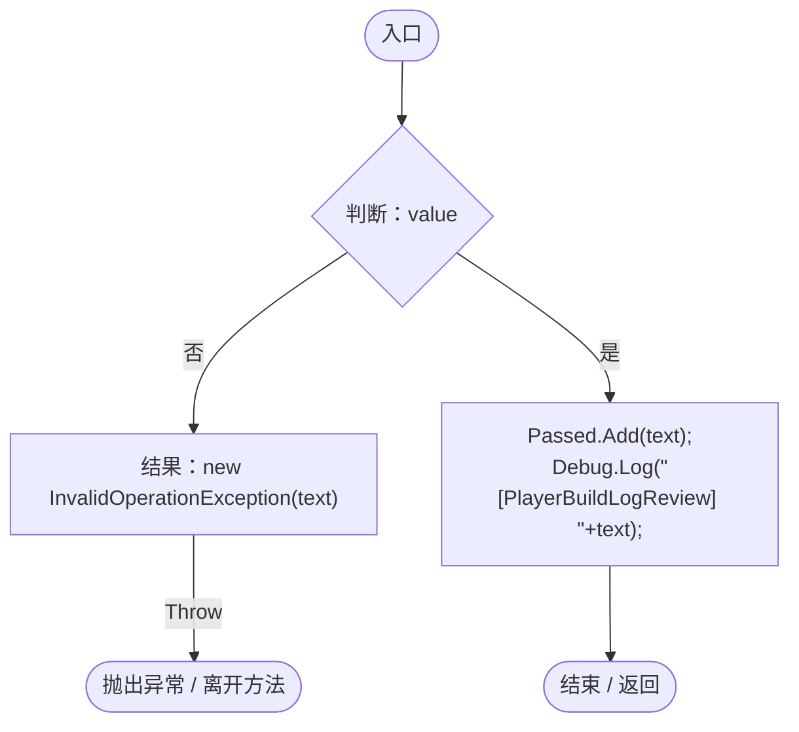

## RunBatch · L20

`public static void RunBatch()`

### Editor · Roslyn编译器控制流

```mermaid
flowchart TD
  b0(["入口"])
  b1["Directory.CreateDirectory(Folder);<br/>Passed.Clear();<br/>File.WriteAllText(Path.Combine(Folder,&quot;result.txt&quot;),&quot;RUNNING&quot;);<br/>error=null"]
  b2["VerifyLogging();<br/>materials=Resources.LoadAll&lt;Material&gt;(&quot;RuntimeMaterials&quot;)"]
  b3{"判断：materials.Length==3"}
  b4["materials.All(m=&gt;m.shader!=null&amp;&amp;m.shader.isSupported)"]
  b5["materials.Length==3"]
  b6["Check(materials.Length==3&amp;&amp;materials.All(m=&gt;m.shader!=null&amp;&amp;m.shader.isSupported),&quot;太阳、星空与发光能量块材质都有可打包的Shader引用&quot;);"]
  b7["scenes=EditorBuildSettings.scenes.Where(s=&gt;s.enabled).Select(s=&gt;s.path).ToArray()"]
  b8{"判断：scenes.Length&gt;0"}
  b9["scenes.All(File.Exists)"]
  b10["scenes.Length&gt;0"]
  b11["Check(scenes.Length&gt;0&amp;&amp;scenes.All(File.Exists),&quot;发布场景有效&quot;);"]
  b12["target=Path.Combine(Folder,&quot;Windows&quot;,&quot;DarwinParadise.exe&quot;)<br/>Directory.CreateDirectory(Path.GetDirectoryName(target));"]
  b13["new BuildPlayerOptions{scenes=scenes,locationPathName=target,target=BuildTarget.StandaloneWindows64,options=BuildOptions.None}<br/>scenes=scenes<br/>locationPathName=target<br/>target=BuildTarget.StandaloneWindows64<br/>options=BuildOptions.None<br/>report=…"]
  b14["ExportMessages(report);<br/>File.WriteAllText(Path.Combine(Folder,&quot;build-summary.txt&quot;),&quot;Result=&quot;+report.summary.result+&quot;\nErrors=&quot;+report.summary.totalErrors+&quot;\nWarnings=&quot;+report.summary.totalWarnings+&quot;\nSize=&quot;+report.summary.totalSize+&quot;\nPa…"]
  b15{"判断：report.summary.result==BuildResult.Succeeded"}
  b16["report.summary.totalErrors==0"]
  b17["report.summary.result==BuildResult.Succeeded"]
  b18["Check(report.summary.result==BuildResult.Succeeded&amp;&amp;report.summary.totalErrors==0,&quot;真实Windows非开发版Player构建成功&quot;);"]
  b19["(Exception ex)<br/>error=ex.ToString();<br/>Debug.LogException(ex);"]
  b20["RuntimeFileLog.Shutdown(&quot;日志回归结束&quot;);"]
  b21{"Path.Combine(Folder,&quot;result.txt&quot;)<br/>判断：error==null"}
  b22["&quot;PASS&quot;"]
  b23["&quot;FAIL&quot;"]
  b24["File.WriteAllText(Path.Combine(Folder,&quot;result.txt&quot;),(error==null?&quot;PASS&quot;:&quot;FAIL&quot;)+&quot;\n&quot;+error+&quot;\n&quot;+string.Join(&quot;\n&quot;,Passed),new UTF8Encoding(false));"]
  b25{"&quot;[PlayerBuildLogReview] &quot;<br/>判断：error==null"}
  b26["&quot;PASS&quot;"]
  b27["&quot;FAIL&quot;"]
  b28["Debug.Log(&quot;[PlayerBuildLogReview] &quot;+(error==null?&quot;PASS&quot;:&quot;FAIL&quot;));"]
  b29{"判断：error==null"}
  b30["0"]
  b31["1"]
  b32["EditorApplication.Exit(error==null?0:1);"]
  b33(["结束 / 返回"])
  b0 --> b1
  b1 --> b2
  b2 --> b3
  b3 -->|"是"| b4
  b3 -->|"否"| b5
  b4 --> b6
  b5 --> b6
  b6 --> b7
  b7 --> b8
  b8 -->|"是"| b9
  b8 -->|"否"| b10
  b9 --> b11
  b10 --> b11
  b11 --> b12
  b12 --> b13
  b13 --> b14
  b14 --> b15
  b15 -->|"是"| b16
  b15 -->|"否"| b17
  b16 --> b18
  b17 --> b18
  b18 -->|"经过finally 20"| b21
  b19 -->|"经过finally 20"| b21
  b21 -->|"是"| b22
  b21 -->|"否"| b23
  b22 --> b24
  b23 --> b24
  b24 --> b25
  b25 -->|"是"| b26
  b25 -->|"否"| b27
  b26 --> b28
  b27 --> b28
  b28 --> b29
  b29 -->|"是"| b30
  b29 -->|"否"| b31
  b30 --> b32
  b31 --> b32
  b32 --> b33
  b2 -. "保护区可能异常（示意）" .-> b19
  b2 -. "退出保护区时 finally（示意）" .-> b20

```

项目内调用/回调引用：

- [PlayerBuildLogRegression.VerifyLogging · L56](ba708b485a4c1e25.md#m7aa244f974fb150e)（方法）
- [PlayerBuildLogRegression.Check · L19](ba708b485a4c1e25.md#m35c71d0a11cc5da1)（方法）
- [PlayerBuildLogRegression.ExportMessages · L44](ba708b485a4c1e25.md#m9f45455d0ac7cf38)（方法）
- [RuntimeFileLog.Shutdown · L49](8080b38a7e1c5585.md#m817cce367fb66edc)（方法）
- [PlayerBuildLogRegression.回调@27 · L27](ba708b485a4c1e25.md#ma4ee18468da79879)（回调/委托）
- [PlayerBuildLogRegression.回调@28 · L28](ba708b485a4c1e25.md#m97f5a4b8ead5c217)（回调/委托）
- [PlayerBuildLogRegression.回调@28 · L28](ba708b485a4c1e25.md#m8ccf5d896218693e)（回调/委托）

## 回调@27 · L27

`m … => 回调`

### Editor · Roslyn编译器控制流

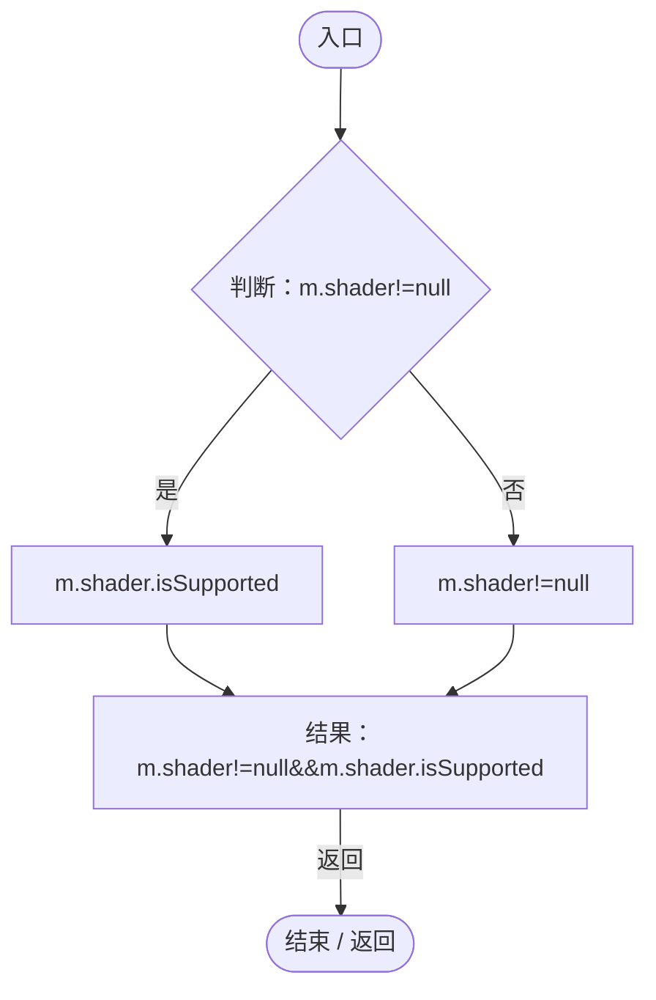

## 回调@28 · L28

`s … => 回调`

### Editor · Roslyn编译器控制流

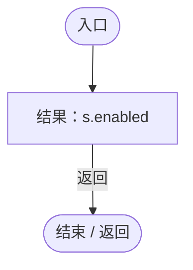

## 回调@28 · L28

`s … => 回调`

### Editor · Roslyn编译器控制流

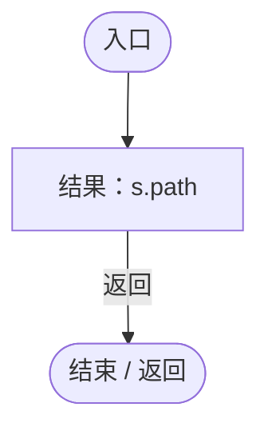

## InspectLastReportBatch · L40

`public static void InspectLastReportBatch()`

### Editor · Roslyn编译器控制流

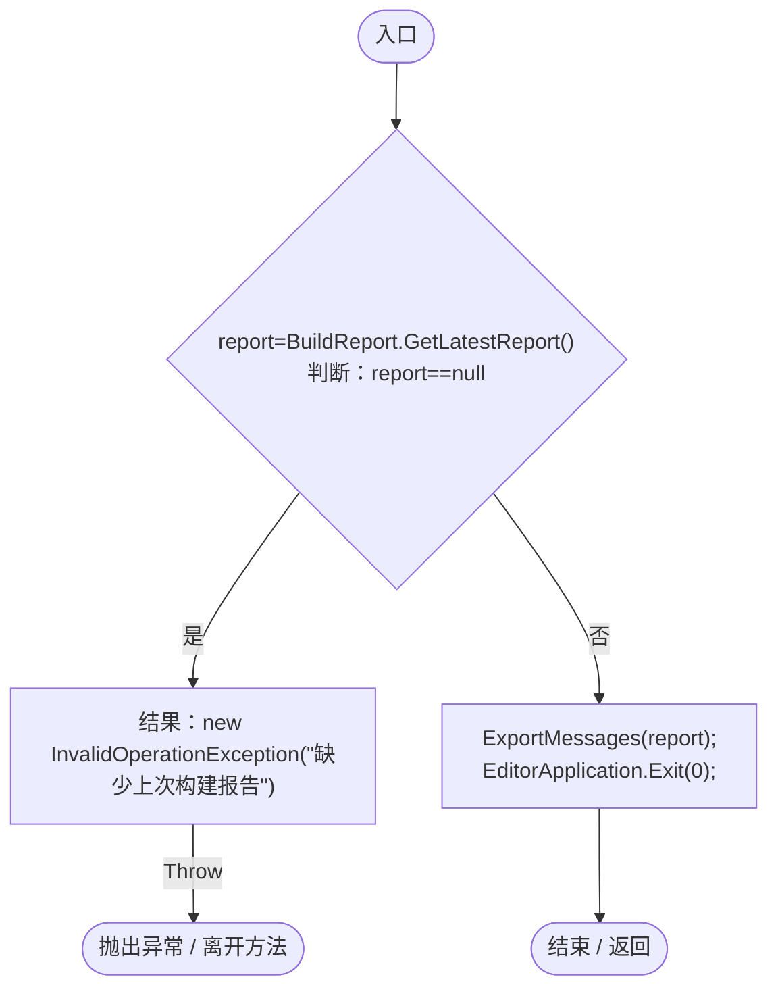

项目内调用/回调引用：

- [PlayerBuildLogRegression.ExportMessages · L44](ba708b485a4c1e25.md#m9f45455d0ac7cf38)（方法）

## ExportMessages · L44

`private static void ExportMessages(BuildReport report)`

### Editor · Roslyn编译器控制流

```mermaid
flowchart TD
  b0(["入口"])
  b1["File.WriteAllText(Path.Combine(Folder,&quot;build-messages.txt&quot;),string.Join(&quot;\n&quot;,report.steps.SelectMany(s=&gt;s.messages).Where(m=&gt;m.type==LogType.Warning&#124;&#124;m.type==LogType.Error&#124;&#124;m.type==LogType.Exception).Select(m=&gt;m.type+&quot;: &quot;+m.content)),new…"]
  b2(["结束 / 返回"])
  b0 --> b1
  b1 --> b2

```

项目内调用/回调引用：

- [PlayerBuildLogRegression.回调@47 · L47](ba708b485a4c1e25.md#m2c25a881b9e04e88)（回调/委托）
- [PlayerBuildLogRegression.回调@47 · L47](ba708b485a4c1e25.md#me6d5b08731f5aa38)（回调/委托）
- [PlayerBuildLogRegression.回调@47 · L47](ba708b485a4c1e25.md#mae0414067a852ded)（回调/委托）

## 回调@47 · L47

`s … => 回调`

### Editor · Roslyn编译器控制流

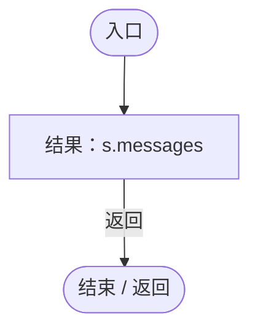

## 回调@47 · L47

`m … => 回调`

### Editor · Roslyn编译器控制流

```mermaid
flowchart TD
  b0(["入口"])
  b1{"判断：m.type==LogType.Warning"}
  b2{"判断：m.type==LogType.Error"}
  b3["m.type==LogType.Exception"]
  b4["m.type==LogType.Warning&#124;&#124;m.type==LogType.Error&#124;&#124;m.type==LogType.Exception"]
  b5["结果：m.type==LogType.Warning&#124;&#124;m.type==LogType.Error&#124;&#124;m.type==LogType.Exception"]
  b6(["结束 / 返回"])
  b0 --> b1
  b1 -->|"否"| b2
  b1 -->|"是"| b4
  b2 -->|"否"| b3
  b2 -->|"是"| b4
  b3 --> b5
  b4 --> b5
  b5 -->|"返回"| b6

```

## 回调@47 · L47

`m … => 回调`

### Editor · Roslyn编译器控制流

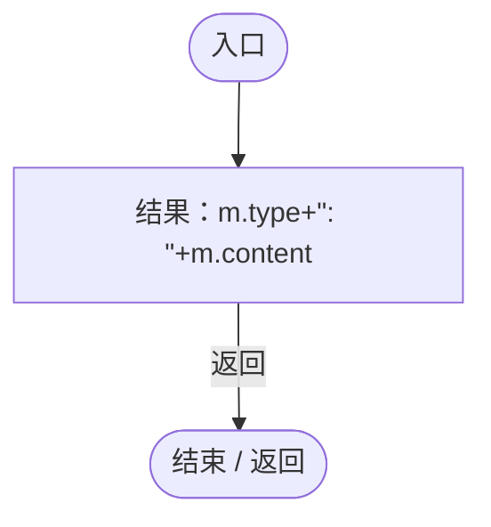

## Settings · L49

`private static RuntimeLogSettings Settings()`

### Editor · Roslyn编译器控制流

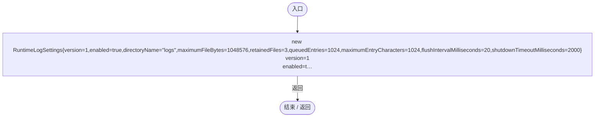

## ReadActive · L50

`private static byte[] ReadActive(string path)`

### Editor · Roslyn编译器控制流

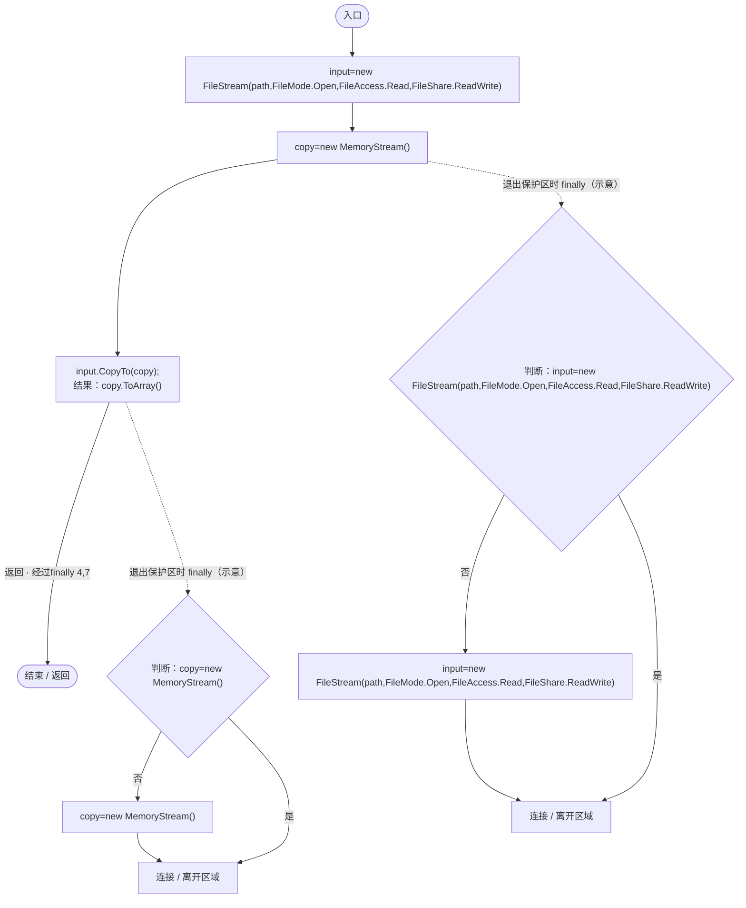

## VerifyLogging · L56

`private static void VerifyLogging()`

### Editor · Roslyn编译器控制流

```mermaid
flowchart TD
  b0(["入口"])
  b1["configured=RuntimeLogSettings.Load()"]
  b2{"判断：configured.enabled"}
  b3["configured.maximumFileBytes&gt;0"]
  b4["configured.enabled"]
  b5["Check(configured.enabled&amp;&amp;configured.maximumFileBytes&gt;0,&quot;日志JSON配置可加载并校验&quot;);"]
  b6["root=Path.Combine(Folder,&quot;LogTests-&quot;+Guid.NewGuid().ToString(&quot;N&quot;))<br/>Directory.CreateDirectory(root);<br/>settings=Settings()<br/>capture=Path.Combine(root,&quot;capture&quot;)<br/>RuntimeFileLog.StartSession(settings,capture,capture);<br/>first=RuntimeFileLog.Curr…"]
  b7["结果：new InvalidOperationException(marker+&quot;预期异常&quot;)"]
  x7(["抛出异常 / 离开方法"])
  b8["(Exception ex)<br/>Debug.LogException(ex);"]
  b9["Task.Run(()=&gt;{for(int i=0;i&lt;32;i++)Debug.Log(marker+&quot;后台-&quot;+i.ToString(&quot;D2&quot;));}).GetAwaiter().GetResult();<br/>Check(RuntimeFileLog.Flush(),&quot;普通输出和工作线程输出可以主动刷新&quot;);<br/>text=Encoding.UTF8.GetString(ReadActive(first))"]
  b10{"判断：text.Contains(marker+&quot;普通输出&quot;)"}
  b11{"判断：text.Contains(marker+&quot;预期警告&quot;)"}
  b12{"判断：text.Contains(marker+&quot;预期错误&quot;)"}
  b13{"判断：text.Contains(marker+&quot;预期异常&quot;)"}
  b14["text.Contains(nameof(VerifyLogging))"]
  b15["text.Contains(marker+&quot;普通输出&quot;)&amp;&amp;text.Contains(marker+&quot;预期警告&quot;)&amp;&amp;text.Contains(marker+&quot;预期错误&quot;)&amp;&amp;text.Contains(marker+&quot;预期异常&quot;)&amp;&amp;text.Contains(nameof(VerifyLogging))"]
  b16["Check(text.Contains(marker+&quot;普通输出&quot;)&amp;&amp;text.Contains(marker+&quot;预期警告&quot;)&amp;&amp;text.Contains(marker+&quot;预期错误&quot;)&amp;&amp;text.Contains(marker+&quot;预期异常&quot;)&amp;&amp;text.Contains(nameof(VerifyLogging)),&quot;捕获Unity全部级别及异常堆栈&quot;);"]
  b17["Check(Enumerable.Range(0,32).All(i=&gt;text.Contains(marker+&quot;后台-&quot;+i.ToString(&quot;D2&quot;))),&quot;32条真实后台线程Unity日志全部写入&quot;);"]
  b18{"判断：text.Contains(&quot;[线程 &quot;)"}
  b19{"判断：text.Contains(&quot;[Warning]&quot;)"}
  b20{"判断：text.Contains(&quot;[Error]&quot;)"}
  b21["text.Contains(&quot;[Exception]&quot;)"]
  b22["text.Contains(&quot;[线程 &quot;)&amp;&amp;text.Contains(&quot;[Warning]&quot;)&amp;&amp;text.Contains(&quot;[Error]&quot;)&amp;&amp;text.Contains(&quot;[Exception]&quot;)"]
  b23["Check(text.Contains(&quot;[线程 &quot;)&amp;&amp;text.Contains(&quot;[Warning]&quot;)&amp;&amp;text.Contains(&quot;[Error]&quot;)&amp;&amp;text.Contains(&quot;[Exception]&quot;),&quot;包含时间、级别和线程信息&quot;);"]
  b24["bytes=ReadActive(first)<br/>new UTF8Encoding(false,true).GetString(bytes);"]
  b25{"判断：bytes.Length&gt;=3"}
  b26{"判断：bytes[0]==239"}
  b27{"判断：bytes[1]==187"}
  b28["bytes[2]==191"]
  b29["bytes.Length&gt;=3&amp;&amp;bytes[0]==239&amp;&amp;bytes[1]==187&amp;&amp;bytes[2]==191"]
  b30["Check(!(bytes.Length&gt;=3&amp;&amp;bytes[0]==239&amp;&amp;bytes[1]==187&amp;&amp;bytes[2]==191),&quot;日志UTF-8无BOM且中文可读&quot;);"]
  b31["RuntimeFileLog.StartSession(settings,capture,capture);<br/>second=RuntimeFileLog.CurrentFilePath<br/>Debug.Log(marker+&quot;不重复订阅&quot;);<br/>RuntimeFileLog.Shutdown(&quot;预期退出&quot;);<br/>latest=File.ReadAllText(second)"]
  b32{"判断：first!=second"}
  b33{"判断：latest.Split(new[]{marker+&quot;不重复订阅&quot;},StringSplitOptions.None).Length==2"}
  b34["latest.Contains(&quot;会话结束&quot;)"]
  b35["first!=second&amp;&amp;latest.Split(new[]{marker+&quot;不重复订阅&quot;},StringSplitOptions.None).Length==2&amp;&amp;latest.Contains(&quot;会话结束&quot;)"]
  b36["Check(first!=second&amp;&amp;latest.Split(new[]{marker+&quot;不重复订阅&quot;},StringSplitOptions.None).Length==2&amp;&amp;latest.Contains(&quot;会话结束&quot;),&quot;重开会话文件独立、只订阅一次、退出排空尾部&quot;);"]
  b37["length=new FileInfo(second).Length<br/>Debug.Log(marker+&quot;关闭后不捕获&quot;);<br/>Check(new FileInfo(second).Length==length,&quot;关闭日志后注销Unity事件&quot;);"]
  b38["new FileStream(second,FileMode.Open,FileAccess.ReadWrite,FileShare.None)"]
  b39["Check(true,&quot;关闭后日志文件锁已释放&quot;);"]
  b40{"判断：new FileStream(second,FileMode.Open,FileAccess.ReadWrite,FileShare.None)"}
  b41["new FileStream(second,FileMode.Open,FileAccess.ReadWrite,FileShare.None)"]
  b42["连接 / 离开区域"]
  b43["blocked=Path.Combine(root,&quot;not-a-directory&quot;)<br/>File.WriteAllText(blocked,&quot;existing file&quot;);<br/>fallback=Path.Combine(root,&quot;fallback&quot;)"]
  b44["writer=new SessionLogWriter(settings,blocked,fallback)"]
  b45["writer.Write(&quot;fallback-tail&quot;,&quot;&quot;,LogType.Log);"]
  b46{"判断：writer.DirectoryPath==fallback"}
  b47{"判断：writer.FallbackReason!=null"}
  b48["writer.Flush()"]
  b49["writer.DirectoryPath==fallback&amp;&amp;writer.FallbackReason!=null&amp;&amp;writer.Flush()"]
  b50["Check(writer.DirectoryPath==fallback&amp;&amp;writer.FallbackReason!=null&amp;&amp;writer.Flush(),&quot;游戏目录不可写时改用用户目录且说明原因&quot;);"]
  b51{"判断：writer=new SessionLogWriter(settings,blocked,fallback)"}
  b52["writer=new SessionLogWriter(settings,blocked,fallback)"]
  b53["连接 / 离开区域"]
  b54["rotate=Path.Combine(root,&quot;rotate&quot;)<br/>settings=Settings();<br/>settings.maximumEntryCharacters=128;<br/>settings.maximumFileBytes=1024;"]
  b55["writer=new SessionLogWriter(settings,rotate,rotate)"]
  b56["i=0"]
  b57{"判断：i&lt;40"}
  b58["writer.Write(i.ToString(&quot;D2&quot;)+new string('a',220),&quot;&quot;,LogType.Log);<br/>i++"]
  b59["writer.Write(&quot;rotation-final&quot;,&quot;&quot;,LogType.Log);<br/>Check(writer.Flush(),&quot;轮转后后台写入仍正常&quot;);"]
  b60{"判断：writer=new SessionLogWriter(settings,rotate,rotate)"}
  b61["writer=new SessionLogWriter(settings,rotate,rotate)"]
  b62["连接 / 离开区域"]
  b63["files=Directory.GetFiles(rotate,&quot;session-*.log&quot;)"]
  b64{"判断：files.Length==settings.retainedFiles"}
  b65["files.All(f=&gt;new FileInfo(f).Length&lt;=settings.maximumFileBytes)"]
  b66["files.Length==settings.retainedFiles"]
  b67["Check(files.Length==settings.retainedFiles&amp;&amp;files.All(f=&gt;new FileInfo(f).Length&lt;=settings.maximumFileBytes),&quot;日志轮转文件大小及保留数量有界&quot;);"]
  b68["rotated=string.Join(&quot;\n&quot;,files.Select(File.ReadAllText))"]
  b69{"判断：rotated.Contains(&quot;rotation-final&quot;)"}
  b70{"判断：rotated.Contains(&quot;已截断&quot;)"}
  b71["File.Exists(File.ReadAllText(Path.Combine(rotate,&quot;latest-log.txt&quot;)))"]
  b72["rotated.Contains(&quot;rotation-final&quot;)&amp;&amp;rotated.Contains(&quot;已截断&quot;)&amp;&amp;File.Exists(File.ReadAllText(Path.Combine(rotate,&quot;latest-log.txt&quot;)))"]
  b73["Check(rotated.Contains(&quot;rotation-final&quot;)&amp;&amp;rotated.Contains(&quot;已截断&quot;)&amp;&amp;File.Exists(File.ReadAllText(Path.Combine(rotate,&quot;latest-log.txt&quot;))),&quot;过长消息截断、最终输出和最新日志指针有效&quot;);"]
  b74["settings.enabled=false;<br/>disabled=Path.Combine(root,&quot;disabled&quot;)<br/>RuntimeFileLog.StartSession(settings,disabled,disabled);"]
  b75{"判断：Directory.Exists(disabled)"}
  b76["string.IsNullOrEmpty(RuntimeFileLog.CurrentFilePath)"]
  b77["!Directory.Exists(disabled)"]
  b78["Check(!Directory.Exists(disabled)&amp;&amp;string.IsNullOrEmpty(RuntimeFileLog.CurrentFilePath),&quot;禁用日志时不创建文件&quot;);"]
  b79(["结束 / 返回"])
  b0 --> b1
  b1 --> b2
  b2 -->|"是"| b3
  b2 -->|"否"| b4
  b3 --> b5
  b4 --> b5
  b5 --> b6
  b6 --> b7
  b7 -->|"Throw"| x7
  b8 --> b9
  b9 --> b10
  b10 -->|"是"| b11
  b10 -->|"否"| b15
  b11 -->|"是"| b12
  b11 -->|"否"| b15
  b12 -->|"是"| b13
  b12 -->|"否"| b15
  b13 -->|"是"| b14
  b13 -->|"否"| b15
  b14 --> b16
  b15 --> b16
  b16 --> b17
  b17 --> b18
  b18 -->|"是"| b19
  b18 -->|"否"| b22
  b19 -->|"是"| b20
  b19 -->|"否"| b22
  b20 -->|"是"| b21
  b20 -->|"否"| b22
  b21 --> b23
  b22 --> b23
  b23 --> b24
  b24 --> b25
  b25 -->|"是"| b26
  b25 -->|"否"| b29
  b26 -->|"是"| b27
  b26 -->|"否"| b29
  b27 -->|"是"| b28
  b27 -->|"否"| b29
  b28 --> b30
  b29 --> b30
  b30 --> b31
  b31 --> b32
  b32 -->|"是"| b33
  b32 -->|"否"| b35
  b33 -->|"是"| b34
  b33 -->|"否"| b35
  b34 --> b36
  b35 --> b36
  b36 --> b37
  b37 --> b38
  b38 --> b39
  b39 -->|"经过finally 40"| b43
  b40 -->|"否"| b41
  b40 -->|"是"| b42
  b41 --> b42
  b43 --> b44
  b44 --> b45
  b45 --> b46
  b46 -->|"是"| b47
  b46 -->|"否"| b49
  b47 -->|"是"| b48
  b47 -->|"否"| b49
  b48 --> b50
  b49 --> b50
  b50 -->|"经过finally 51"| b54
  b51 -->|"否"| b52
  b51 -->|"是"| b53
  b52 --> b53
  b54 --> b55
  b55 --> b56
  b56 --> b57
  b57 -->|"是"| b58
  b57 -->|"否"| b59
  b58 --> b57
  b59 -->|"经过finally 60"| b63
  b60 -->|"否"| b61
  b60 -->|"是"| b62
  b61 --> b62
  b63 --> b64
  b64 -->|"是"| b65
  b64 -->|"否"| b66
  b65 --> b67
  b66 --> b67
  b67 --> b68
  b68 --> b69
  b69 -->|"是"| b70
  b69 -->|"否"| b72
  b70 -->|"是"| b71
  b70 -->|"否"| b72
  b71 --> b73
  b72 --> b73
  b73 --> b74
  b74 --> b75
  b75 -->|"否"| b76
  b75 -->|"是"| b77
  b76 --> b78
  b77 --> b78
  b78 --> b79
  b7 -. "保护区可能异常（示意）" .-> b8
  b39 -. "退出保护区时 finally（示意）" .-> b40
  b45 -. "退出保护区时 finally（示意）" .-> b51
  b56 -. "退出保护区时 finally（示意）" .-> b60

```

项目内调用/回调引用：

- [RuntimeLogSettings.Load · L20](ade1290a5194a825.md#m0f3085aaf1b46923)（方法）
- [PlayerBuildLogRegression.Check · L19](ba708b485a4c1e25.md#m35c71d0a11cc5da1)（方法）
- [PlayerBuildLogRegression.Settings · L49](ba708b485a4c1e25.md#m60d36def020af34f)（方法）
- [RuntimeFileLog.StartSession · L35](8080b38a7e1c5585.md#mf0de887184e18c16)（方法）
- [RuntimeFileLog.Flush · L48](8080b38a7e1c5585.md#mf8cac7c8613ec3d6)（方法）
- [PlayerBuildLogRegression.ReadActive · L50](ba708b485a4c1e25.md#ma9e4a1e0244899c0)（方法）
- [RuntimeFileLog.Shutdown · L49](8080b38a7e1c5585.md#m817cce367fb66edc)（方法）
- [SessionLogWriter.SessionLogWriter.ctor · L26](40cf249053355538.md#m31807e1034b4251e)（构造函数）
- [SessionLogWriter.Write · L40](40cf249053355538.md#m158b7ff150120b71)（方法）
- [SessionLogWriter.DirectoryPath.get · L22](40cf249053355538.md#m87f743b3f976472b)（访问器）
- [SessionLogWriter.FallbackReason.get · L25](40cf249053355538.md#mf8ceee2abfb5c3f5)（访问器）
- [SessionLogWriter.Flush · L49](40cf249053355538.md#m4c75140dcf6a8af2)（方法）
- [PlayerBuildLogRegression.回调@64 · L64](ba708b485a4c1e25.md#m31dd9463aea17324)（回调/委托）
- [PlayerBuildLogRegression.回调@67 · L67](ba708b485a4c1e25.md#m55e506a741d43391)（回调/委托）
- [PlayerBuildLogRegression.回调@78 · L78](ba708b485a4c1e25.md#mec70fa9c4b4a5a5f)（回调/委托）

## 回调@64 · L64

`( … => 回调`

### Editor · Roslyn编译器控制流

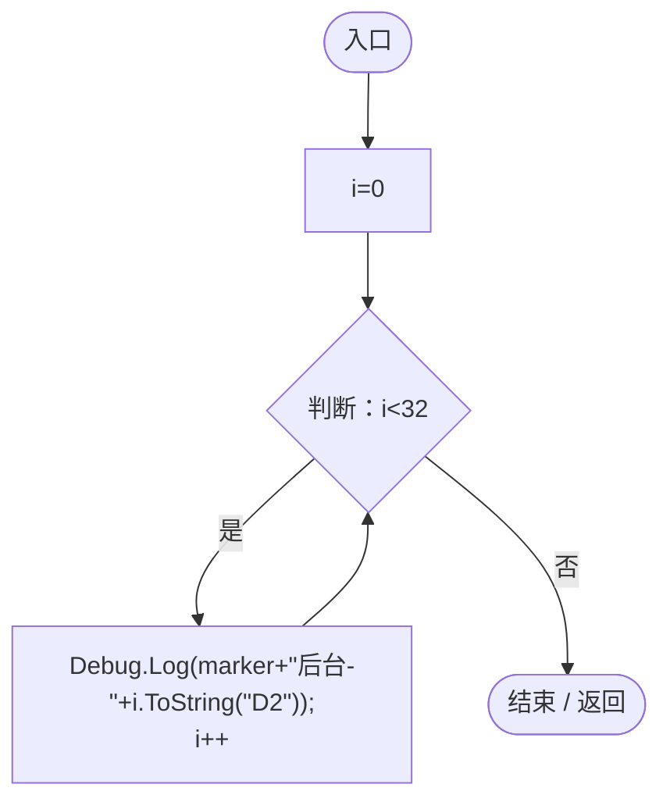

## 回调@67 · L67

`i … => 回调`

### Editor · Roslyn编译器控制流

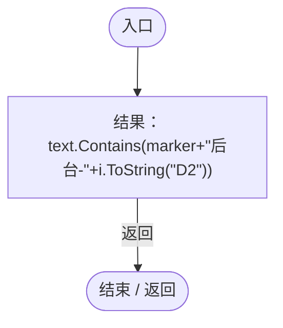

## 回调@78 · L78

`f … => 回调`

### Editor · Roslyn编译器控制流

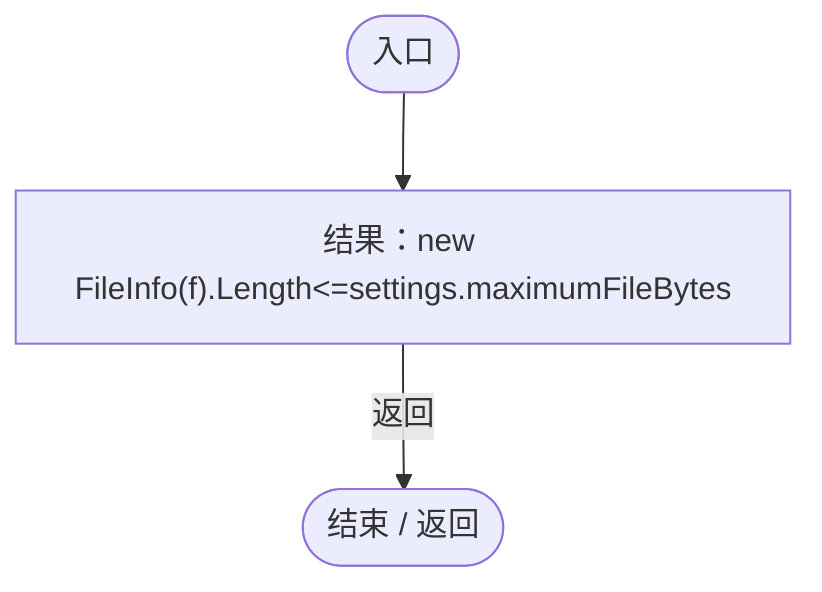
