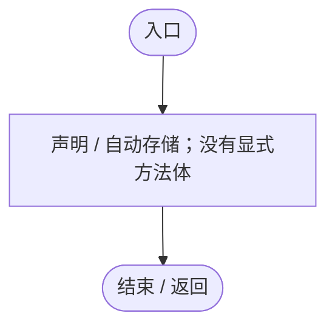
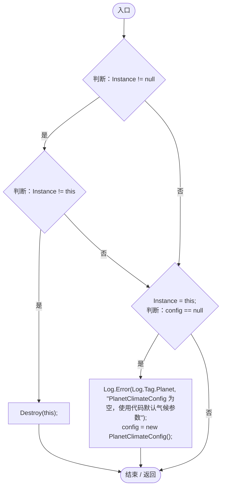
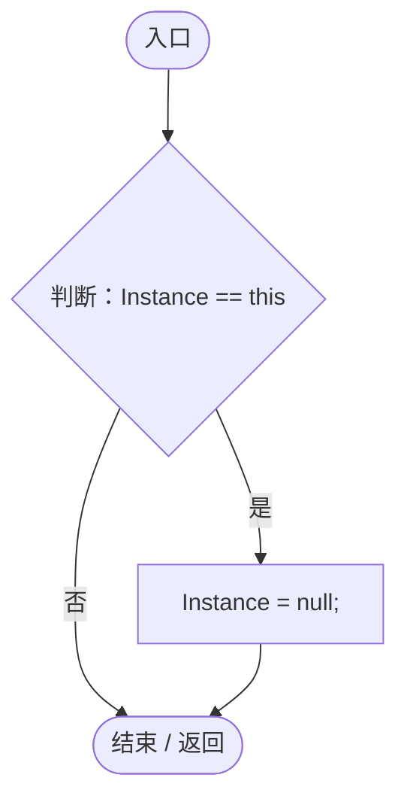
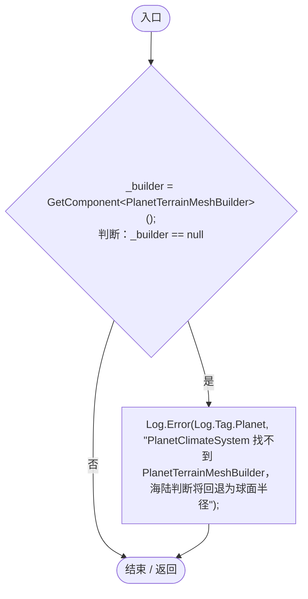
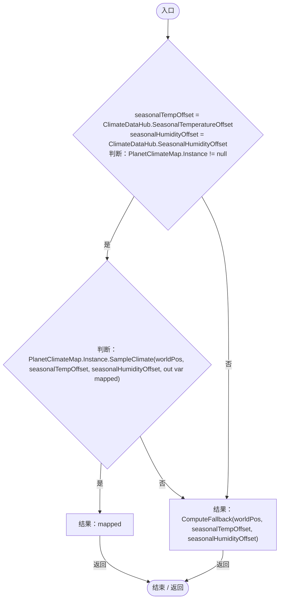

```mermaid
flowchart TD
  b0(["入口"])
  b1{"判断：_builder == null"}
  b2["_builder = GetComponent&lt;PlanetTerrainMeshBuilder&gt;();"]
  b3{"判断：_builder == null"}
  b4["_builder = FindFirstObjectByType&lt;PlanetTerrainMeshBuilder&gt;();"]
  b5["localPos = worldPos - transform.position<br/>distance = localPos.magnitude<br/>unitDir = transform.InverseTransformDirection(localPos).normalized<br/>latDeg = Mathf.Asin(Mathf.Clamp(Mathf.Abs(unitDir.y), 0f, 1f)) * Mathf.Rad2Deg"]
  b6{"判断：_builder != null"}
  b7{"判断：_builder.Data != null"}
  b8["_builder.Data.SeaLevel"]
  b9["0.45f"]
  b10["seaLevel = _builder != null &amp;&amp; _builder.Data != null ? _builder.Data.SeaLevel : 0.45f"]
  b11["height = 0f"]
  b12{"判断：_builder != null"}
  b13["_builder.WaterRadius"]
  b14["planetRadius"]
  b15["waterRadius = _builder != null ? _builder.WaterRadius : planetRadius"]
  b16{"isOcean = distance &lt; waterRadius<br/>判断：_builder != null"}
  b17{"判断：_builder.Data != null"}
  b18["height = PlanetTerrainSampler.SampleHeight(_builder.Data, unitDir);"]
  b19["altitudeNorm = Mathf.Clamp01( (height - seaLevel) / Mathf.Max(0.01f, PlanetTerrainData.MaxNormalizedHeight - seaLevel))"]
  b20{"config<br/>判断：config"}
  b21["config"]
  b22["new PlanetClimateConfig()"]
  b23["cfg = config ?? new PlanetClimateConfig()"]
  b24{"latCurve = Mathf.Pow(Mathf.Cos(latDeg * Mathf.Deg2Rad), Mathf.Max(0.1f, cfg.latitudeTempExponent))<br/>temp = Mathf.Lerp(cfg.regionalTemperature, Mathf.Lerp(cfg.poleTemp, cfg.equatorTemp, latCurve), cfg.solarTemperatureWeight)<br/>temp += Climat…"}
  b25["oceanTarget = Mathf.Lerp(cfg.regionalTemperature, Mathf.Lerp(cfg.oceanPoleTemp, cfg.oceanEquatorTemp, latCurve), cfg.solarTemperatureWeight)<br/>temp = Mathf.Lerp(temp, oceanTarget, cfg.oceanTempModeration);<br/>humidity = 100f;"]
  b26["temp = Mathf.Clamp(temp + tempOffset, -60f, 70f);<br/>humidity = Mathf.Clamp(humidity + humidityOffset, 0f, 100f);<br/>precipitation = Mathf.Clamp(humidity - altitudeNorm * cfg.altitudePrecipitationPenalty, 0f, 100f)"]
  b27["new ClimateData { Temperature = temp, Humidity = humidity, Precipitation = precipitation, Type = cfg.Classify(temp, humidity, isOcean) }<br/>Temperature = temp<br/>Humidity = humidity<br/>Precipitation = precipitation<br/>Type = cfg.Classify(temp, humid…"]
  b28(["结束 / 返回"])
  b0 --> b1
  b1 -->|"是"| b2
  b1 -->|"否"| b3
  b2 --> b3
  b3 -->|"是"| b4
  b3 -->|"否"| b5
  b4 --> b5
  b5 --> b6
  b6 -->|"是"| b7
  b6 -->|"否"| b9
  b7 -->|"是"| b8
  b7 -->|"否"| b9
  b8 --> b10
  b9 --> b10
  b10 --> b11
  b11 --> b12
  b12 -->|"是"| b13
  b12 -->|"否"| b14
  b13 --> b15
  b14 --> b15
  b15 --> b16
  b16 -->|"是"| b17
  b16 -->|"否"| b19
  b17 -->|"是"| b18
  b17 -->|"否"| b19
  b18 --> b19
  b19 --> b20
  b20 -->|"否"| b21
  b20 -->|"是"| b22
  b21 --> b23
  b22 --> b23
  b23 --> b24
  b24 -->|"是"| b25
  b24 -->|"否"| b26
  b25 --> b26
  b26 --> b27
  b27 -->|"返回"| b28

```

# PlanetClimateSystem.cs

[返回总索引](../README.md) · `Runtime` · `Assets/DarwinPark/Planet/PlanetClimateSystem.cs`

[源文件](../../../Assets/DarwinPark/Planet/PlanetClimateSystem.cs) · 源码校验：`68956d9d55f7286d87e17ccc8ede4ef74c0f65d7f293a1070c6822c5397ef3b2`

方法按源文件位置排列。事件/回调引用不表示立即执行；分支与异常说明见总索引。完整源码与可点击关系图请打开离线手册。

## Instance.get · L32

`get`

### Editor / Player · 语法控制结构 / 声明（非CFG）

## Instance.set · L32

`private set`

### Editor / Player · 语法控制结构 / 声明（非CFG）

## Awake · L42

`private void Awake()`

### Editor / Player · Roslyn编译器控制流

项目内调用/回调引用：

- [PlanetClimateSystem.Instance.get · L32](ba86e31da9b7d0a5.md#mf8e5c7e126d7b598)（访问器）
- [PlanetClimateSystem.Instance.set · L32](ba86e31da9b7d0a5.md#m73100129c2412b2d)（访问器）
- [Log.Error · L43](735e5abf0df2bddc.md#m2addd5e1d74b000d)（方法）

## OnDestroy · L54

`private void OnDestroy()`

### Editor / Player · Roslyn编译器控制流

项目内调用/回调引用：

- [PlanetClimateSystem.Instance.get · L32](ba86e31da9b7d0a5.md#mf8e5c7e126d7b598)（访问器）
- [PlanetClimateSystem.Instance.set · L32](ba86e31da9b7d0a5.md#m73100129c2412b2d)（访问器）

## Start · L59

`private void Start()`

### Editor / Player · Roslyn编译器控制流

项目内调用/回调引用：

- [Log.Error · L43](735e5abf0df2bddc.md#m2addd5e1d74b000d)（方法）

## GetClimateAt · L69

`public ClimateData GetClimateAt(Vector3 worldPos)`

  获取世界坐标处的气候数据。  

### Editor / Player · Roslyn编译器控制流

项目内调用/回调引用：

- [PlanetClimateMap.Instance.get · L16](b4e9726c1bcf4c37.md#m3add54a419aeef9f)（访问器）
- [PlanetClimateMap.SampleClimate · L180](b4e9726c1bcf4c37.md#m494faa6a038b3552)（方法）
- [PlanetClimateSystem.ComputeFallback · L86](ba86e31da9b7d0a5.md#m4b931974e5cce606)（方法）

## ComputeFallback · L86

`private ClimateData ComputeFallback(Vector3 worldPos, float tempOffset, float humidityOffset)`

### Editor / Player · Roslyn编译器控制流

项目内调用/回调引用：

- [PlanetTerrainMeshBuilder.Data.get · L78](415285cf043354a9.md#m8382f579717fbc6d)（访问器）
- [PlanetTerrainMeshBuilder.WaterRadius.get · L94](415285cf043354a9.md#m28d8809083881ec1)（访问器）
- [PlanetTerrainSampler.SampleHeight · L32](fd5c1d83b88a7c8b.md#m759508f0c5a04b21)（方法）
- [PlanetClimateConfig.Classify · L129](caa5d97c52b00485.md#m07936a82a4f7e6a6)（方法）
