# RuntimeDropdownDismissal.cs

[返回总索引](../README.md) · `Runtime` · `Assets/DarwinPark/UI/RuntimeDropdownDismissal.cs`

[源文件](../../../Assets/DarwinPark/UI/RuntimeDropdownDismissal.cs) · 源码校验：`0b720e378541e04cccae8f95b21c945a31272f5b6971a13daeeb77f376b0c141`

方法按源文件位置排列。事件/回调引用不表示立即执行；分支与异常说明见总索引。完整源码与可点击关系图请打开离线手册。

## Popup.get · L18

`private Transform Popup`

### Editor / Player · 语法控制结构 / 声明（非CFG）

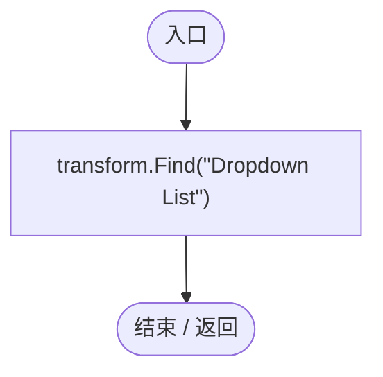

## IsOpen.get · L19

`public bool IsOpen`

### Editor / Player · 语法控制结构 / 声明（非CFG）

```mermaid
flowchart TD
  n2(["入口"])
  n1["_dropdown!=null&amp;&amp;(_dropdown.template!=null&amp;&amp;_dropdown.template.gameObject.activeSelf&#124;&#124;Popup is Transform popup&amp;&amp;popup.gameObject.activeSelf)"]
  n0(["结束 / 返回"])
  n1 --> n0
  n2 --> n1

```

## Awake · L20

`private void Awake()`

### Editor / Player · Roslyn编译器控制流

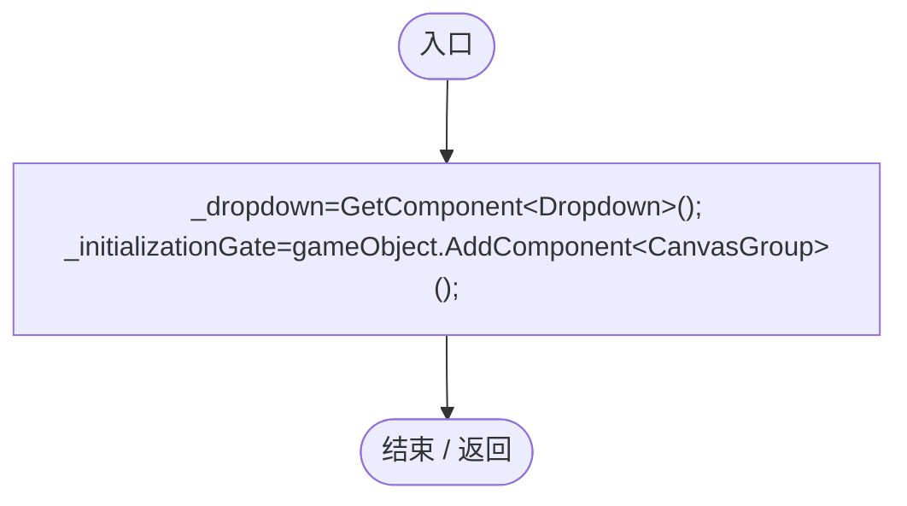

## OnEnable · L21

`private void OnEnable()`

### Editor / Player · Roslyn编译器控制流

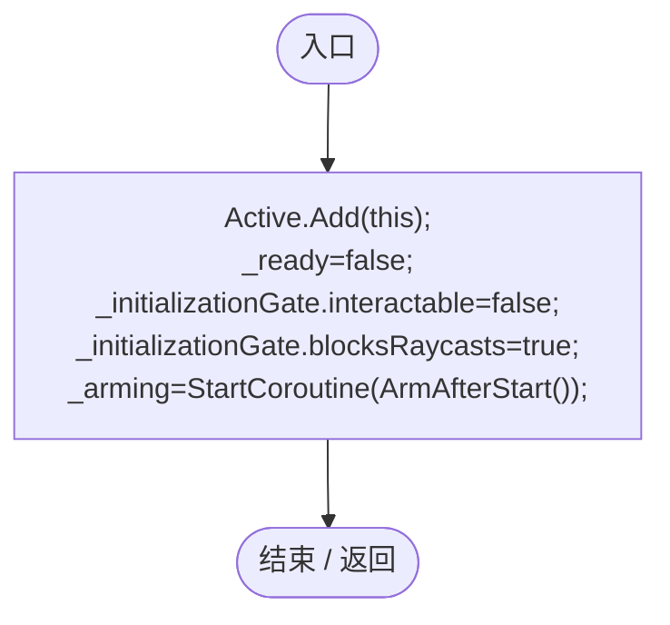

项目内调用/回调引用：

- [RuntimeDropdownDismissal.ArmAfterStart · L26](bab72c915cc299c5.md#m909dece634e974be)（方法）

## ArmAfterStart · L26

`private IEnumerator ArmAfterStart()`

### Editor / Player · Roslyn编译器控制流

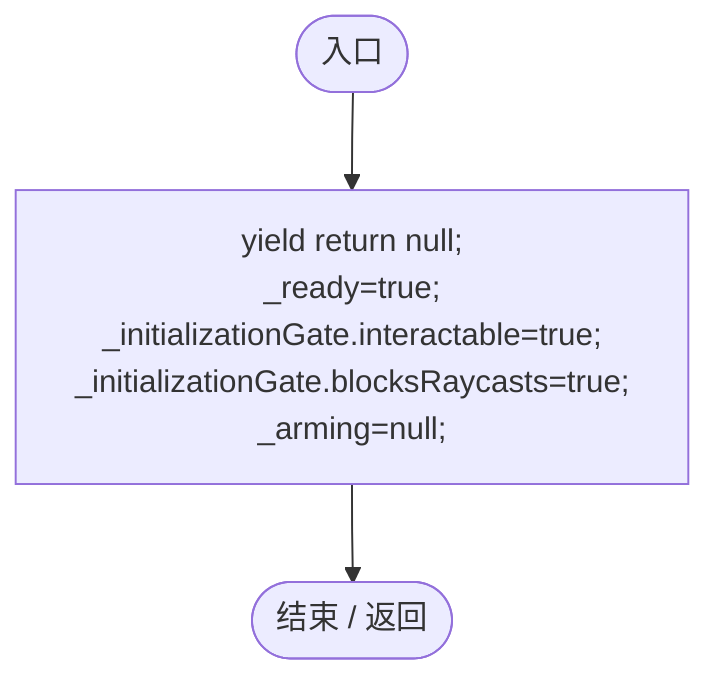

## ClosePopup · L31

`public void ClosePopup()`

### Editor / Player · Roslyn编译器控制流

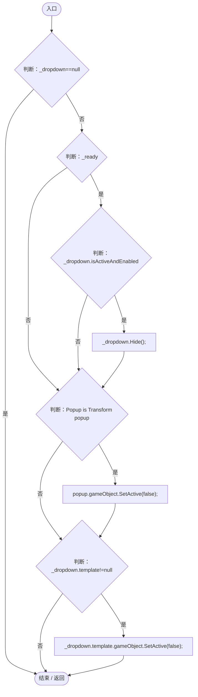

## CloseOpenPopups · L39

`public static bool CloseOpenPopups()`

### Editor / Player · Roslyn编译器控制流

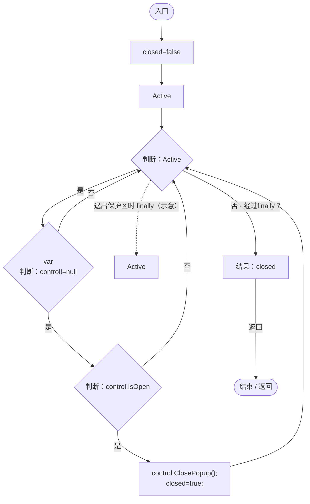

项目内调用/回调引用：

- [RuntimeDropdownDismissal.ClosePopup · L31](bab72c915cc299c5.md#m5d5c73530b0131b7)（方法）

## OnPointerDown · L43

`public void OnPointerDown(PointerEventData data)`

### Editor / Player · Roslyn编译器控制流

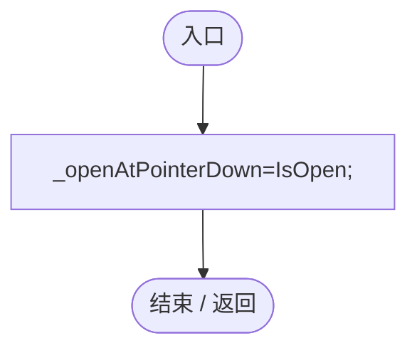

## OnPointerClick · L44

`public void OnPointerClick(PointerEventData data)`

### Editor / Player · Roslyn编译器控制流

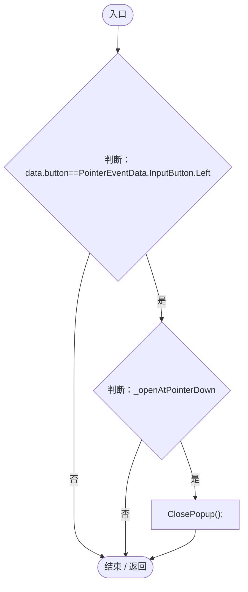

项目内调用/回调引用：

- [RuntimeDropdownDismissal.ClosePopup · L31](bab72c915cc299c5.md#m5d5c73530b0131b7)（方法）

## OnCancel · L45

`public void OnCancel(BaseEventData data)`

### Editor / Player · Roslyn编译器控制流

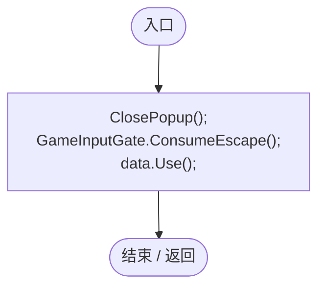

项目内调用/回调引用：

- [RuntimeDropdownDismissal.ClosePopup · L31](bab72c915cc299c5.md#m5d5c73530b0131b7)（方法）
- [GameInputGate.ConsumeEscape · L9](52955daae7e592ab.md#m5b050ac6f014de67)（方法）

## LateUpdate · L46

`private void LateUpdate()`

### Editor / Player · Roslyn编译器控制流

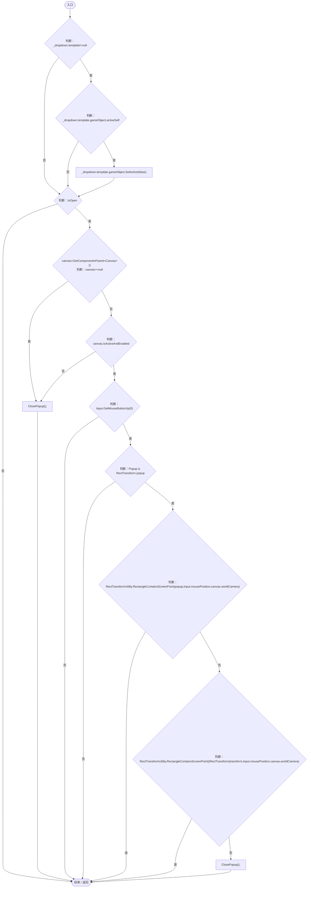

项目内调用/回调引用：

- [RuntimeDropdownDismissal.ClosePopup · L31](bab72c915cc299c5.md#m5d5c73530b0131b7)（方法）

## OnDisable · L55

`private void OnDisable()`

### Editor / Player · Roslyn编译器控制流

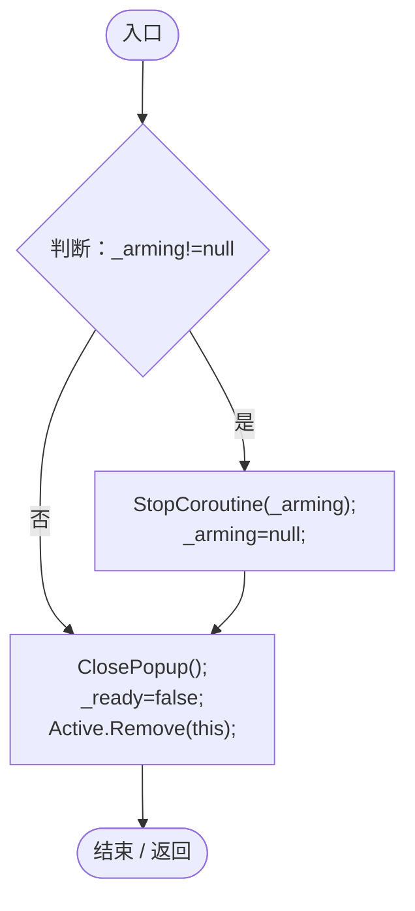

项目内调用/回调引用：

- [RuntimeDropdownDismissal.ClosePopup · L31](bab72c915cc299c5.md#m5d5c73530b0131b7)（方法）

## Reset · L59

`[RuntimeInitializeOnLoadMethod(RuntimeInitializeLoadType.SubsystemRegistration)] private static void Reset()`

### Editor / Player · Roslyn编译器控制流

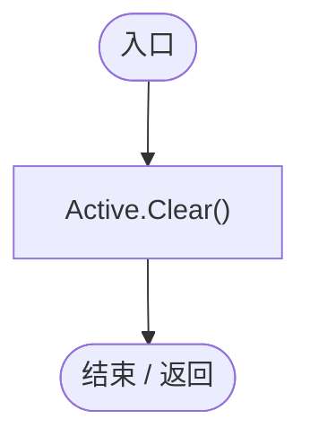
