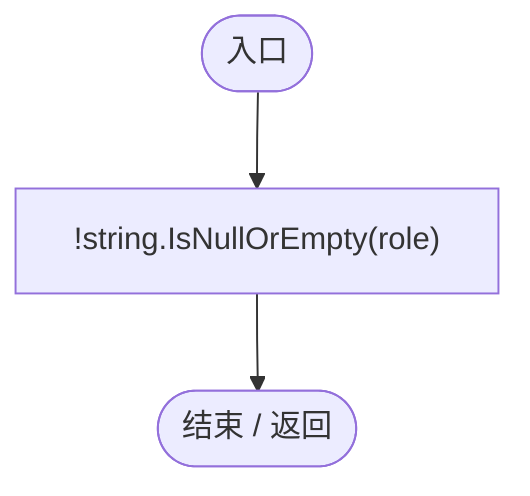
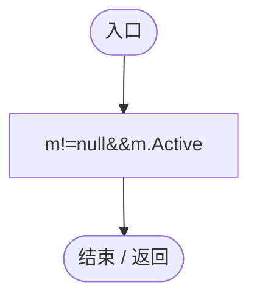
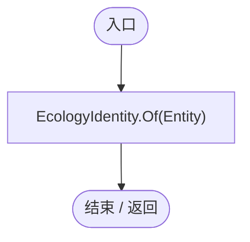
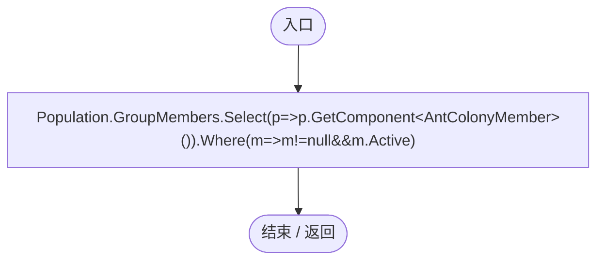
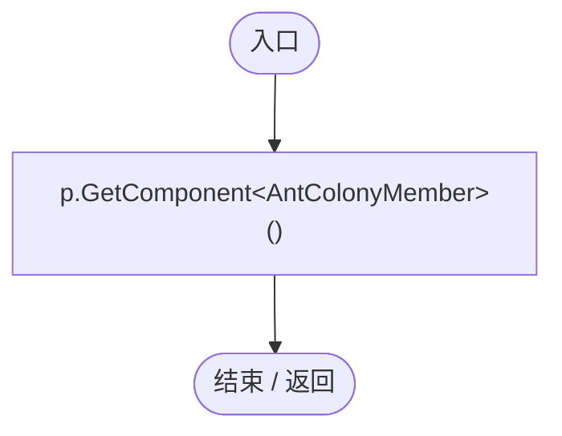

# AntColonyMember.cs

[返回总索引](../README.md) · `Runtime` · `Assets/DarwinPark/Entities/Ecology/AntColonyMember.cs`

[源文件](../../../Assets/DarwinPark/Entities/Ecology/AntColonyMember.cs) · 源码校验：`d525e67f8baae6f57ecfb3cd339b7756c4f28af84a14c1931777609c94b632ab`

方法按源文件位置排列。事件/回调引用不表示立即执行；分支与异常说明见总索引。完整源码与可点击关系图请打开离线手册。

<a id="m4e0cbcaea0988db8"></a>

## HasData.get · L24

`public bool HasData`


### Editor / Player · 语法控制结构 / 声明（非CFG）



<a id="m43f54bf1139f49bd"></a>

## All.get · L31

`public static IEnumerable<AntColonyMember> All`


### Editor / Player · 语法控制结构 / 声明（非CFG）


项目内调用/回调引用：

- [AntColonyMember.回调@31 · L31](baebd85c05598377.md#mfe103378603ec02d)（回调/委托）

<a id="mfe103378603ec02d"></a>

## 回调@31 · L31

`m … => 回调`


### Editor / Player · 语法控制结构 / 声明（非CFG）



<a id="m426db6a7c12dd7aa"></a>

## State.get · L32

`get`


### Editor / Player · 语法控制结构 / 声明（非CFG）


<a id="m9dcc7defc77618e1"></a>

## State.set · L32

`private set`


### Editor / Player · 语法控制结构 / 声明（非CFG）


<a id="m7331eee1fdd98961"></a>

## Genes.get · L33

`get`


### Editor / Player · 语法控制结构 / 声明（非CFG）


<a id="ma25148e78f7902a6"></a>

## Genes.set · L33

`private set`


### Editor / Player · 语法控制结构 / 声明（非CFG）


<a id="m490b8793043471d0"></a>

## Entity.get · L34

`get`


### Editor / Player · 语法控制结构 / 声明（非CFG）


<a id="m6d7b287c6b19a4a2"></a>

## Entity.set · L34

`private set`


### Editor / Player · 语法控制结构 / 声明（非CFG）


<a id="mbb8ec90c4baa2d1c"></a>

## Population.get · L35

`get`


### Editor / Player · 语法控制结构 / 声明（非CFG）


<a id="md714c09418ffbd97"></a>

## Population.set · L35

`private set`


### Editor / Player · 语法控制结构 / 声明（非CFG）


<a id="mab30d459d599e4df"></a>

## Role.get · L38

`get`


### Editor / Player · Roslyn编译器控制流


项目内调用/回调引用：

- [AntColonyMember.State.get · L32](baebd85c05598377.md#m426db6a7c12dd7aa)（访问器）

<a id="m83c091da5bbe1d30"></a>

## Active.get · L39

`public bool Active`


### Editor / Player · 语法控制结构 / 声明（非CFG）


项目内调用/回调引用：

- [AntColonyMember.Population.get · L35](baebd85c05598377.md#mbb8ec90c4baa2d1c)（访问器）
- [EcologySettings.Load · L18](90428a275d065ef6.md#mb0575490373edaf2)（方法）

<a id="m9498fbfb3f70c931"></a>

## Young.get · L40

`public bool Young`


### Editor / Player · 语法控制结构 / 声明（非CFG）


项目内调用/回调引用：

- [EntityGeneController.CurrentAge.get · L37](7494d53178552f0e.md#md08823d8f9a2fa16)（访问器）
- [AntColonyMember.Genes.get · L33](baebd85c05598377.md#m7331eee1fdd98961)（访问器）

<a id="m784346a86ffd250f"></a>

## GroupId.get · L41

`public string GroupId`


### Editor / Player · 语法控制结构 / 声明（非CFG）


项目内调用/回调引用：

- [PopulationBehavior.GroupId.get · L20](21e4f62f75a9a80f.md#m5145936fa914ba8c)（访问器）
- [AntColonyMember.Population.get · L35](baebd85c05598377.md#mbb8ec90c4baa2d1c)（访问器）

<a id="ma5e97f1e2c61ea63"></a>

## Id.get · L42

`public string Id`


### Editor / Player · 语法控制结构 / 声明（非CFG）



项目内调用/回调引用：

- [EcologyIdentity.Of · L21](bdf7ccc2c9c0452f.md#m1143cf9570a93b72)（方法）
- [AntColonyMember.Entity.get · L34](baebd85c05598377.md#m490b8793043471d0)（访问器）

<a id="m42cd0e140a4c3494"></a>

## Group.get · L43

`public IEnumerable<AntColonyMember> Group`


### Editor / Player · 语法控制结构 / 声明（非CFG）



项目内调用/回调引用：

- [AntColonyMember.Population.get · L35](baebd85c05598377.md#mbb8ec90c4baa2d1c)（访问器）
- [AntColonyMember.回调@43 · L43](baebd85c05598377.md#m79449c70123cb6f2)（回调/委托）
- [AntColonyMember.回调@43 · L43](baebd85c05598377.md#m8a437f604042d7ac)（回调/委托）

<a id="m79449c70123cb6f2"></a>

## 回调@43 · L43

`p … => 回调`


### Editor / Player · 语法控制结构 / 声明（非CFG）



<a id="m8a437f604042d7ac"></a>

## 回调@43 · L43

`m … => 回调`


### Editor / Player · 语法控制结构 / 声明（非CFG）


<a id="m7a80c47fb26035a0"></a>

## Queen.get · L44

`public AntColonyMember Queen`


### Editor / Player · 语法控制结构 / 声明（非CFG）


项目内调用/回调引用：

- [PopulationGroupIndex.Queen · L46](6bb343d8be5beae5.md#m083b5efa3064e08c)（方法）
- [AntColonyMember.Population.get · L35](baebd85c05598377.md#mbb8ec90c4baa2d1c)（访问器）

<a id="m9814886883b8be8a"></a>

## Center.get · L45

`get`


### Editor / Player · Roslyn编译器控制流

```mermaid
flowchart TD
  b0(["入口"])
  b1["queen=Queen"]
  b2{"判断：queen!=null"}
  b3["queen.transform.position"]
  b4["transform.position"]
  b5["结果：queen!=null?queen.transform.position:transform.position"]
  b6(["结束 / 返回"])
  b0 --> b1
  b1 --> b2
  b2 -->|"是"| b3
  b2 -->|"否"| b4
  b3 --> b5
  b4 --> b5
  b5 -->|"返回"| b6

```

<a id="m9d463bed4ccbc704"></a>

## Radius.get · L46

`public float Radius`


### Editor / Player · 语法控制结构 / 声明（非CFG）

```mermaid
flowchart TD
  n2(["入口"])
  n1["Mathf.Max(AntColonySettings.Current.minimumColonyRadius,Genes.GetAttribute(&quot;territory_radius&quot;),AntColonySettings.Current.colonyRadius)*DarwinPark.Core.GameplayTuning.Current.colonyActivityRadiusMultiplier"]
  n0(["结束 / 返回"])
  n1 --> n0
  n2 --> n1

```

项目内调用/回调引用：

- [AntColonySettings.Current.get · L31](cb0a937e97c8fbb3.md#mcd121159f407ccdf)（访问器）
- [EntityGeneController.GetAttribute · L277](7494d53178552f0e.md#m5ef0e4e944f0c71b)（方法）
- [AntColonyMember.Genes.get · L33](baebd85c05598377.md#m7331eee1fdd98961)（访问器）
- [GameplayTuning.Current.get · L40](db546e5713b32d53.md#m1bbf27bd17853fc4)（访问器）

<a id="m4467b5f6563e25a2"></a>

## Frozen.get · L47

`public bool Frozen`


### Editor / Player · 语法控制结构 / 声明（非CFG）

```mermaid
flowchart TD
  n2(["入口"])
  n1["Active&amp;&amp;Role!=AntRole.None&amp;&amp;AntColonySettings.Current.Rule(Role).frozenGenome"]
  n0(["结束 / 返回"])
  n1 --> n0
  n2 --> n1

```

项目内调用/回调引用：

- [AntColonyMember.Role.get · L38](baebd85c05598377.md#mab30d459d599e4df)（访问器）
- [AntColonySettings.Rule · L56](cb0a937e97c8fbb3.md#m46f80f7628c118a8)（方法）
- [AntColonySettings.Current.get · L31](cb0a937e97c8fbb3.md#mcd121159f407ccdf)（访问器）

<a id="m50ece4c10946f98c"></a>

## Activity.get · L50

`get`


### Editor / Player · Roslyn编译器控制流

```mermaid
flowchart TD
  b0(["入口"])
  b1{"判断：EntityTaskPlan.Feeding(this)"}
  b2{"State.plan<br/>判断：State.plan"}
  b3[".supply"]
  b4["State.plan"]
  b5{"判断：ColonyResource.Find(State.plan?.supply)!=null"}
  b6["ColonyActivity.Feed"]
  b7["_activity"]
  b8["结果：EntityTaskPlan.Feeding(this)&amp;&amp;ColonyResource.Find(State.plan?.supply)!=null?ColonyActivity.Feed:_activity"]
  b9(["结束 / 返回"])
  b0 --> b1
  b1 -->|"是"| b2
  b1 -->|"否"| b7
  b2 -->|"否"| b3
  b2 -->|"是"| b4
  b3 --> b5
  b4 --> b5
  b5 -->|"是"| b6
  b5 -->|"否"| b7
  b6 --> b8
  b7 --> b8
  b8 -->|"返回"| b9

```

项目内调用/回调引用：

- [EntityTaskPlan.Feeding · L20](da041665b1125ffc.md#m0546cdf948a33533)（方法）
- [ColonyResource.Find · L28](293dbaecfff4b585.md#m1324285ab40ac6f4)（方法）
- [AntColonyMember.State.get · L32](baebd85c05598377.md#m426db6a7c12dd7aa)（访问器）

<a id="mde27369ea48da368"></a>

## Activity.set · L50

`internal set`


### Editor / Player · Roslyn编译器控制流

```mermaid
flowchart TD
  b0(["入口"])
  b1["_activity=value;<br/>MemberTaskSequence.Record(this,value);"]
  b2(["结束 / 返回"])
  b0 --> b1
  b1 --> b2

```

项目内调用/回调引用：

- [MemberTaskSequence.Record · L7](e0c3a41d605c176a.md#m688656f9edfaf045)（方法）

<a id="m266f7b1d4ef5d2c7"></a>

## TaskPriority.get · L51

`public int TaskPriority`


### Editor / Player · 语法控制结构 / 声明（非CFG）

```mermaid
flowchart TD
  n2(["入口"])
  n1["EntityTaskPlan.Priority(Activity)"]
  n0(["结束 / 返回"])
  n1 --> n0
  n2 --> n1

```

项目内调用/回调引用：

- [EntityTaskPlan.Priority · L19](da041665b1125ffc.md#mf4050bd85d0733de)（方法）
- [AntColonyMember.Activity.get · L50](baebd85c05598377.md#m50ece4c10946f98c)（访问器）

<a id="mc12dfff7d69ffa98"></a>

## Awake · L55

`private void Awake()`


### Editor / Player · Roslyn编译器控制流

```mermaid
flowchart TD
  b0(["入口"])
  b1["Genes=GetComponent&lt;EntityGeneController&gt;();<br/>Entity=GetComponent&lt;DarwinEntity&gt;();<br/>Population=GetComponent&lt;PopulationBehavior&gt;();"]
  b2(["结束 / 返回"])
  b0 --> b1
  b1 --> b2

```

项目内调用/回调引用：

- [AntColonyMember.Genes.set · L33](baebd85c05598377.md#ma25148e78f7902a6)（访问器）
- [AntColonyMember.Entity.set · L34](baebd85c05598377.md#m6d7b287c6b19a4a2)（访问器）
- [AntColonyMember.Population.set · L35](baebd85c05598377.md#md714c09418ffbd97)（访问器）

<a id="me834f6ccbef8bfd2"></a>

## OnEnable · L56

`private void OnEnable()`


### Editor / Player · Roslyn编译器控制流

```mermaid
flowchart TD
  b0(["入口"])
  b1{"判断：Members.Contains(this)"}
  b2["Members.Add(this);"]
  b3(["结束 / 返回"])
  b0 --> b1
  b1 -->|"否"| b2
  b1 -->|"是"| b3
  b2 --> b3

```

<a id="m4fcf01b03b35cf30"></a>

## OnDisable · L57

`private void OnDisable()`


### Editor / Player · Roslyn编译器控制流

```mermaid
flowchart TD
  b0(["入口"])
  b1["AntColonyWorker.Release(this);<br/>Members.Remove(this);"]
  b2(["结束 / 返回"])
  b0 --> b1
  b1 --> b2

```

项目内调用/回调引用：

- [AntColonyWorker.Release · L115](8a0cca2020271b6f.md#m554fde48cbae45dd)（方法）

<a id="md64dc08ed963b761"></a>

## Reset · L58

`[RuntimeInitializeOnLoadMethod(RuntimeInitializeLoadType.SubsystemRegistration)] private static void Reset()`


### Editor / Player · Roslyn编译器控制流

```mermaid
flowchart TD
  b0(["入口"])
  b1["Members.Clear()"]
  b2(["结束 / 返回"])
  b0 --> b1
  b1 --> b2

```

<a id="m54f7cb4868517795"></a>

## Ensure · L59

`public static AntColonyMember Ensure(PopulationBehavior pop)`


### Editor / Player · Roslyn编译器控制流

```mermaid
flowchart TD
  b0(["入口"])
  b1{"pop.GetComponent&lt;AntColonyMember&gt;()<br/>判断：pop.GetComponent&lt;AntColonyMember&gt;()"}
  b2["pop.GetComponent&lt;AntColonyMember&gt;()"]
  b3["pop.gameObject.AddComponent&lt;AntColonyMember&gt;()"]
  b4["结果：pop.GetComponent&lt;AntColonyMember&gt;()??pop.gameObject.AddComponent&lt;AntColonyMember&gt;()"]
  b5(["结束 / 返回"])
  b0 --> b1
  b1 -->|"否"| b2
  b1 -->|"是"| b3
  b2 --> b4
  b3 --> b4
  b4 -->|"返回"| b5

```

<a id="m084d713ff8d19a0a"></a>

## QueenFor · L60

`public static AntColonyMember QueenFor(PopulationBehavior pop)`


### Editor / Player · Roslyn编译器控制流

```mermaid
flowchart TD
  b0(["入口"])
  b1{"pop.GetComponent&lt;AntColonyMember&gt;()<br/>判断：pop.GetComponent&lt;AntColonyMember&gt;()"}
  b2[".Queen"]
  b3["pop.GetComponent&lt;AntColonyMember&gt;()"]
  b4["结果：pop.GetComponent&lt;AntColonyMember&gt;()?.Queen"]
  b5(["结束 / 返回"])
  b0 --> b1
  b1 -->|"否"| b2
  b1 -->|"是"| b3
  b2 --> b4
  b3 --> b4
  b4 -->|"返回"| b5

```

<a id="mea2441446115e22a"></a>

## IsManaged · L61

`public static bool IsManaged(EntityGeneController genes)`


### Editor / Player · Roslyn编译器控制流

```mermaid
flowchart TD
  b0(["入口"])
  b1{"判断：genes!=null"}
  b2{"genes.GetComponent&lt;AntColonyMember&gt;()<br/>判断：genes.GetComponent&lt;AntColonyMember&gt;()"}
  b3[".Active"]
  b4["genes.GetComponent&lt;AntColonyMember&gt;()"]
  b5["genes.GetComponent&lt;AntColonyMember&gt;()?.Active==true"]
  b6["genes!=null"]
  b7["结果：genes!=null&amp;&amp;genes.GetComponent&lt;AntColonyMember&gt;()?.Active==true"]
  b8(["结束 / 返回"])
  b0 --> b1
  b1 -->|"是"| b2
  b1 -->|"否"| b6
  b2 -->|"否"| b3
  b2 -->|"是"| b4
  b3 --> b5
  b4 --> b5
  b5 --> b7
  b6 --> b7
  b7 -->|"返回"| b8

```

<a id="m4841f123cc075e2c"></a>

## Assign · L62

`public void Assign(AntRole role,string group=null)`


### Editor / Player · Roslyn编译器控制流

```mermaid
flowchart TD
  b0(["入口"])
  b1{"判断：group!=null"}
  b2["Population.JoinColony(group,role==AntRole.Queen);"]
  b3["State.role=role.ToString();"]
  b4{"State.lockedGenome<br/>判断：AntColonySettings.Current.Rule(role).frozenGenome"}
  b5["JsonUtility.ToJson(Genes.Genome)"]
  b6["null"]
  b7["State.lockedGenome=AntColonySettings.Current.Rule(role).frozenGenome?JsonUtility.ToJson(Genes.Genome):null;"]
  b8{"PopulationGroupIndex.Invalidate();<br/>Genes.IsGestating=false;<br/>_suppressionRole=null;<br/>Genes.Recalculate();<br/>判断：GetComponent&lt;ColonyMemberMarker&gt;()==null"}
  b9["gameObject.AddComponent&lt;ColonyMemberMarker&gt;();"]
  b10{"判断：role==AntRole.Queen"}
  b11["EnsureSupplyPoints();"]
  b12(["结束 / 返回"])
  b0 --> b1
  b1 -->|"是"| b2
  b1 -->|"否"| b3
  b2 --> b3
  b3 --> b4
  b4 -->|"是"| b5
  b4 -->|"否"| b6
  b5 --> b7
  b6 --> b7
  b7 --> b8
  b8 -->|"是"| b9
  b8 -->|"否"| b10
  b9 --> b10
  b10 -->|"是"| b11
  b10 -->|"否"| b12
  b11 --> b12

```

项目内调用/回调引用：

- [PopulationBehavior.JoinColony · L123](21e4f62f75a9a80f.md#m570adce7c88ec55a)（方法）
- [AntColonyMember.Population.get · L35](baebd85c05598377.md#mbb8ec90c4baa2d1c)（访问器）
- [AntColonyMember.State.get · L32](baebd85c05598377.md#m426db6a7c12dd7aa)（访问器）
- [AntColonySettings.Rule · L56](cb0a937e97c8fbb3.md#m46f80f7628c118a8)（方法）
- [AntColonySettings.Current.get · L31](cb0a937e97c8fbb3.md#mcd121159f407ccdf)（访问器）
- [AntColonyMember.Genes.get · L33](baebd85c05598377.md#m7331eee1fdd98961)（访问器）
- [PopulationGroupIndex.Invalidate · L20](6bb343d8be5beae5.md#m5e79b5692d858f7a)（方法）
- [EntityGeneController.Recalculate · L111](7494d53178552f0e.md#mf588f8c1148316c6)（方法）
- [AntColonyMember.EnsureSupplyPoints · L172](baebd85c05598377.md#m8e5e4f7fdf6ad918)（方法）

<a id="me0f68dda14b5d3d6"></a>

## OnBirth · L71

`public static void OnBirth(EntityGeneController parent,DarwinEntity child)`


### Editor / Player · Roslyn编译器控制流

```mermaid
flowchart TD
  b0(["入口"])
  b1{"source=parent.GetComponent&lt;AntColonyMember&gt;()<br/>判断：source==null"}
  b2{"判断：source.Active"}
  b3{"判断：child==null"}
  b4{"pop=child.GetComponent&lt;PopulationBehavior&gt;()<br/>判断：pop==null"}
  b5["member=Ensure(pop)<br/>member.Assign(source.ChooseBirthRole(),source.GroupId);"]
  b6(["结束 / 返回"])
  b0 --> b1
  b1 -->|"否"| b2
  b1 -->|"是"| b6
  b2 -->|"是"| b3
  b2 -->|"否"| b6
  b3 -->|"是"| b6
  b3 -->|"否"| b4
  b4 -->|"是"| b6
  b4 -->|"否"| b5
  b5 --> b6

```

项目内调用/回调引用：

- [AntColonyMember.Ensure · L59](baebd85c05598377.md#m54f7cb4868517795)（方法）
- [AntColonyMember.Assign · L62](baebd85c05598377.md#m4841f123cc075e2c)（方法）
- [AntColonyMember.ChooseBirthRole · L77](baebd85c05598377.md#m26eae840fc994317)（方法）

<a id="m26eae840fc994317"></a>

## ChooseBirthRole · L77

`public AntRole ChooseBirthRole()`


### Editor / Player · Roslyn编译器控制流

```mermaid
flowchart TD
  b0(["入口"])
  b1{"判断：ColonyFoundingSupport.NeedsWorker(this)"}
  b2["结果：AntRole.Worker"]
  b3{"判断：ColonyContinuityPriority.NeedsSuccessor(this)"}
  b4["结果：AntRole.Reproductive"]
  b5{"settings=AntColonySettings.Current<br/>判断：Group.Count()&gt;=settings.reproductivePopulationThreshold"}
  b6{"判断：Group.Count(m=&gt;m.Role==AntRole.Reproductive)&lt;settings.minimumReproductives"}
  b7["结果：AntRole.Reproductive"]
  b8["choices=settings.roles.Where(r=&gt;r.birthWeight&gt;0&amp;&amp;(r.Role!=AntRole.Reproductive&#124;&#124;Group.Count(m=&gt;m.Role==AntRole.Reproductive)&lt;settings.maximumReproductives)).ToArray()<br/>roll=UnityEngine.Random.value*choices.Sum(r=&gt;r.birthWeight)"]
  b9["choices"]
  b10{"判断：choices"}
  b11{"var<br/>roll-=rule.birthWeight;<br/>判断：roll&lt;=0"}
  b12["结果：rule.Role"]
  b13{"choices<br/>判断：choices"}
  b14["choices"]
  b15["连接 / 离开区域"]
  b16["结果：choices[choices.Length-1].Role"]
  b17(["结束 / 返回"])
  b0 --> b1
  b1 -->|"是"| b2
  b1 -->|"否"| b3
  b2 -->|"返回"| b17
  b3 -->|"是"| b4
  b3 -->|"否"| b5
  b4 -->|"返回"| b17
  b5 -->|"是"| b6
  b5 -->|"否"| b8
  b6 -->|"是"| b7
  b6 -->|"否"| b8
  b7 -->|"返回"| b17
  b8 --> b9
  b9 --> b10
  b10 -->|"是"| b11
  b10 -->|"否 · 经过finally 13"| b16
  b11 -->|"是"| b12
  b11 -->|"否"| b10
  b12 -->|"返回 · 经过finally 13"| b17
  b13 -->|"否"| b14
  b13 -->|"是"| b15
  b14 --> b15
  b16 -->|"返回"| b17
  b10 -. "退出保护区时 finally（示意）" .-> b13

```

项目内调用/回调引用：

- [ColonyFoundingSupport.NeedsWorker · L14](404bb05c7f82518a.md#maadfc5b35bfda290)（方法）
- [ColonyContinuityPriority.NeedsSuccessor · L11](dbd1eb8a8137aa05.md#m5afb728b830565b7)（方法）
- [AntColonySettings.Current.get · L31](cb0a937e97c8fbb3.md#mcd121159f407ccdf)（访问器）
- [AntColonyMember.回调@84 · L84](baebd85c05598377.md#m6ab78c0bfd43c6de)（回调/委托）
- [AntColonyMember.回调@85 · L85](baebd85c05598377.md#mb714aeea5630d0fb)（回调/委托）
- [AntColonyMember.回调@86 · L86](baebd85c05598377.md#mc527e1f42c7d9357)（回调/委托）

<a id="m6ab78c0bfd43c6de"></a>

## 回调@84 · L84

`m … => 回调`


### Editor / Player · Roslyn编译器控制流

```mermaid
flowchart TD
  b0(["入口"])
  b1["结果：m.Role==AntRole.Reproductive"]
  b2(["结束 / 返回"])
  b0 --> b1
  b1 -->|"返回"| b2

```

项目内调用/回调引用：

- [AntColonyMember.Role.get · L38](baebd85c05598377.md#mab30d459d599e4df)（访问器）

<a id="mb714aeea5630d0fb"></a>

## 回调@85 · L85

`r … => 回调`


### Editor / Player · Roslyn编译器控制流

```mermaid
flowchart TD
  b0(["入口"])
  b1{"判断：r.birthWeight&gt;0"}
  b2{"判断：r.Role!=AntRole.Reproductive"}
  b3["Group.Count(m=&gt;m.Role==AntRole.Reproductive)&lt;settings.maximumReproductives"]
  b4["r.Role!=AntRole.Reproductive"]
  b5["r.birthWeight&gt;0"]
  b6["结果：r.birthWeight&gt;0&amp;&amp;(r.Role!=AntRole.Reproductive&#124;&#124;Group.Count(m=&gt;m.Role==AntRole.Reproductive)&lt;settings.maximumReproductives)"]
  b7(["结束 / 返回"])
  b0 --> b1
  b1 -->|"是"| b2
  b1 -->|"否"| b5
  b2 -->|"否"| b3
  b2 -->|"是"| b4
  b3 --> b6
  b4 --> b6
  b5 --> b6
  b6 -->|"返回"| b7

```

项目内调用/回调引用：

- [AntColonyMember.回调@85 · L85](baebd85c05598377.md#mbe6222b67836fb48)（回调/委托）

<a id="mbe6222b67836fb48"></a>

## 回调@85 · L85

`m … => 回调`


### Editor / Player · Roslyn编译器控制流

```mermaid
flowchart TD
  b0(["入口"])
  b1["结果：m.Role==AntRole.Reproductive"]
  b2(["结束 / 返回"])
  b0 --> b1
  b1 -->|"返回"| b2

```

项目内调用/回调引用：

- [AntColonyMember.Role.get · L38](baebd85c05598377.md#mab30d459d599e4df)（访问器）

<a id="mc527e1f42c7d9357"></a>

## 回调@86 · L86

`r … => 回调`


### Editor / Player · Roslyn编译器控制流

```mermaid
flowchart TD
  b0(["入口"])
  b1["结果：r.birthWeight"]
  b2(["结束 / 返回"])
  b0 --> b1
  b1 -->|"返回"| b2

```

<a id="md2a4dbccd9bd3897"></a>

## Advance · L89

`public void Advance(float dt)`


### Editor / Player · Roslyn编译器控制流

```mermaid
flowchart TD
  b0(["入口"])
  b1["performance=DarwinPark.Core.PerformanceTimings.Measure(DarwinPark.Core.PerformanceTimings.Area.ColonyTasks)"]
  b2{"判断：Active"}
  b3{"判断：dt&lt;=0"}
  b4{"判断：Role==AntRole.None"}
  b5{"Assign<br/>判断：Population.LeaderFlag"}
  b6["AntRole.Queen"]
  b7["ChooseBirthRole()"]
  b8["Assign(Population.LeaderFlag?AntRole.Queen:ChooseBirthRole());"]
  b9["State.scan-=dt;<br/>State.reproductionCooldown=Mathf.Max(0,State.reproductionCooldown-dt);<br/>ColonyResource.Feed(this,dt);"]
  b10{"GetComponent&lt;EggIncubation&gt;()<br/>判断：GetComponent&lt;EggIncubation&gt;()"}
  b11[".Incubating"]
  b12["GetComponent&lt;EggIncubation&gt;()"]
  b13{"判断：GetComponent&lt;EggIncubation&gt;()?.Incubating==true"}
  b14{"判断：Young"}
  b15["Activity=ColonyActivity.Young;"]
  b16{"判断：Role==AntRole.Reproductive"}
  b17["BeginFounding();"]
  b18{"判断：State.founding"}
  b19{"判断：ColonyFeeding.Destination(this,out _)"}
  b20{"Activity=ColonyActivity.Founding;<br/>判断：EcologyQueries.Distance(transform.position,EcologyQueries.ToWorld(State.foundingPoint))&lt;=AntColonySettings.Current.arrivalDistance"}
  b21["State.founding=false;<br/>EnsureSupplyPoints();"]
  b22{"GetComponent&lt;TerritoryBehavior&gt;()<br/>判断：GetComponent&lt;TerritoryBehavior&gt;()"}
  b23["GetComponent&lt;TerritoryBehavior&gt;()?.Restore(EcologyQueries.ToLocal(transform.position),true,0,Vector3.zero);"]
  b24{"判断：Role==AntRole.Queen"}
  b25["Activity=ColonyActivity.Reproduce;<br/>ColonyFoundingSupport.Advance(this,dt);<br/>AntColonyReproduction.Advance(this,dt);"]
  b26{"判断：Role==AntRole.Worker"}
  b27["AntColonyWorker.Advance(this,dt);"]
  b28{"判断：Role==AntRole.Mate"}
  b29["Activity=ColonyActivity.Mate;"]
  b30["AdvanceSoldier(dt);"]
  b31["performance=DarwinPark.Core.PerformanceTimings.Measure(DarwinPark.Core.PerformanceTimings.Area.ColonyTasks)"]
  b32(["结束 / 返回"])
  b0 --> b1
  b1 --> b2
  b2 -->|"是"| b3
  b2 -->|"否 · 经过finally 31"| b32
  b3 -->|"是 · 经过finally 31"| b32
  b3 -->|"否"| b4
  b4 -->|"是"| b5
  b4 -->|"否"| b9
  b5 -->|"是"| b6
  b5 -->|"否"| b7
  b6 --> b8
  b7 --> b8
  b8 --> b9
  b9 --> b10
  b10 -->|"否"| b11
  b10 -->|"是"| b12
  b11 --> b13
  b12 --> b13
  b13 -->|"是 · 经过finally 31"| b32
  b13 -->|"否"| b14
  b14 -->|"是"| b15
  b14 -->|"否"| b16
  b15 -->|"经过finally 31"| b32
  b16 -->|"是"| b17
  b16 -->|"否"| b18
  b17 -->|"经过finally 31"| b32
  b18 -->|"是"| b19
  b18 -->|"否"| b24
  b19 -->|"是 · 经过finally 31"| b32
  b19 -->|"否"| b20
  b20 -->|"是"| b21
  b20 -->|"否 · 经过finally 31"| b32
  b21 --> b22
  b22 -->|"否"| b23
  b22 -->|"是 · 经过finally 31"| b32
  b23 -->|"经过finally 31"| b32
  b24 -->|"是"| b25
  b24 -->|"否"| b26
  b25 -->|"经过finally 31"| b32
  b26 -->|"是"| b27
  b26 -->|"否"| b28
  b27 -->|"经过finally 31"| b32
  b28 -->|"是"| b29
  b28 -->|"否"| b30
  b29 -->|"经过finally 31"| b32
  b30 -->|"经过finally 31"| b32
  b2 -. "退出保护区时 finally（示意）" .-> b31

```

项目内调用/回调引用：

- [PerformanceTimings.Measure · L24](a8403a4c7503726d.md#ma7cb18ee4d22d887)（方法）
- [AntColonyMember.Role.get · L38](baebd85c05598377.md#mab30d459d599e4df)（访问器）
- [AntColonyMember.Assign · L62](baebd85c05598377.md#m4841f123cc075e2c)（方法）
- [PopulationBehavior.LeaderFlag.get · L22](21e4f62f75a9a80f.md#m381bf45ebdf091a9)（访问器）
- [AntColonyMember.Population.get · L35](baebd85c05598377.md#mbb8ec90c4baa2d1c)（访问器）
- [AntColonyMember.ChooseBirthRole · L77](baebd85c05598377.md#m26eae840fc994317)（方法）
- [AntColonyMember.State.get · L32](baebd85c05598377.md#m426db6a7c12dd7aa)（访问器）
- [ColonyResource.Feed · L94](293dbaecfff4b585.md#m173f86b0990bddd7)（方法）
- [AntColonyMember.Activity.set · L50](baebd85c05598377.md#mde27369ea48da368)（访问器）
- [AntColonyMember.BeginFounding · L114](baebd85c05598377.md#m732321dadd09d59f)（方法）
- [ColonyFeeding.Destination · L37](2cb56c08d08ff8ec.md#mae2885d7d6ea7035)（方法）
- [EcologyQueries.Distance · L42](bdf7ccc2c9c0452f.md#mba9c3e3c95d0f2dd)（方法）
- [EcologyQueries.ToWorld · L40](bdf7ccc2c9c0452f.md#m320932c05ccecbf7)（方法）
- [AntColonySettings.Current.get · L31](cb0a937e97c8fbb3.md#mcd121159f407ccdf)（访问器）
- [AntColonyMember.EnsureSupplyPoints · L172](baebd85c05598377.md#m8e5e4f7fdf6ad918)（方法）
- [TerritoryBehavior.Restore · L76](19d504dcdc8bc624.md#m46f7e3f781d6bee3)（方法）
- [EcologyQueries.ToLocal · L39](bdf7ccc2c9c0452f.md#m1a07639eacf3aa47)（方法）
- [ColonyFoundingSupport.Advance · L16](404bb05c7f82518a.md#med9576e033cd215a)（方法）
- [AntColonyReproduction.Advance · L25](c22084eac4e522ed.md#mf3336413ca12a59b)（方法）
- [AntColonyWorker.Advance · L38](8a0cca2020271b6f.md#m50cbc0299445ba6b)（方法）
- [AntColonyMember.AdvanceSoldier · L124](baebd85c05598377.md#m12d2714997d381a0)（方法）

<a id="m732321dadd09d59f"></a>

## BeginFounding · L114

`private void BeginFounding()`


### Editor / Player · Roslyn编译器控制流

```mermaid
flowchart TD
  b0(["入口"])
  b1["parentGroup=GroupId<br/>center=Center<br/>up=EcologyQueries.Up(center)<br/>tangent=Vector3.ProjectOnPlane(UnityEngine.Random.onUnitSphere,up).normalized<br/>State.foundingPoint=EcologyQueries.ToLocal(EcologyQueries.Surface(center+tangent*Radius*AntColon…"]
  b2(["结束 / 返回"])
  b0 --> b1
  b1 --> b2

```

项目内调用/回调引用：

- [AntColonyMember.Center.get · L45](baebd85c05598377.md#m9814886883b8be8a)（访问器）
- [EcologyQueries.Up · L41](bdf7ccc2c9c0452f.md#maca7070196f125fd)（方法）
- [AntColonyMember.State.get · L32](baebd85c05598377.md#m426db6a7c12dd7aa)（访问器）
- [EcologyQueries.ToLocal · L39](bdf7ccc2c9c0452f.md#m1a07639eacf3aa47)（方法）
- [EcologyQueries.Surface · L47](bdf7ccc2c9c0452f.md#m2f1f6873ee5fc8df)（方法）
- [AntColonySettings.Current.get · L31](cb0a937e97c8fbb3.md#mcd121159f407ccdf)（访问器）
- [AntColonyMember.Assign · L62](baebd85c05598377.md#m4841f123cc075e2c)（方法）
- [PopulationArchive.RecordFounding · L60](084e119b69cdd751.md#mf4687fa10ee7a98a)（方法）
- [AntColonyMember.Population.get · L35](baebd85c05598377.md#mbb8ec90c4baa2d1c)（访问器）
- [AntColonyMember.Entity.get · L34](baebd85c05598377.md#m490b8793043471d0)（访问器）
- [AntColonyMember.Activity.set · L50](baebd85c05598377.md#mde27369ea48da368)（访问器）

<a id="m12d2714997d381a0"></a>

## AdvanceSoldier · L124

`private void AdvanceSoldier(float dt)`


### Editor / Player · Roslyn编译器控制流

```mermaid
flowchart TD
  b0(["入口"])
  b1{"判断：ColonyFeeding.Destination(this,out _)"}
  b2{"判断：PerceivedTargets.Valid(Genes,HuntTarget,false,out _)"}
  b3["HuntTarget=null;"]
  b4{"判断：State.scan&lt;=0"}
  b5["State.scan=AntColonySettings.Current.scanInterval;<br/>HuntTarget=PerceivedTargets.Nearest(Genes,false,HuntTarget,out _);"]
  b6{"判断：HuntTarget!=null"}
  b7["Activity=ColonyActivity.Hunt;"]
  b8{"settings=AntColonySettings.Current<br/>判断：State.patrolRemaining&gt;0"}
  b9{"State.patrolRemaining=Mathf.Max(0,State.patrolRemaining-dt);<br/>circumference=2*Mathf.PI*ColonyActivityRange.PatrolCircle(this).Radius*settings.soldierPatrolRadiusRatio<br/>State.circleAngle+=360*Genes.GetAttribute(&quot;moveSpeed&quot;)*dt/Mathf.Max(set…"}
  b10["State.restRemaining=settings.soldierRestSeconds;"]
  b11{"State.restRemaining=Mathf.Max(0,State.restRemaining-dt);<br/>Activity=ColonyActivity.Rest;<br/>判断：State.restRemaining&lt;=0"}
  b12["State.patrolRemaining=settings.soldierPatrolSeconds;"]
  b13(["结束 / 返回"])
  b0 --> b1
  b1 -->|"是"| b13
  b1 -->|"否"| b2
  b2 -->|"否"| b3
  b2 -->|"是"| b4
  b3 --> b4
  b4 -->|"是"| b5
  b4 -->|"否"| b6
  b5 --> b6
  b6 -->|"是"| b7
  b6 -->|"否"| b8
  b7 --> b13
  b8 -->|"是"| b9
  b8 -->|"否"| b11
  b9 -->|"是"| b10
  b9 -->|"否"| b13
  b10 --> b13
  b11 -->|"是"| b12
  b11 -->|"否"| b13
  b12 --> b13

```

项目内调用/回调引用：

- [ColonyFeeding.Destination · L37](2cb56c08d08ff8ec.md#mae2885d7d6ea7035)（方法）
- [PerceivedTargets.Valid · L7](b78759d0d0a172e4.md#m1aa909943d40ed9f)（方法）
- [AntColonyMember.Genes.get · L33](baebd85c05598377.md#m7331eee1fdd98961)（访问器）
- [AntColonyMember.State.get · L32](baebd85c05598377.md#m426db6a7c12dd7aa)（访问器）
- [AntColonySettings.Current.get · L31](cb0a937e97c8fbb3.md#mcd121159f407ccdf)（访问器）
- [PerceivedTargets.Nearest · L11](b78759d0d0a172e4.md#mb5f59684e2d33e59)（方法）
- [AntColonyMember.Activity.set · L50](baebd85c05598377.md#mde27369ea48da368)（访问器）
- [ColonyActivityRange.PatrolCircle · L43](e8d854132f563257.md#md1a4333831875e44)（方法）
- [EntityGeneController.GetAttribute · L277](7494d53178552f0e.md#m5ef0e4e944f0c71b)（方法）

<a id="md3a55aa040fac773"></a>

## AfterKill · L147

`public void AfterKill()`


### Editor / Player · Roslyn编译器控制流

```mermaid
flowchart TD
  b0(["入口"])
  b1["HuntTarget=null;<br/>State.scan=AntColonySettings.Current.soldierPatrolSeconds;<br/>State.patrolRemaining=AntColonySettings.Current.soldierPatrolSeconds;<br/>State.restRemaining=0;<br/>Activity=ColonyActivity.Patrol;"]
  b2(["结束 / 返回"])
  b0 --> b1
  b1 --> b2

```

项目内调用/回调引用：

- [AntColonyMember.State.get · L32](baebd85c05598377.md#m426db6a7c12dd7aa)（访问器）
- [AntColonySettings.Current.get · L31](cb0a937e97c8fbb3.md#mcd121159f407ccdf)（访问器）
- [AntColonyMember.Activity.set · L50](baebd85c05598377.md#mde27369ea48da368)（访问器）

<a id="m030342cf009df4b1"></a>

## Destination · L148

`public bool Destination(out Vector3 point,out DarwinEntity target,out float multiplier)`


### Editor / Player · Roslyn编译器控制流

```mermaid
flowchart TD
  b0(["入口"])
  b1{"point=transform.position;<br/>target=null;<br/>multiplier=1;<br/>判断：Active"}
  b2{"判断：Role==AntRole.None"}
  b3["结果：false"]
  b4{"判断：ColonyFeeding.Destination(this,out point)"}
  b5["结果：true"]
  b6{"判断：State.founding"}
  b7["point=EcologyQueries.ToWorld(State.foundingPoint);<br/>结果：true"]
  b8{"判断：Young"}
  b9{"判断：Role==AntRole.Mate"}
  b10["point=ColonyFormation.Home(this,Center,AntColonySettings.Current.feedRadius*.8f);<br/>结果：true"]
  b11{"判断：Role==AntRole.Worker"}
  b12{"判断：ColonyFoundingSupport.Collecting(this)"}
  b13["point=AntColonyWorker.Destination(this);<br/>结果：true"]
  b14{"判断：Role==AntRole.Soldier"}
  b15{"判断：PerceivedTargets.Valid(Genes,HuntTarget,false,out point)"}
  b16["target=HuntTarget;<br/>结果：true"]
  b17{"判断：Role==AntRole.Soldier"}
  b18{"判断：State.patrolRemaining&gt;0"}
  b19["circle=ColonyActivityRange.PatrolCircle(this)<br/>point=ColonyActivityRange.Boundary(circle,State.circleAngle,AntColonySettings.Current.soldierPatrolRadiusRatio);"]
  b20{"判断：Role==AntRole.Soldier"}
  b21["point=ColonyFormation.Home(this,Center,Radius*.75f);"]
  b22["结果：true"]
  b23(["结束 / 返回"])
  b0 --> b1
  b1 -->|"是"| b2
  b1 -->|"否"| b3
  b2 -->|"是"| b3
  b2 -->|"否"| b4
  b3 -->|"返回"| b23
  b4 -->|"是"| b5
  b4 -->|"否"| b6
  b5 -->|"返回"| b23
  b6 -->|"是"| b7
  b6 -->|"否"| b8
  b7 -->|"返回"| b23
  b8 -->|"否"| b9
  b8 -->|"是"| b10
  b9 -->|"是"| b10
  b9 -->|"否"| b11
  b10 -->|"返回"| b23
  b11 -->|"否"| b12
  b11 -->|"是"| b13
  b12 -->|"是"| b13
  b12 -->|"否"| b14
  b13 -->|"返回"| b23
  b14 -->|"是"| b15
  b14 -->|"否"| b17
  b15 -->|"是"| b16
  b15 -->|"否"| b17
  b16 -->|"返回"| b23
  b17 -->|"是"| b18
  b17 -->|"否"| b20
  b18 -->|"是"| b19
  b18 -->|"否"| b20
  b19 --> b22
  b20 -->|"是"| b21
  b20 -->|"否"| b22
  b21 --> b22
  b22 -->|"返回"| b23

```

项目内调用/回调引用：

- [AntColonyMember.Role.get · L38](baebd85c05598377.md#mab30d459d599e4df)（访问器）
- [ColonyFeeding.Destination · L37](2cb56c08d08ff8ec.md#mae2885d7d6ea7035)（方法）
- [AntColonyMember.State.get · L32](baebd85c05598377.md#m426db6a7c12dd7aa)（访问器）
- [EcologyQueries.ToWorld · L40](bdf7ccc2c9c0452f.md#m320932c05ccecbf7)（方法）
- [ColonyFormation.Home · L36](c65dce2d54e43480.md#m79ad3420baeaf49d)（方法）
- [AntColonyMember.Center.get · L45](baebd85c05598377.md#m9814886883b8be8a)（访问器）
- [AntColonySettings.Current.get · L31](cb0a937e97c8fbb3.md#mcd121159f407ccdf)（访问器）
- [ColonyFoundingSupport.Collecting · L13](404bb05c7f82518a.md#m9dbfa09daab029b1)（方法）
- [AntColonyWorker.Destination · L103](8a0cca2020271b6f.md#m4e9bf57142274256)（方法）
- [PerceivedTargets.Valid · L7](b78759d0d0a172e4.md#m1aa909943d40ed9f)（方法）
- [AntColonyMember.Genes.get · L33](baebd85c05598377.md#m7331eee1fdd98961)（访问器）
- [ColonyActivityRange.PatrolCircle · L43](e8d854132f563257.md#md1a4333831875e44)（方法）
- [ColonyActivityRange.Boundary · L29](e8d854132f563257.md#m28715bae49a2ac0e)（方法）

<a id="ma4bdc5a95e835e16"></a>

## TrySupplyDestination · L168

`public bool TrySupplyDestination(out Vector3 point)`


### Editor / Player · Roslyn编译器控制流

```mermaid
flowchart TD
  b0(["入口"])
  b1["结果：ColonyFeeding.Destination(this,out point)"]
  b2(["结束 / 返回"])
  b0 --> b1
  b1 -->|"返回"| b2

```

项目内调用/回调引用：

- [ColonyFeeding.Destination · L37](2cb56c08d08ff8ec.md#mae2885d7d6ea7035)（方法）

<a id="m8e5e4f7fdf6ad918"></a>

## EnsureSupplyPoints · L172

`public void EnsureSupplyPoints()`


### Editor / Player · Roslyn编译器控制流

```mermaid
flowchart TD
  b0(["入口"])
  b1["State.supplyPoints.Clear();"]
  b2["ResourceGroups.Read(GroupId)"]
  b3{"判断：ResourceGroups.Read(GroupId)"}
  b4{"var<br/>判断：item.resource.State.kind==ColonyResourceKind.Supply"}
  b5{"判断：item.resource.State.energy&gt;0"}
  b6["State.supplyPoints.Add(EcologyQueries.ToLocal(item.position));"]
  b7{"判断：ResourceGroups.Read(GroupId)"}
  b8["ResourceGroups.Read(GroupId)"]
  b9["连接 / 离开区域"]
  b10(["结束 / 返回"])
  b0 --> b1
  b1 --> b2
  b2 --> b3
  b3 -->|"是"| b4
  b3 -->|"否 · 经过finally 7"| b10
  b4 -->|"是"| b5
  b4 -->|"否"| b3
  b5 -->|"是"| b6
  b5 -->|"否"| b3
  b6 --> b3
  b7 -->|"否"| b8
  b7 -->|"是"| b9
  b8 --> b9
  b3 -. "退出保护区时 finally（示意）" .-> b7

```

项目内调用/回调引用：

- [AntColonyMember.State.get · L32](baebd85c05598377.md#m426db6a7c12dd7aa)（访问器）
- [ResourceGroups.Read · L9](97a3c8522367343a.md#mffa234cc9b41040c)（方法）
- [ColonyResource.State.get · L24](293dbaecfff4b585.md#m41824f1a0e160aa5)（访问器）
- [EcologyQueries.ToLocal · L39](bdf7ccc2c9c0452f.md#m1a07639eacf3aa47)（方法）

<a id="m1c141cd3f2e74133"></a>

## EnforceGenome · L179

`public void EnforceGenome()`


### Editor / Player · Roslyn编译器控制流

```mermaid
flowchart TD
  b0(["入口"])
  b1{"判断：Frozen"}
  b2{"判断：string.IsNullOrEmpty(State.lockedGenome)"}
  b3{"判断：JsonUtility.ToJson(Genes.Genome)!=State.lockedGenome"}
  b4["Genes.Genome=JsonUtility.FromJson&lt;Genome&gt;(State.lockedGenome);"]
  b5(["结束 / 返回"])
  b0 --> b1
  b1 -->|"是"| b2
  b1 -->|"否"| b5
  b2 -->|"否"| b3
  b2 -->|"是"| b5
  b3 -->|"是"| b4
  b3 -->|"否"| b5
  b4 --> b5

```

项目内调用/回调引用：

- [AntColonyMember.State.get · L32](baebd85c05598377.md#m426db6a7c12dd7aa)（访问器）
- [AntColonyMember.Genes.get · L33](baebd85c05598377.md#m7331eee1fdd98961)（访问器）

<a id="ma042a16eeb0985a7"></a>

## ExpressionSuppression · L184

`public static IReadOnlyDictionary<string,float> ExpressionSuppression(EntityGeneController genes)`


### Editor / Player · Roslyn编译器控制流

```mermaid
flowchart TD
  b0(["入口"])
  b1{"member=genes.GetComponent&lt;AntColonyMember&gt;()<br/>判断：member==null"}
  b2{"判断：member.Active"}
  b3{"判断：member.Role==AntRole.None"}
  b4["结果：null"]
  b5{"判断：member._suppressionRole!=member.State.role"}
  b6["member._suppression.Clear();"]
  b7["AntColonySettings.Current.Rule(member.Role).suppressedGenes"]
  b8{"判断：AntColonySettings.Current.Rule(member.Role).suppressedGenes"}
  b9["var<br/>member._suppression[id]=AntColonySettings.Current.geneSuppression;"]
  b10{"AntColonySettings.Current.Rule(member.Role).suppressedGenes<br/>判断：AntColonySettings.Current.Rule(member.Role).suppressedGenes"}
  b11["AntColonySettings.Current.Rule(member.Role).suppressedGenes"]
  b12["连接 / 离开区域"]
  b13{"判断：member._suppression.ContainsKey(ParthenogenesisEvolutionUpgrade.SourceGeneId)"}
  b14["member._suppression[ParthenogenesisEvolutionUpgrade.GeneId]=AntColonySettings.Current.geneSuppression;"]
  b15{"判断：member._suppression.ContainsKey(MultipleBirthEvolutionUpgrade.SourceGeneId)"}
  b16["member._suppression[MultipleBirthEvolutionUpgrade.GeneId]=AntColonySettings.Current.geneSuppression;"]
  b17["member._suppressionRole=member.State.role;"]
  b18["结果：member._suppression"]
  b19(["结束 / 返回"])
  b0 --> b1
  b1 -->|"否"| b2
  b1 -->|"是"| b4
  b2 -->|"是"| b3
  b2 -->|"否"| b4
  b3 -->|"是"| b4
  b3 -->|"否"| b5
  b4 -->|"返回"| b19
  b5 -->|"是"| b6
  b5 -->|"否"| b18
  b6 --> b7
  b7 --> b8
  b8 -->|"是"| b9
  b8 -->|"否 · 经过finally 10"| b13
  b9 --> b8
  b10 -->|"否"| b11
  b10 -->|"是"| b12
  b11 --> b12
  b13 -->|"是"| b14
  b13 -->|"否"| b15
  b14 --> b15
  b15 -->|"是"| b16
  b15 -->|"否"| b17
  b16 --> b17
  b17 --> b18
  b18 -->|"返回"| b19
  b8 -. "退出保护区时 finally（示意）" .-> b10

```

项目内调用/回调引用：

- [AntColonyMember.Role.get · L38](baebd85c05598377.md#mab30d459d599e4df)（访问器）
- [AntColonyMember.State.get · L32](baebd85c05598377.md#m426db6a7c12dd7aa)（访问器）
- [AntColonySettings.Rule · L56](cb0a937e97c8fbb3.md#m46f80f7628c118a8)（方法）
- [AntColonySettings.Current.get · L31](cb0a937e97c8fbb3.md#mcd121159f407ccdf)（访问器）

<a id="mc65da4ecafa58e49"></a>

## Attribute · L197

`public static float Attribute(EntityGeneController genes,string id,float value)`


### Editor / Player · Roslyn编译器控制流

```mermaid
flowchart TD
  b0(["入口"])
  b1{"member=genes.GetComponent&lt;AntColonyMember&gt;()<br/>判断：member==null"}
  b2{"判断：member.Active"}
  b3{"判断：member.Role==AntRole.None"}
  b4["结果：value"]
  b5{"rule=AntColonySettings.Current.Rule(member.Role)<br/>判断：id==&quot;attack&quot;"}
  b6{"判断：member.Young"}
  b7["0"]
  b8["value*rule.attackMultiplier"]
  b9["结果：member.Young?0:value*rule.attackMultiplier"]
  b10{"判断：id==&quot;moveSpeed&quot;"}
  b11{"value<br/>判断：member.State.founding"}
  b12["1"]
  b13["rule.moveMultiplier"]
  b14["结果：value*(member.State.founding?1:rule.moveMultiplier)"]
  b15["结果：value"]
  b16(["结束 / 返回"])
  b0 --> b1
  b1 -->|"否"| b2
  b1 -->|"是"| b4
  b2 -->|"是"| b3
  b2 -->|"否"| b4
  b3 -->|"是"| b4
  b3 -->|"否"| b5
  b4 -->|"返回"| b16
  b5 -->|"是"| b6
  b5 -->|"否"| b10
  b6 -->|"是"| b7
  b6 -->|"否"| b8
  b7 --> b9
  b8 --> b9
  b9 -->|"返回"| b16
  b10 -->|"是"| b11
  b10 -->|"否"| b15
  b11 -->|"是"| b12
  b11 -->|"否"| b13
  b12 --> b14
  b13 --> b14
  b14 -->|"返回"| b16
  b15 -->|"返回"| b16

```

项目内调用/回调引用：

- [AntColonyMember.Role.get · L38](baebd85c05598377.md#mab30d459d599e4df)（访问器）
- [AntColonySettings.Rule · L56](cb0a937e97c8fbb3.md#m46f80f7628c118a8)（方法）
- [AntColonySettings.Current.get · L31](cb0a937e97c8fbb3.md#mcd121159f407ccdf)（访问器）
- [AntColonyMember.State.get · L32](baebd85c05598377.md#m426db6a7c12dd7aa)（访问器）

<a id="m531752838d6923c2"></a>

## Capture · L205

`public AntColonyMemberSave Capture()`


### Editor / Player · Roslyn编译器控制流

```mermaid
flowchart TD
  b0(["入口"])
  b1["结果：JsonUtility.FromJson&lt;AntColonyMemberSave&gt;(JsonUtility.ToJson(State))"]
  b2(["结束 / 返回"])
  b0 --> b1
  b1 -->|"返回"| b2

```

项目内调用/回调引用：

- [AntColonyMember.State.get · L32](baebd85c05598377.md#m426db6a7c12dd7aa)（访问器）

<a id="m7e293e84c14acc70"></a>

## Suspend · L206

`public void Suspend()`


### Editor / Player · Roslyn编译器控制流

```mermaid
flowchart TD
  b0(["入口"])
  b1["AntColonyWorker.Release(this);<br/>HuntTarget=null;"]
  b2(["结束 / 返回"])
  b0 --> b1
  b1 --> b2

```

项目内调用/回调引用：

- [AntColonyWorker.Release · L115](8a0cca2020271b6f.md#m554fde48cbae45dd)（方法）

<a id="m68e2bc53aa043fed"></a>

## Restore · L207

`public void Restore(AntColonyMemberSave state)`


### Editor / Player · Roslyn编译器控制流

```mermaid
flowchart TD
  b0(["入口"])
  b1{"判断：state==null"}
  b2{"判断：state.HasData"}
  b3["State=JsonUtility.FromJson&lt;AntColonyMemberSave&gt;(JsonUtility.ToJson(state));"]
  b4{"State.partnerGenome<br/>判断：State.partnerGenome"}
  b5[".Genes"]
  b6{"判断：.Genes"}
  b7[".Count"]
  b8["State.partnerGenome?.Genes?.Count"]
  b9{"判断：State.partnerGenome?.Genes?.Count==0"}
  b10["State.partnerGenome=null;"]
  b11{"_suppressionRole=null;<br/>PopulationGroupIndex.Invalidate();<br/>Genes.Recalculate();<br/>Population.EnsureMembership();<br/>判断：GetComponent&lt;ColonyMemberMarker&gt;()==null"}
  b12["gameObject.AddComponent&lt;ColonyMemberMarker&gt;();"]
  b13(["结束 / 返回"])
  b0 --> b1
  b1 -->|"否"| b2
  b1 -->|"是"| b13
  b2 -->|"否"| b13
  b2 -->|"是"| b3
  b3 --> b4
  b4 -->|"否"| b5
  b4 -->|"是"| b8
  b5 --> b6
  b6 -->|"否"| b7
  b6 -->|"是"| b8
  b7 --> b9
  b8 --> b9
  b9 -->|"是"| b10
  b9 -->|"否"| b11
  b10 --> b11
  b11 -->|"是"| b12
  b11 -->|"否"| b13
  b12 --> b13

```

项目内调用/回调引用：

- [AntColonyMember.State.set · L32](baebd85c05598377.md#m9dcc7defc77618e1)（访问器）
- [AntColonyMember.State.get · L32](baebd85c05598377.md#m426db6a7c12dd7aa)（访问器）
- [PopulationGroupIndex.Invalidate · L20](6bb343d8be5beae5.md#m5e79b5692d858f7a)（方法）
- [EntityGeneController.Recalculate · L111](7494d53178552f0e.md#mf588f8c1148316c6)（方法）
- [AntColonyMember.Genes.get · L33](baebd85c05598377.md#m7331eee1fdd98961)（访问器）
- [PopulationBehavior.EnsureMembership · L109](21e4f62f75a9a80f.md#m23e7117c3c93e2b4)（方法）
- [AntColonyMember.Population.get · L35](baebd85c05598377.md#mbb8ec90c4baa2d1c)（访问器）
