# AntColonyMember.cs

[返回总索引](../README.md) · `Runtime` · `Assets/DarwinPark/Entities/Ecology/AntColonyMember.cs`

[源文件](../../../Assets/DarwinPark/Entities/Ecology/AntColonyMember.cs) · 源码校验：`10ec87e1d8ebd57c49b7504070333f21c216601ecbf6740b7268d3fdb4cf17fa`

方法按源文件位置排列。事件/回调引用不表示立即执行；分支与异常说明见总索引。完整源码与可点击关系图请打开离线手册。

<a id="m7805bc5ec8b255cf"></a>

## HasData.get · L19

`public bool HasData`


### Editor / Player · 语法控制结构 / 声明（非CFG）

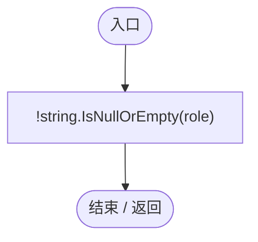

<a id="m5a34f2f3e7be36cd"></a>

## All.get · L26

`public static IEnumerable<AntColonyMember> All`


### Editor / Player · 语法控制结构 / 声明（非CFG）

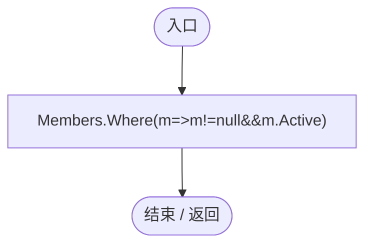

项目内调用/回调引用：

- [AntColonyMember.回调@26 · L26](baebd85c05598377.md#m0b3c9bc0f8d00b09)（回调/委托）

<a id="m0b3c9bc0f8d00b09"></a>

## 回调@26 · L26

`m … => 回调`


### Editor / Player · 语法控制结构 / 声明（非CFG）


<a id="mc8282e8cc823ceeb"></a>

## State.get · L27

`get`


### Editor / Player · 语法控制结构 / 声明（非CFG）

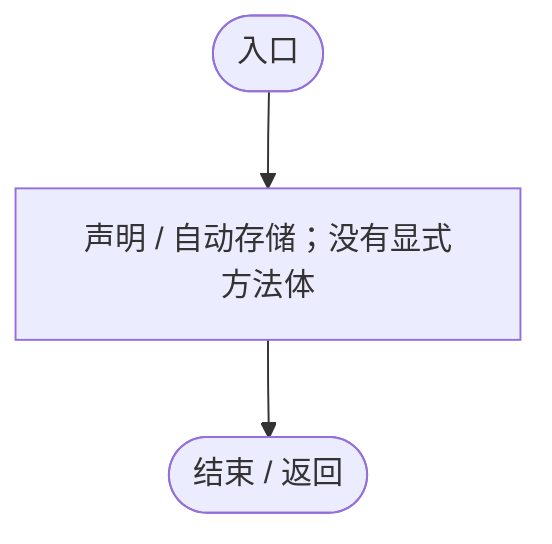

<a id="m2371536928e8242d"></a>

## State.set · L27

`private set`


### Editor / Player · 语法控制结构 / 声明（非CFG）


<a id="m3b8445af6c82650a"></a>

## Genes.get · L28

`get`


### Editor / Player · 语法控制结构 / 声明（非CFG）


<a id="m845feb5ab59d15bb"></a>

## Genes.set · L28

`private set`


### Editor / Player · 语法控制结构 / 声明（非CFG）


<a id="m4a0664814e72f13c"></a>

## Entity.get · L29

`get`


### Editor / Player · 语法控制结构 / 声明（非CFG）


<a id="m31c091a791aa6b82"></a>

## Entity.set · L29

`private set`


### Editor / Player · 语法控制结构 / 声明（非CFG）


<a id="m688c2c0dfb5a66d6"></a>

## Population.get · L30

`get`


### Editor / Player · 语法控制结构 / 声明（非CFG）


<a id="m16aa78fc3d68fa9a"></a>

## Population.set · L30

`private set`


### Editor / Player · 语法控制结构 / 声明（非CFG）


<a id="mdf6df89f7116c7a3"></a>

## Role.get · L33

`get`


### Editor / Player · Roslyn编译器控制流

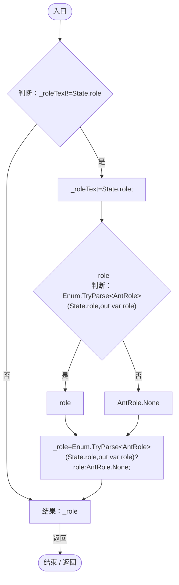

项目内调用/回调引用：

- [AntColonyMember.State.get · L27](baebd85c05598377.md#mc8282e8cc823ceeb)（访问器）

<a id="mf6337f1a7e4c8fd4"></a>

## Active.get · L34

`public bool Active`


### Editor / Player · 语法控制结构 / 声明（非CFG）

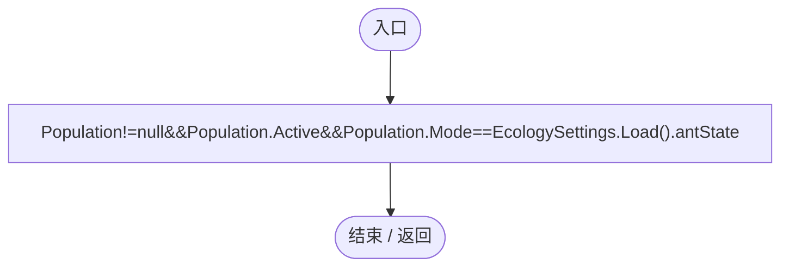

项目内调用/回调引用：

- [AntColonyMember.Population.get · L30](baebd85c05598377.md#m688c2c0dfb5a66d6)（访问器）
- [EcologySettings.Load · L18](90428a275d065ef6.md#mb0575490373edaf2)（方法）

<a id="m85ffde5227c8a685"></a>

## Young.get · L35

`public bool Young`


### Editor / Player · 语法控制结构 / 声明（非CFG）

```mermaid
flowchart TD
  n2(["入口"])
  n1["Genes.CurrentAge==AgeState.Infant&#124;&#124;GetComponent&lt;EggIncubation&gt;()?.Incubating==true"]
  n0(["结束 / 返回"])
  n1 --> n0
  n2 --> n1

```

项目内调用/回调引用：

- [EntityGeneController.CurrentAge.get · L34](7494d53178552f0e.md#m83a42c16950b22a4)（访问器）
- [AntColonyMember.Genes.get · L28](baebd85c05598377.md#m3b8445af6c82650a)（访问器）

<a id="m63284a8c785fcd9d"></a>

## GroupId.get · L36

`public string GroupId`


### Editor / Player · 语法控制结构 / 声明（非CFG）

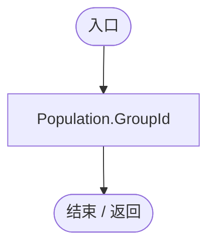

项目内调用/回调引用：

- [PopulationBehavior.GroupId.get · L20](21e4f62f75a9a80f.md#m5145936fa914ba8c)（访问器）
- [AntColonyMember.Population.get · L30](baebd85c05598377.md#m688c2c0dfb5a66d6)（访问器）

<a id="m43541f4b3109d901"></a>

## Id.get · L37

`public string Id`


### Editor / Player · 语法控制结构 / 声明（非CFG）

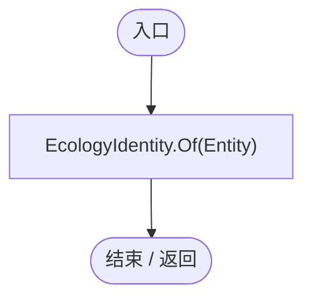

项目内调用/回调引用：

- [EcologyIdentity.Of · L21](bdf7ccc2c9c0452f.md#m1143cf9570a93b72)（方法）
- [AntColonyMember.Entity.get · L29](baebd85c05598377.md#m4a0664814e72f13c)（访问器）

<a id="m9498fbfb3f70c931"></a>

## Group.get · L38

`public IEnumerable<AntColonyMember> Group`


### Editor / Player · 语法控制结构 / 声明（非CFG）

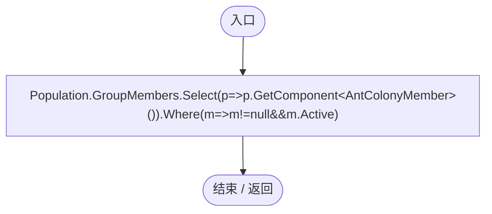

项目内调用/回调引用：

- [AntColonyMember.Population.get · L30](baebd85c05598377.md#m688c2c0dfb5a66d6)（访问器）
- [AntColonyMember.回调@38 · L38](baebd85c05598377.md#m26dac75b188bc43b)（回调/委托）
- [AntColonyMember.回调@38 · L38](baebd85c05598377.md#m8bf066d5b647b5b2)（回调/委托）

<a id="m26dac75b188bc43b"></a>

## 回调@38 · L38

`p … => 回调`


### Editor / Player · 语法控制结构 / 声明（非CFG）

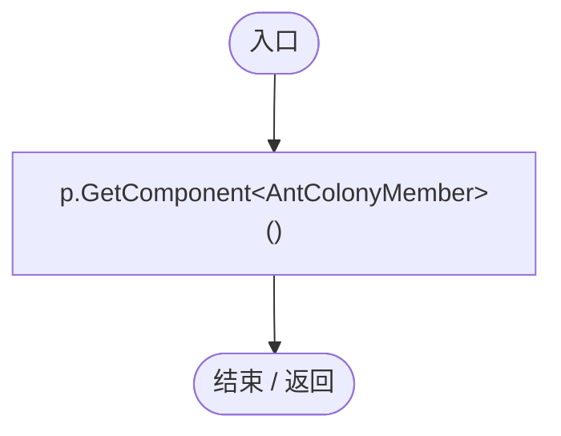

<a id="m8bf066d5b647b5b2"></a>

## 回调@38 · L38

`m … => 回调`


### Editor / Player · 语法控制结构 / 声明（非CFG）

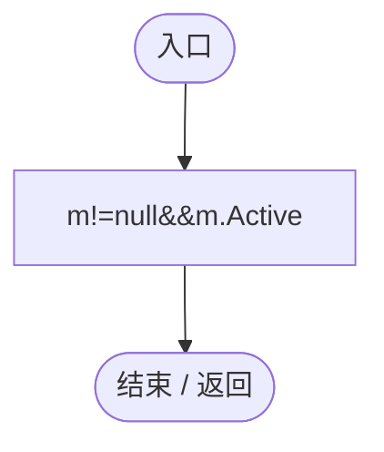

<a id="m91ccb4a7a7d6c4a5"></a>

## Queen.get · L39

`public AntColonyMember Queen`


### Editor / Player · 语法控制结构 / 声明（非CFG）

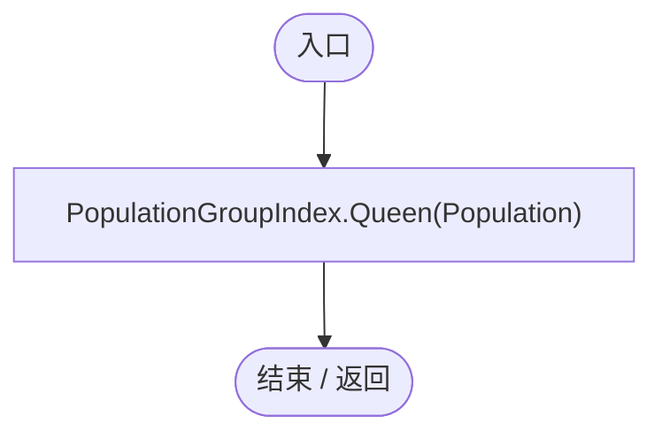

项目内调用/回调引用：

- [PopulationGroupIndex.Queen · L46](6bb343d8be5beae5.md#m083b5efa3064e08c)（方法）
- [AntColonyMember.Population.get · L30](baebd85c05598377.md#m688c2c0dfb5a66d6)（访问器）

<a id="m0295e0f1ea7ab95c"></a>

## Center.get · L40

`get`


### Editor / Player · Roslyn编译器控制流

```mermaid
flowchart TD
  b0(["入口"])
  b1["queen=Queen"]
  b2{"判断：queen!=null"}
  b3["queen.transform.position"]
  b4["transform.position"]
  b5["结果：queen!=null?queen.transform.position:transform.position"]
  b6(["结束 / 返回"])
  b0 --> b1
  b1 --> b2
  b2 -->|"是"| b3
  b2 -->|"否"| b4
  b3 --> b5
  b4 --> b5
  b5 -->|"返回"| b6

```

<a id="mdd2c60a2f9fa3b69"></a>

## Radius.get · L41

`public float Radius`


### Editor / Player · 语法控制结构 / 声明（非CFG）

```mermaid
flowchart TD
  n2(["入口"])
  n1["Mathf.Max(AntColonySettings.Current.minimumColonyRadius,Genes.GetAttribute(&quot;territory_radius&quot;),AntColonySettings.Current.colonyRadius)*DarwinPark.Core.GameplayTuning.Current.colonyActivityRadiusMultiplier"]
  n0(["结束 / 返回"])
  n1 --> n0
  n2 --> n1

```

项目内调用/回调引用：

- [AntColonySettings.Current.get · L31](cb0a937e97c8fbb3.md#mcd121159f407ccdf)（访问器）
- [EntityGeneController.GetAttribute · L257](7494d53178552f0e.md#m600509f72d274f0c)（方法）
- [AntColonyMember.Genes.get · L28](baebd85c05598377.md#m3b8445af6c82650a)（访问器）
- [GameplayTuning.Current.get · L21](db546e5713b32d53.md#m1caba89e7704d239)（访问器）

<a id="m408582551b894b39"></a>

## Frozen.get · L42

`public bool Frozen`


### Editor / Player · 语法控制结构 / 声明（非CFG）

```mermaid
flowchart TD
  n2(["入口"])
  n1["Active&amp;&amp;Role!=AntRole.None&amp;&amp;AntColonySettings.Current.Rule(Role).frozenGenome"]
  n0(["结束 / 返回"])
  n1 --> n0
  n2 --> n1

```

项目内调用/回调引用：

- [AntColonyMember.Role.get · L33](baebd85c05598377.md#mdf6df89f7116c7a3)（访问器）
- [AntColonySettings.Rule · L56](cb0a937e97c8fbb3.md#m46f80f7628c118a8)（方法）
- [AntColonySettings.Current.get · L31](cb0a937e97c8fbb3.md#mcd121159f407ccdf)（访问器）

<a id="m033aa4a066e4fd8c"></a>

## Activity.get · L43

`get`


### Editor / Player · 语法控制结构 / 声明（非CFG）

```mermaid
flowchart TD
  n2(["入口"])
  n1["声明 / 自动存储；没有显式方法体"]
  n0(["结束 / 返回"])
  n1 --> n0
  n2 --> n1

```

<a id="m8a34eff66ccac9e4"></a>

## Activity.set · L43

`internal set`


### Editor / Player · 语法控制结构 / 声明（非CFG）

```mermaid
flowchart TD
  n2(["入口"])
  n1["声明 / 自动存储；没有显式方法体"]
  n0(["结束 / 返回"])
  n1 --> n0
  n2 --> n1

```

<a id="m31ea742f55f43af2"></a>

## Awake · L47

`private void Awake()`


### Editor / Player · Roslyn编译器控制流

```mermaid
flowchart TD
  b0(["入口"])
  b1["Genes=GetComponent&lt;EntityGeneController&gt;();<br/>Entity=GetComponent&lt;DarwinEntity&gt;();<br/>Population=GetComponent&lt;PopulationBehavior&gt;();"]
  b2(["结束 / 返回"])
  b0 --> b1
  b1 --> b2

```

项目内调用/回调引用：

- [AntColonyMember.Genes.set · L28](baebd85c05598377.md#m845feb5ab59d15bb)（访问器）
- [AntColonyMember.Entity.set · L29](baebd85c05598377.md#m31c091a791aa6b82)（访问器）
- [AntColonyMember.Population.set · L30](baebd85c05598377.md#m16aa78fc3d68fa9a)（访问器）

<a id="mc7655d8e19d3e04d"></a>

## OnEnable · L48

`private void OnEnable()`


### Editor / Player · Roslyn编译器控制流

```mermaid
flowchart TD
  b0(["入口"])
  b1{"判断：Members.Contains(this)"}
  b2["Members.Add(this);"]
  b3(["结束 / 返回"])
  b0 --> b1
  b1 -->|"否"| b2
  b1 -->|"是"| b3
  b2 --> b3

```

<a id="m65dd8525b3b096a8"></a>

## OnDisable · L49

`private void OnDisable()`


### Editor / Player · Roslyn编译器控制流

```mermaid
flowchart TD
  b0(["入口"])
  b1["AntColonyWorker.Release(this);<br/>Members.Remove(this);"]
  b2(["结束 / 返回"])
  b0 --> b1
  b1 --> b2

```

项目内调用/回调引用：

- [AntColonyWorker.Release · L125](8a0cca2020271b6f.md#m1d9a49a310c2b22d)（方法）

<a id="m4b22635645be4a1c"></a>

## Reset · L50

`[RuntimeInitializeOnLoadMethod(RuntimeInitializeLoadType.SubsystemRegistration)] private static void Reset()`


### Editor / Player · Roslyn编译器控制流

```mermaid
flowchart TD
  b0(["入口"])
  b1["Members.Clear()"]
  b2(["结束 / 返回"])
  b0 --> b1
  b1 --> b2

```

<a id="m408f716118716988"></a>

## Ensure · L51

`public static AntColonyMember Ensure(PopulationBehavior pop)`


### Editor / Player · Roslyn编译器控制流

```mermaid
flowchart TD
  b0(["入口"])
  b1{"pop.GetComponent&lt;AntColonyMember&gt;()<br/>判断：pop.GetComponent&lt;AntColonyMember&gt;()"}
  b2["pop.GetComponent&lt;AntColonyMember&gt;()"]
  b3["pop.gameObject.AddComponent&lt;AntColonyMember&gt;()"]
  b4["结果：pop.GetComponent&lt;AntColonyMember&gt;()??pop.gameObject.AddComponent&lt;AntColonyMember&gt;()"]
  b5(["结束 / 返回"])
  b0 --> b1
  b1 -->|"否"| b2
  b1 -->|"是"| b3
  b2 --> b4
  b3 --> b4
  b4 -->|"返回"| b5

```

<a id="m43e694922d18a6a8"></a>

## QueenFor · L52

`public static AntColonyMember QueenFor(PopulationBehavior pop)`


### Editor / Player · Roslyn编译器控制流

```mermaid
flowchart TD
  b0(["入口"])
  b1{"pop.GetComponent&lt;AntColonyMember&gt;()<br/>判断：pop.GetComponent&lt;AntColonyMember&gt;()"}
  b2[".Queen"]
  b3["pop.GetComponent&lt;AntColonyMember&gt;()"]
  b4["结果：pop.GetComponent&lt;AntColonyMember&gt;()?.Queen"]
  b5(["结束 / 返回"])
  b0 --> b1
  b1 -->|"否"| b2
  b1 -->|"是"| b3
  b2 --> b4
  b3 --> b4
  b4 -->|"返回"| b5

```

<a id="m2762de72909d5da5"></a>

## IsManaged · L53

`public static bool IsManaged(EntityGeneController genes)`


### Editor / Player · Roslyn编译器控制流

```mermaid
flowchart TD
  b0(["入口"])
  b1{"判断：genes!=null"}
  b2{"genes.GetComponent&lt;AntColonyMember&gt;()<br/>判断：genes.GetComponent&lt;AntColonyMember&gt;()"}
  b3[".Active"]
  b4["genes.GetComponent&lt;AntColonyMember&gt;()"]
  b5["genes.GetComponent&lt;AntColonyMember&gt;()?.Active==true"]
  b6["genes!=null"]
  b7["结果：genes!=null&amp;&amp;genes.GetComponent&lt;AntColonyMember&gt;()?.Active==true"]
  b8(["结束 / 返回"])
  b0 --> b1
  b1 -->|"是"| b2
  b1 -->|"否"| b6
  b2 -->|"否"| b3
  b2 -->|"是"| b4
  b3 --> b5
  b4 --> b5
  b5 --> b7
  b6 --> b7
  b7 -->|"返回"| b8

```

<a id="mda0fe308acecb8f2"></a>

## Assign · L54

`public void Assign(AntRole role,string group=null)`


### Editor / Player · Roslyn编译器控制流

```mermaid
flowchart TD
  b0(["入口"])
  b1{"判断：group!=null"}
  b2["Population.JoinColony(group,role==AntRole.Queen);"]
  b3["State.role=role.ToString();"]
  b4{"State.lockedGenome<br/>判断：AntColonySettings.Current.Rule(role).frozenGenome"}
  b5["JsonUtility.ToJson(Genes.Genome)"]
  b6["null"]
  b7["State.lockedGenome=AntColonySettings.Current.Rule(role).frozenGenome?JsonUtility.ToJson(Genes.Genome):null;"]
  b8{"PopulationGroupIndex.Invalidate();<br/>Genes.IsGestating=false;<br/>_suppressionRole=null;<br/>Genes.Recalculate();<br/>判断：GetComponent&lt;ColonyMemberMarker&gt;()==null"}
  b9["gameObject.AddComponent&lt;ColonyMemberMarker&gt;();"]
  b10{"判断：role==AntRole.Queen"}
  b11["EnsureSupplyPoints();"]
  b12(["结束 / 返回"])
  b0 --> b1
  b1 -->|"是"| b2
  b1 -->|"否"| b3
  b2 --> b3
  b3 --> b4
  b4 -->|"是"| b5
  b4 -->|"否"| b6
  b5 --> b7
  b6 --> b7
  b7 --> b8
  b8 -->|"是"| b9
  b8 -->|"否"| b10
  b9 --> b10
  b10 -->|"是"| b11
  b10 -->|"否"| b12
  b11 --> b12

```

项目内调用/回调引用：

- [PopulationBehavior.JoinColony · L121](21e4f62f75a9a80f.md#mf185963e98c1e28c)（方法）
- [AntColonyMember.Population.get · L30](baebd85c05598377.md#m688c2c0dfb5a66d6)（访问器）
- [AntColonyMember.State.get · L27](baebd85c05598377.md#mc8282e8cc823ceeb)（访问器）
- [AntColonySettings.Rule · L56](cb0a937e97c8fbb3.md#m46f80f7628c118a8)（方法）
- [AntColonySettings.Current.get · L31](cb0a937e97c8fbb3.md#mcd121159f407ccdf)（访问器）
- [AntColonyMember.Genes.get · L28](baebd85c05598377.md#m3b8445af6c82650a)（访问器）
- [PopulationGroupIndex.Invalidate · L20](6bb343d8be5beae5.md#m5e79b5692d858f7a)（方法）
- [EntityGeneController.Recalculate · L97](7494d53178552f0e.md#m65ea735c1e0e37a1)（方法）
- [AntColonyMember.EnsureSupplyPoints · L157](baebd85c05598377.md#meac391c25479ba7e)（方法）

<a id="m367e6d3ae7db07f4"></a>

## OnBirth · L63

`public static void OnBirth(EntityGeneController parent,DarwinEntity child)`


### Editor / Player · Roslyn编译器控制流

```mermaid
flowchart TD
  b0(["入口"])
  b1{"source=parent.GetComponent&lt;AntColonyMember&gt;()<br/>判断：source==null"}
  b2{"判断：source.Active"}
  b3{"判断：child==null"}
  b4{"pop=child.GetComponent&lt;PopulationBehavior&gt;()<br/>判断：pop==null"}
  b5["member=Ensure(pop)<br/>member.Assign(source.ChooseBirthRole(),source.GroupId);"]
  b6(["结束 / 返回"])
  b0 --> b1
  b1 -->|"否"| b2
  b1 -->|"是"| b6
  b2 -->|"是"| b3
  b2 -->|"否"| b6
  b3 -->|"是"| b6
  b3 -->|"否"| b4
  b4 -->|"是"| b6
  b4 -->|"否"| b5
  b5 --> b6

```

项目内调用/回调引用：

- [AntColonyMember.Ensure · L51](baebd85c05598377.md#m408f716118716988)（方法）
- [AntColonyMember.Assign · L54](baebd85c05598377.md#mda0fe308acecb8f2)（方法）
- [AntColonyMember.ChooseBirthRole · L69](baebd85c05598377.md#m3618c1ed13989a8d)（方法）

<a id="m3618c1ed13989a8d"></a>

## ChooseBirthRole · L69

`public AntRole ChooseBirthRole()`


### Editor / Player · Roslyn编译器控制流

```mermaid
flowchart TD
  b0(["入口"])
  b1{"settings=AntColonySettings.Current<br/>判断：Group.Count()&gt;=settings.reproductivePopulationThreshold"}
  b2{"判断：Group.Count(m=&gt;m.Role==AntRole.Reproductive)&lt;settings.minimumReproductives"}
  b3["结果：AntRole.Reproductive"]
  b4["choices=settings.roles.Where(r=&gt;r.birthWeight&gt;0&amp;&amp;(r.Role!=AntRole.Reproductive&#124;&#124;Group.Count(m=&gt;m.Role==AntRole.Reproductive)&lt;settings.maximumReproductives)).ToArray()<br/>roll=UnityEngine.Random.value*choices.Sum(r=&gt;r.birthWeight)"]
  b5["choices"]
  b6{"判断：choices"}
  b7{"var<br/>roll-=rule.birthWeight;<br/>判断：roll&lt;=0"}
  b8["结果：rule.Role"]
  b9{"choices<br/>判断：choices"}
  b10["choices"]
  b11["连接 / 离开区域"]
  b12["结果：choices[choices.Length-1].Role"]
  b13(["结束 / 返回"])
  b0 --> b1
  b1 -->|"是"| b2
  b1 -->|"否"| b4
  b2 -->|"是"| b3
  b2 -->|"否"| b4
  b3 -->|"返回"| b13
  b4 --> b5
  b5 --> b6
  b6 -->|"是"| b7
  b6 -->|"否 · 经过finally 9"| b12
  b7 -->|"是"| b8
  b7 -->|"否"| b6
  b8 -->|"返回 · 经过finally 9"| b13
  b9 -->|"否"| b10
  b9 -->|"是"| b11
  b10 --> b11
  b12 -->|"返回"| b13
  b6 -. "退出保护区时 finally（示意）" .-> b9

```

项目内调用/回调引用：

- [AntColonySettings.Current.get · L31](cb0a937e97c8fbb3.md#mcd121159f407ccdf)（访问器）
- [AntColonyMember.回调@72 · L72](baebd85c05598377.md#m3a3aebc9545b021e)（回调/委托）
- [AntColonyMember.回调@73 · L73](baebd85c05598377.md#m981ae924f931f4de)（回调/委托）
- [AntColonyMember.回调@74 · L74](baebd85c05598377.md#me3b3ddf7c2241380)（回调/委托）

<a id="m3a3aebc9545b021e"></a>

## 回调@72 · L72

`m … => 回调`


### Editor / Player · Roslyn编译器控制流

```mermaid
flowchart TD
  b0(["入口"])
  b1["结果：m.Role==AntRole.Reproductive"]
  b2(["结束 / 返回"])
  b0 --> b1
  b1 -->|"返回"| b2

```

项目内调用/回调引用：

- [AntColonyMember.Role.get · L33](baebd85c05598377.md#mdf6df89f7116c7a3)（访问器）

<a id="m981ae924f931f4de"></a>

## 回调@73 · L73

`r … => 回调`


### Editor / Player · Roslyn编译器控制流

```mermaid
flowchart TD
  b0(["入口"])
  b1{"判断：r.birthWeight&gt;0"}
  b2{"判断：r.Role!=AntRole.Reproductive"}
  b3["Group.Count(m=&gt;m.Role==AntRole.Reproductive)&lt;settings.maximumReproductives"]
  b4["r.Role!=AntRole.Reproductive"]
  b5["r.birthWeight&gt;0"]
  b6["结果：r.birthWeight&gt;0&amp;&amp;(r.Role!=AntRole.Reproductive&#124;&#124;Group.Count(m=&gt;m.Role==AntRole.Reproductive)&lt;settings.maximumReproductives)"]
  b7(["结束 / 返回"])
  b0 --> b1
  b1 -->|"是"| b2
  b1 -->|"否"| b5
  b2 -->|"否"| b3
  b2 -->|"是"| b4
  b3 --> b6
  b4 --> b6
  b5 --> b6
  b6 -->|"返回"| b7

```

项目内调用/回调引用：

- [AntColonyMember.回调@73 · L73](baebd85c05598377.md#m38e0391a6838247b)（回调/委托）

<a id="m38e0391a6838247b"></a>

## 回调@73 · L73

`m … => 回调`


### Editor / Player · Roslyn编译器控制流

```mermaid
flowchart TD
  b0(["入口"])
  b1["结果：m.Role==AntRole.Reproductive"]
  b2(["结束 / 返回"])
  b0 --> b1
  b1 -->|"返回"| b2

```

项目内调用/回调引用：

- [AntColonyMember.Role.get · L33](baebd85c05598377.md#mdf6df89f7116c7a3)（访问器）

<a id="me3b3ddf7c2241380"></a>

## 回调@74 · L74

`r … => 回调`


### Editor / Player · Roslyn编译器控制流

```mermaid
flowchart TD
  b0(["入口"])
  b1["结果：r.birthWeight"]
  b2(["结束 / 返回"])
  b0 --> b1
  b1 -->|"返回"| b2

```

<a id="m29cff578dd85ff16"></a>

## Advance · L77

`public void Advance(float dt)`


### Editor / Player · Roslyn编译器控制流

```mermaid
flowchart TD
  b0(["入口"])
  b1{"判断：Active"}
  b2{"判断：dt&lt;=0"}
  b3{"判断：Role==AntRole.None"}
  b4{"Assign<br/>判断：Population.LeaderFlag"}
  b5["AntRole.Queen"]
  b6["ChooseBirthRole()"]
  b7["Assign(Population.LeaderFlag?AntRole.Queen:ChooseBirthRole());"]
  b8["State.scan-=dt;<br/>State.reproductionCooldown=Mathf.Max(0,State.reproductionCooldown-dt);<br/>ColonyResource.Feed(this,dt);"]
  b9{"GetComponent&lt;EggIncubation&gt;()<br/>判断：GetComponent&lt;EggIncubation&gt;()"}
  b10[".Incubating"]
  b11["GetComponent&lt;EggIncubation&gt;()"]
  b12{"判断：GetComponent&lt;EggIncubation&gt;()?.Incubating==true"}
  b13{"判断：Young"}
  b14["Activity=ColonyActivity.Young;"]
  b15{"判断：Role==AntRole.Reproductive"}
  b16["BeginFounding();"]
  b17{"判断：State.founding"}
  b18{"Activity=ColonyActivity.Founding;<br/>判断：EcologyQueries.Distance(transform.position,EcologyQueries.ToWorld(State.foundingPoint))&lt;=AntColonySettings.Current.arrivalDistance"}
  b19["State.founding=false;<br/>EnsureSupplyPoints();"]
  b20{"GetComponent&lt;TerritoryBehavior&gt;()<br/>判断：GetComponent&lt;TerritoryBehavior&gt;()"}
  b21["GetComponent&lt;TerritoryBehavior&gt;()?.Restore(EcologyQueries.ToLocal(transform.position),true,0,Vector3.zero);"]
  b22{"判断：Role==AntRole.Queen"}
  b23["Activity=ColonyActivity.Reproduce;<br/>AntColonyReproduction.Advance(this,dt);"]
  b24{"判断：Role==AntRole.Worker"}
  b25["AntColonyWorker.Advance(this,dt);"]
  b26{"判断：Role==AntRole.Mate"}
  b27["Activity=ColonyActivity.Mate;"]
  b28["AdvanceSoldier(dt);"]
  b29(["结束 / 返回"])
  b0 --> b1
  b1 -->|"是"| b2
  b1 -->|"否"| b29
  b2 -->|"是"| b29
  b2 -->|"否"| b3
  b3 -->|"是"| b4
  b3 -->|"否"| b8
  b4 -->|"是"| b5
  b4 -->|"否"| b6
  b5 --> b7
  b6 --> b7
  b7 --> b8
  b8 --> b9
  b9 -->|"否"| b10
  b9 -->|"是"| b11
  b10 --> b12
  b11 --> b12
  b12 -->|"是"| b29
  b12 -->|"否"| b13
  b13 -->|"是"| b14
  b13 -->|"否"| b15
  b14 --> b29
  b15 -->|"是"| b16
  b15 -->|"否"| b17
  b16 --> b29
  b17 -->|"是"| b18
  b17 -->|"否"| b22
  b18 -->|"是"| b19
  b18 -->|"否"| b29
  b19 --> b20
  b20 -->|"否"| b21
  b20 -->|"是"| b29
  b21 --> b29
  b22 -->|"是"| b23
  b22 -->|"否"| b24
  b23 --> b29
  b24 -->|"是"| b25
  b24 -->|"否"| b26
  b25 --> b29
  b26 -->|"是"| b27
  b26 -->|"否"| b28
  b27 --> b29
  b28 --> b29

```

项目内调用/回调引用：

- [AntColonyMember.Role.get · L33](baebd85c05598377.md#mdf6df89f7116c7a3)（访问器）
- [AntColonyMember.Assign · L54](baebd85c05598377.md#mda0fe308acecb8f2)（方法）
- [PopulationBehavior.LeaderFlag.get · L22](21e4f62f75a9a80f.md#m381bf45ebdf091a9)（访问器）
- [AntColonyMember.Population.get · L30](baebd85c05598377.md#m688c2c0dfb5a66d6)（访问器）
- [AntColonyMember.ChooseBirthRole · L69](baebd85c05598377.md#m3618c1ed13989a8d)（方法）
- [AntColonyMember.State.get · L27](baebd85c05598377.md#mc8282e8cc823ceeb)（访问器）
- [ColonyResource.Feed · L85](293dbaecfff4b585.md#m1ed7b62042c6dda6)（方法）
- [AntColonyMember.Activity.set · L43](baebd85c05598377.md#m8a34eff66ccac9e4)（访问器）
- [AntColonyMember.BeginFounding · L98](baebd85c05598377.md#m34a7070e0f4f78e6)（方法）
- [EcologyQueries.Distance · L42](bdf7ccc2c9c0452f.md#mba9c3e3c95d0f2dd)（方法）
- [EcologyQueries.ToWorld · L40](bdf7ccc2c9c0452f.md#m320932c05ccecbf7)（方法）
- [AntColonySettings.Current.get · L31](cb0a937e97c8fbb3.md#mcd121159f407ccdf)（访问器）
- [AntColonyMember.EnsureSupplyPoints · L157](baebd85c05598377.md#meac391c25479ba7e)（方法）
- [TerritoryBehavior.Restore · L76](19d504dcdc8bc624.md#m46f7e3f781d6bee3)（方法）
- [EcologyQueries.ToLocal · L39](bdf7ccc2c9c0452f.md#m1a07639eacf3aa47)（方法）
- [AntColonyReproduction.Advance · L25](c22084eac4e522ed.md#mf3336413ca12a59b)（方法）
- [AntColonyWorker.Advance · L39](8a0cca2020271b6f.md#md5046cdbf7c74508)（方法）
- [AntColonyMember.AdvanceSoldier · L108](baebd85c05598377.md#mf21248664cc0ba3a)（方法）

<a id="m34a7070e0f4f78e6"></a>

## BeginFounding · L98

`private void BeginFounding()`


### Editor / Player · Roslyn编译器控制流

```mermaid
flowchart TD
  b0(["入口"])
  b1["parentGroup=GroupId<br/>center=Center<br/>up=EcologyQueries.Up(center)<br/>tangent=Vector3.ProjectOnPlane(UnityEngine.Random.onUnitSphere,up).normalized<br/>State.foundingPoint=EcologyQueries.ToLocal(EcologyQueries.Surface(center+tangent*Radius*AntColon…"]
  b2(["结束 / 返回"])
  b0 --> b1
  b1 --> b2

```

项目内调用/回调引用：

- [AntColonyMember.Center.get · L40](baebd85c05598377.md#m0295e0f1ea7ab95c)（访问器）
- [EcologyQueries.Up · L41](bdf7ccc2c9c0452f.md#maca7070196f125fd)（方法）
- [AntColonyMember.State.get · L27](baebd85c05598377.md#mc8282e8cc823ceeb)（访问器）
- [EcologyQueries.ToLocal · L39](bdf7ccc2c9c0452f.md#m1a07639eacf3aa47)（方法）
- [EcologyQueries.Surface · L47](bdf7ccc2c9c0452f.md#m2f1f6873ee5fc8df)（方法）
- [AntColonySettings.Current.get · L31](cb0a937e97c8fbb3.md#mcd121159f407ccdf)（访问器）
- [AntColonyMember.Assign · L54](baebd85c05598377.md#mda0fe308acecb8f2)（方法）
- [PopulationArchive.RecordFounding · L60](084e119b69cdd751.md#mf4687fa10ee7a98a)（方法）
- [AntColonyMember.Population.get · L30](baebd85c05598377.md#m688c2c0dfb5a66d6)（访问器）
- [AntColonyMember.Entity.get · L29](baebd85c05598377.md#m4a0664814e72f13c)（访问器）
- [AntColonyMember.Activity.set · L43](baebd85c05598377.md#m8a34eff66ccac9e4)（访问器）

<a id="mf21248664cc0ba3a"></a>

## AdvanceSoldier · L108

`private void AdvanceSoldier(float dt)`


### Editor / Player · Roslyn编译器控制流

```mermaid
flowchart TD
  b0(["入口"])
  b1{"判断：ColonyFeeding.Destination(this,out _)"}
  b2{"判断：EcologyQueries.Alive(HuntTarget)"}
  b3{"判断：EcologyMotion.CanHunt(Genes,HuntTarget)"}
  b4{"判断：EcologyMotion.Detectable(HuntTarget,transform.position,Genes.GetAttribute(&quot;senseRange&quot;),Entity)"}
  b5["HuntTarget=null;"]
  b6{"判断：State.scan&lt;=0"}
  b7["State.scan=AntColonySettings.Current.scanInterval;<br/>range=Genes.GetAttribute(&quot;senseRange&quot;)<br/>position=transform.position<br/>HuntTarget=EntityRegistry.All.Where(e=&gt;e!=Entity&amp;&amp;(e.transform.position-position).sqrMagnitude&lt;=range*range&amp;&amp;EcologyQue…"]
  b8{"判断：HuntTarget!=null"}
  b9["Activity=ColonyActivity.Hunt;"]
  b10{"settings=AntColonySettings.Current<br/>判断：State.patrolRemaining&gt;0"}
  b11{"State.patrolRemaining=Mathf.Max(0,State.patrolRemaining-dt);<br/>circumference=2*Mathf.PI*ColonyActivityRange.PatrolCircle(this).Radius*settings.soldierPatrolRadiusRatio<br/>State.circleAngle+=360*Genes.GetAttribute(&quot;moveSpeed&quot;)*dt/Mathf.Max(set…"}
  b12["State.restRemaining=settings.soldierRestSeconds;"]
  b13{"State.restRemaining=Mathf.Max(0,State.restRemaining-dt);<br/>Activity=ColonyActivity.Rest;<br/>判断：State.restRemaining&lt;=0"}
  b14["State.patrolRemaining=settings.soldierPatrolSeconds;"]
  b15(["结束 / 返回"])
  b0 --> b1
  b1 -->|"是"| b15
  b1 -->|"否"| b2
  b2 -->|"是"| b3
  b2 -->|"否"| b5
  b3 -->|"是"| b4
  b3 -->|"否"| b5
  b4 -->|"否"| b5
  b4 -->|"是"| b6
  b5 --> b6
  b6 -->|"是"| b7
  b6 -->|"否"| b8
  b7 --> b8
  b8 -->|"是"| b9
  b8 -->|"否"| b10
  b9 --> b15
  b10 -->|"是"| b11
  b10 -->|"否"| b13
  b11 -->|"是"| b12
  b11 -->|"否"| b15
  b12 --> b15
  b13 -->|"是"| b14
  b13 -->|"否"| b15
  b14 --> b15

```

项目内调用/回调引用：

- [ColonyFeeding.Destination · L41](2cb56c08d08ff8ec.md#m9eaa68b3dda17a5d)（方法）
- [EcologyQueries.Alive · L38](bdf7ccc2c9c0452f.md#mb2877c487f449970)（方法）
- [EcologyMotion.CanHunt · L38](6ed9d0eedb456d32.md#m4271864b37a65a94)（方法）
- [AntColonyMember.Genes.get · L28](baebd85c05598377.md#m3b8445af6c82650a)（访问器）
- [EcologyMotion.Detectable · L61](6ed9d0eedb456d32.md#m24ba4bf4b1ca5c20)（方法）
- [EntityGeneController.GetAttribute · L257](7494d53178552f0e.md#m600509f72d274f0c)（方法）
- [AntColonyMember.Entity.get · L29](baebd85c05598377.md#m4a0664814e72f13c)（访问器）
- [AntColonyMember.State.get · L27](baebd85c05598377.md#mc8282e8cc823ceeb)（访问器）
- [AntColonySettings.Current.get · L31](cb0a937e97c8fbb3.md#mcd121159f407ccdf)（访问器）
- [AntColonyMember.Activity.set · L43](baebd85c05598377.md#m8a34eff66ccac9e4)（访问器）
- [ColonyActivityRange.PatrolCircle · L52](e8d854132f563257.md#mabe216cff487a9cd)（方法）
- [AntColonyMember.回调@118 · L118](baebd85c05598377.md#m4e838fb751cab2f4)（回调/委托）
- [AntColonyMember.回调@119 · L119](baebd85c05598377.md#m28c83643769f05ce)（回调/委托）

<a id="m4e838fb751cab2f4"></a>

## 回调@118 · L118

`e … => 回调`


### Editor / Player · Roslyn编译器控制流

```mermaid
flowchart TD
  b0(["入口"])
  b1{"判断：e!=Entity"}
  b2{"判断：(e.transform.position-position).sqrMagnitude&lt;=range*range"}
  b3{"判断：EcologyQueries.Alive(e)"}
  b4{"判断：EcologyMotion.CanHunt(Genes,e)"}
  b5["EcologyMotion.Detectable(e,position,range,Entity)"]
  b6["e!=Entity&amp;&amp;(e.transform.position-position).sqrMagnitude&lt;=range*range&amp;&amp;EcologyQueries.Alive(e)&amp;&amp;EcologyMotion.CanHunt(Genes,e)&amp;&amp;EcologyMotion.Detectable(e,position,range,Entity)"]
  b7["结果：e!=Entity&amp;&amp;(e.transform.position-position).sqrMagnitude&lt;=range*range&amp;&amp;EcologyQueries.Alive(e)&amp;&amp;EcologyMotion.CanHunt(Genes,e)&amp;&amp;EcologyMotion.Detectable(e,position,range,Entity)"]
  b8(["结束 / 返回"])
  b0 --> b1
  b1 -->|"是"| b2
  b1 -->|"否"| b6
  b2 -->|"是"| b3
  b2 -->|"否"| b6
  b3 -->|"是"| b4
  b3 -->|"否"| b6
  b4 -->|"是"| b5
  b4 -->|"否"| b6
  b5 --> b7
  b6 --> b7
  b7 -->|"返回"| b8

```

项目内调用/回调引用：

- [AntColonyMember.Entity.get · L29](baebd85c05598377.md#m4a0664814e72f13c)（访问器）
- [EcologyQueries.Alive · L38](bdf7ccc2c9c0452f.md#mb2877c487f449970)（方法）
- [EcologyMotion.CanHunt · L38](6ed9d0eedb456d32.md#m4271864b37a65a94)（方法）
- [AntColonyMember.Genes.get · L28](baebd85c05598377.md#m3b8445af6c82650a)（访问器）
- [EcologyMotion.Detectable · L61](6ed9d0eedb456d32.md#m24ba4bf4b1ca5c20)（方法）

<a id="m28c83643769f05ce"></a>

## 回调@119 · L119

`e … => 回调`


### Editor / Player · Roslyn编译器控制流

```mermaid
flowchart TD
  b0(["入口"])
  b1["结果：(e.transform.position-transform.position).sqrMagnitude"]
  b2(["结束 / 返回"])
  b0 --> b1
  b1 -->|"返回"| b2

```

<a id="m3e2bbeb3787f6e75"></a>

## AfterKill · L133

`public void AfterKill()`


### Editor / Player · Roslyn编译器控制流

```mermaid
flowchart TD
  b0(["入口"])
  b1["HuntTarget=null;<br/>State.scan=AntColonySettings.Current.soldierPatrolSeconds;<br/>State.patrolRemaining=AntColonySettings.Current.soldierPatrolSeconds;<br/>State.restRemaining=0;<br/>Activity=ColonyActivity.Patrol;"]
  b2(["结束 / 返回"])
  b0 --> b1
  b1 --> b2

```

项目内调用/回调引用：

- [AntColonyMember.State.get · L27](baebd85c05598377.md#mc8282e8cc823ceeb)（访问器）
- [AntColonySettings.Current.get · L31](cb0a937e97c8fbb3.md#mcd121159f407ccdf)（访问器）
- [AntColonyMember.Activity.set · L43](baebd85c05598377.md#m8a34eff66ccac9e4)（访问器）

<a id="m8fbd14b933818c86"></a>

## Destination · L134

`public bool Destination(out Vector3 point,out DarwinEntity target,out float multiplier)`


### Editor / Player · Roslyn编译器控制流

```mermaid
flowchart TD
  b0(["入口"])
  b1{"point=transform.position;<br/>target=null;<br/>multiplier=1;<br/>判断：Active"}
  b2{"判断：Role==AntRole.None"}
  b3["结果：false"]
  b4{"判断：State.founding"}
  b5["point=EcologyQueries.ToWorld(State.foundingPoint);<br/>结果：true"]
  b6{"判断：ColonyFeeding.Destination(this,out point)"}
  b7["结果：true"]
  b8{"判断：Young"}
  b9{"判断：Role==AntRole.Mate"}
  b10["point=ColonyFormation.Home(this,Center,AntColonySettings.Current.feedRadius*.8f);<br/>结果：true"]
  b11{"判断：Role==AntRole.Worker"}
  b12["point=AntColonyWorker.Destination(this);<br/>结果：true"]
  b13{"判断：Role==AntRole.Soldier"}
  b14{"判断：EcologyQueries.Alive(HuntTarget)"}
  b15["target=HuntTarget;<br/>point=target.transform.position;<br/>结果：true"]
  b16{"判断：Role==AntRole.Soldier"}
  b17{"判断：State.patrolRemaining&gt;0"}
  b18["circle=ColonyActivityRange.PatrolCircle(this)<br/>point=ColonyActivityRange.Boundary(circle,State.circleAngle,AntColonySettings.Current.soldierPatrolRadiusRatio);"]
  b19{"判断：Role==AntRole.Soldier"}
  b20["point=ColonyFormation.Home(this,Center,Radius*.75f);"]
  b21["结果：true"]
  b22(["结束 / 返回"])
  b0 --> b1
  b1 -->|"是"| b2
  b1 -->|"否"| b3
  b2 -->|"是"| b3
  b2 -->|"否"| b4
  b3 -->|"返回"| b22
  b4 -->|"是"| b5
  b4 -->|"否"| b6
  b5 -->|"返回"| b22
  b6 -->|"是"| b7
  b6 -->|"否"| b8
  b7 -->|"返回"| b22
  b8 -->|"否"| b9
  b8 -->|"是"| b10
  b9 -->|"是"| b10
  b9 -->|"否"| b11
  b10 -->|"返回"| b22
  b11 -->|"是"| b12
  b11 -->|"否"| b13
  b12 -->|"返回"| b22
  b13 -->|"是"| b14
  b13 -->|"否"| b16
  b14 -->|"是"| b15
  b14 -->|"否"| b16
  b15 -->|"返回"| b22
  b16 -->|"是"| b17
  b16 -->|"否"| b19
  b17 -->|"是"| b18
  b17 -->|"否"| b19
  b18 --> b21
  b19 -->|"是"| b20
  b19 -->|"否"| b21
  b20 --> b21
  b21 -->|"返回"| b22

```

项目内调用/回调引用：

- [AntColonyMember.Role.get · L33](baebd85c05598377.md#mdf6df89f7116c7a3)（访问器）
- [AntColonyMember.State.get · L27](baebd85c05598377.md#mc8282e8cc823ceeb)（访问器）
- [EcologyQueries.ToWorld · L40](bdf7ccc2c9c0452f.md#m320932c05ccecbf7)（方法）
- [ColonyFeeding.Destination · L41](2cb56c08d08ff8ec.md#m9eaa68b3dda17a5d)（方法）
- [ColonyFormation.Home · L36](c65dce2d54e43480.md#m79ad3420baeaf49d)（方法）
- [AntColonyMember.Center.get · L40](baebd85c05598377.md#m0295e0f1ea7ab95c)（访问器）
- [AntColonySettings.Current.get · L31](cb0a937e97c8fbb3.md#mcd121159f407ccdf)（访问器）
- [AntColonyWorker.Destination · L114](8a0cca2020271b6f.md#me3f1e96ebdd988f8)（方法）
- [EcologyQueries.Alive · L38](bdf7ccc2c9c0452f.md#mb2877c487f449970)（方法）
- [ColonyActivityRange.PatrolCircle · L52](e8d854132f563257.md#mabe216cff487a9cd)（方法）
- [ColonyActivityRange.Boundary · L38](e8d854132f563257.md#m46a418cd54a2ba04)（方法）

<a id="mbf75f9276ae4992f"></a>

## TrySupplyDestination · L153

`public bool TrySupplyDestination(out Vector3 point)`


### Editor / Player · Roslyn编译器控制流

```mermaid
flowchart TD
  b0(["入口"])
  b1["结果：ColonyFeeding.Destination(this,out point)"]
  b2(["结束 / 返回"])
  b0 --> b1
  b1 -->|"返回"| b2

```

项目内调用/回调引用：

- [ColonyFeeding.Destination · L41](2cb56c08d08ff8ec.md#m9eaa68b3dda17a5d)（方法）

<a id="meac391c25479ba7e"></a>

## EnsureSupplyPoints · L157

`public void EnsureSupplyPoints()`


### Editor / Player · Roslyn编译器控制流

```mermaid
flowchart TD
  b0(["入口"])
  b1["State.supplyPoints.Clear();"]
  b2["ColonyResource.All"]
  b3{"判断：ColonyResource.All"}
  b4{"var<br/>判断：resource.State.group==GroupId"}
  b5{"判断：resource.State.kind==ColonyResourceKind.Supply"}
  b6["State.supplyPoints.Add(EcologyQueries.ToLocal(resource.transform.position));"]
  b7{"判断：ColonyResource.All"}
  b8["ColonyResource.All"]
  b9["连接 / 离开区域"]
  b10(["结束 / 返回"])
  b0 --> b1
  b1 --> b2
  b2 --> b3
  b3 -->|"是"| b4
  b3 -->|"否 · 经过finally 7"| b10
  b4 -->|"是"| b5
  b4 -->|"否"| b3
  b5 -->|"是"| b6
  b5 -->|"否"| b3
  b6 --> b3
  b7 -->|"否"| b8
  b7 -->|"是"| b9
  b8 --> b9
  b3 -. "退出保护区时 finally（示意）" .-> b7

```

项目内调用/回调引用：

- [AntColonyMember.State.get · L27](baebd85c05598377.md#mc8282e8cc823ceeb)（访问器）
- [ColonyResource.State.get · L22](293dbaecfff4b585.md#m341a1355f4d657bf)（访问器）
- [EcologyQueries.ToLocal · L39](bdf7ccc2c9c0452f.md#m1a07639eacf3aa47)（方法）

<a id="ma2daf0035eecd332"></a>

## EnforceGenome · L164

`public void EnforceGenome()`


### Editor / Player · Roslyn编译器控制流

```mermaid
flowchart TD
  b0(["入口"])
  b1{"判断：Frozen"}
  b2{"判断：string.IsNullOrEmpty(State.lockedGenome)"}
  b3{"判断：JsonUtility.ToJson(Genes.Genome)!=State.lockedGenome"}
  b4["Genes.Genome=JsonUtility.FromJson&lt;Genome&gt;(State.lockedGenome);"]
  b5(["结束 / 返回"])
  b0 --> b1
  b1 -->|"是"| b2
  b1 -->|"否"| b5
  b2 -->|"否"| b3
  b2 -->|"是"| b5
  b3 -->|"是"| b4
  b3 -->|"否"| b5
  b4 --> b5

```

项目内调用/回调引用：

- [AntColonyMember.State.get · L27](baebd85c05598377.md#mc8282e8cc823ceeb)（访问器）
- [AntColonyMember.Genes.get · L28](baebd85c05598377.md#m3b8445af6c82650a)（访问器）

<a id="m0aa8c8b455df83cc"></a>

## ExpressionSuppression · L169

`public static IReadOnlyDictionary<string,float> ExpressionSuppression(EntityGeneController genes)`


### Editor / Player · Roslyn编译器控制流

```mermaid
flowchart TD
  b0(["入口"])
  b1{"member=genes.GetComponent&lt;AntColonyMember&gt;()<br/>判断：member==null"}
  b2{"判断：member.Active"}
  b3{"判断：member.Role==AntRole.None"}
  b4["结果：null"]
  b5{"判断：member._suppressionRole!=member.State.role"}
  b6["member._suppression.Clear();"]
  b7["AntColonySettings.Current.Rule(member.Role).suppressedGenes"]
  b8{"判断：AntColonySettings.Current.Rule(member.Role).suppressedGenes"}
  b9["var<br/>member._suppression[id]=AntColonySettings.Current.geneSuppression;"]
  b10{"AntColonySettings.Current.Rule(member.Role).suppressedGenes<br/>判断：AntColonySettings.Current.Rule(member.Role).suppressedGenes"}
  b11["AntColonySettings.Current.Rule(member.Role).suppressedGenes"]
  b12["连接 / 离开区域"]
  b13{"判断：member._suppression.ContainsKey(ParthenogenesisEvolutionUpgrade.SourceGeneId)"}
  b14["member._suppression[ParthenogenesisEvolutionUpgrade.GeneId]=AntColonySettings.Current.geneSuppression;"]
  b15["member._suppressionRole=member.State.role;"]
  b16["结果：member._suppression"]
  b17(["结束 / 返回"])
  b0 --> b1
  b1 -->|"否"| b2
  b1 -->|"是"| b4
  b2 -->|"是"| b3
  b2 -->|"否"| b4
  b3 -->|"是"| b4
  b3 -->|"否"| b5
  b4 -->|"返回"| b17
  b5 -->|"是"| b6
  b5 -->|"否"| b16
  b6 --> b7
  b7 --> b8
  b8 -->|"是"| b9
  b8 -->|"否 · 经过finally 10"| b13
  b9 --> b8
  b10 -->|"否"| b11
  b10 -->|"是"| b12
  b11 --> b12
  b13 -->|"是"| b14
  b13 -->|"否"| b15
  b14 --> b15
  b15 --> b16
  b16 -->|"返回"| b17
  b8 -. "退出保护区时 finally（示意）" .-> b10

```

项目内调用/回调引用：

- [AntColonyMember.Role.get · L33](baebd85c05598377.md#mdf6df89f7116c7a3)（访问器）
- [AntColonyMember.State.get · L27](baebd85c05598377.md#mc8282e8cc823ceeb)（访问器）
- [AntColonySettings.Rule · L56](cb0a937e97c8fbb3.md#m46f80f7628c118a8)（方法）
- [AntColonySettings.Current.get · L31](cb0a937e97c8fbb3.md#mcd121159f407ccdf)（访问器）

<a id="m7e05885740a44e0b"></a>

## Attribute · L181

`public static float Attribute(EntityGeneController genes,string id,float value)`


### Editor / Player · Roslyn编译器控制流

```mermaid
flowchart TD
  b0(["入口"])
  b1{"member=genes.GetComponent&lt;AntColonyMember&gt;()<br/>判断：member==null"}
  b2{"判断：member.Active"}
  b3{"判断：member.Role==AntRole.None"}
  b4["结果：value"]
  b5{"rule=AntColonySettings.Current.Rule(member.Role)<br/>判断：id==&quot;attack&quot;"}
  b6{"判断：member.Young"}
  b7["0"]
  b8["value*rule.attackMultiplier"]
  b9["结果：member.Young?0:value*rule.attackMultiplier"]
  b10{"判断：id==&quot;moveSpeed&quot;"}
  b11{"value<br/>判断：member.State.founding"}
  b12["1"]
  b13["rule.moveMultiplier"]
  b14["结果：value*(member.State.founding?1:rule.moveMultiplier)"]
  b15["结果：value"]
  b16(["结束 / 返回"])
  b0 --> b1
  b1 -->|"否"| b2
  b1 -->|"是"| b4
  b2 -->|"是"| b3
  b2 -->|"否"| b4
  b3 -->|"是"| b4
  b3 -->|"否"| b5
  b4 -->|"返回"| b16
  b5 -->|"是"| b6
  b5 -->|"否"| b10
  b6 -->|"是"| b7
  b6 -->|"否"| b8
  b7 --> b9
  b8 --> b9
  b9 -->|"返回"| b16
  b10 -->|"是"| b11
  b10 -->|"否"| b15
  b11 -->|"是"| b12
  b11 -->|"否"| b13
  b12 --> b14
  b13 --> b14
  b14 -->|"返回"| b16
  b15 -->|"返回"| b16

```

项目内调用/回调引用：

- [AntColonyMember.Role.get · L33](baebd85c05598377.md#mdf6df89f7116c7a3)（访问器）
- [AntColonySettings.Rule · L56](cb0a937e97c8fbb3.md#m46f80f7628c118a8)（方法）
- [AntColonySettings.Current.get · L31](cb0a937e97c8fbb3.md#mcd121159f407ccdf)（访问器）
- [AntColonyMember.State.get · L27](baebd85c05598377.md#mc8282e8cc823ceeb)（访问器）

<a id="mdfb4ace9299cbaf0"></a>

## Capture · L189

`public AntColonyMemberSave Capture()`


### Editor / Player · Roslyn编译器控制流

```mermaid
flowchart TD
  b0(["入口"])
  b1["结果：JsonUtility.FromJson&lt;AntColonyMemberSave&gt;(JsonUtility.ToJson(State))"]
  b2(["结束 / 返回"])
  b0 --> b1
  b1 -->|"返回"| b2

```

项目内调用/回调引用：

- [AntColonyMember.State.get · L27](baebd85c05598377.md#mc8282e8cc823ceeb)（访问器）

<a id="m0e44590a5c6aec92"></a>

## Suspend · L190

`public void Suspend()`


### Editor / Player · Roslyn编译器控制流

```mermaid
flowchart TD
  b0(["入口"])
  b1["AntColonyWorker.Release(this);<br/>HuntTarget=null;"]
  b2(["结束 / 返回"])
  b0 --> b1
  b1 --> b2

```

项目内调用/回调引用：

- [AntColonyWorker.Release · L125](8a0cca2020271b6f.md#m1d9a49a310c2b22d)（方法）

<a id="m7bfd664ed689f5c9"></a>

## Restore · L191

`public void Restore(AntColonyMemberSave state)`


### Editor / Player · Roslyn编译器控制流

```mermaid
flowchart TD
  b0(["入口"])
  b1{"判断：state==null"}
  b2{"判断：state.HasData"}
  b3["State=JsonUtility.FromJson&lt;AntColonyMemberSave&gt;(JsonUtility.ToJson(state));"]
  b4{"State.partnerGenome<br/>判断：State.partnerGenome"}
  b5[".Genes"]
  b6{"判断：.Genes"}
  b7[".Count"]
  b8["State.partnerGenome?.Genes?.Count"]
  b9{"判断：State.partnerGenome?.Genes?.Count==0"}
  b10["State.partnerGenome=null;"]
  b11{"_suppressionRole=null;<br/>PopulationGroupIndex.Invalidate();<br/>Genes.Recalculate();<br/>Population.EnsureMembership();<br/>判断：GetComponent&lt;ColonyMemberMarker&gt;()==null"}
  b12["gameObject.AddComponent&lt;ColonyMemberMarker&gt;();"]
  b13(["结束 / 返回"])
  b0 --> b1
  b1 -->|"否"| b2
  b1 -->|"是"| b13
  b2 -->|"否"| b13
  b2 -->|"是"| b3
  b3 --> b4
  b4 -->|"否"| b5
  b4 -->|"是"| b8
  b5 --> b6
  b6 -->|"否"| b7
  b6 -->|"是"| b8
  b7 --> b9
  b8 --> b9
  b9 -->|"是"| b10
  b9 -->|"否"| b11
  b10 --> b11
  b11 -->|"是"| b12
  b11 -->|"否"| b13
  b12 --> b13

```

项目内调用/回调引用：

- [AntColonyMember.State.set · L27](baebd85c05598377.md#m2371536928e8242d)（访问器）
- [AntColonyMember.State.get · L27](baebd85c05598377.md#mc8282e8cc823ceeb)（访问器）
- [PopulationGroupIndex.Invalidate · L20](6bb343d8be5beae5.md#m5e79b5692d858f7a)（方法）
- [EntityGeneController.Recalculate · L97](7494d53178552f0e.md#m65ea735c1e0e37a1)（方法）
- [AntColonyMember.Genes.get · L28](baebd85c05598377.md#m3b8445af6c82650a)（访问器）
- [PopulationBehavior.EnsureMembership · L107](21e4f62f75a9a80f.md#medb038b51f8cd8e6)（方法）
- [AntColonyMember.Population.get · L30](baebd85c05598377.md#m688c2c0dfb5a66d6)（访问器）
