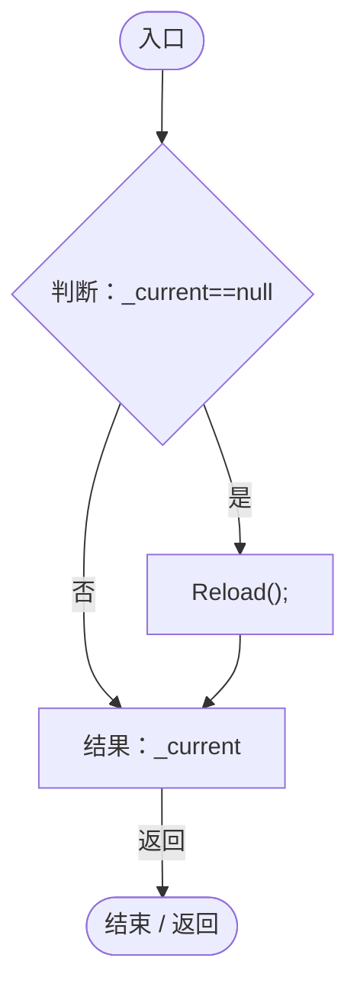
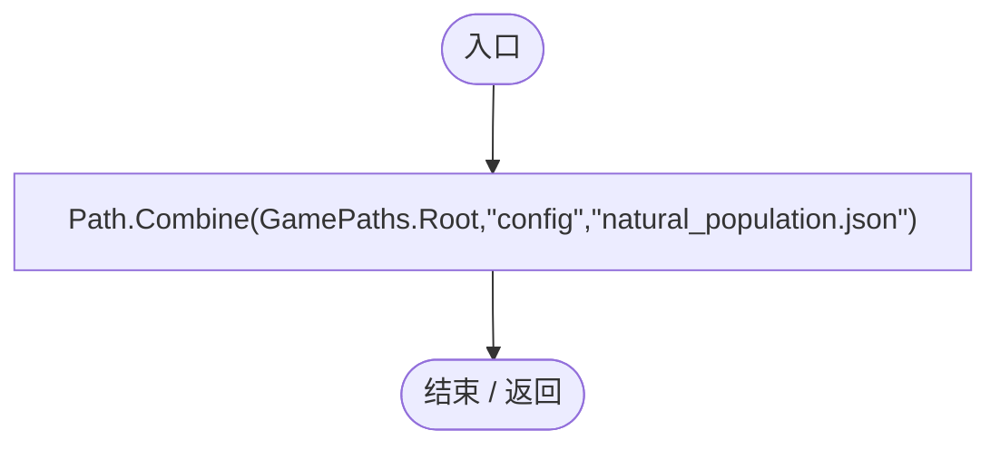
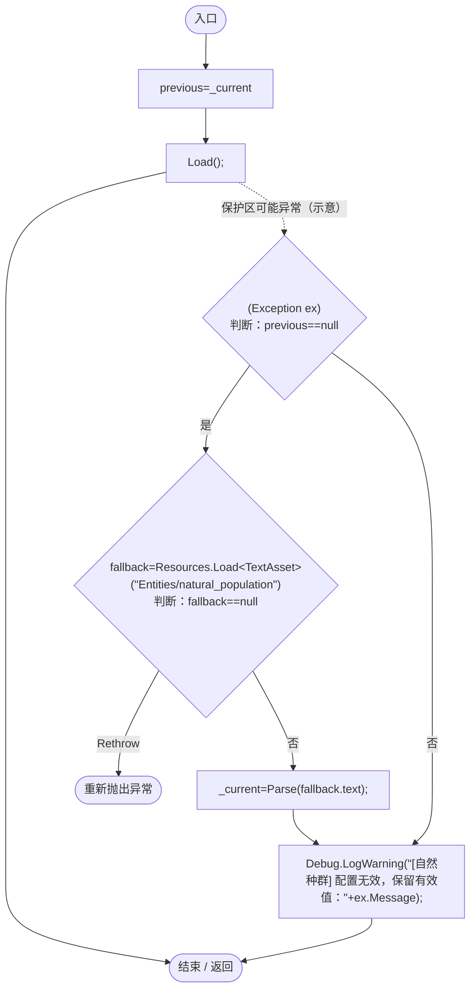
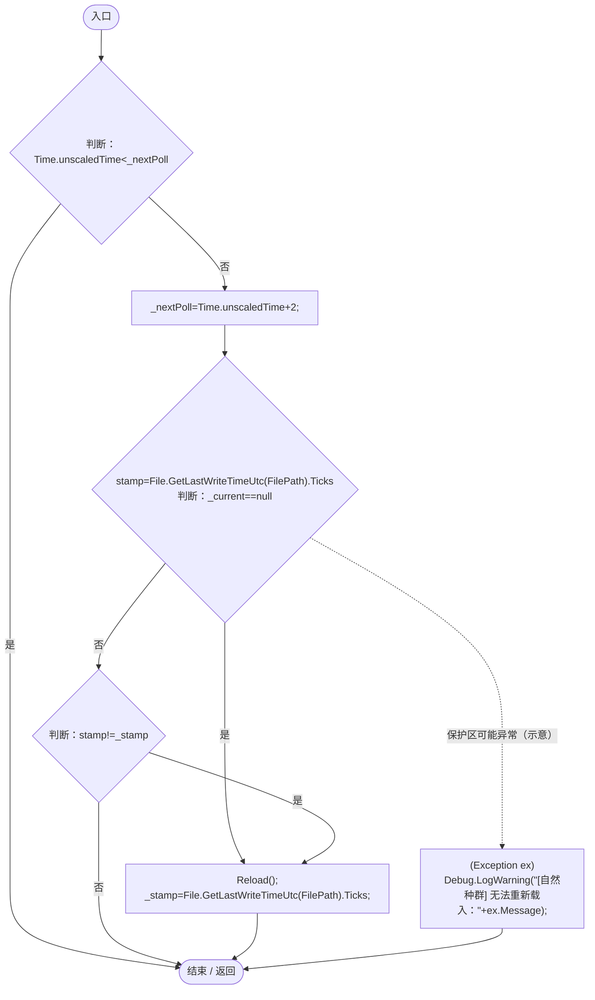
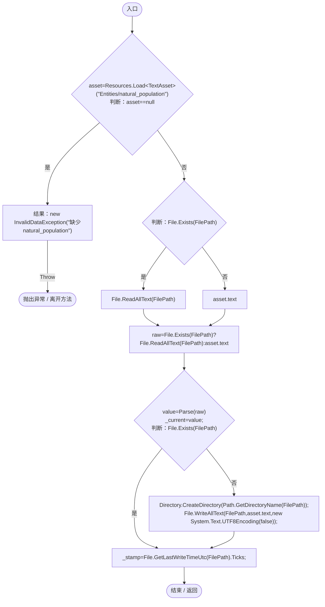
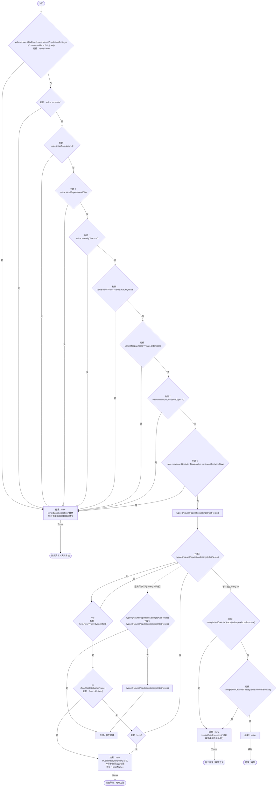
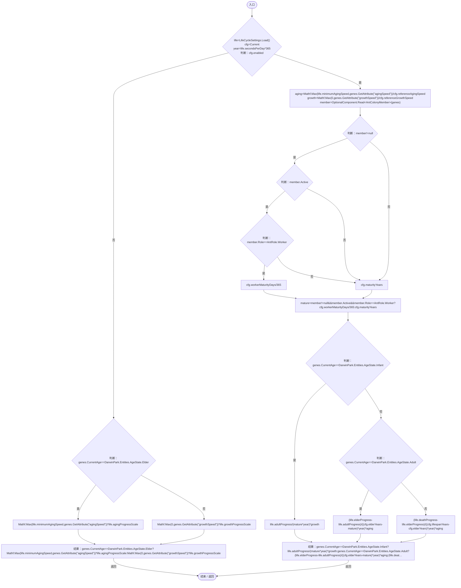
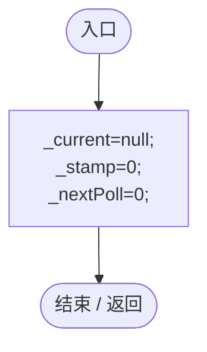

# NaturalPopulationPace.cs

[返回总索引](../README.md) · `Runtime` · `Assets/DarwinPark/Entities/Ecology/NaturalPopulationPace.cs`

[源文件](../../../Assets/DarwinPark/Entities/Ecology/NaturalPopulationPace.cs) · 源码校验：`98dd8d66725511e4b50fb3c1c82180b1c00bd849224fb0488d474f92d5660570`

方法按源文件位置排列。事件/回调引用不表示立即执行；分支与异常说明见总索引。完整源码与可点击关系图请打开离线手册。

## Current.get · L19

`get`

### Editor / Player · Roslyn编译器控制流

项目内调用/回调引用：

- [NaturalPopulationPace.Reload · L21](bb501fbca2e1b01f.md#m3287761d49aaa330)（方法）

## FilePath.get · L20

`public static string FilePath`

### Editor / Player · 语法控制结构 / 声明（非CFG）

## Reload · L21

`public static void Reload()`

### Editor / Player · Roslyn编译器控制流

项目内调用/回调引用：

- [NaturalPopulationPace.Load · L29](bb501fbca2e1b01f.md#mbeba1b6fbceaba64)（方法）
- [NaturalPopulationPace.Parse · L35](bb501fbca2e1b01f.md#mb550373dea39a9d7)（方法）

## Poll · L27

`public static void Poll()`

### Editor / Player · Roslyn编译器控制流

项目内调用/回调引用：

- [NaturalPopulationPace.Reload · L21](bb501fbca2e1b01f.md#m3287761d49aaa330)（方法）

## Load · L29

`private static void Load()`

### Editor / Player · Roslyn编译器控制流

项目内调用/回调引用：

- [NaturalPopulationPace.Parse · L35](bb501fbca2e1b01f.md#mb550373dea39a9d7)（方法）

## Parse · L35

`public static NaturalPopulationSettings Parse(string raw)`

### Editor / Player · Roslyn编译器控制流

项目内调用/回调引用：

- [CommentedJson.Strip · L9](f72593057d514ce3.md#mc9c02edd5a7f0a4d)（方法）

## LifeSpeed · L43

`public static float LifeSpeed(EntityGeneController genes)`

### Editor / Player · Roslyn编译器控制流

项目内调用/回调引用：

- [LifeCycleSettings.Load · L16](ace76969fe8f61de.md#m6fe263852e5a8989)（方法）
- [NaturalPopulationPace.Current.get · L19](bb501fbca2e1b01f.md#m902ff80ab222d2ce)（访问器）
- [EntityGeneController.CurrentAge.get · L39](7494d53178552f0e.md#m977f52932bb90600)（访问器）
- [EntityGeneController.GetAttribute · L288](7494d53178552f0e.md#m45127bcdd833aaf5)（方法）
- [OptionalComponent.Read · L7](806c46b42ced4d36.md#m69622a4dee165c5a)（方法）
- [AntColonyMember.Role.get · L40](baebd85c05598377.md#m382545c3d4092bf1)（访问器）

## Reset · L51

`[RuntimeInitializeOnLoadMethod(RuntimeInitializeLoadType.SubsystemRegistration)]private static void Reset()`

### Editor / Player · Roslyn编译器控制流

