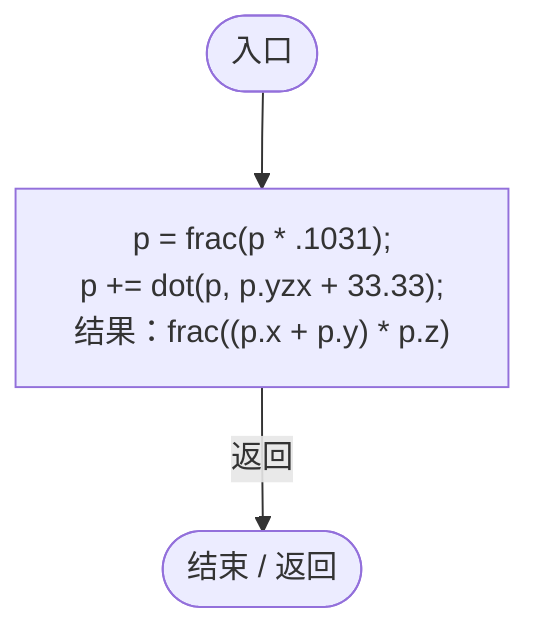
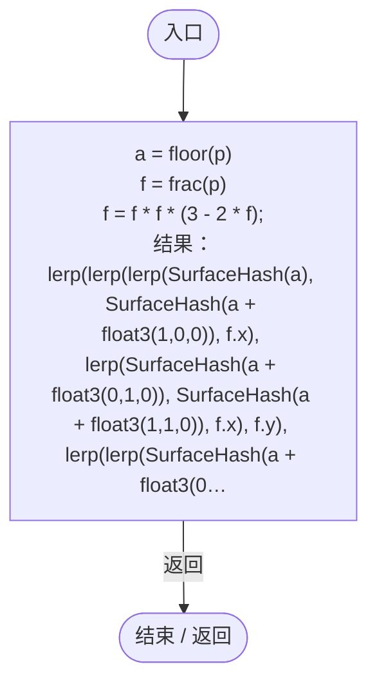
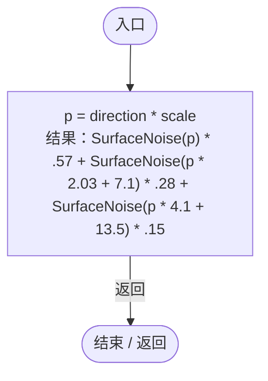

# PlanetSurfaceDetail.hlsl

[返回总索引](../README.md) · `GPU` · `Assets/DarwinPark/Planet/Terrain/PlanetSurfaceDetail.hlsl`

[源文件](../../../Assets/DarwinPark/Planet/Terrain/PlanetSurfaceDetail.hlsl) · 源码校验：`806ee13209c90077e1c36ba89780821e305d014400e076b87fec593a2f268f98`

方法按源文件位置排列。事件/回调引用不表示立即执行；分支与异常说明见总索引。完整源码与可点击关系图请打开离线手册。

## SurfaceHash · L4

`float SurfaceHash(float3 p)`

### GPU · GPU控制结构（名称链接，不作C#类型推断）

## SurfaceNoise · L10

`float SurfaceNoise(float3 p)`

### GPU · GPU控制结构（名称链接，不作C#类型推断）

项目内调用/回调引用：

- [PlanetSurfaceDetail.SurfaceHash · L4](bcbe3a3de96b1f72.md#m366638440cd34ebe)（GPU函数）

## SurfaceDetail · L19

`float SurfaceDetail(float3 direction, float scale)`

### GPU · GPU控制结构（名称链接，不作C#类型推断）

项目内调用/回调引用：

- [PlanetSurfaceDetail.SurfaceNoise · L10](bcbe3a3de96b1f72.md#m932c128f3b0b9f2e)（GPU函数）
