# EcologyIdentity.cs

[返回总索引](../README.md) · `Runtime` · `Assets/DarwinPark/Entities/Ecology/EcologyIdentity.cs`

[源文件](../../../Assets/DarwinPark/Entities/Ecology/EcologyIdentity.cs) · 源码校验：`6e20a484e56abcdef706dccca449900df1ef5a8f548b6d486cfeaad8d7161a64`

方法按源文件位置排列。事件/回调引用不表示立即执行；分支与异常说明见总索引。完整源码与可点击关系图请打开离线手册。

## Id.get · L14

`get`

### Editor / Player · 语法控制结构 / 声明（非CFG）

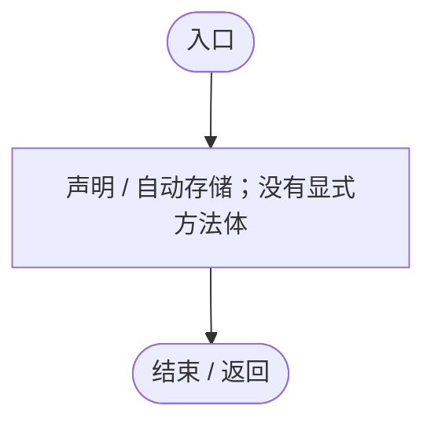

## Id.set · L14

`private set`

### Editor / Player · 语法控制结构 / 声明（非CFG）

## OnEnable · L15

`private void OnEnable()`

### Editor / Player · Roslyn编译器控制流

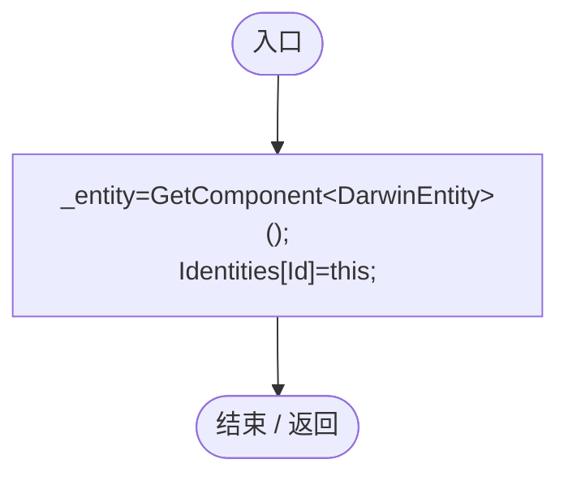

项目内调用/回调引用：

- [EcologyIdentity.Id.get · L14](bdf7ccc2c9c0452f.md#m989150a58b56a6c2)（访问器）

## OnDisable · L16

`private void OnDisable()`

### Editor / Player · Roslyn编译器控制流

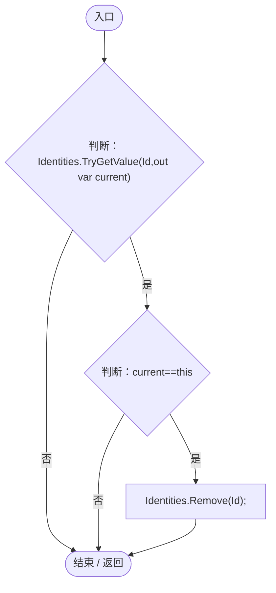

项目内调用/回调引用：

- [EcologyIdentity.Id.get · L14](bdf7ccc2c9c0452f.md#m989150a58b56a6c2)（访问器）

## Reset · L17

`[RuntimeInitializeOnLoadMethod(RuntimeInitializeLoadType.SubsystemRegistration)] private static void Reset()`

### Editor / Player · Roslyn编译器控制流

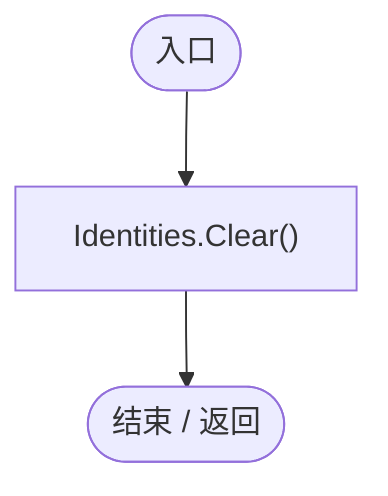

## Restore · L18

`public void Restore(string id)`

### Editor / Player · Roslyn编译器控制流

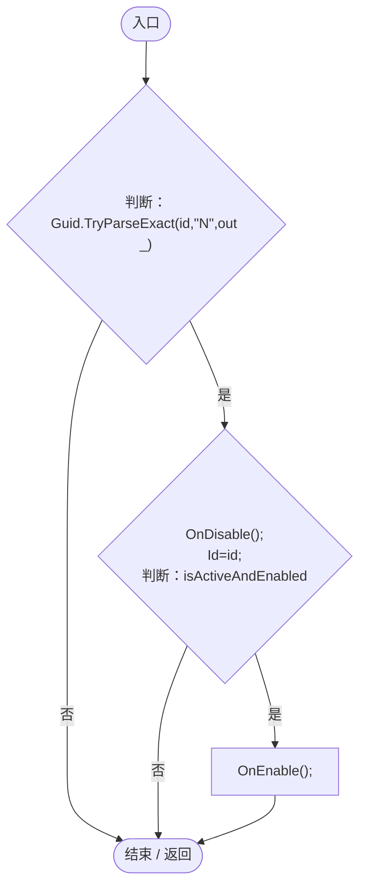

项目内调用/回调引用：

- [EcologyIdentity.OnDisable · L16](bdf7ccc2c9c0452f.md#m4d069aaa794dcdd9)（方法）
- [EcologyIdentity.Id.set · L14](bdf7ccc2c9c0452f.md#m49c42c1725782f99)（访问器）
- [EcologyIdentity.OnEnable · L15](bdf7ccc2c9c0452f.md#m8f343f942b17b807)（方法）

## Find · L20

`public static DarwinEntity Find(string id)`

★ 修复（防Bug回归）：运输每帧解析实体 ID，不能为每名工匠再次遍历全部实体；恢复 ID 和停用时同步更新索引。

### Editor / Player · Roslyn编译器控制流

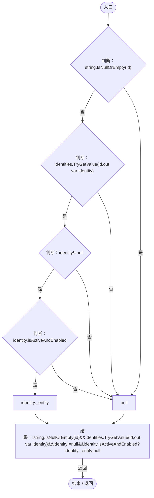

## Of · L21

`public static string Of(DarwinEntity entity)`

### Editor / Player · Roslyn编译器控制流

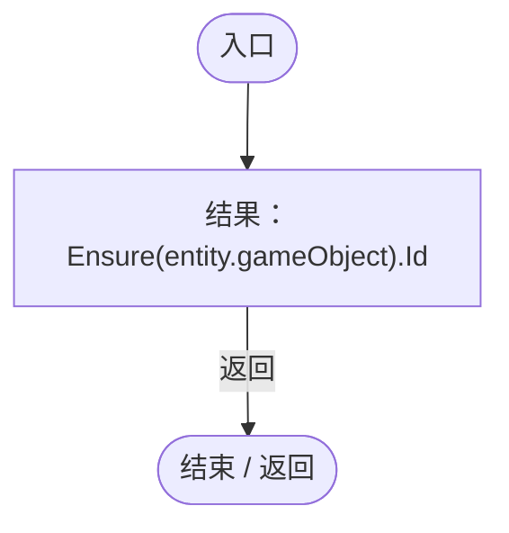

项目内调用/回调引用：

- [EcologyIdentity.Id.get · L14](bdf7ccc2c9c0452f.md#m989150a58b56a6c2)（访问器）
- [EcologyIdentity.Ensure · L22](bdf7ccc2c9c0452f.md#m40609054a6d444d0)（方法）

## Ensure · L22

`public static EcologyIdentity Ensure(GameObject obj)`

### Editor / Player · Roslyn编译器控制流

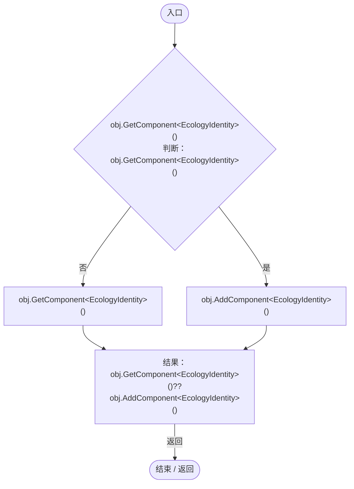

## Planet.get · L27

`public static PlanetTerrainMeshBuilder Planet`

### Editor / Player · 语法控制结构 / 声明（非CFG）

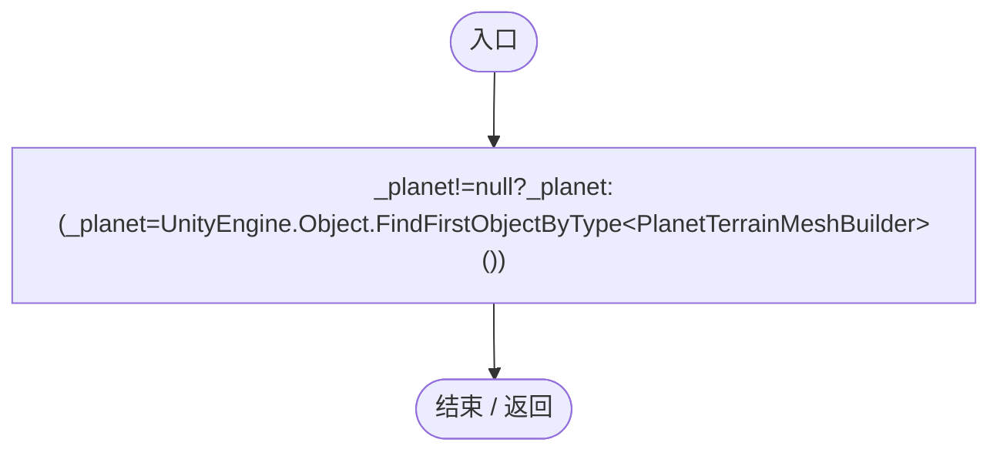

## Active · L28

`public static GeneEvaluation Active(EntityGeneController genes,string id)`

### Editor / Player · Roslyn编译器控制流

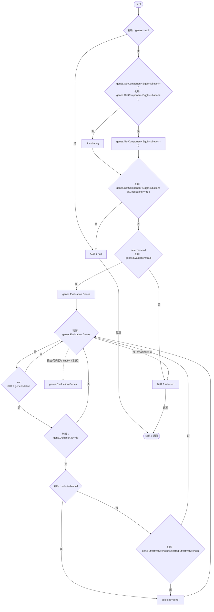

项目内调用/回调引用：

- [EntityGeneController.Evaluation.get · L19](7494d53178552f0e.md#m2cb74e57d810ca42)（访问器）

## Alive · L38

`public static bool Alive(DarwinEntity entity)`

### Editor / Player · Roslyn编译器控制流

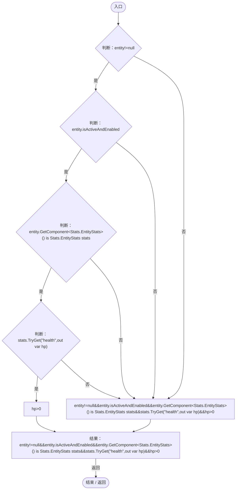

项目内调用/回调引用：

- [EntityStats.TryGet · L90](75aa86a368efdf24.md#m24ee1433e4a70d94)（方法）

## ToLocal · L39

`public static Vector3 ToLocal(Vector3 point)`

### Editor / Player · Roslyn编译器控制流

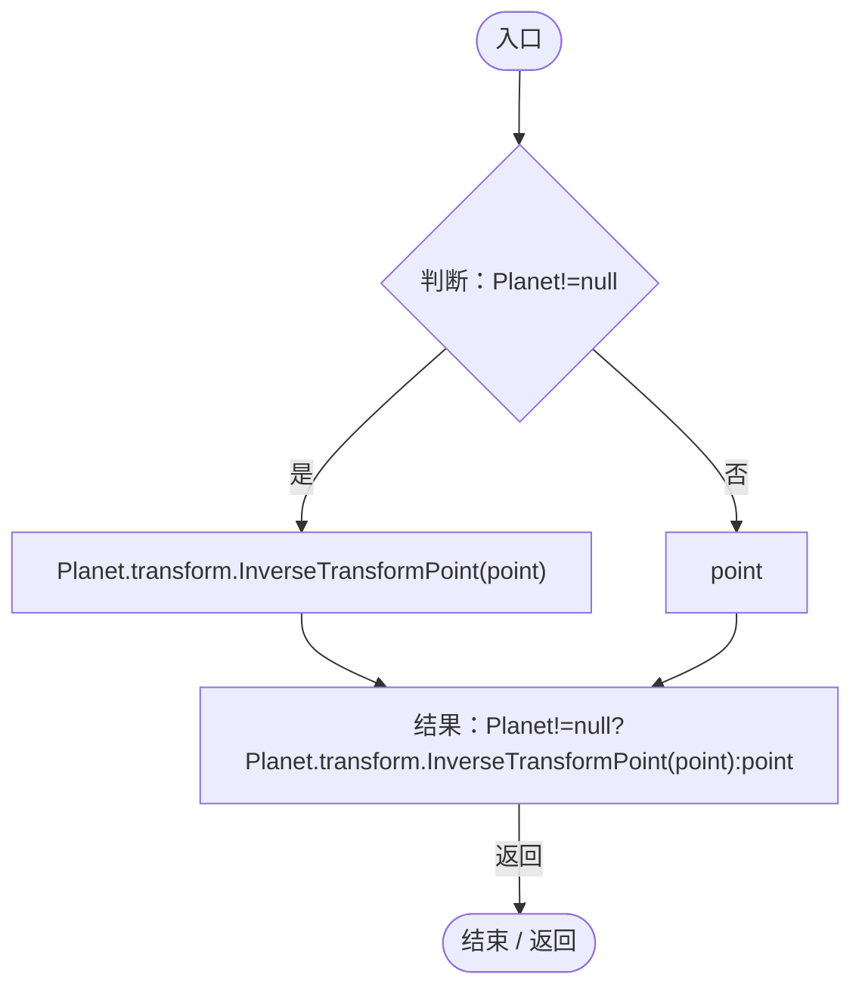

## ToWorld · L40

`public static Vector3 ToWorld(Vector3 point)`

### Editor / Player · Roslyn编译器控制流

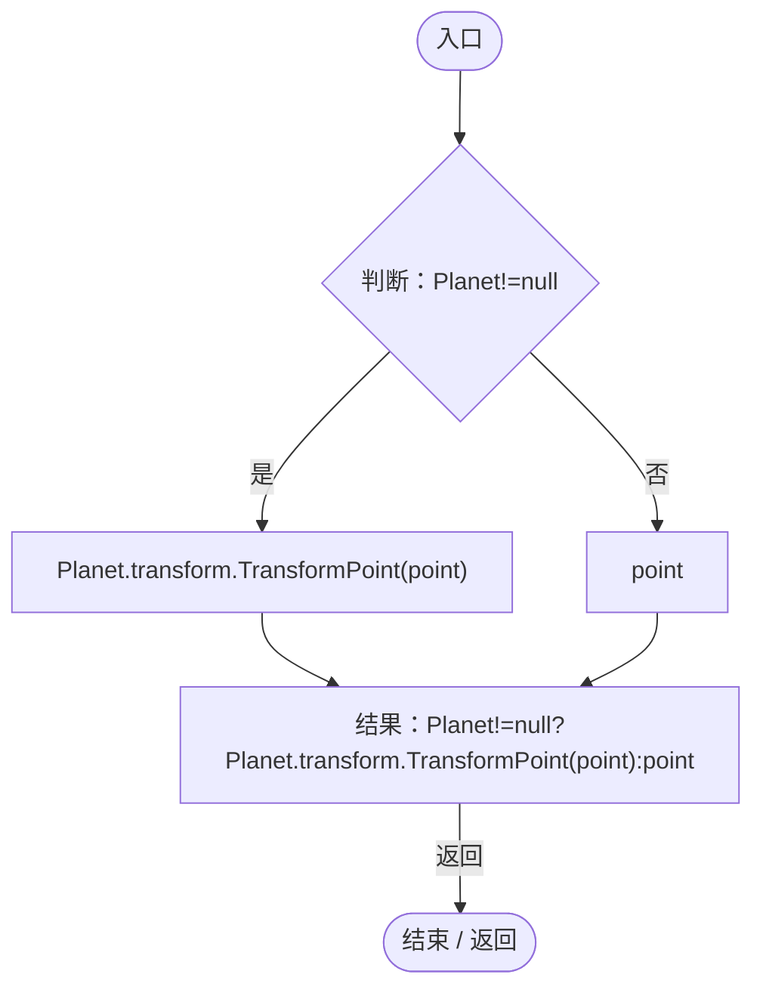

## Up · L41

`public static Vector3 Up(Vector3 point)`

### Editor / Player · Roslyn编译器控制流

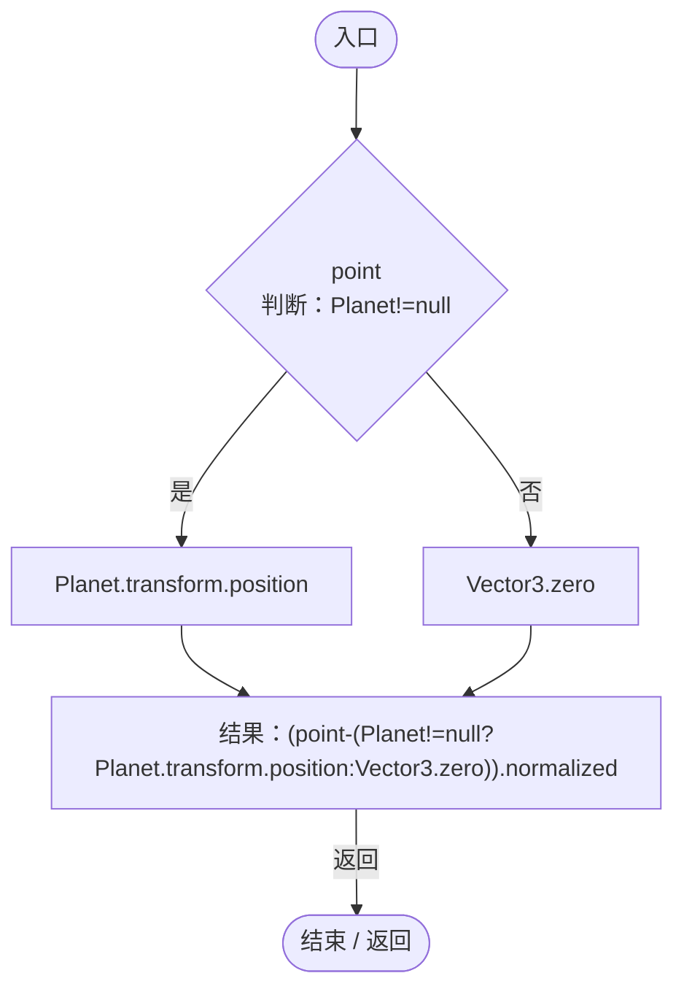

## Distance · L42

`public static float Distance(Vector3 a,Vector3 b)`

### Editor / Player · Roslyn编译器控制流

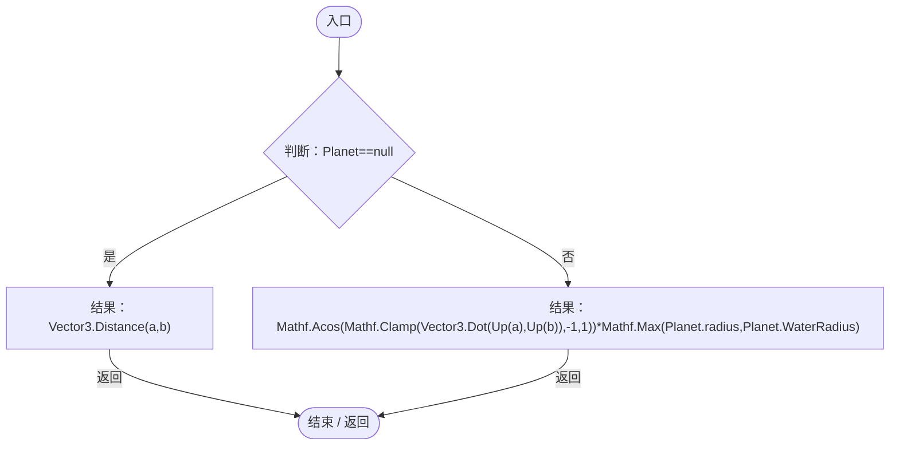

项目内调用/回调引用：

- [EcologyQueries.Up · L41](bdf7ccc2c9c0452f.md#maca7070196f125fd)（方法）
- [PlanetTerrainMeshBuilder.WaterRadius.get · L94](415285cf043354a9.md#m28d8809083881ec1)（访问器）

## Surface · L47

`public static Vector3 Surface(Vector3 point)`

### Editor / Player · Roslyn编译器控制流

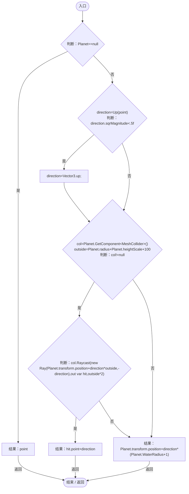

项目内调用/回调引用：

- [EcologyQueries.Up · L41](bdf7ccc2c9c0452f.md#maca7070196f125fd)（方法）
- [PlanetTerrainMeshBuilder.WaterRadius.get · L94](415285cf043354a9.md#m28d8809083881ec1)（访问器）
