# EcologyIdentity.cs

[返回总索引](../README.md) · `Runtime` · `Assets/DarwinPark/Entities/Ecology/EcologyIdentity.cs`

[源文件](../../../Assets/DarwinPark/Entities/Ecology/EcologyIdentity.cs) · 源码校验：`2cc514412f215bbf010244af1f9f8ed3424184b3f9ce3392c964ee396ddbd4cb`

方法按源文件位置排列。事件/回调引用不表示立即执行；分支与异常说明见总索引。完整源码与可点击关系图请打开离线手册。

## Id.get · L15

`get`

### Editor / Player · 语法控制结构 / 声明（非CFG）

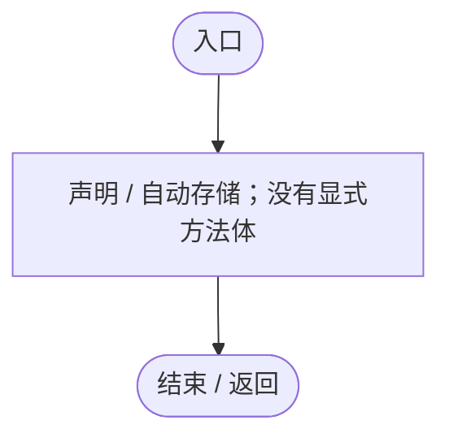

## Id.set · L15

`private set`

### Editor / Player · 语法控制结构 / 声明（非CFG）

## OnEnable · L16

`private void OnEnable()`

### Editor / Player · Roslyn编译器控制流

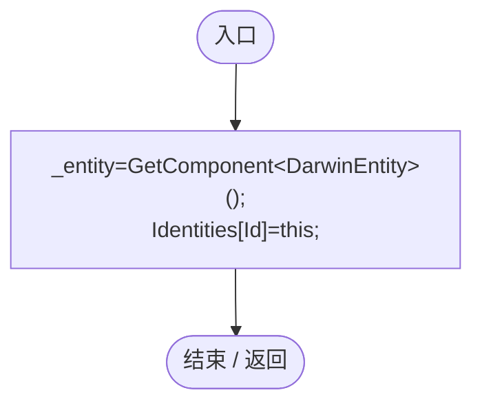

项目内调用/回调引用：

- [EcologyIdentity.Id.get · L15](bdf7ccc2c9c0452f.md#m7ac96c56a47a45d3)（访问器）

## OnDisable · L17

`private void OnDisable()`

### Editor / Player · Roslyn编译器控制流

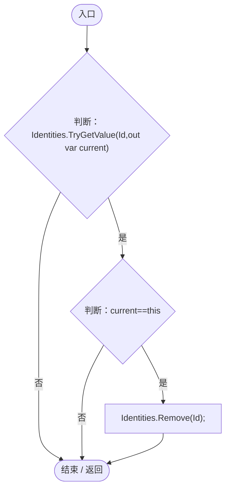

项目内调用/回调引用：

- [EcologyIdentity.Id.get · L15](bdf7ccc2c9c0452f.md#m7ac96c56a47a45d3)（访问器）

## Reset · L18

`[RuntimeInitializeOnLoadMethod(RuntimeInitializeLoadType.SubsystemRegistration)] private static void Reset()`

### Editor / Player · Roslyn编译器控制流

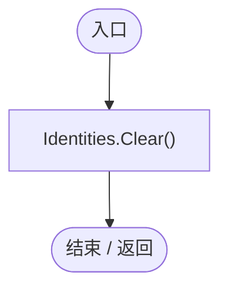

## Restore · L19

`public void Restore(string id)`

### Editor / Player · Roslyn编译器控制流

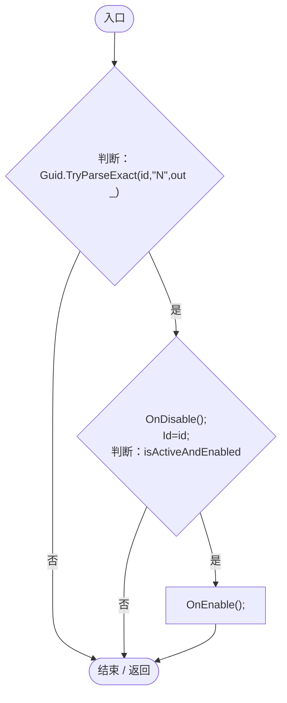

项目内调用/回调引用：

- [EcologyIdentity.OnDisable · L17](bdf7ccc2c9c0452f.md#m360f829a5f85f872)（方法）
- [EcologyIdentity.Id.set · L15](bdf7ccc2c9c0452f.md#mfb0d5b1814d3e594)（访问器）
- [EcologyIdentity.OnEnable · L16](bdf7ccc2c9c0452f.md#me29a2247bba15e88)（方法）

## Find · L21

`public static DarwinEntity Find(string id)`

★ 修复（防Bug回归）：运输每帧解析实体 ID，不能为每名工匠再次遍历全部实体；恢复 ID 和停用时同步更新索引。

### Editor / Player · Roslyn编译器控制流

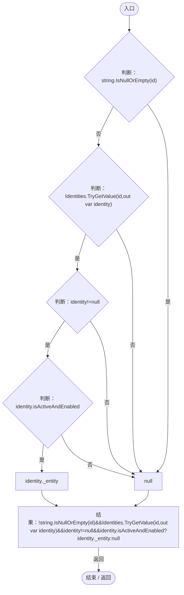

## Of · L22

`public static string Of(DarwinEntity entity)`

### Editor / Player · Roslyn编译器控制流

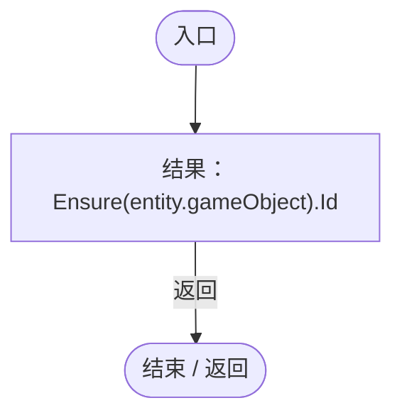

项目内调用/回调引用：

- [EcologyIdentity.Id.get · L15](bdf7ccc2c9c0452f.md#m7ac96c56a47a45d3)（访问器）
- [EcologyIdentity.Ensure · L23](bdf7ccc2c9c0452f.md#m8adfd15f583f225a)（方法）

## Ensure · L23

`public static EcologyIdentity Ensure(GameObject obj)`

### Editor / Player · Roslyn编译器控制流

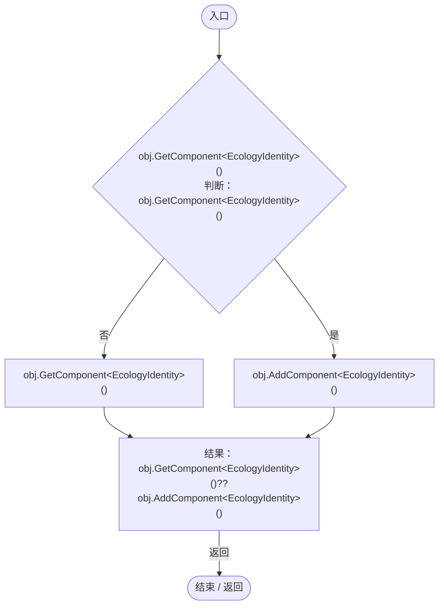

## Planet.get · L28

`public static PlanetTerrainMeshBuilder Planet`

### Editor / Player · 语法控制结构 / 声明（非CFG）

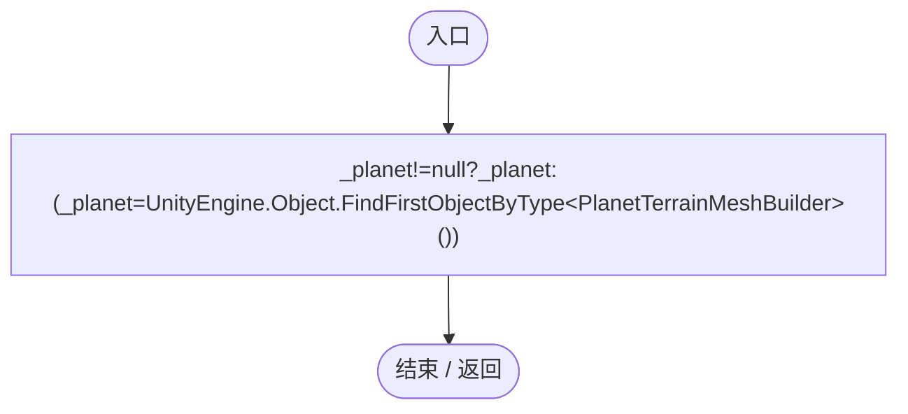

## Active · L29

`public static GeneEvaluation Active(EntityGeneController genes,string id)`

### Editor / Player · Roslyn编译器控制流

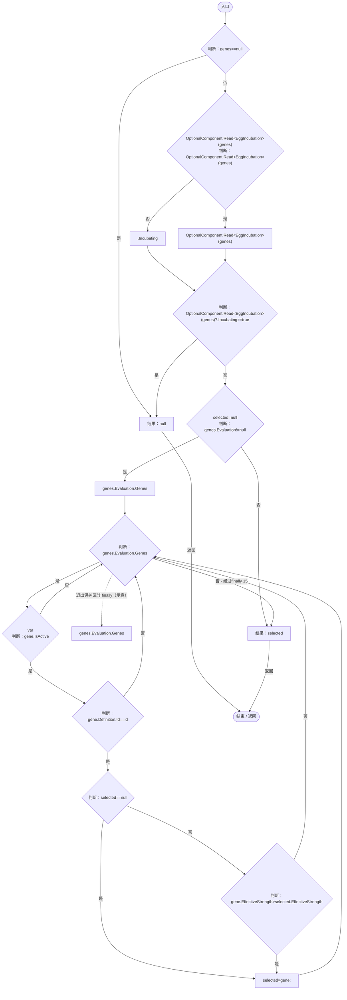

项目内调用/回调引用：

- [OptionalComponent.Read · L7](806c46b42ced4d36.md#m69622a4dee165c5a)（方法）
- [EntityGeneController.Evaluation.get · L20](7494d53178552f0e.md#mf275f100ea21601a)（访问器）

## Alive · L39

`public static bool Alive(DarwinEntity entity)`

### Editor / Player · Roslyn编译器控制流

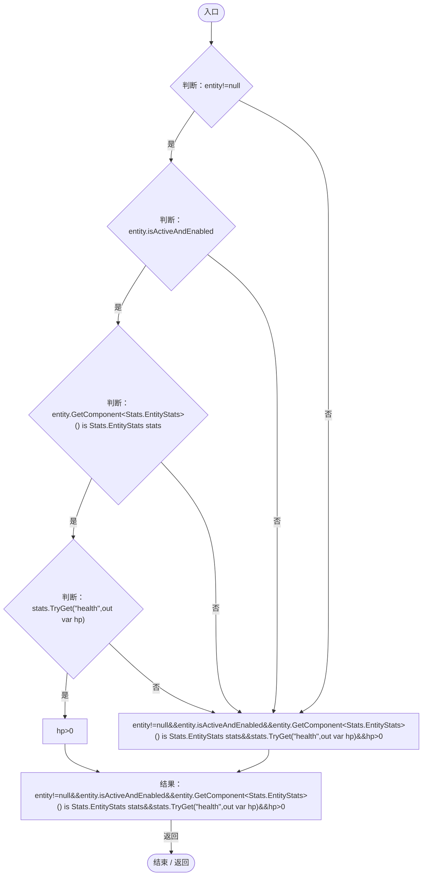

项目内调用/回调引用：

- [EntityStats.TryGet · L93](75aa86a368efdf24.md#m03cef847022eee28)（方法）

## ToLocal · L40

`public static Vector3 ToLocal(Vector3 point)`

### Editor / Player · Roslyn编译器控制流

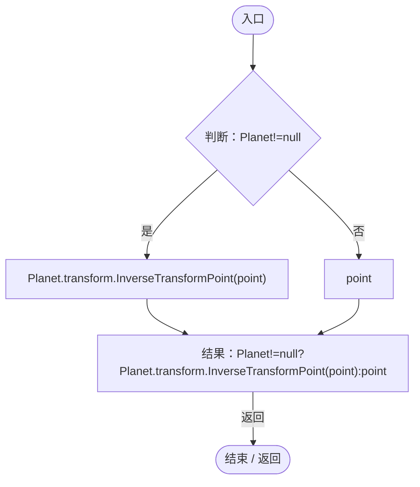

## ToWorld · L41

`public static Vector3 ToWorld(Vector3 point)`

### Editor / Player · Roslyn编译器控制流

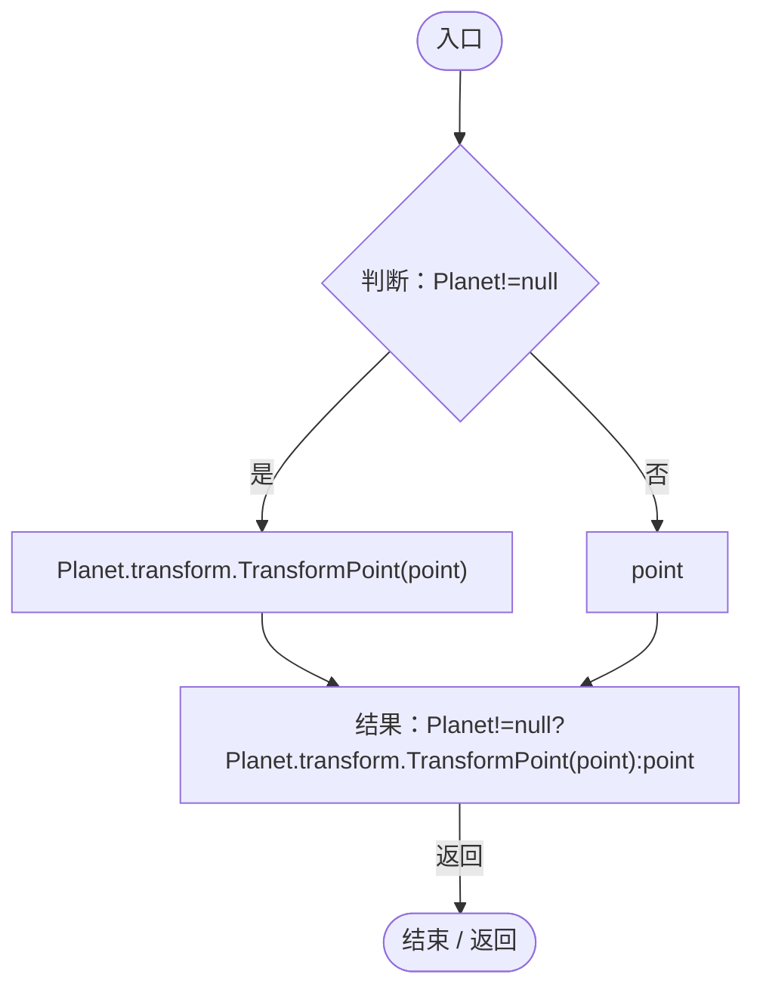

## Up · L42

`public static Vector3 Up(Vector3 point)`

### Editor / Player · Roslyn编译器控制流

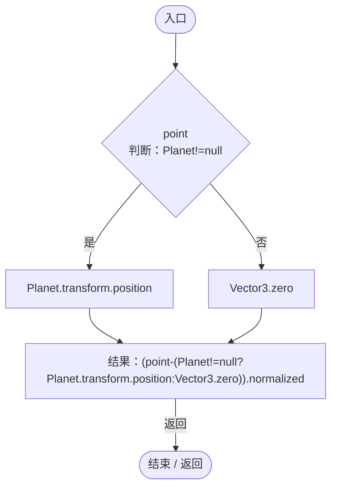

## Distance · L43

`public static float Distance(Vector3 a,Vector3 b)`

### Editor / Player · Roslyn编译器控制流

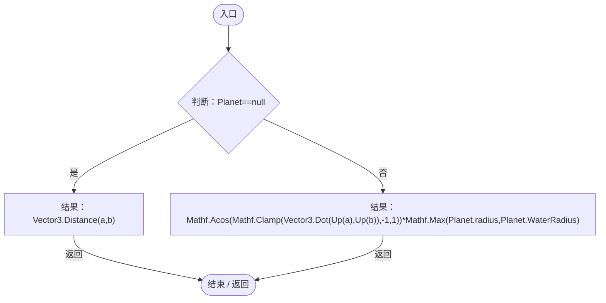

项目内调用/回调引用：

- [EcologyQueries.Up · L42](bdf7ccc2c9c0452f.md#ma73e6bbbc726282f)（方法）
- [PlanetTerrainMeshBuilder.WaterRadius.get · L99](415285cf043354a9.md#m76719c213b06ba56)（访问器）

## Surface · L48

`public static Vector3 Surface(Vector3 point)`

### Editor / Player · Roslyn编译器控制流

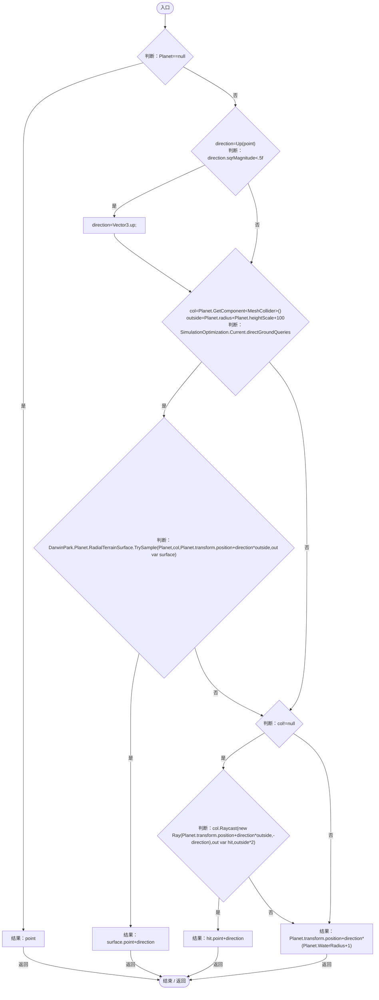

项目内调用/回调引用：

- [EcologyQueries.Up · L42](bdf7ccc2c9c0452f.md#ma73e6bbbc726282f)（方法）
- [SimulationOptimization.Current.get · L30](11c9091e70893352.md#mcfa8eb2e650e57b1)（访问器）
- [RadialTerrainSurface.TrySample · L12](4eb5c0c8143bed20.md#m994c30d4296dac34)（方法）
- [PlanetTerrainMeshBuilder.WaterRadius.get · L99](415285cf043354a9.md#m76719c213b06ba56)（访问器）
