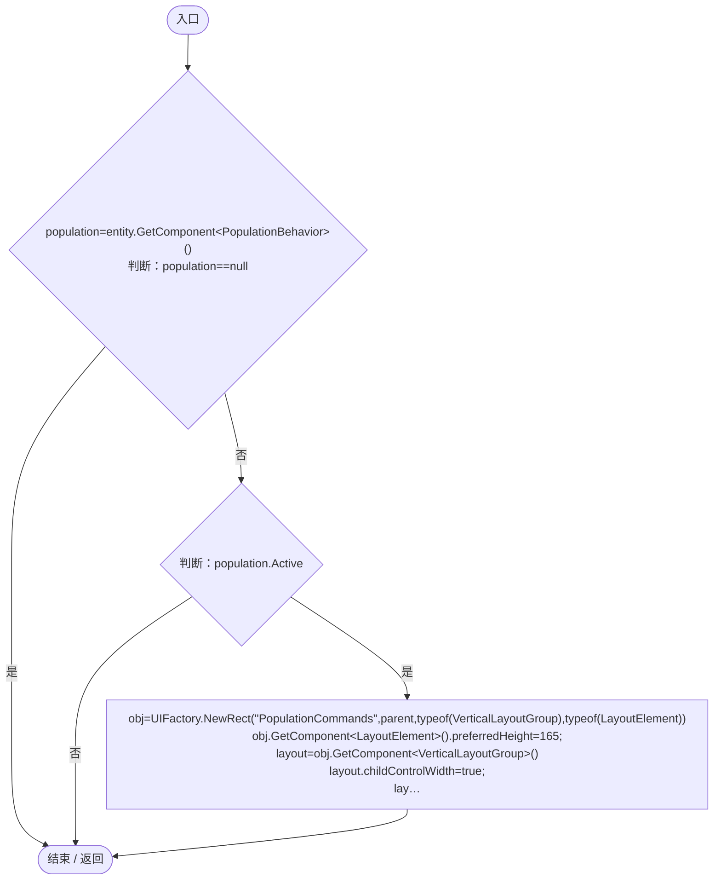
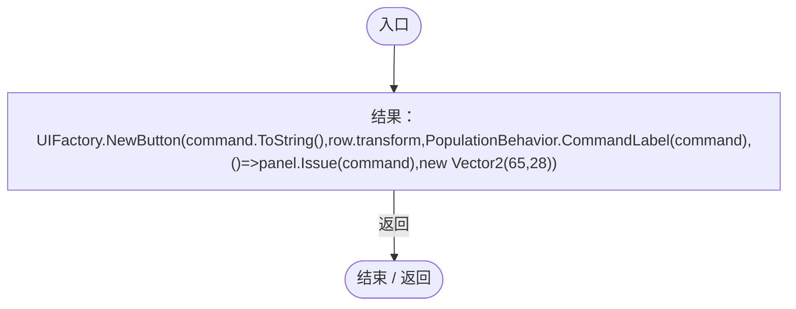
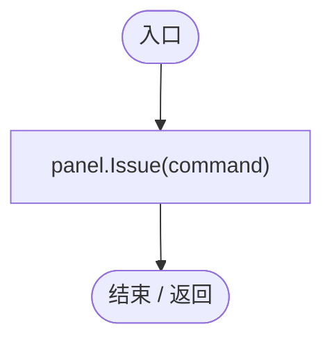
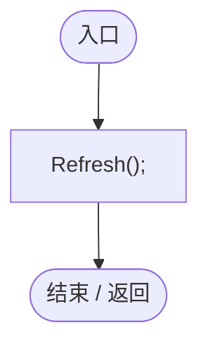
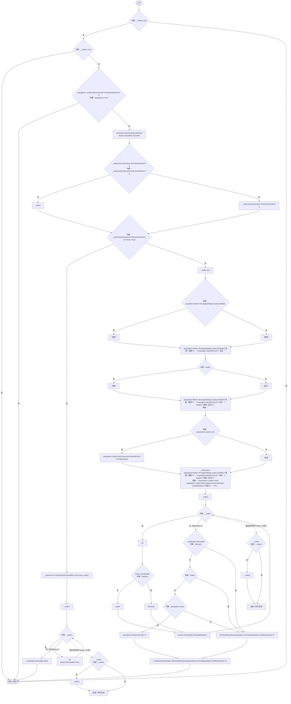
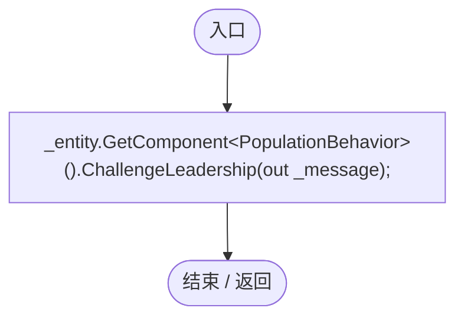
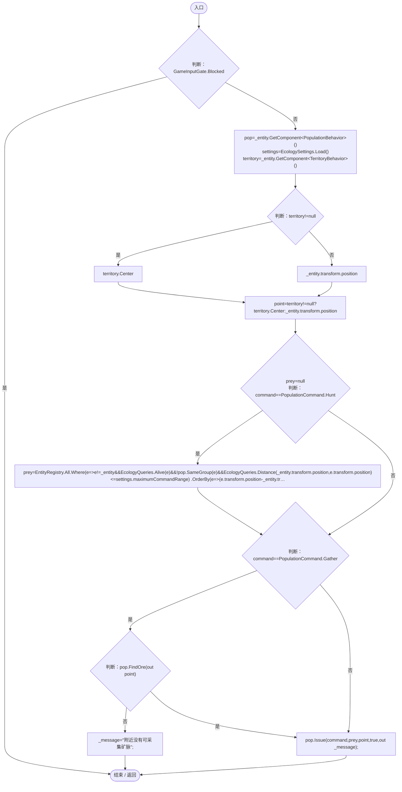
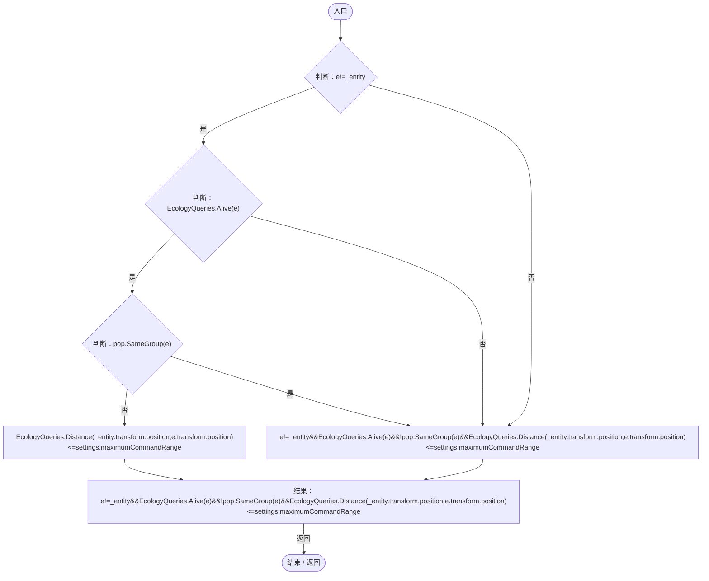
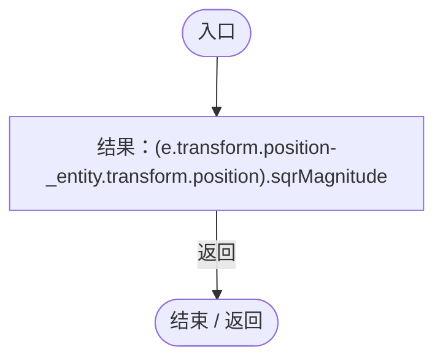

# PopulationCommandPanel.cs

[返回总索引](../README.md) · `Runtime` · `Assets/DarwinPark/UI/PopulationCommandPanel.cs`

[源文件](../../../Assets/DarwinPark/UI/PopulationCommandPanel.cs) · 源码校验：`4d4e2f422473cfc5d308aaa0b37bc186edb1aaf8df94f1fd03ab0e4e04185b9a`

方法按源文件位置排列。事件/回调引用不表示立即执行；分支与异常说明见总索引。完整源码与可点击关系图请打开离线手册。

## Build · L15

`public static void Build(DarwinEntity entity,Transform parent)`

### Editor / Player · Roslyn编译器控制流

项目内调用/回调引用：

- [UIFactory.NewRect · L33](dd1096a6995423db.md#med612116f3152344)（方法）
- [UIFactory.NewText · L57](dd1096a6995423db.md#m9dbccb5f0c38189e)（方法）
- [UIFactory.NewButton · L73](dd1096a6995423db.md#m5896f1b097c8bdde)（方法）
- [PopulationCommandPanel.Refresh · L32](be52342abb2dced2.md#m7cac95f603bd237f)（方法）
- [PopulationCommandPanel.回调@26 · L26](be52342abb2dced2.md#medb41ae895e87ac6)（回调/委托）
- [PopulationCommandPanel.Challenge · L43](be52342abb2dced2.md#mcb24fd9c823c3aa4)（方法）

## 回调@26 · L26

`command … => 回调`

### Editor / Player · Roslyn编译器控制流

项目内调用/回调引用：

- [UIFactory.NewButton · L73](dd1096a6995423db.md#m5896f1b097c8bdde)（方法）
- [PopulationBehavior.CommandLabel · L208](21e4f62f75a9a80f.md#m7907c38716c35174)（方法）
- [PopulationCommandPanel.回调@26 · L26](be52342abb2dced2.md#m98b77f482fa7ee22)（回调/委托）

## 回调@26 · L26

`( … => 回调`

### Editor / Player · Roslyn编译器控制流

项目内调用/回调引用：

- [PopulationCommandPanel.Issue · L44](be52342abb2dced2.md#m7176948fd6361d25)（方法）

## Update · L31

`private void Update()`

### Editor / Player · Roslyn编译器控制流

项目内调用/回调引用：

- [PopulationCommandPanel.Refresh · L32](be52342abb2dced2.md#m7cac95f603bd237f)（方法）

## Refresh · L32

`private void Refresh()`

### Editor / Player · Roslyn编译器控制流

项目内调用/回调引用：

- [GameInputGate.Blocked.get · L8](52955daae7e592ab.md#m765763b665829633)（访问器）
- [ColonyStatusPresentation.Summary · L18](37a7c5ffa1a1a8c2.md#m2e20a4d682fb38ba)（方法）
- [EcologySettings.Load · L18](90428a275d065ef6.md#mb0575490373edaf2)（方法）
- [PopulationBehavior.CommandLabel · L208](21e4f62f75a9a80f.md#m7907c38716c35174)（方法）
- [PopulationBehavior.Command.get · L23](21e4f62f75a9a80f.md#md6a4209cecb72885)（访问器）

## Challenge · L43

`private void Challenge()`

### Editor / Player · Roslyn编译器控制流

项目内调用/回调引用：

- [PopulationBehavior.ChallengeLeadership · L125](21e4f62f75a9a80f.md#m5391b2572c2724a5)（方法）

## Issue · L44

`private void Issue(PopulationCommand command)`

### Editor / Player · Roslyn编译器控制流

项目内调用/回调引用：

- [GameInputGate.Blocked.get · L8](52955daae7e592ab.md#m765763b665829633)（访问器）
- [EcologySettings.Load · L18](90428a275d065ef6.md#mb0575490373edaf2)（方法）
- [PopulationBehavior.FindOre · L163](21e4f62f75a9a80f.md#mc4d95f5f8d7fcd10)（方法）
- [PopulationBehavior.Issue · L138](21e4f62f75a9a80f.md#m814bead2a1a9395d)（方法）
- [PopulationCommandPanel.回调@50 · L50](be52342abb2dced2.md#m82cf527d322d4573)（回调/委托）
- [PopulationCommandPanel.回调@51 · L51](be52342abb2dced2.md#m1c1286172d8c1be4)（回调/委托）

## 回调@50 · L50

`e … => 回调`

### Editor / Player · Roslyn编译器控制流

项目内调用/回调引用：

- [EcologyQueries.Alive · L38](bdf7ccc2c9c0452f.md#mb2877c487f449970)（方法）
- [PopulationBehavior.SameGroup · L123](21e4f62f75a9a80f.md#m7a9d850e1d8967d4)（方法）
- [EcologyQueries.Distance · L42](bdf7ccc2c9c0452f.md#mba9c3e3c95d0f2dd)（方法）

## 回调@51 · L51

`e … => 回调`

### Editor / Player · Roslyn编译器控制流

