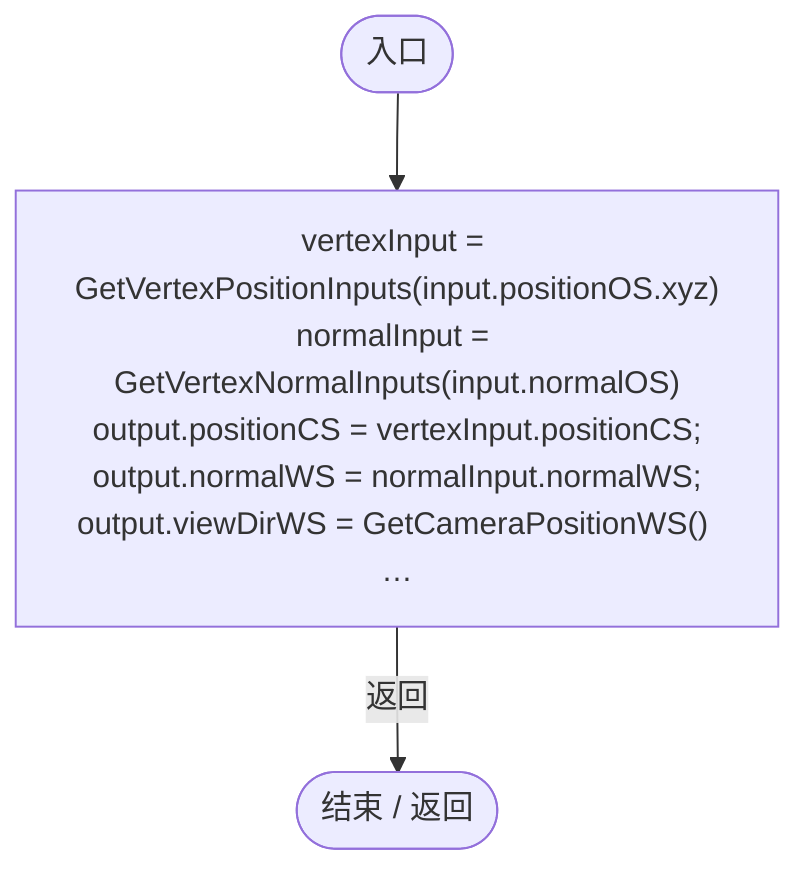
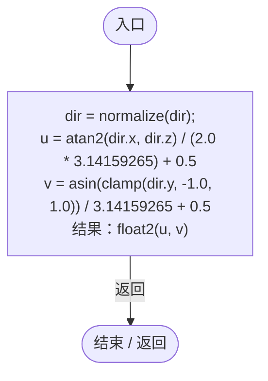
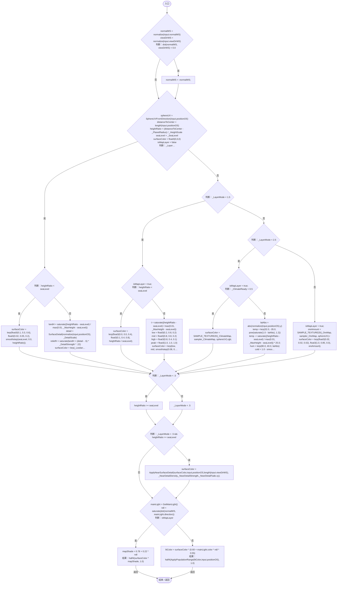

# PlanetURP.shader

[返回总索引](../README.md) · `GPU` · `Assets/DarwinPark/Planet/PlanetURP.shader`

[源文件](../../../Assets/DarwinPark/Planet/PlanetURP.shader) · 源码校验：`38f35dee7de5fd33033d4dae10d5d6875341c47a84cb72a94db35bc03b44ba6b`

方法按源文件位置排列。事件/回调引用不表示立即执行；分支与异常说明见总索引。完整源码与可点击关系图请打开离线手册。

## vert · L64

`Varyings vert(Attributes input)`

### GPU · GPU控制结构（名称链接，不作C#类型推断）

## SphereUVFromDirection · L81

`float2 SphereUVFromDirection(float3 dir)`

### GPU · GPU控制结构（名称链接，不作C#类型推断）

## frag · L89

`half4 frag(Varyings input) : SV_Target`

### GPU · GPU控制结构（名称链接，不作C#类型推断）

项目内调用/回调引用：

- [PlanetURP.SphereUVFromDirection · L81](be668c1a6c88dc09.md#md0e3f866935f7c1a)（GPU函数）
- [PlanetSurfaceDetail.SurfaceDetail · L19](bcbe3a3de96b1f72.md#mf71c1e43fd82f7c3)（GPU函数）
- [PlanetNearSurfaceDetail.ApplyNearSurfaceDetail · L11](1b2299bfeb3c3590.md#m080d9dfdf11197c3)（GPU函数）
- [PopulationRangeOverlay.ApplyPopulationRange · L6](04884ff1984fea3f.md#m3763ac11c03eb812)（GPU函数）
