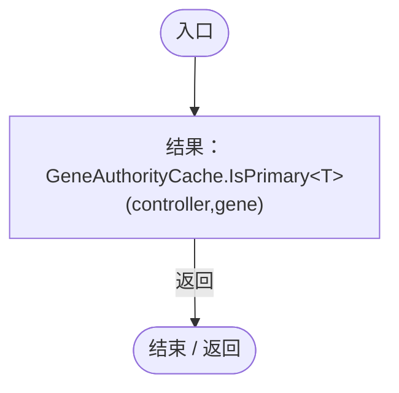

# GeneBehaviorAuthority.cs

[返回总索引](../README.md) · `Runtime` · `Assets/DarwinPark/Entities/Logic/GeneBehaviorAuthority.cs`

[源文件](../../../Assets/DarwinPark/Entities/Logic/GeneBehaviorAuthority.cs) · 源码校验：`30f1607bb21c70ca00eaf207860651c413086194b787d377faec34c4a034b41d`

方法按源文件位置排列。事件/回调引用不表示立即执行；分支与异常说明见总索引。完整源码与可点击关系图请打开离线手册。

## IsPrimary · L10

`public static bool IsPrimary<T>(EntityGeneController controller,GeneInstance gene) where T:class,IGeneLogic`

### Editor / Player · Roslyn编译器控制流

项目内调用/回调引用：

- [GeneAuthorityCache.IsPrimary · L13](9ff546df23a8ee4f.md#m364185932a539432)（方法）
