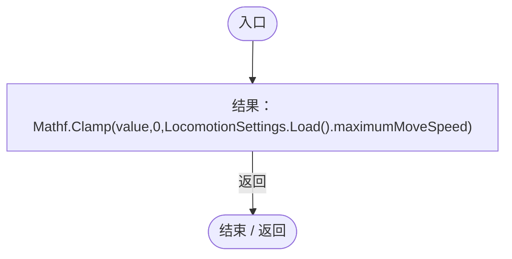
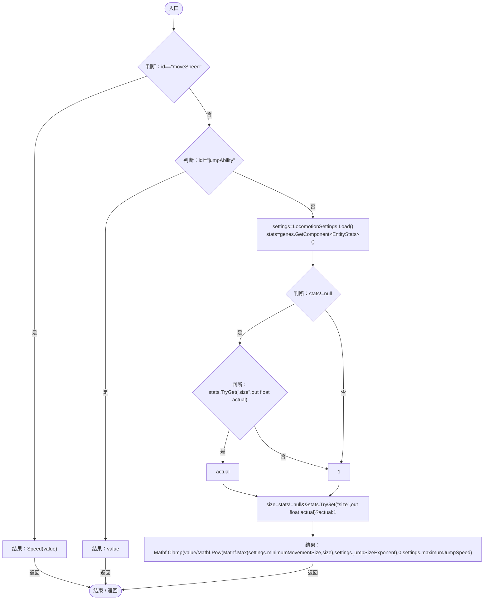

# EntityMovementLimits.cs

[返回总索引](../README.md) · `Runtime` · `Assets/DarwinPark/Entities/Logic/EntityMovementLimits.cs`

[源文件](../../../Assets/DarwinPark/Entities/Logic/EntityMovementLimits.cs) · 源码校验：`9aec1d253aff9627a10e9d7cdb1aadec200138213b153a4c1e6319e70ec1f420`

方法按源文件位置排列。事件/回调引用不表示立即执行；分支与异常说明见总索引。完整源码与可点击关系图请打开离线手册。

## Speed · L9

`public static float Speed(float value)`

### Editor / Player · Roslyn编译器控制流

项目内调用/回调引用：

- [LocomotionSettings.Load · L17](8cce83c7d4563cf0.md#m06b74c04dd63fb4a)（方法）

## Attribute · L10

`public static float Attribute(EntityGeneController genes,string id,float value)`

### Editor / Player · Roslyn编译器控制流

项目内调用/回调引用：

- [EntityMovementLimits.Speed · L9](bf2a44fffc5f10d6.md#mbe765ae4c73829b7)（方法）
- [LocomotionSettings.Load · L17](8cce83c7d4563cf0.md#m06b74c04dd63fb4a)（方法）
- [EntityStats.TryGet · L90](75aa86a368efdf24.md#m24ee1433e4a70d94)（方法）
