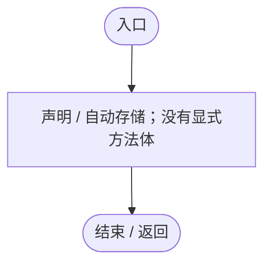
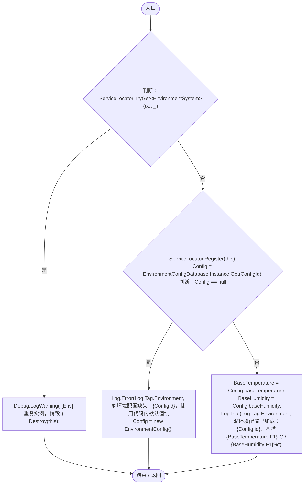
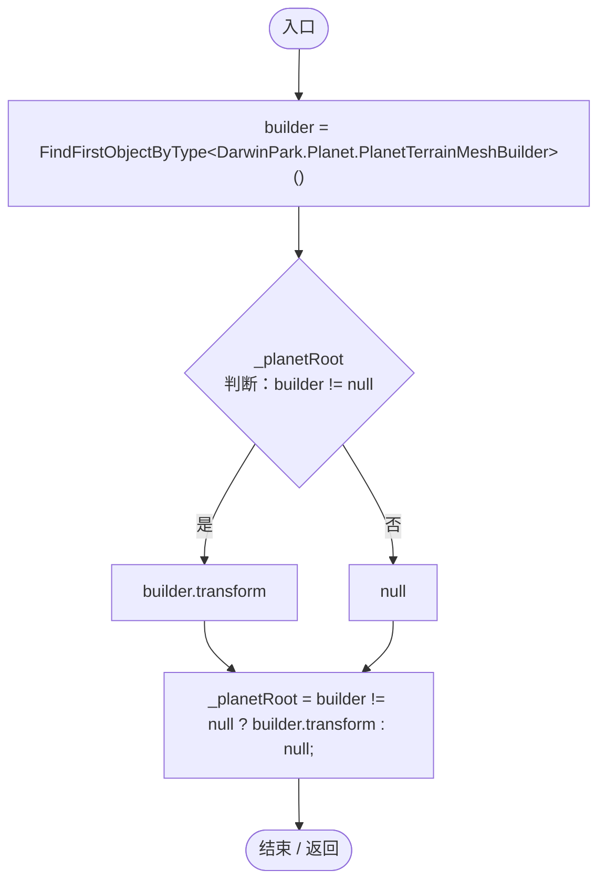
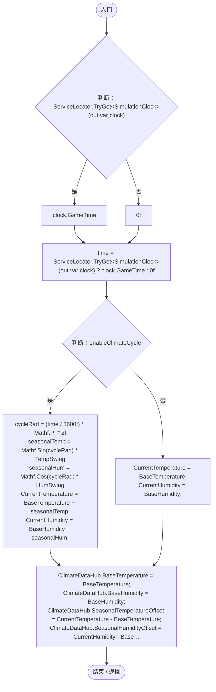
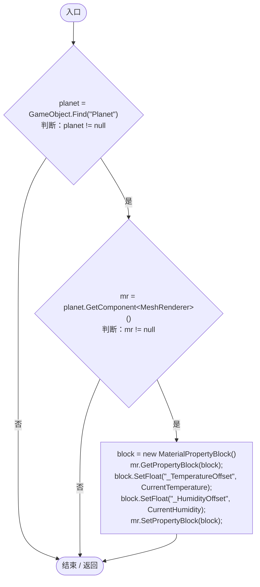
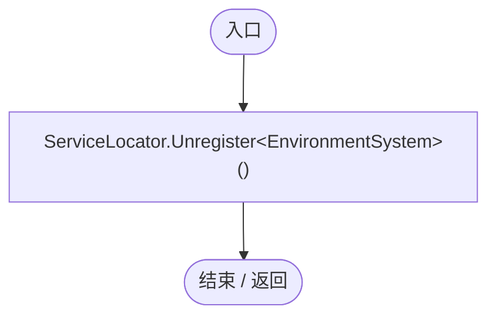
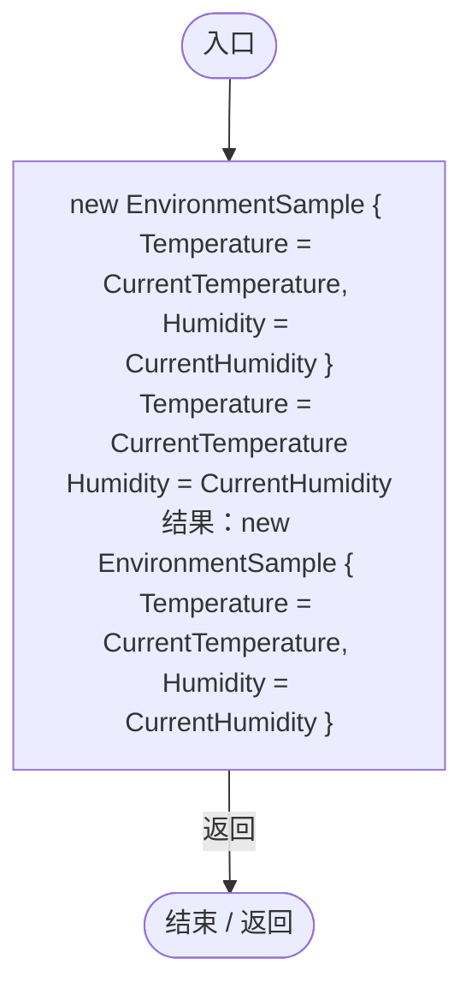

# EnvironmentSystem.cs

[返回总索引](../README.md) · `Runtime` · `Assets/DarwinPark/Environment/EnvironmentSystem.cs`

[源文件](../../../Assets/DarwinPark/Environment/EnvironmentSystem.cs) · 源码校验：`acefd3d51ea8bf8b1ea82025577a18a808a32edc3ad075fa75ded9b9b3b5b348`

方法按源文件位置排列。事件/回调引用不表示立即执行；分支与异常说明见总索引。完整源码与可点击关系图请打开离线手册。

## CurrentTemperature.get · L21

`get`

### Editor / Player · 语法控制结构 / 声明（非CFG）

## CurrentTemperature.set · L21

`private set`

### Editor / Player · 语法控制结构 / 声明（非CFG）

## CurrentHumidity.get · L22

`get`

### Editor / Player · 语法控制结构 / 声明（非CFG）

## CurrentHumidity.set · L22

`private set`

### Editor / Player · 语法控制结构 / 声明（非CFG）

## Config.get · L25

`get`

### Editor / Player · 语法控制结构 / 声明（非CFG）

## Config.set · L25

`private set`

### Editor / Player · 语法控制结构 / 声明（非CFG）

## Awake · L29

`private void Awake()`

### Editor / Player · Roslyn编译器控制流

项目内调用/回调引用：

- [ServiceLocator.TryGet · L26](f2fdbe9f9ccd93cb.md#m143b24e6d58471b0)（方法）
- [ServiceLocator.Register · L16](f2fdbe9f9ccd93cb.md#m26753aeca74b231e)（方法）
- [EnvironmentSystem.Config.set · L25](bfb4f2987b577f02.md#mb6374e1af2989d78)（访问器）
- [JsonResourceDatabase.Get · L69](55a3ec07ee308cf8.md#m20bbd84a76422a9e)（方法）
- [EnvironmentSystem.Config.get · L25](bfb4f2987b577f02.md#m89db420c1afba8f5)（访问器）
- [Log.Error · L43](735e5abf0df2bddc.md#m2addd5e1d74b000d)（方法）
- [Log.Info · L31](735e5abf0df2bddc.md#md1fe08215a3ce4d3)（方法）

## Start · L54

`private void Start()`

### Editor / Player · Roslyn编译器控制流

## Update · L61

`private void Update()`

### Editor / Player · Roslyn编译器控制流

项目内调用/回调引用：

- [ServiceLocator.TryGet · L26](f2fdbe9f9ccd93cb.md#m143b24e6d58471b0)（方法）
- [SimulationClock.GameTime.get · L23](a8f444aec9614b0a.md#m74adfa39a896652f)（访问器）
- [EnvironmentSystem.CurrentTemperature.set · L21](bfb4f2987b577f02.md#m2074178aacc5c234)（访问器）
- [EnvironmentSystem.CurrentHumidity.set · L22](bfb4f2987b577f02.md#mba8a0c9b18e5c7d9)（访问器）
- [EnvironmentSystem.CurrentTemperature.get · L21](bfb4f2987b577f02.md#m3a0c2df48ae2c37d)（访问器）
- [EnvironmentSystem.CurrentHumidity.get · L22](bfb4f2987b577f02.md#me5d44e71ef36315f)（访问器）
- [EnvironmentSystem.UpdatePlanetShader · L90](bfb4f2987b577f02.md#ma8f38e73f7de7f1f)（方法）

## UpdatePlanetShader · L90

`private void UpdatePlanetShader()`

### Editor / Player · Roslyn编译器控制流

项目内调用/回调引用：

- [EnvironmentSystem.CurrentTemperature.get · L21](bfb4f2987b577f02.md#m3a0c2df48ae2c37d)（访问器）
- [EnvironmentSystem.CurrentHumidity.get · L22](bfb4f2987b577f02.md#me5d44e71ef36315f)（访问器）

## OnDisable · L107

`private void OnDisable()`

### Editor / Player · Roslyn编译器控制流

项目内调用/回调引用：

- [ServiceLocator.Unregister · L24](f2fdbe9f9ccd93cb.md#m24b4fe5c1600b5cf)（方法）

## Sample · L109

`public EnvironmentSample Sample(Vector3 pos)`

### Editor / Player · Roslyn编译器控制流

项目内调用/回调引用：

- [EnvironmentSystem.CurrentTemperature.get · L21](bfb4f2987b577f02.md#m3a0c2df48ae2c37d)（访问器）
- [EnvironmentSystem.CurrentHumidity.get · L22](bfb4f2987b577f02.md#me5d44e71ef36315f)（访问器）
