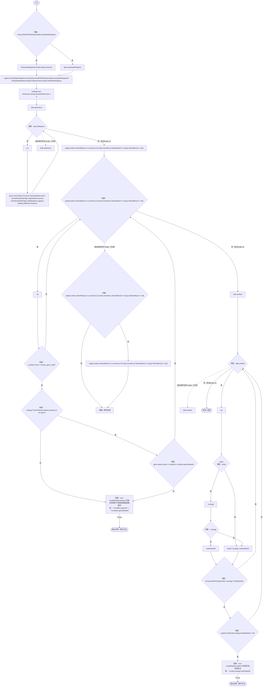
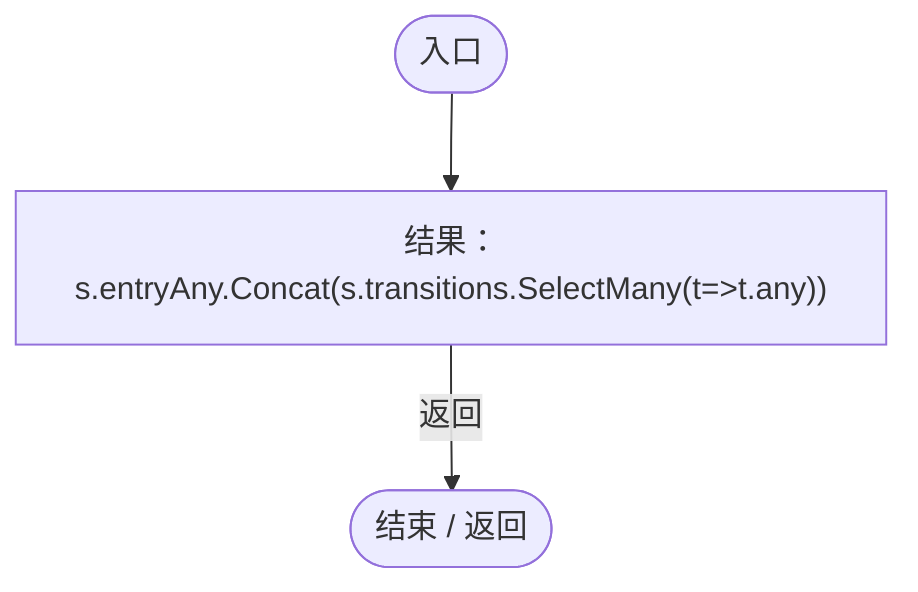
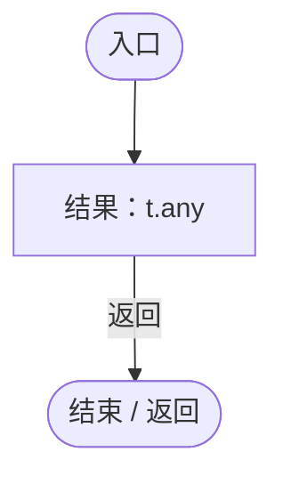
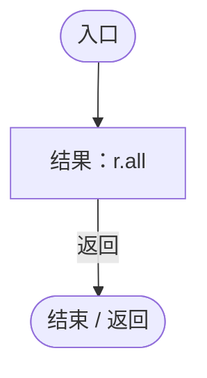
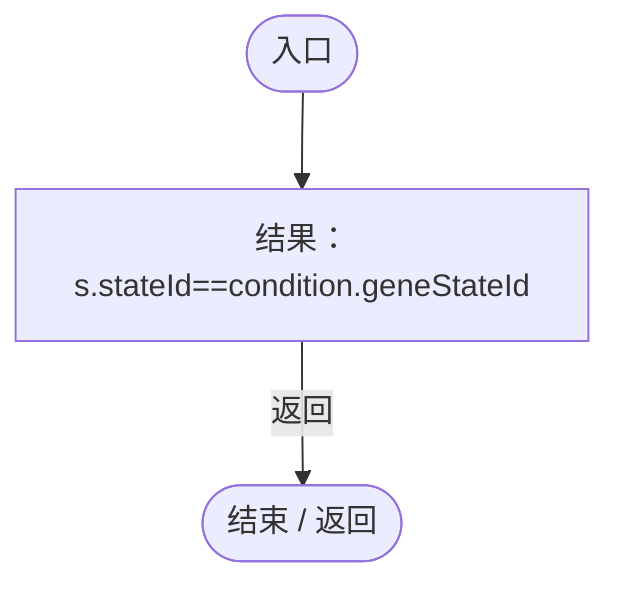

# EntityStateSaveValidation.cs

[返回总索引](../README.md) · `Runtime` · `Assets/DarwinPark/UI/EntityStateSaveValidation.cs`

[源文件](../../../Assets/DarwinPark/UI/EntityStateSaveValidation.cs) · 源码校验：`3f2560a34846903006298e0cbeee593abe894c4c0f75d8849bb8f0e02f10a3d7`

方法按源文件位置排列。事件/回调引用不表示立即执行；分支与异常说明见总索引。完整源码与可点击关系图请打开离线手册。

## Validate · L12

`public static void Validate(WorldSaveData data)`

### Editor / Player · Roslyn编译器控制流

项目内调用/回调引用：

- [EntityStateRegistry.Parse · L57](440408d2db5c7d96.md#m4543a04396bcbc54)（方法）
- [EntityStateRegistry.ReadConfiguredJson · L44](440408d2db5c7d96.md#mf18b710e5c3e8d7c)（方法）
- [GeneEntityStateTags.Upgrade · L11](d87d75eb0b331d5c.md#m2462e83f788e9dea)（方法）
- [GeneEntityStateTags.Validate · L24](d87d75eb0b331d5c.md#m07abded73ee4a80f)（方法）
- [EntityStateDocument.Get · L32](440408d2db5c7d96.md#m52cb41ccf0c9d3c9)（方法）
- [EntityStateSaveValidation.回调@21 · L21](c02a83cd0790720c.md#m5ba9c19162837993)（回调/委托）
- [EntityStateSaveValidation.回调@21 · L21](c02a83cd0790720c.md#m4bf9adf4a243d4f7)（回调/委托）
- [EntityStateSaveValidation.回调@22 · L22](c02a83cd0790720c.md#mafe0e28557ccb10b)（回调/委托）

## 回调@21 · L21

`s … => 回调`

### Editor / Player · Roslyn编译器控制流

项目内调用/回调引用：

- [EntityStateSaveValidation.回调@21 · L21](c02a83cd0790720c.md#mafb23e3ce1ee33a7)（回调/委托）

## 回调@21 · L21

`t … => 回调`

### Editor / Player · Roslyn编译器控制流

## 回调@21 · L21

`r … => 回调`

### Editor / Player · Roslyn编译器控制流

## 回调@22 · L22

`s … => 回调`

### Editor / Player · Roslyn编译器控制流

