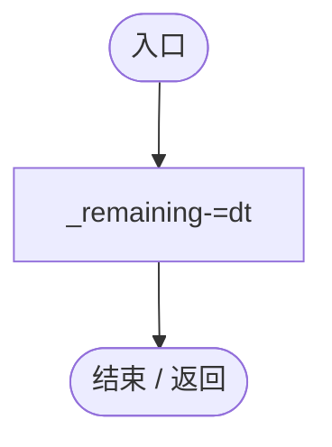
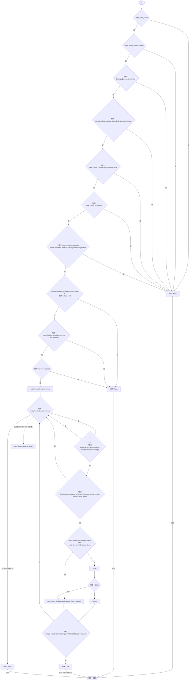
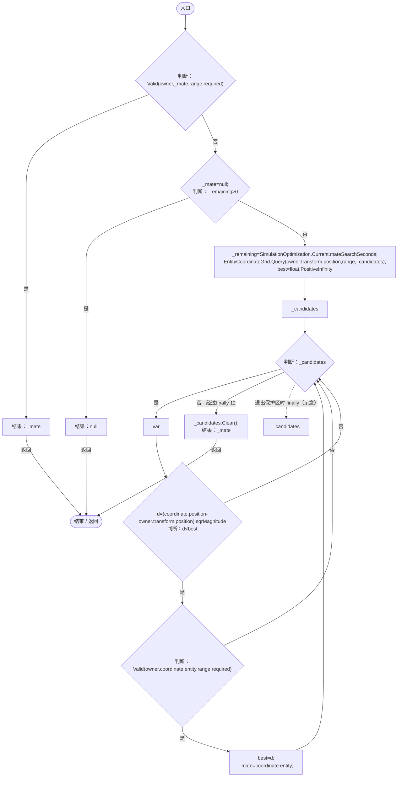

# MateCoordinates.cs

[返回总索引](../README.md) · `Runtime` · `Assets/DarwinPark/Entities/Ecology/MateCoordinates.cs`

[源文件](../../../Assets/DarwinPark/Entities/Ecology/MateCoordinates.cs) · 源码校验：`e7a705e3a2e9927d4b8cb56e401ccc913dd723933f67b4058373cdf04492c6ed`

方法按源文件位置排列。事件/回调引用不表示立即执行；分支与异常说明见总索引。完整源码与可点击关系图请打开离线手册。

## Advance · L13

`public void Advance(float dt)`

### Editor / Player · Roslyn编译器控制流

## Valid · L14

`private static bool Valid(EntityGeneController owner,DarwinEntity entity,float range,float required)`

### Editor / Player · Roslyn编译器控制流

项目内调用/回调引用：

- [DarwinEntity.Genes.get · L14](70798dde169f2e8b.md#m622eb1adf401d431)（访问器）
- [EcologyQueries.Alive · L38](bdf7ccc2c9c0452f.md#mb2877c487f449970)（方法）
- [AntColonyReproduction.BlocksOrdinary · L12](c22084eac4e522ed.md#m8e86301468932b34)（方法）
- [EntityGeneController.CurrentAge.get · L37](7494d53178552f0e.md#md08823d8f9a2fa16)（访问器）
- [EntityStats.TryGet · L90](75aa86a368efdf24.md#m24ee1433e4a70d94)（方法）
- [EntityGeneController.GetLogic · L231](7494d53178552f0e.md#mf5ee6292befedc7b)（方法）
- [GeneBehaviorAuthority.IsPrimary · L10](be83fa896bbe02ae.md#me2fc1f2e16fcd073)（方法）
- [EntityGeneController.GetEvaluation · L225](7494d53178552f0e.md#mdb63fa1e2a8779d0)（方法）

## Find · L21

`public DarwinEntity Find(EntityGeneController owner,float range,float required)`

### Editor / Player · Roslyn编译器控制流

项目内调用/回调引用：

- [MateCoordinates.Valid · L14](c0c58c738d12bfd2.md#m53856ac648ef46b4)（方法）
- [SimulationOptimization.Current.get · L18](11c9091e70893352.md#m81dac8318af42ca9)（访问器）
- [EntityCoordinateGrid.Query · L26](f6d0404a662a5d5c.md#mb223b609771bd310)（方法）
