# AntColonyReproduction.cs

[返回总索引](../README.md) · `Runtime` · `Assets/DarwinPark/Entities/Ecology/AntColonyReproduction.cs`

[源文件](../../../Assets/DarwinPark/Entities/Ecology/AntColonyReproduction.cs) · 源码校验：`58d2415fd44472d9c70da5b25f267b6f053a8cfad619ccfcbe8a79f031ebf018`

方法按源文件位置排列。事件/回调引用不表示立即执行；分支与异常说明见总索引。完整源码与可点击关系图请打开离线手册。

## BlocksOrdinary · L12

`public static bool BlocksOrdinary(EntityGeneController genes)`

### Editor / Player · Roslyn编译器控制流

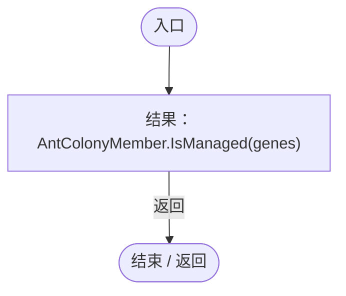

项目内调用/回调引用：

- [AntColonyMember.IsManaged · L53](baebd85c05598377.md#m2762de72909d5da5)（方法）

## Copy · L13

`private static Genome Copy(Genome genome)`

### Editor / Player · Roslyn编译器控制流

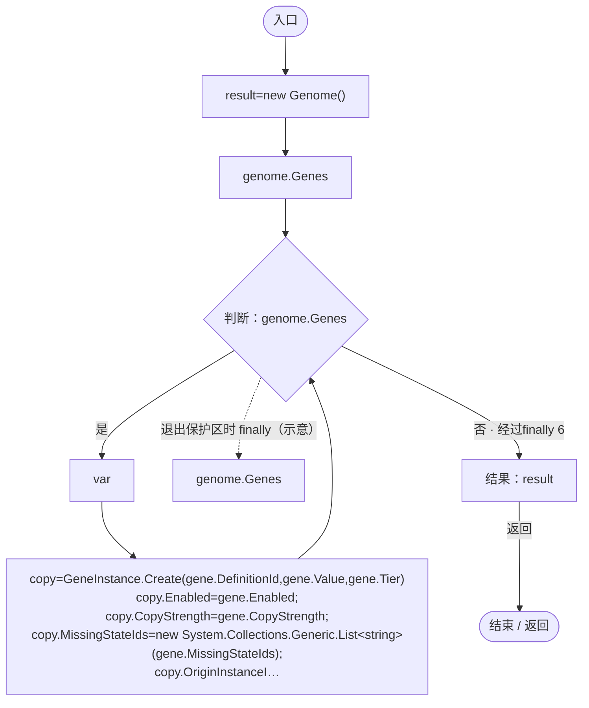

项目内调用/回调引用：

- [GeneInstance.Create · L20](f82e1498d67f5afd.md#m72e94c278de3cf8b)（方法）
- [Genome.Add · L19](a2ef23f865bc7ee8.md#md9cfdc94b8b8d40f)（方法）

## Spawn · L20

`private static DarwinEntity Spawn(Genome genome,Vector3 point)`

### Editor / Player · Roslyn编译器控制流

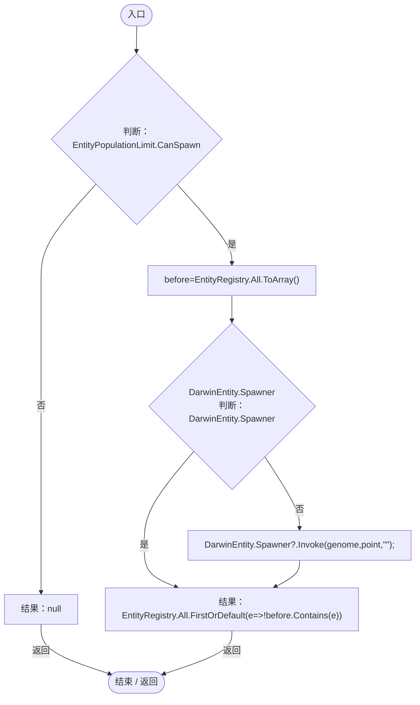

项目内调用/回调引用：

- [AntColonyReproduction.回调@23 · L23](c22084eac4e522ed.md#mc221a75f09659e3e)（回调/委托）

## 回调@23 · L23

`e … => 回调`

### Editor / Player · Roslyn编译器控制流

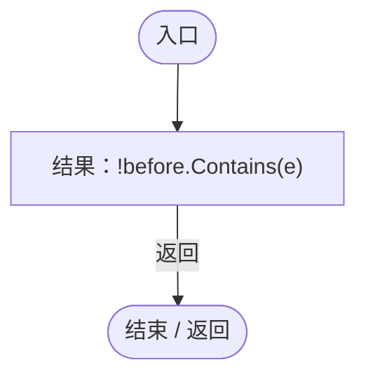

## Advance · L25

`public static void Advance(AntColonyMember queen,float dt)`

### Editor / Player · Roslyn编译器控制流

```mermaid
flowchart TD
  b0(["入口"])
  b1{"判断：queen.Role!=AntRole.Queen"}
  b2{"判断：queen.Young"}
  b3{"判断：queen.State.founding"}
  b4{"判断：queen.Genes.CurrentAge!=AgeState.Adult"}
  b5["queen.State.mateWait=0;"]
  b6{"判断：dt&lt;=0"}
  b7{"判断：DarwinPark.Core.WorldAuthority.IsReplica"}
  b8{"genes=queen.Genes<br/>state=queen.State<br/>settings=AntColonySettings.Current<br/>stats=queen.GetComponent&lt;EntityStats&gt;()<br/>reproduction=genes.Evaluation.Genes.Where(g=&gt;g.IsActive&amp;&amp;genes.GetLogic(g.Gene) is ReproductionGeneLogic).OrderByDescending(g=…"}
  b9{"state.mateWait=0;<br/>判断：genes.IsGestating"}
  b10["genes.IsGestating=false;<br/>state.reproductionTimer=0;<br/>genes.Recalculate();"]
  b11{"reproduction.State<br/>判断：reproduction.State"}
  b12[".StateId"]
  b13["reproduction.State"]
  b14["sexual=reproduction.State?.StateId==&quot;sexual&quot;"]
  b15{"mates=queen.Group.Where(m=&gt;m.Role==AntRole.Mate).OrderBy(m=&gt;m.Population.JoinOrder).ToArray()<br/>判断：EntityPopulationLimit.CanSpawn"}
  b16{"判断：sexual"}
  b17{"判断：ParthenogenesisCondition.Enabled(genes)"}
  b18{"判断：mates.Length==0"}
  b19{"判断：stats.TryGet(&quot;storedNutrient&quot;,out var mateReserve)"}
  b20{"判断：mateReserve&gt;=settings.mateCost"}
  b21{"判断：DarwinEntity.Spawner!=null"}
  b22{"判断：ColonyFormation.TryBirthPosition(queen,out var matePoint)"}
  b23["Spawn(Copy(genes.Genome),matePoint)"]
  b24["null"]
  b25["mate=ColonyFormation.TryBirthPosition(queen,out var matePoint)?Spawn(Copy(genes.Genome),matePoint):null"]
  b26{"判断：mate!=null"}
  b27["AntColonyMember.Ensure(mate.GetComponent&lt;PopulationBehavior&gt;()).Assign(AntRole.Mate,queen.GroupId);<br/>mate.GetComponent&lt;EntityLifeCycle&gt;().RestoreProgress(LifeCycleSettings.Load().adultProgress);<br/>mask=(1&lt;&lt;(int)AgeState.Infant)&#124;(1&lt;&lt;(int)Age…"]
  b28{"判断：genes.IsGestating"}
  b29{"state.mateWait=0;<br/>state.reproductionTimer=Mathf.Max(0,state.reproductionTimer-dt);<br/>判断：state.reproductionTimer&gt;0"}
  b30{"判断：DarwinEntity.Spawner==null"}
  b31{"判断：ColonyFormation.TryBirthPosition(queen,out var point)"}
  b32{"child=Copy(genes.Genome)<br/>判断：state.partnerGenome!=null"}
  b33["child.Genes"]
  b34{"判断：child.Genes"}
  b35["var"]
  b36{"partner=state.partnerGenome.Genes.FirstOrDefault(g=&gt;g.DefinitionId==gene.DefinitionId)<br/>判断：partner!=null"}
  b37["gene.Value=(gene.Value+partner.Value)*.5f;"]
  b38["child.Genes"]
  b39{"判断：EcologyReproduction.Spawn(genes,child,point)"}
  b40["genes.IsGestating=false;<br/>state.partnerGenome=null;<br/>state.parthenogenetic=false;<br/>state.reproductionCooldown=settings.queenCooldownSeconds;<br/>genes.Recalculate();"]
  b41{"判断：state.reproductionCooldown&gt;0"}
  b42["state.mateWait=0;"]
  b43["eligibleMate=mates.FirstOrDefault(m=&gt;EcologyQueries.Distance(queen.transform.position,m.transform.position)&lt;=settings.feedRadius)"]
  b44{"genes<br/>state.mateWait<br/>判断：sexual"}
  b45["eligibleMate!=null"]
  b46["!sexual"]
  b47["parthenogenetic=ParthenogenesisCondition.Advance(genes,ref state.mateWait,!sexual&#124;&#124;eligibleMate!=null,dt)"]
  b48{"判断：EntityPopulationLimit.CanSpawn"}
  b49{"判断：sexual"}
  b50{"判断：eligibleMate==null"}
  b51{"判断：parthenogenetic"}
  b52{"判断：stats.TryGet(&quot;storedNutrient&quot;,out float reserve)"}
  b53{"判断：reserve&lt;settings.queenBirthCost"}
  b54{"判断：PopulationMaintenance.BreedingReady(genes,ref state.maintenanceWait,dt)"}
  b55["state.maintenanceWait=0;<br/>stats.Modify(&quot;storedNutrient&quot;,-settings.queenBirthCost);"]
  b56{"state.partnerGenome<br/>判断：sexual"}
  b57{"判断：parthenogenetic"}
  b58["Copy(eligibleMate.Genes.Genome)"]
  b59["null"]
  b60["state.partnerGenome=sexual&amp;&amp;!parthenogenetic?Copy(eligibleMate.Genes.Genome):null;"]
  b61["state.parthenogenetic=parthenogenetic;<br/>state.mateWait=0;<br/>state.reproductionTimer=settings.queenGestationSeconds;<br/>genes.IsGestating=true;<br/>genes.Recalculate();"]
  b62(["结束 / 返回"])
  b0 --> b1
  b1 -->|"否"| b2
  b1 -->|"是"| b5
  b2 -->|"否"| b3
  b2 -->|"是"| b5
  b3 -->|"否"| b4
  b3 -->|"是"| b5
  b4 -->|"是"| b5
  b4 -->|"否"| b6
  b5 --> b62
  b6 -->|"否"| b7
  b6 -->|"是"| b62
  b7 -->|"是"| b62
  b7 -->|"否"| b8
  b8 -->|"是"| b9
  b8 -->|"否"| b11
  b9 -->|"是"| b10
  b9 -->|"否"| b62
  b10 --> b62
  b11 -->|"否"| b12
  b11 -->|"是"| b13
  b12 --> b14
  b13 --> b14
  b14 --> b15
  b15 -->|"是"| b16
  b15 -->|"否"| b28
  b16 -->|"是"| b17
  b16 -->|"否"| b28
  b17 -->|"否"| b18
  b17 -->|"是"| b28
  b18 -->|"是"| b19
  b18 -->|"否"| b28
  b19 -->|"是"| b20
  b19 -->|"否"| b28
  b20 -->|"是"| b21
  b20 -->|"否"| b28
  b21 -->|"是"| b22
  b21 -->|"否"| b28
  b22 -->|"是"| b23
  b22 -->|"否"| b24
  b23 --> b25
  b24 --> b25
  b25 --> b26
  b26 -->|"是"| b27
  b26 -->|"否"| b28
  b27 --> b28
  b28 -->|"是"| b29
  b28 -->|"否"| b41
  b29 -->|"否"| b30
  b29 -->|"是"| b62
  b30 -->|"是"| b62
  b30 -->|"否"| b31
  b31 -->|"否"| b62
  b31 -->|"是"| b32
  b32 -->|"是"| b33
  b32 -->|"否"| b39
  b33 --> b34
  b34 -->|"是"| b35
  b34 -->|"否 · 经过finally 38"| b39
  b35 --> b36
  b36 -->|"是"| b37
  b36 -->|"否"| b34
  b37 --> b34
  b39 -->|"否"| b62
  b39 -->|"是"| b40
  b40 --> b62
  b41 -->|"是"| b42
  b41 -->|"否"| b43
  b42 --> b62
  b43 --> b44
  b44 -->|"是"| b45
  b44 -->|"否"| b46
  b45 --> b47
  b46 --> b47
  b47 --> b48
  b48 -->|"是"| b49
  b48 -->|"否"| b62
  b49 -->|"是"| b50
  b49 -->|"否"| b52
  b50 -->|"是"| b51
  b50 -->|"否"| b52
  b51 -->|"否"| b62
  b51 -->|"是"| b52
  b52 -->|"是"| b53
  b52 -->|"否"| b62
  b53 -->|"是"| b62
  b53 -->|"否"| b54
  b54 -->|"否"| b62
  b54 -->|"是"| b55
  b55 --> b56
  b56 -->|"是"| b57
  b56 -->|"否"| b59
  b57 -->|"否"| b58
  b57 -->|"是"| b59
  b58 --> b60
  b59 --> b60
  b60 --> b61
  b61 --> b62
  b34 -. "退出保护区时 finally（示意）" .-> b38

```

项目内调用/回调引用：

- [AntColonyMember.Role.get · L33](baebd85c05598377.md#mdf6df89f7116c7a3)（访问器）
- [AntColonyMember.State.get · L27](baebd85c05598377.md#mc8282e8cc823ceeb)（访问器）
- [EntityGeneController.CurrentAge.get · L34](7494d53178552f0e.md#m83a42c16950b22a4)（访问器）
- [AntColonyMember.Genes.get · L28](baebd85c05598377.md#m3b8445af6c82650a)（访问器）
- [AntColonySettings.Current.get · L31](cb0a937e97c8fbb3.md#mcd121159f407ccdf)（访问器）
- [EntityGeneController.Evaluation.get · L18](7494d53178552f0e.md#mc0039c100a31b455)（访问器）
- [EntityGeneController.Recalculate · L97](7494d53178552f0e.md#m65ea735c1e0e37a1)（方法）
- [ParthenogenesisCondition.Enabled · L240](ac319ea70bd8b723.md#m499205f07a802d45)（方法）
- [EntityStats.TryGet · L90](75aa86a368efdf24.md#m24ee1433e4a70d94)（方法）
- [ColonyFormation.TryBirthPosition · L58](c65dce2d54e43480.md#mca6d307a76eab2fd)（方法）
- [AntColonyReproduction.Spawn · L20](c22084eac4e522ed.md#m99ea14de391cddc1)（方法）
- [AntColonyReproduction.Copy · L13](c22084eac4e522ed.md#m5e7859cf2b7c0507)（方法）
- [AntColonyMember.Assign · L54](baebd85c05598377.md#mda0fe308acecb8f2)（方法）
- [AntColonyMember.Ensure · L51](baebd85c05598377.md#m408f716118716988)（方法）
- [EntityLifeCycle.RestoreProgress · L48](9f4138bfbae654b7.md#mfc75121476d49679)（方法）
- [LifeCycleSettings.Load · L16](ace76969fe8f61de.md#mbd2925785484f343)（方法）
- [EntityGeneController.RestoreStageState · L51](7494d53178552f0e.md#m6264213de2a5ca6f)（方法）
- [DarwinEntity.Genes.get · L14](70798dde169f2e8b.md#m622eb1adf401d431)（访问器）
- [EntityStats.Modify · L104](75aa86a368efdf24.md#m858c2a75d852ecc1)（方法）
- [EcologyReproduction.Spawn · L9](eaaa574d7ae50e29.md#mc64a3524363ab773)（方法）
- [ParthenogenesisCondition.Advance · L241](ac319ea70bd8b723.md#m9459f12c1abb4ab0)（方法）
- [PopulationMaintenance.BreedingReady · L119](923ccc4e86c4786c.md#mdecd55c22dabf7b3)（方法）
- [AntColonyReproduction.回调@30 · L30](c22084eac4e522ed.md#m1f026797728dbc63)（回调/委托）
- [AntColonyReproduction.回调@30 · L30](c22084eac4e522ed.md#m24e5edcb08c33e81)（回调/委托）
- [AntColonyReproduction.回调@34 · L34](c22084eac4e522ed.md#m102557098f2d7696)（回调/委托）
- [AntColonyReproduction.回调@34 · L34](c22084eac4e522ed.md#me28efcf9964dd0e3)（回调/委托）
- [AntColonyReproduction.回调@57 · L57](c22084eac4e522ed.md#me250f414645deff2)（回调/委托）
- [AntColonyReproduction.回调@62 · L62](c22084eac4e522ed.md#m226be2737d50e4da)（回调/委托）

## 回调@30 · L30

`g … => 回调`

### Editor / Player · Roslyn编译器控制流

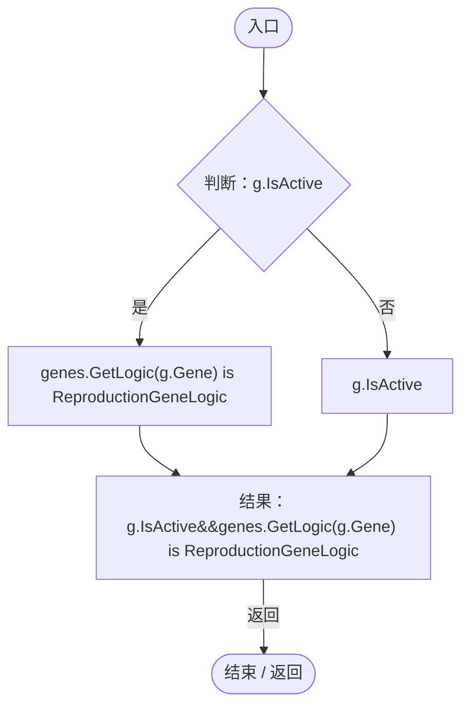

项目内调用/回调引用：

- [EntityGeneController.GetLogic · L211](7494d53178552f0e.md#maadb710e89e60395)（方法）

## 回调@30 · L30

`g … => 回调`

### Editor / Player · Roslyn编译器控制流

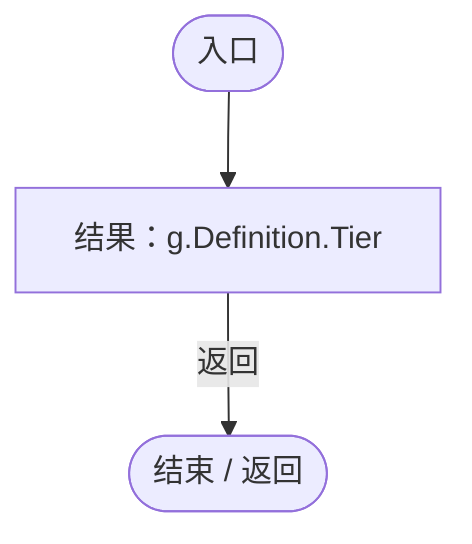

## 回调@34 · L34

`m … => 回调`

### Editor / Player · Roslyn编译器控制流

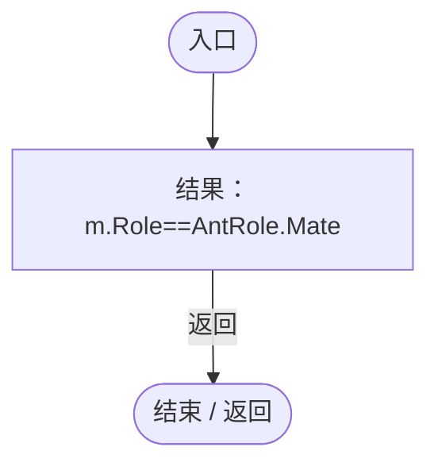

项目内调用/回调引用：

- [AntColonyMember.Role.get · L33](baebd85c05598377.md#mdf6df89f7116c7a3)（访问器）

## 回调@34 · L34

`m … => 回调`

### Editor / Player · Roslyn编译器控制流

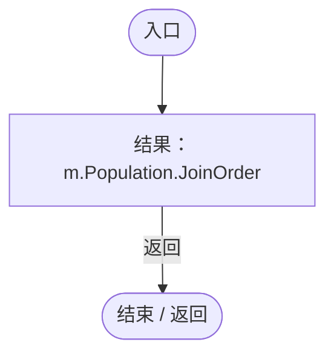

项目内调用/回调引用：

- [PopulationBehavior.JoinOrder.get · L21](21e4f62f75a9a80f.md#m83871a50fb1160fd)（访问器）
- [AntColonyMember.Population.get · L30](baebd85c05598377.md#m688c2c0dfb5a66d6)（访问器）

## 回调@57 · L57

`g … => 回调`

### Editor / Player · Roslyn编译器控制流

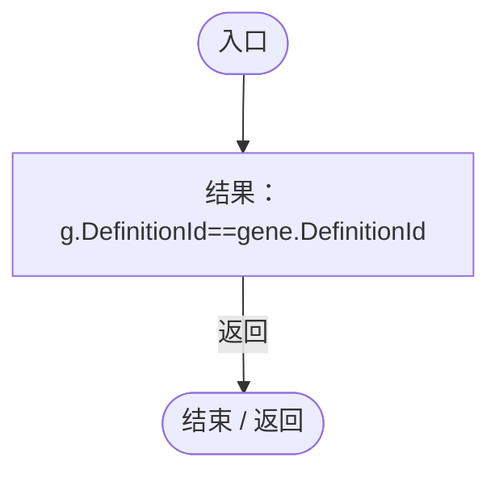

## 回调@62 · L62

`m … => 回调`

### Editor / Player · Roslyn编译器控制流

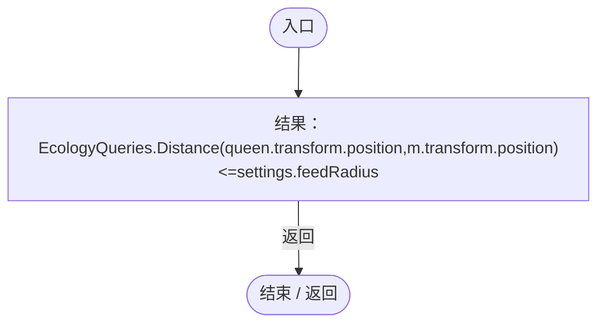

项目内调用/回调引用：

- [EcologyQueries.Distance · L42](bdf7ccc2c9c0452f.md#mba9c3e3c95d0f2dd)（方法）
