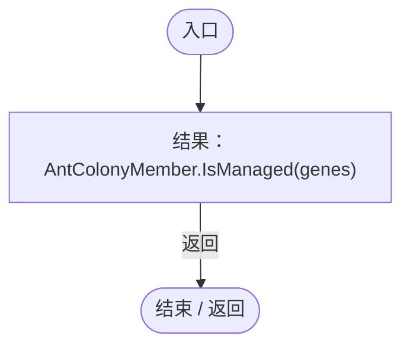
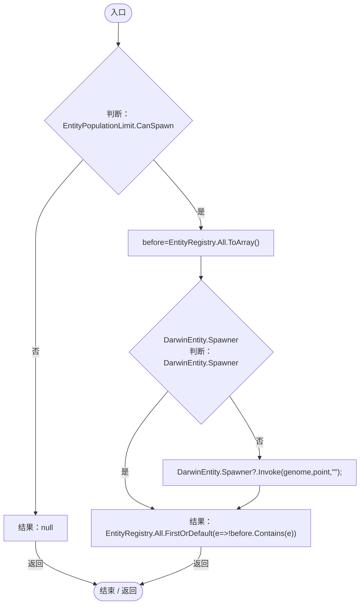
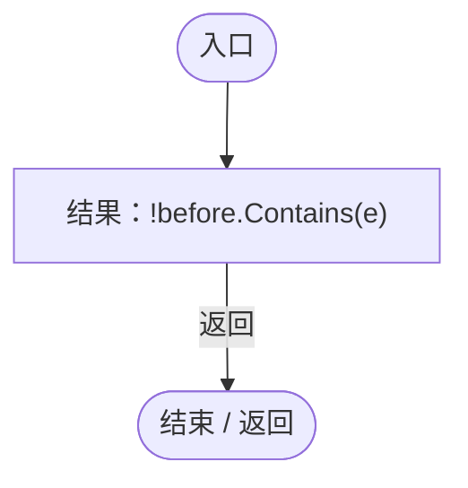
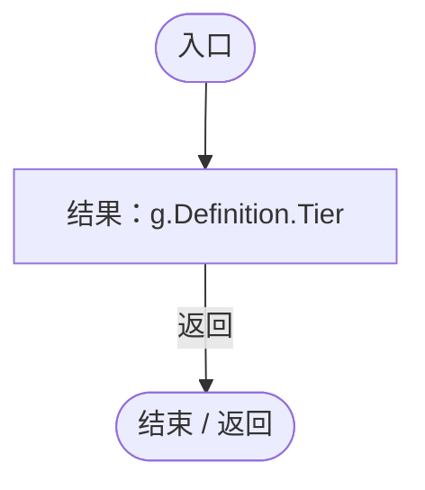
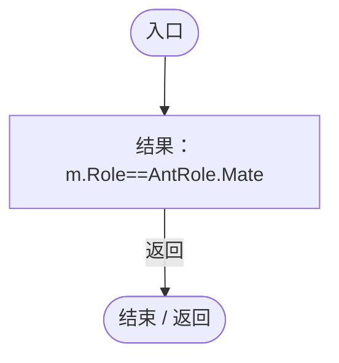
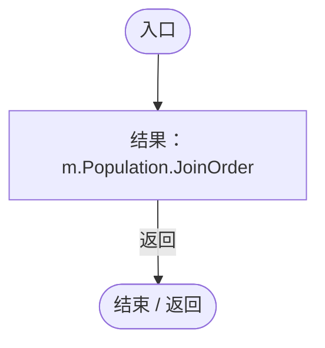
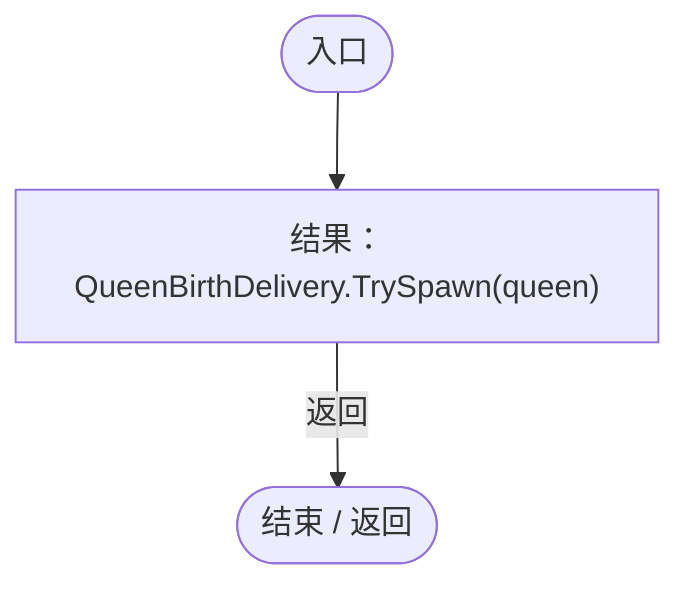
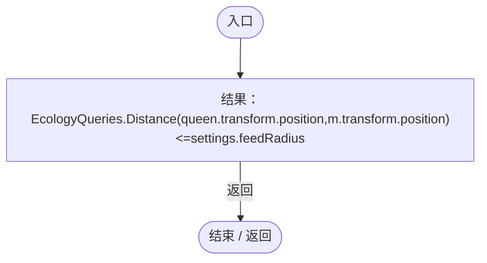

```mermaid
flowchart TD
  b0(["入口"])
  b1{"判断：queen.Role!=AntRole.Queen"}
  b2{"判断：queen.Young"}
  b3{"判断：queen.State.founding"}
  b4{"判断：queen.Genes.CurrentAge!=AgeState.Adult"}
  b5["queen.State.mateWait=0;"]
  b6{"判断：dt&lt;=0"}
  b7{"判断：DarwinPark.Core.WorldAuthority.IsReplica"}
  b8{"genes=queen.Genes<br/>state=queen.State<br/>settings=AntColonySettings.Current<br/>stats=queen.GetComponent&lt;EntityStats&gt;()<br/>reproduction=genes.Evaluation.Genes.Where(g=&gt;g.IsActive&amp;&amp;genes.GetLogic(g.Gene) is ReproductionGeneLogic).OrderByDescending(g=…"}
  b9{"state.mateWait=0;<br/>判断：genes.IsGestating"}
  b10["genes.IsGestating=false;<br/>state.reproductionTimer=0;<br/>genes.Recalculate();"]
  b11{"reproduction.State<br/>判断：reproduction.State"}
  b12[".StateId"]
  b13["reproduction.State"]
  b14["sexual=reproduction.State?.StateId==&quot;sexual&quot;"]
  b15{"mates=queen.Group.Where(m=&gt;m.Role==AntRole.Mate).OrderBy(m=&gt;m.Population.JoinOrder).ToArray()<br/>判断：EntityPopulationLimit.CanSpawn"}
  b16{"判断：sexual"}
  b17{"判断：ParthenogenesisCondition.Enabled(genes)"}
  b18{"判断：mates.Length==0"}
  b19{"判断：stats.TryGet(&quot;storedNutrient&quot;,out var mateReserve)"}
  b20{"判断：mateReserve&gt;=settings.mateCost"}
  b21{"判断：DarwinEntity.Spawner!=null"}
  b22{"判断：ColonyFormation.TryBirthPosition(queen,out var matePoint)"}
  b23["Spawn(Copy(genes.Genome),matePoint)"]
  b24["null"]
  b25["mate=ColonyFormation.TryBirthPosition(queen,out var matePoint)?Spawn(Copy(genes.Genome),matePoint):null"]
  b26{"判断：mate!=null"}
  b27["AntColonyMember.Ensure(mate.GetComponent&lt;PopulationBehavior&gt;()).Assign(AntRole.Mate,queen.GroupId);<br/>mate.GetComponent&lt;EntityLifeCycle&gt;().RestoreProgress(LifeCycleSettings.Load().adultProgress);<br/>mask=(1&lt;&lt;(int)AgeState.Infant)&#124;(1&lt;&lt;(int)Age…"]
  b28{"判断：genes.IsGestating"}
  b29{"state.mateWait=0;<br/>state.reproductionTimer=Mathf.Max(0,state.reproductionTimer-dt);<br/>判断：state.reproductionTimer&gt;0"}
  b30{"判断：DarwinEntity.Spawner==null"}
  b31{"判断：MultipleBirthPolicy.Deliver(ref state.litter,()=&gt;QueenBirthDelivery.TrySpawn(queen))"}
  b32["state.litter=null;<br/>genes.IsGestating=false;<br/>state.partnerGenome=null;<br/>state.parthenogenetic=false;<br/>state.reproductionCooldown=settings.queenCooldownSeconds;<br/>genes.Recalculate();"]
  b33{"判断：state.reproductionCooldown&gt;0"}
  b34["state.mateWait=0;"]
  b35["eligibleMate=mates.FirstOrDefault(m=&gt;EcologyQueries.Distance(queen.transform.position,m.transform.position)&lt;=settings.feedRadius)"]
  b36{"genes<br/>state.mateWait<br/>判断：sexual"}
  b37["eligibleMate!=null"]
  b38["!sexual"]
  b39["parthenogenetic=ParthenogenesisCondition.Advance(genes,ref state.mateWait,!sexual&#124;&#124;eligibleMate!=null,dt)"]
  b40{"判断：EntityPopulationLimit.CanSpawn"}
  b41{"判断：sexual"}
  b42{"判断：eligibleMate==null"}
  b43{"判断：parthenogenetic"}
  b44{"判断：stats.TryGet(&quot;storedNutrient&quot;,out float reserve)"}
  b45{"判断：reserve&lt;settings.queenBirthCost*MultipleBirthPolicy.Count(genes)"}
  b46{"判断：ColonyFoundingSupport.NeedsWorker(queen)"}
  b47{"判断：PopulationMaintenance.BreedingReady(genes,ref state.maintenanceWait,dt)"}
  b48["state.maintenanceWait=0;<br/>state.litter=MultipleBirthPolicy.Begin(genes);<br/>stats.Modify(&quot;storedNutrient&quot;,-settings.queenBirthCost*state.litter.planned);"]
  b49{"state.partnerGenome<br/>判断：sexual"}
  b50{"判断：parthenogenetic"}
  b51["Copy(eligibleMate.Genes.Genome)"]
  b52["null"]
  b53["state.partnerGenome=sexual&amp;&amp;!parthenogenetic?Copy(eligibleMate.Genes.Genome):null;"]
  b54["state.parthenogenetic=parthenogenetic;<br/>state.mateWait=0;<br/>state.reproductionTimer=settings.queenGestationSeconds;<br/>genes.IsGestating=true;<br/>genes.Recalculate();"]
  b55(["结束 / 返回"])
  b0 --> b1
  b1 -->|"否"| b2
  b1 -->|"是"| b5
  b2 -->|"否"| b3
  b2 -->|"是"| b5
  b3 -->|"否"| b4
  b3 -->|"是"| b5
  b4 -->|"是"| b5
  b4 -->|"否"| b6
  b5 --> b55
  b6 -->|"否"| b7
  b6 -->|"是"| b55
  b7 -->|"是"| b55
  b7 -->|"否"| b8
  b8 -->|"是"| b9
  b8 -->|"否"| b11
  b9 -->|"是"| b10
  b9 -->|"否"| b55
  b10 --> b55
  b11 -->|"否"| b12
  b11 -->|"是"| b13
  b12 --> b14
  b13 --> b14
  b14 --> b15
  b15 -->|"是"| b16
  b15 -->|"否"| b28
  b16 -->|"是"| b17
  b16 -->|"否"| b28
  b17 -->|"否"| b18
  b17 -->|"是"| b28
  b18 -->|"是"| b19
  b18 -->|"否"| b28
  b19 -->|"是"| b20
  b19 -->|"否"| b28
  b20 -->|"是"| b21
  b20 -->|"否"| b28
  b21 -->|"是"| b22
  b21 -->|"否"| b28
  b22 -->|"是"| b23
  b22 -->|"否"| b24
  b23 --> b25
  b24 --> b25
  b25 --> b26
  b26 -->|"是"| b27
  b26 -->|"否"| b28
  b27 --> b28
  b28 -->|"是"| b29
  b28 -->|"否"| b33
  b29 -->|"否"| b30
  b29 -->|"是"| b55
  b30 -->|"是"| b55
  b30 -->|"否"| b31
  b31 -->|"否"| b55
  b31 -->|"是"| b32
  b32 --> b55
  b33 -->|"是"| b34
  b33 -->|"否"| b35
  b34 --> b55
  b35 --> b36
  b36 -->|"是"| b37
  b36 -->|"否"| b38
  b37 --> b39
  b38 --> b39
  b39 --> b40
  b40 -->|"是"| b41
  b40 -->|"否"| b55
  b41 -->|"是"| b42
  b41 -->|"否"| b44
  b42 -->|"是"| b43
  b42 -->|"否"| b44
  b43 -->|"否"| b55
  b43 -->|"是"| b44
  b44 -->|"是"| b45
  b44 -->|"否"| b55
  b45 -->|"是"| b55
  b45 -->|"否"| b46
  b46 -->|"否"| b47
  b46 -->|"是"| b48
  b47 -->|"否"| b55
  b47 -->|"是"| b48
  b48 --> b49
  b49 -->|"是"| b50
  b49 -->|"否"| b52
  b50 -->|"否"| b51
  b50 -->|"是"| b52
  b51 --> b53
  b52 --> b53
  b53 --> b54
  b54 --> b55

```

# AntColonyReproduction.cs

[返回总索引](../README.md) · `Runtime` · `Assets/DarwinPark/Entities/Ecology/AntColonyReproduction.cs`

[源文件](../../../Assets/DarwinPark/Entities/Ecology/AntColonyReproduction.cs) · 源码校验：`1ad53ff8bec7a155bb9acf5e63bf8e8aba72be6240b23125918bdfed8ad59fc4`

方法按源文件位置排列。事件/回调引用不表示立即执行；分支与异常说明见总索引。完整源码与可点击关系图请打开离线手册。

## BlocksOrdinary · L12

`public static bool BlocksOrdinary(EntityGeneController genes)`

### Editor / Player · Roslyn编译器控制流

项目内调用/回调引用：

- [AntColonyMember.IsManaged · L61](baebd85c05598377.md#mea2441446115e22a)（方法）

## Copy · L13

`private static Genome Copy(Genome genome)`

### Editor / Player · Roslyn编译器控制流

项目内调用/回调引用：

- [GeneInstance.Create · L20](f82e1498d67f5afd.md#m72e94c278de3cf8b)（方法）
- [Genome.Add · L19](a2ef23f865bc7ee8.md#md9cfdc94b8b8d40f)（方法）

## Spawn · L20

`private static DarwinEntity Spawn(Genome genome,Vector3 point)`

### Editor / Player · Roslyn编译器控制流

项目内调用/回调引用：

- [AntColonyReproduction.回调@23 · L23](c22084eac4e522ed.md#mc221a75f09659e3e)（回调/委托）

## 回调@23 · L23

`e … => 回调`

### Editor / Player · Roslyn编译器控制流

## Advance · L25

`public static void Advance(AntColonyMember queen,float dt)`

### Editor / Player · Roslyn编译器控制流

项目内调用/回调引用：

- [AntColonyMember.Role.get · L38](baebd85c05598377.md#mab30d459d599e4df)（访问器）
- [AntColonyMember.State.get · L32](baebd85c05598377.md#m426db6a7c12dd7aa)（访问器）
- [EntityGeneController.CurrentAge.get · L37](7494d53178552f0e.md#md08823d8f9a2fa16)（访问器）
- [AntColonyMember.Genes.get · L33](baebd85c05598377.md#m7331eee1fdd98961)（访问器）
- [AntColonySettings.Current.get · L31](cb0a937e97c8fbb3.md#mcd121159f407ccdf)（访问器）
- [EntityGeneController.Evaluation.get · L18](7494d53178552f0e.md#mc0039c100a31b455)（访问器）
- [EntityGeneController.Recalculate · L118](7494d53178552f0e.md#m707d9a56b0c7c609)（方法）
- [ParthenogenesisCondition.Enabled · L223](ac319ea70bd8b723.md#m08c81cd178d10c97)（方法）
- [EntityStats.TryGet · L90](75aa86a368efdf24.md#m24ee1433e4a70d94)（方法）
- [ColonyFormation.TryBirthPosition · L60](c65dce2d54e43480.md#m831083c364c87901)（方法）
- [AntColonyReproduction.Spawn · L20](c22084eac4e522ed.md#m99ea14de391cddc1)（方法）
- [AntColonyReproduction.Copy · L13](c22084eac4e522ed.md#m5e7859cf2b7c0507)（方法）
- [AntColonyMember.Assign · L62](baebd85c05598377.md#m4841f123cc075e2c)（方法）
- [AntColonyMember.Ensure · L59](baebd85c05598377.md#m54f7cb4868517795)（方法）
- [EntityLifeCycle.RestoreProgress · L52](9f4138bfbae654b7.md#m007c73a0c714c238)（方法）
- [LifeCycleSettings.Load · L16](ace76969fe8f61de.md#mbd2925785484f343)（方法）
- [EntityGeneController.RestoreStageState · L56](7494d53178552f0e.md#m37c1dbfa64e7c2ce)（方法）
- [DarwinEntity.Genes.get · L14](70798dde169f2e8b.md#m622eb1adf401d431)（访问器）
- [EntityStats.Modify · L104](75aa86a368efdf24.md#m858c2a75d852ecc1)（方法）
- [MultipleBirthPolicy.Deliver · L28](337309de03d51a54.md#m35382b130970384c)（方法）
- [ParthenogenesisCondition.Advance · L224](ac319ea70bd8b723.md#mcf1a1fee2fdbd0d3)（方法）
- [MultipleBirthPolicy.Count · L13](337309de03d51a54.md#m0fef88a7307367ee)（方法）
- [ColonyFoundingSupport.NeedsWorker · L14](404bb05c7f82518a.md#maadfc5b35bfda290)（方法）
- [PopulationMaintenance.BreedingReady · L129](923ccc4e86c4786c.md#m413243103de37add)（方法）
- [MultipleBirthPolicy.Begin · L20](337309de03d51a54.md#mc4aee4b72ab5db35)（方法）
- [AntColonyReproduction.回调@30 · L30](c22084eac4e522ed.md#m1f026797728dbc63)（回调/委托）
- [AntColonyReproduction.回调@30 · L30](c22084eac4e522ed.md#m24e5edcb08c33e81)（回调/委托）
- [AntColonyReproduction.回调@34 · L34](c22084eac4e522ed.md#m102557098f2d7696)（回调/委托）
- [AntColonyReproduction.回调@34 · L34](c22084eac4e522ed.md#me28efcf9964dd0e3)（回调/委托）
- [AntColonyReproduction.回调@54 · L54](c22084eac4e522ed.md#m1324185ee24f0598)（回调/委托）
- [AntColonyReproduction.回调@58 · L58](c22084eac4e522ed.md#m43ef85a830526335)（回调/委托）

## 回调@30 · L30

`g … => 回调`

### Editor / Player · Roslyn编译器控制流

项目内调用/回调引用：

- [EntityGeneController.GetLogic · L240](7494d53178552f0e.md#m9be6a2566c76c275)（方法）

## 回调@30 · L30

`g … => 回调`

### Editor / Player · Roslyn编译器控制流

## 回调@34 · L34

`m … => 回调`

### Editor / Player · Roslyn编译器控制流

项目内调用/回调引用：

- [AntColonyMember.Role.get · L38](baebd85c05598377.md#mab30d459d599e4df)（访问器）

## 回调@34 · L34

`m … => 回调`

### Editor / Player · Roslyn编译器控制流

项目内调用/回调引用：

- [PopulationBehavior.JoinOrder.get · L21](21e4f62f75a9a80f.md#m83871a50fb1160fd)（访问器）
- [AntColonyMember.Population.get · L35](baebd85c05598377.md#mbb8ec90c4baa2d1c)（访问器）

## 回调@54 · L54

`( … => 回调`

### Editor / Player · Roslyn编译器控制流

项目内调用/回调引用：

- [QueenBirthDelivery.TrySpawn · L9](10252933c19b3182.md#m909af39309730abd)（方法）

## 回调@58 · L58

`m … => 回调`

### Editor / Player · Roslyn编译器控制流

项目内调用/回调引用：

- [EcologyQueries.Distance · L42](bdf7ccc2c9c0452f.md#mba9c3e3c95d0f2dd)（方法）
