# MapEntityGeneFilterUI.cs

[返回总索引](../README.md) · `Runtime` · `Assets/DarwinPark/UI/MapEntityGeneFilterUI.cs`

[源文件](../../../Assets/DarwinPark/UI/MapEntityGeneFilterUI.cs) · 源码校验：`47e59987e61599ace9e5cfa61ef2b02726edbe61b5ee1844250b104831a365fc`

方法按源文件位置排列。事件/回调引用不表示立即执行；分支与异常说明见总索引。完整源码与可点击关系图请打开离线手册。

<a id="md463670cdf572dd3"></a>

## Criteria.get · L20

`get`


### Editor / Player · 语法控制结构 / 声明（非CFG）


<a id="me49f5899292d2cb2"></a>

## Matches.get · L21

`public IReadOnlyList<DarwinEntity> Matches`


### Editor / Player · 语法控制结构 / 声明（非CFG）

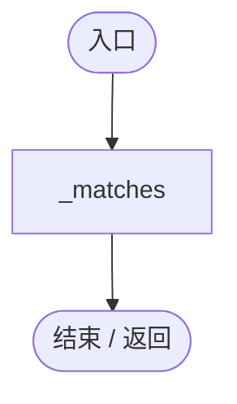

<a id="ma8e13db0a5068ad9"></a>

## Total.get · L22

`get`


### Editor / Player · 语法控制结构 / 声明（非CFG）

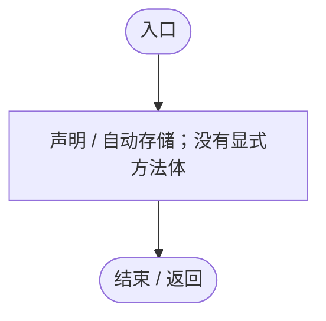

<a id="m6c4813369a52dc9a"></a>

## Total.set · L22

`private set`


### Editor / Player · 语法控制结构 / 声明（非CFG）


<a id="me3f26f9663c4ac0e"></a>

## LocatedEntity.get · L23

`get`


### Editor / Player · 语法控制结构 / 声明（非CFG）


<a id="m4e34574a8c8bc545"></a>

## LocatedEntity.set · L23

`private set`


### Editor / Player · 语法控制结构 / 声明（非CFG）


<a id="m02705633cd4835e0"></a>

## WideLayout.get · L24

`get`


### Editor / Player · 语法控制结构 / 声明（非CFG）


<a id="me6e08c95e3ce51f8"></a>

## WideLayout.set · L24

`private set`


### Editor / Player · 语法控制结构 / 声明（非CFG）


<a id="m373cb15050ba6722"></a>

## Card.get · L25

`public RectTransform Card`


### Editor / Player · 语法控制结构 / 声明（非CFG）

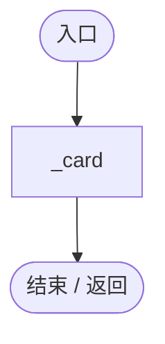

<a id="mc88f3eb8e48de500"></a>

## Results.get · L26

`public EntityFilterResultsUI Results`


### Editor / Player · 语法控制结构 / 声明（非CFG）

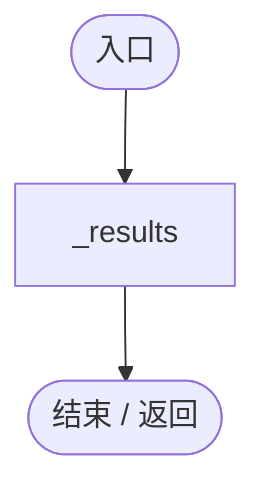

<a id="mff50a4605701578a"></a>

## Attach · L33

`public static void Attach(MapEntityStatisticsUI stats)`


### Editor / Player · Roslyn编译器控制流

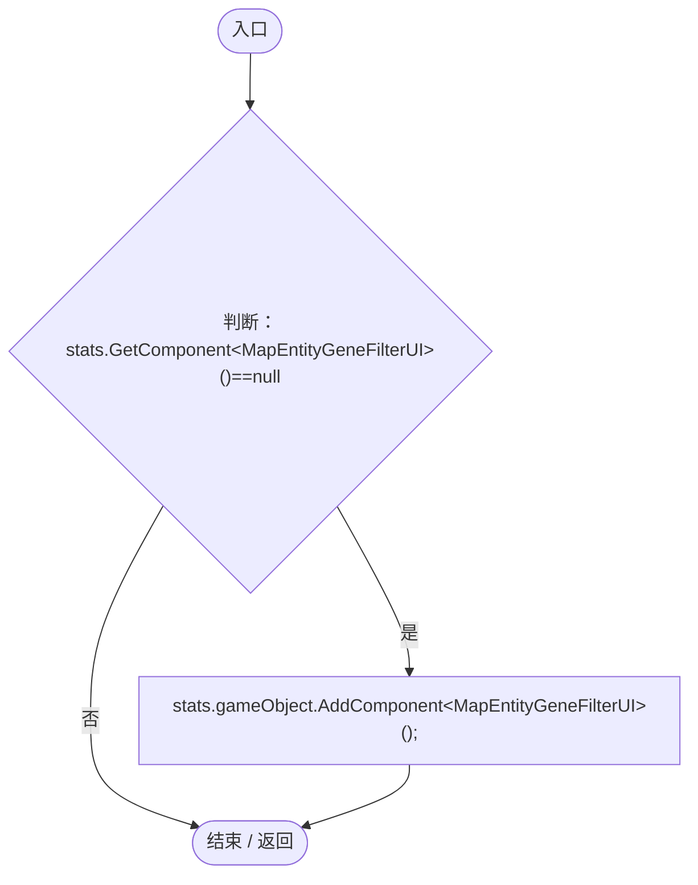

<a id="m019e81e3e295fbc4"></a>

## Start · L34

`private void Start()`


### Editor / Player · Roslyn编译器控制流

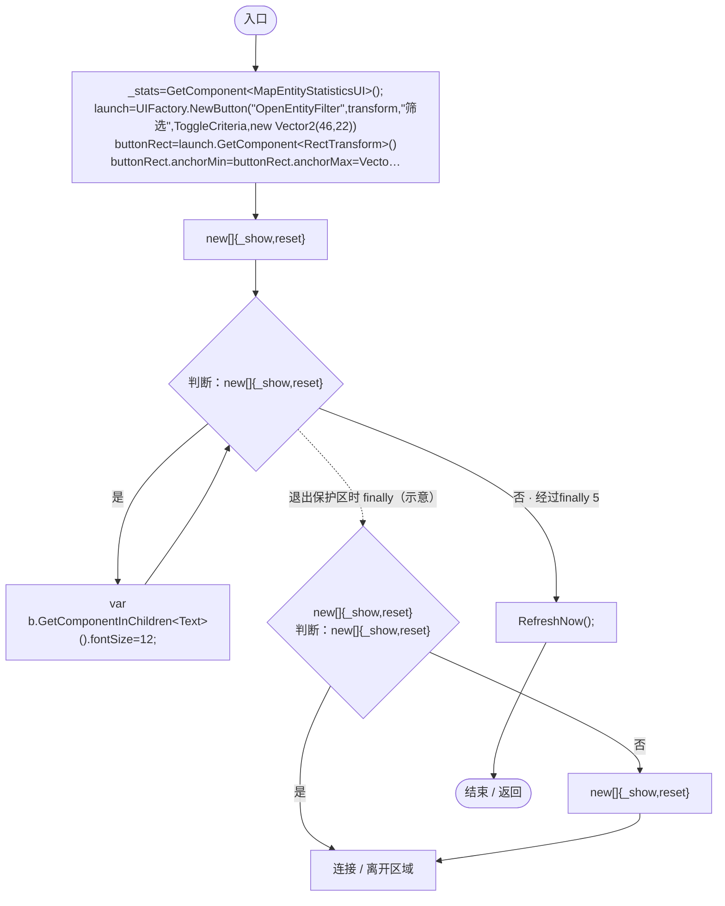

项目内调用/回调引用：

- [UIFactory.NewButton · L73](dd1096a6995423db.md#m5896f1b097c8bdde)（方法）
- [UIFactory.NewRect · L33](dd1096a6995423db.md#med612116f3152344)（方法）
- [UIVisualTheme.Paint · L58](ca525a798a08f966.md#m2d61a6b26ab24980)（方法）
- [MapEntityGeneFilterUI.Label · L49](c2cd33111de06171.md#m1bdbbeaf7cd19943)（方法）
- [MapEntityGeneFilterUI.Dropdown · L53](c2cd33111de06171.md#mc5f424327e239447)（方法）
- [MapEntityGeneFilterUI.Place · L51](c2cd33111de06171.md#m53579ae6839cefbb)（方法）
- [MapEntityGeneFilterUI.RefreshNow · L85](c2cd33111de06171.md#mb01da891ea5513fa)（方法）
- [MapEntityGeneFilterUI.ToggleCriteria · L115](c2cd33111de06171.md#ma2a79bd01ac6ede7)（方法）
- [MapEntityGeneFilterUI.OpenResults · L116](c2cd33111de06171.md#m9c7582411525ee46)（方法）
- [MapEntityGeneFilterUI.ResetFilter · L70](c2cd33111de06171.md#m7283c4fc481ca510)（方法）

<a id="m1bdbbeaf7cd19943"></a>

## Label · L49

`private Text Label(string name,string text,float y,float height,int size)`


### Editor / Player · Roslyn编译器控制流

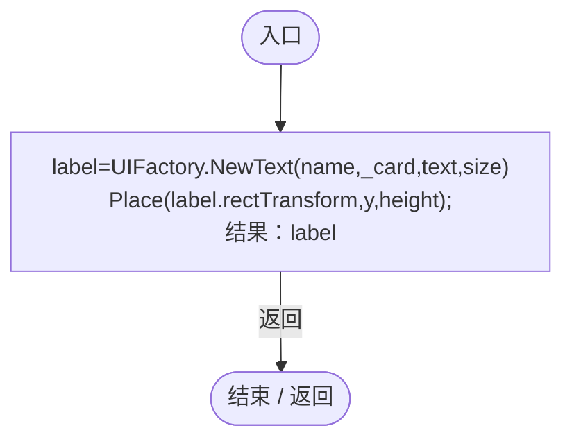

项目内调用/回调引用：

- [UIFactory.NewText · L57](dd1096a6995423db.md#m9dbccb5f0c38189e)（方法）
- [MapEntityGeneFilterUI.Place · L51](c2cd33111de06171.md#m53579ae6839cefbb)（方法）

<a id="m53579ae6839cefbb"></a>

## Place · L51

`private static void Place(RectTransform rect,float y,float height,float left=0,float right=1)`


### Editor / Player · Roslyn编译器控制流

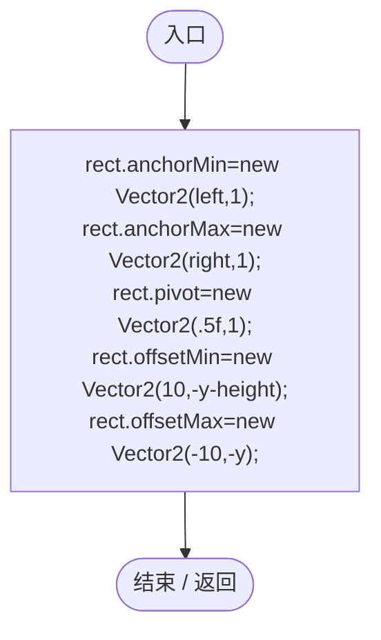

<a id="mc5f424327e239447"></a>

## Dropdown · L53

`private Dropdown Dropdown(string name,float y,bool include)`


### Editor / Player · Roslyn编译器控制流

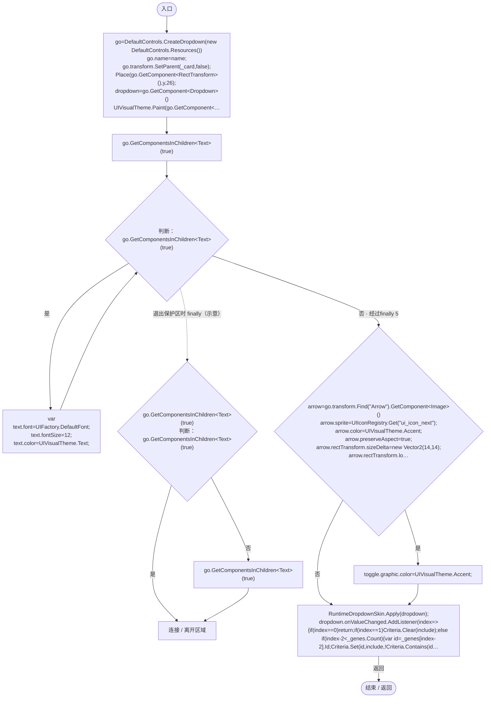

项目内调用/回调引用：

- [MapEntityGeneFilterUI.Place · L51](c2cd33111de06171.md#m53579ae6839cefbb)（方法）
- [UIVisualTheme.Paint · L58](ca525a798a08f966.md#m2d61a6b26ab24980)（方法）
- [UIFactory.DefaultFont.get · L17](dd1096a6995423db.md#m89af6843ae7629d3)（访问器）
- [UIIconRegistry.Get · L38](5e97f4545b48cac2.md#m95da89c0db2bbab9)（方法）
- [RuntimeDropdownSkin.Apply · L10](4e9d66f8395f54ec.md#m2b589d708f286228)（方法）
- [MapEntityGeneFilterUI.回调@63 · L63](c2cd33111de06171.md#m56f9b56de1854fa0)（回调/委托）

<a id="m56f9b56de1854fa0"></a>

## 回调@63 · L63

`index … => 回调`


### Editor / Player · Roslyn编译器控制流

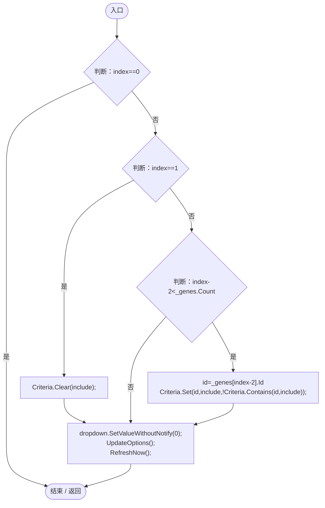

项目内调用/回调引用：

- [EntityGeneFilter.Clear · L23](9ff35fef2ba68deb.md#m8e2d24c782ff7469)（方法）
- [MapEntityGeneFilterUI.Criteria.get · L20](c2cd33111de06171.md#md463670cdf572dd3)（访问器）
- [EntityGeneFilter.Set · L16](9ff35fef2ba68deb.md#m3e568df1c7cc7da4)（方法）
- [EntityGeneFilter.Contains · L25](9ff35fef2ba68deb.md#ma1a047f98683fad4)（方法）
- [MapEntityGeneFilterUI.UpdateOptions · L71](c2cd33111de06171.md#m3b228a2cdb7b8e3e)（方法）
- [MapEntityGeneFilterUI.RefreshNow · L85](c2cd33111de06171.md#mb01da891ea5513fa)（方法）

<a id="m90c7c3a4c1019644"></a>

## SetGene · L66

`public bool SetGene(string id,bool include,bool enabled=true)`


### Editor / Player · Roslyn编译器控制流

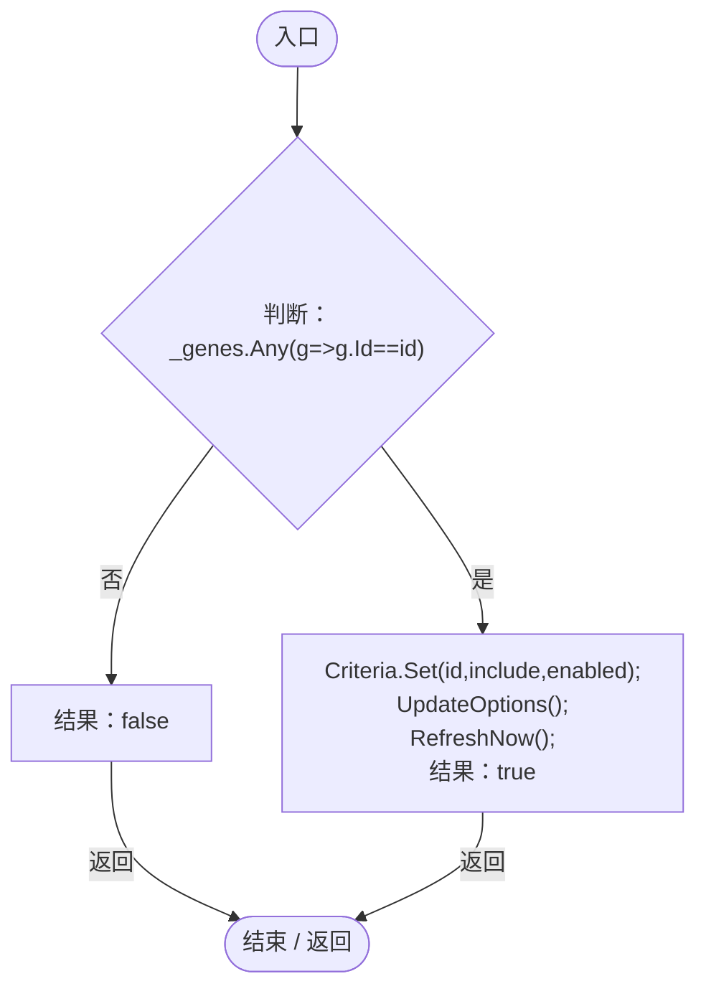

项目内调用/回调引用：

- [EntityGeneFilter.Set · L16](9ff35fef2ba68deb.md#m3e568df1c7cc7da4)（方法）
- [MapEntityGeneFilterUI.Criteria.get · L20](c2cd33111de06171.md#md463670cdf572dd3)（访问器）
- [MapEntityGeneFilterUI.UpdateOptions · L71](c2cd33111de06171.md#m3b228a2cdb7b8e3e)（方法）
- [MapEntityGeneFilterUI.RefreshNow · L85](c2cd33111de06171.md#mb01da891ea5513fa)（方法）
- [MapEntityGeneFilterUI.回调@68 · L68](c2cd33111de06171.md#m3db7cf5c0554f67e)（回调/委托）

<a id="m3db7cf5c0554f67e"></a>

## 回调@68 · L68

`g … => 回调`


### Editor / Player · Roslyn编译器控制流

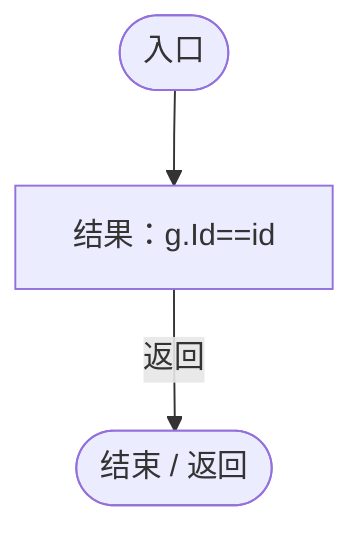

<a id="m7283c4fc481ca510"></a>

## ResetFilter · L70

`public void ResetFilter()`


### Editor / Player · Roslyn编译器控制流

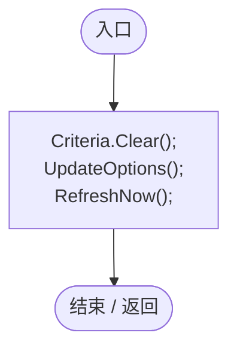

项目内调用/回调引用：

- [EntityGeneFilter.Clear · L22](9ff35fef2ba68deb.md#m33cd3d9bf4fab3c6)（方法）
- [MapEntityGeneFilterUI.Criteria.get · L20](c2cd33111de06171.md#md463670cdf572dd3)（访问器）
- [MapEntityGeneFilterUI.UpdateOptions · L71](c2cd33111de06171.md#m3b228a2cdb7b8e3e)（方法）
- [MapEntityGeneFilterUI.RefreshNow · L85](c2cd33111de06171.md#mb01da891ea5513fa)（方法）

<a id="m3b228a2cdb7b8e3e"></a>

## UpdateOptions · L71

`private void UpdateOptions()`


### Editor / Player · Roslyn编译器控制流

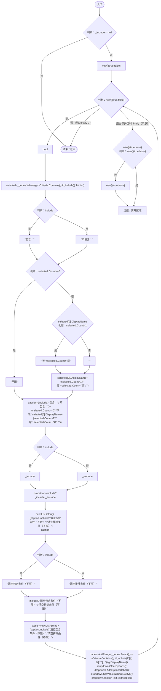

项目内调用/回调引用：

- [MapEntityGeneFilterUI.回调@76 · L76](c2cd33111de06171.md#mb9e76a3ffcaaff84)（回调/委托）
- [MapEntityGeneFilterUI.回调@80 · L80](c2cd33111de06171.md#mba11df217036f927)（回调/委托）

<a id="mb9e76a3ffcaaff84"></a>

## 回调@76 · L76

`g … => 回调`


### Editor / Player · Roslyn编译器控制流

```mermaid
flowchart TD
  b0(["入口"])
  b1["结果：Criteria.Contains(g.Id,include)"]
  b2(["结束 / 返回"])
  b0 --> b1
  b1 -->|"返回"| b2

```

项目内调用/回调引用：

- [EntityGeneFilter.Contains · L25](9ff35fef2ba68deb.md#ma1a047f98683fad4)（方法）
- [MapEntityGeneFilterUI.Criteria.get · L20](c2cd33111de06171.md#md463670cdf572dd3)（访问器）

<a id="mba11df217036f927"></a>

## 回调@80 · L80

`g … => 回调`


### Editor / Player · Roslyn编译器控制流

```mermaid
flowchart TD
  b0(["入口"])
  b1{"判断：Criteria.Contains(g.Id,include)"}
  b2["&quot;[已选] &quot;"]
  b3["&quot;[ ] &quot;"]
  b4["结果：(Criteria.Contains(g.Id,include)?&quot;[已选] &quot;:&quot;[ ] &quot;)+g.DisplayName"]
  b5(["结束 / 返回"])
  b0 --> b1
  b1 -->|"是"| b2
  b1 -->|"否"| b3
  b2 --> b4
  b3 --> b4
  b4 -->|"返回"| b5

```

项目内调用/回调引用：

- [EntityGeneFilter.Contains · L25](9ff35fef2ba68deb.md#ma1a047f98683fad4)（方法）
- [MapEntityGeneFilterUI.Criteria.get · L20](c2cd33111de06171.md#md463670cdf572dd3)（访问器）

<a id="mb01da891ea5513fa"></a>

## RefreshNow · L85

`public void RefreshNow()`


### Editor / Player · Roslyn编译器控制流

```mermaid
flowchart TD
  b0(["入口"])
  b1{"判断：_include==null"}
  b2{"_next=Time.unscaledTime+Mathf.Max(.1f,refreshInterval);<br/>catalog=GeneDatabase.All.ToArray()<br/>signature=string.Join(&quot;&#124;&quot;,catalog.Select(g=&gt;g.Id+&quot;:&quot;+g.DisplayName))<br/>判断：signature!=_catalog"}
  b3["_include.Hide();<br/>_exclude.Hide();<br/>_catalog=signature;<br/>_genes.Clear();<br/>_genes.AddRange(catalog.OrderBy(g=&gt;g.Tier).ThenBy(g=&gt;g.Id));<br/>Criteria.KeepKnown(new HashSet&lt;string&gt;(_genes.Select(g=&gt;g.Id)));<br/>UpdateOptions();"]
  b4{"_matches.Clear();<br/>Total=0;<br/>判断：WorldRuntimeGate.Ready"}
  b5["EntityRegistry.All"]
  b6{"判断：EntityRegistry.All"}
  b7{"var<br/>判断：EcologyQueries.Alive(entity)"}
  b8{"判断：entity.Genes==null"}
  b9{"Total++;<br/>判断：Criteria.Matches(entity)"}
  b10["_matches.Add(entity);"]
  b11{"判断：EntityRegistry.All"}
  b12["EntityRegistry.All"]
  b13["连接 / 离开区域"]
  b14{"_matches.Sort((a,b)=&gt;a.GetInstanceID().CompareTo(b.GetInstanceID()));<br/>_count.text=&quot;匹配 &quot;+_matches.Count+&quot; / &quot;+Total+&quot; 个实体&quot;;<br/>_show.interactable=WorldRuntimeGate.Ready;<br/>判断：WorldRuntimeGate.Ready"}
  b15["LocatedEntity=null;"]
  b16{"_results<br/>判断：_results"}
  b17["_results?.Hide();"]
  b18["_floating=false;"]
  b19{"_results<br/>判断：_results"}
  b20["_results?.Refresh();"]
  b21(["结束 / 返回"])
  b0 --> b1
  b1 -->|"是"| b21
  b1 -->|"否"| b2
  b2 -->|"是"| b3
  b2 -->|"否"| b4
  b3 --> b4
  b4 -->|"是"| b5
  b4 -->|"否"| b14
  b5 --> b6
  b6 -->|"是"| b7
  b6 -->|"否 · 经过finally 11"| b14
  b7 -->|"是"| b8
  b7 -->|"否"| b6
  b8 -->|"是"| b6
  b8 -->|"否"| b9
  b9 -->|"是"| b10
  b9 -->|"否"| b6
  b10 --> b6
  b11 -->|"否"| b12
  b11 -->|"是"| b13
  b12 --> b13
  b14 -->|"否"| b15
  b14 -->|"是"| b19
  b15 --> b16
  b16 -->|"否"| b17
  b16 -->|"是"| b18
  b17 --> b18
  b18 --> b19
  b19 -->|"否"| b20
  b19 -->|"是"| b21
  b20 --> b21
  b6 -. "退出保护区时 finally（示意）" .-> b11

```

项目内调用/回调引用：

- [GeneDatabase.All.get · L128](ec0a03483435a863.md#m0a367ed24734f426)（访问器）
- [EntityGeneFilter.KeepKnown · L24](9ff35fef2ba68deb.md#mffcd67113dd1cbf2)（方法）
- [MapEntityGeneFilterUI.Criteria.get · L20](c2cd33111de06171.md#md463670cdf572dd3)（访问器）
- [MapEntityGeneFilterUI.UpdateOptions · L71](c2cd33111de06171.md#m3b228a2cdb7b8e3e)（方法）
- [MapEntityGeneFilterUI.Total.set · L22](c2cd33111de06171.md#m6c4813369a52dc9a)（访问器）
- [EcologyQueries.Alive · L38](bdf7ccc2c9c0452f.md#mb2877c487f449970)（方法）
- [DarwinEntity.Genes.get · L14](70798dde169f2e8b.md#m622eb1adf401d431)（访问器）
- [MapEntityGeneFilterUI.Total.get · L22](c2cd33111de06171.md#ma8e13db0a5068ad9)（访问器）
- [EntityGeneFilter.Matches · L27](9ff35fef2ba68deb.md#m900802de8e1f1939)（方法）
- [MapEntityGeneFilterUI.LocatedEntity.set · L23](c2cd33111de06171.md#m4e34574a8c8bc545)（访问器）
- [EntityFilterResultsUI.Hide · L50](1376ad45671e7435.md#m55f0ffeb5db522f3)（方法）
- [EntityFilterResultsUI.Refresh · L57](1376ad45671e7435.md#m9fdc9b5605562307)（方法）
- [MapEntityGeneFilterUI.回调@88 · L88](c2cd33111de06171.md#m15b0b4d09e596a72)（回调/委托）
- [MapEntityGeneFilterUI.回调@91 · L91](c2cd33111de06171.md#m8e42b5fec7365e01)（回调/委托）
- [MapEntityGeneFilterUI.回调@91 · L91](c2cd33111de06171.md#mc7b3ea6017741729)（回调/委托）
- [MapEntityGeneFilterUI.回调@92 · L92](c2cd33111de06171.md#m2ffd5a7647c89ab3)（回调/委托）
- [MapEntityGeneFilterUI.回调@97 · L97](c2cd33111de06171.md#m008017f013aa5186)（回调/委托）

<a id="m15b0b4d09e596a72"></a>

## 回调@88 · L88

`g … => 回调`


### Editor / Player · Roslyn编译器控制流

```mermaid
flowchart TD
  b0(["入口"])
  b1["结果：g.Id+&quot;:&quot;+g.DisplayName"]
  b2(["结束 / 返回"])
  b0 --> b1
  b1 -->|"返回"| b2

```

<a id="m8e42b5fec7365e01"></a>

## 回调@91 · L91

`g … => 回调`


### Editor / Player · Roslyn编译器控制流

```mermaid
flowchart TD
  b0(["入口"])
  b1["结果：g.Tier"]
  b2(["结束 / 返回"])
  b0 --> b1
  b1 -->|"返回"| b2

```

<a id="mc7b3ea6017741729"></a>

## 回调@91 · L91

`g … => 回调`


### Editor / Player · Roslyn编译器控制流

```mermaid
flowchart TD
  b0(["入口"])
  b1["结果：g.Id"]
  b2(["结束 / 返回"])
  b0 --> b1
  b1 -->|"返回"| b2

```

<a id="m2ffd5a7647c89ab3"></a>

## 回调@92 · L92

`g … => 回调`


### Editor / Player · Roslyn编译器控制流

```mermaid
flowchart TD
  b0(["入口"])
  b1["结果：g.Id"]
  b2(["结束 / 返回"])
  b0 --> b1
  b1 -->|"返回"| b2

```

<a id="m008017f013aa5186"></a>

## 回调@97 · L97

`( … => 回调`


### Editor / Player · Roslyn编译器控制流

```mermaid
flowchart TD
  b0(["入口"])
  b1["结果：a.GetInstanceID().CompareTo(b.GetInstanceID())"]
  b2(["结束 / 返回"])
  b0 --> b1
  b1 -->|"返回"| b2

```

<a id="mc3ebf196aa1b3ceb"></a>

## LateUpdate · L102

`private void LateUpdate()`


### Editor / Player · Roslyn编译器控制流

```mermaid
flowchart TD
  b0(["入口"])
  b1{"判断：_card==null"}
  b2["parent=(RectTransform)_card.parent<br/>stats=(RectTransform)_stats.transform<br/>x=stats.offsetMax.x+gap<br/>available=parent.rect.width-x-12<br/>WideLayout=available&gt;=minimumWidth;"]
  b3{"判断：WideLayout"}
  b4["Mathf.Min(preferredWidth,available)"]
  b5["Mathf.Min(preferredWidth,parent.rect.width-24)"]
  b6["width=WideLayout?Mathf.Min(preferredWidth,available):Mathf.Min(preferredWidth,parent.rect.width-24)"]
  b7{"_card.gameObject<br/>判断：WideLayout"}
  b8["_floating"]
  b9["WideLayout"]
  b10["_card.gameObject.SetActive(WideLayout&#124;&#124;_floating);"]
  b11{"anchor=new Vector2(0,1)<br/>判断：_card.anchorMin!=anchor"}
  b12{"判断：_card.anchorMax!=anchor"}
  b13{"判断：_card.pivot!=anchor"}
  b14["_card.anchorMin=_card.anchorMax=anchor;<br/>_card.pivot=anchor;"]
  b15{"判断：WideLayout"}
  b16["new Vector2(x,0)"]
  b17["new Vector2(Mathf.Clamp(stats.offsetMin.x,12,Mathf.Max(12,parent.rect.width-width-12)),cardHeight+gap)"]
  b18["position=WideLayout?new Vector2(x,0):new Vector2(Mathf.Clamp(stats.offsetMin.x,12,Mathf.Max(12,parent.rect.width-width-12)),cardHeight+gap)"]
  b19{"size=new Vector2(width,cardHeight)<br/>判断：_card.anchoredPosition!=position"}
  b20["_card.anchoredPosition=position;"]
  b21{"判断：_card.sizeDelta!=size"}
  b22["_card.sizeDelta=size;"]
  b23{"判断：Time.unscaledTime&gt;=_next"}
  b24["RefreshNow();"]
  b25(["结束 / 返回"])
  b0 --> b1
  b1 -->|"是"| b25
  b1 -->|"否"| b2
  b2 --> b3
  b3 -->|"是"| b4
  b3 -->|"否"| b5
  b4 --> b6
  b5 --> b6
  b6 --> b7
  b7 -->|"否"| b8
  b7 -->|"是"| b9
  b8 --> b10
  b9 --> b10
  b10 --> b11
  b11 -->|"否"| b12
  b11 -->|"是"| b14
  b12 -->|"否"| b13
  b12 -->|"是"| b14
  b13 -->|"是"| b14
  b13 -->|"否"| b15
  b14 --> b15
  b15 -->|"是"| b16
  b15 -->|"否"| b17
  b16 --> b18
  b17 --> b18
  b18 --> b19
  b19 -->|"是"| b20
  b19 -->|"否"| b21
  b20 --> b21
  b21 -->|"是"| b22
  b21 -->|"否"| b23
  b22 --> b23
  b23 -->|"是"| b24
  b23 -->|"否"| b25
  b24 --> b25

```

项目内调用/回调引用：

- [MapEntityGeneFilterUI.WideLayout.set · L24](c2cd33111de06171.md#me6e08c95e3ce51f8)（访问器）
- [MapEntityGeneFilterUI.WideLayout.get · L24](c2cd33111de06171.md#m02705633cd4835e0)（访问器）
- [MapEntityGeneFilterUI.RefreshNow · L85](c2cd33111de06171.md#mb01da891ea5513fa)（方法）

<a id="ma2a79bd01ac6ede7"></a>

## ToggleCriteria · L115

`public void ToggleCriteria()`


### Editor / Player · Roslyn编译器控制流

```mermaid
flowchart TD
  b0(["入口"])
  b1{"_results<br/>判断：_results"}
  b2["_results?.Hide();"]
  b3{"_floating=!_floating;<br/>判断：_card!=null"}
  b4["_card.gameObject.SetActive(true);<br/>_card.SetAsLastSibling();"]
  b5["RefreshNow();"]
  b6(["结束 / 返回"])
  b0 --> b1
  b1 -->|"否"| b2
  b1 -->|"是"| b3
  b2 --> b3
  b3 -->|"是"| b4
  b3 -->|"否"| b5
  b4 --> b5
  b5 --> b6

```

项目内调用/回调引用：

- [EntityFilterResultsUI.Hide · L50](1376ad45671e7435.md#m55f0ffeb5db522f3)（方法）
- [MapEntityGeneFilterUI.RefreshNow · L85](c2cd33111de06171.md#mb01da891ea5513fa)（方法）

<a id="m9c7582411525ee46"></a>

## OpenResults · L116

`public void OpenResults()`


### Editor / Player · Roslyn编译器控制流

```mermaid
flowchart TD
  b0(["入口"])
  b1{"RefreshNow();<br/>判断：WorldRuntimeGate.Ready"}
  b2{"判断：_results==null"}
  b3["_results=EntityFilterResultsUI.Create(this);"]
  b4{"_results<br/>判断：_results"}
  b5["_results?.Show();"]
  b6{"判断：WideLayout"}
  b7["_floating=false;"]
  b8(["结束 / 返回"])
  b0 --> b1
  b1 -->|"否"| b8
  b1 -->|"是"| b2
  b2 -->|"是"| b3
  b2 -->|"否"| b4
  b3 --> b4
  b4 -->|"否"| b5
  b4 -->|"是"| b6
  b5 --> b6
  b6 -->|"否"| b7
  b6 -->|"是"| b8
  b7 --> b8

```

项目内调用/回调引用：

- [MapEntityGeneFilterUI.RefreshNow · L85](c2cd33111de06171.md#mb01da891ea5513fa)（方法）
- [EntityFilterResultsUI.Create · L19](1376ad45671e7435.md#m3619466dbcbdd0b5)（方法）
- [EntityFilterResultsUI.Show · L49](1376ad45671e7435.md#m914d9f8df129e6c5)（方法）
- [MapEntityGeneFilterUI.WideLayout.get · L24](c2cd33111de06171.md#m02705633cd4835e0)（访问器）

<a id="me05bb48415da55d6"></a>

## Locate · L121

`public bool Locate(DarwinEntity entity,bool inspect=false)`


### Editor / Player · Roslyn编译器控制流

```mermaid
flowchart TD
  b0(["入口"])
  b1{"判断：WorldRuntimeGate.Ready"}
  b2{"判断：Criteria.Matches(entity)"}
  b3["RefreshNow();<br/>结果：false"]
  b4{"判断：Camera.main!=null"}
  b5["Camera.main.GetComponent&lt;OrbitCamera&gt;()"]
  b6["null"]
  b7["camera=Camera.main!=null?Camera.main.GetComponent&lt;OrbitCamera&gt;():null"]
  b8{"判断：camera==null"}
  b9["结果：false"]
  b10{"EntityViewController.Instance<br/>判断：EntityViewController.Instance"}
  b11["EntityViewController.Instance?.ExitView();"]
  b12["collider=entity.GetComponent&lt;Collider&gt;()"]
  b13{"camera<br/>判断：collider!=null"}
  b14["collider.bounds.center"]
  b15["entity.transform.position"]
  b16["camera.FocusOn(collider!=null?collider.bounds.center:entity.transform.position);"]
  b17{"LocatedEntity=entity;<br/>判断：inspect"}
  b18{"Object.FindFirstObjectByType&lt;GeneInspectorUI&gt;()<br/>判断：Object.FindFirstObjectByType&lt;GeneInspectorUI&gt;()"}
  b19["Object.FindFirstObjectByType&lt;GeneInspectorUI&gt;()?.ShowEntityInfo(entity);"]
  b20{"_results<br/>判断：_results"}
  b21["_results?.Refresh();"]
  b22["结果：true"]
  b23(["结束 / 返回"])
  b0 --> b1
  b1 -->|"是"| b2
  b1 -->|"否"| b3
  b2 -->|"否"| b3
  b2 -->|"是"| b4
  b3 -->|"返回"| b23
  b4 -->|"是"| b5
  b4 -->|"否"| b6
  b5 --> b7
  b6 --> b7
  b7 --> b8
  b8 -->|"是"| b9
  b8 -->|"否"| b10
  b9 -->|"返回"| b23
  b10 -->|"否"| b11
  b10 -->|"是"| b12
  b11 --> b12
  b12 --> b13
  b13 -->|"是"| b14
  b13 -->|"否"| b15
  b14 --> b16
  b15 --> b16
  b16 --> b17
  b17 -->|"是"| b18
  b17 -->|"否"| b20
  b18 -->|"否"| b19
  b18 -->|"是"| b20
  b19 --> b20
  b20 -->|"否"| b21
  b20 -->|"是"| b22
  b21 --> b22
  b22 -->|"返回"| b23

```

项目内调用/回调引用：

- [EntityGeneFilter.Matches · L27](9ff35fef2ba68deb.md#m900802de8e1f1939)（方法）
- [MapEntityGeneFilterUI.Criteria.get · L20](c2cd33111de06171.md#md463670cdf572dd3)（访问器）
- [MapEntityGeneFilterUI.RefreshNow · L85](c2cd33111de06171.md#mb01da891ea5513fa)（方法）
- [EntityViewController.Instance.get · L15](0ad0345f83229ef0.md#mb3b8144b56e80842)（访问器）
- [EntityViewController.ExitView · L105](0ad0345f83229ef0.md#mca8619c7f27942c9)（方法）
- [OrbitCamera.FocusOn · L170](42eb429559b42bcb.md#m90f6d4818e064f1d)（方法）
- [MapEntityGeneFilterUI.LocatedEntity.set · L23](c2cd33111de06171.md#m4e34574a8c8bc545)（访问器）
- [GeneInspectorUI.ShowEntityInfo · L385](924e27c34e7b1f0a.md#mea69a0457b885287)（方法）
- [EntityFilterResultsUI.Refresh · L57](1376ad45671e7435.md#m9fdc9b5605562307)（方法）

<a id="mf41400d977950806"></a>

## OnDisable · L128

`private void OnDisable()`


### Editor / Player · Roslyn编译器控制流

```mermaid
flowchart TD
  b0(["入口"])
  b1{"判断：_card!=null"}
  b2["_card.gameObject.SetActive(false);"]
  b3{"_results<br/>判断：_results"}
  b4["_results?.Hide();"]
  b5(["结束 / 返回"])
  b0 --> b1
  b1 -->|"是"| b2
  b1 -->|"否"| b3
  b2 --> b3
  b3 -->|"否"| b4
  b3 -->|"是"| b5
  b4 --> b5

```

项目内调用/回调引用：

- [EntityFilterResultsUI.Hide · L50](1376ad45671e7435.md#m55f0ffeb5db522f3)（方法）

<a id="m81456a06aa07091c"></a>

## OnDestroy · L129

`private void OnDestroy()`


### Editor / Player · Roslyn编译器控制流

```mermaid
flowchart TD
  b0(["入口"])
  b1{"判断：_card!=null"}
  b2["Destroy(_card.gameObject);"]
  b3{"判断：_results!=null"}
  b4["Destroy(_results.gameObject);"]
  b5(["结束 / 返回"])
  b0 --> b1
  b1 -->|"是"| b2
  b1 -->|"否"| b3
  b2 --> b3
  b3 -->|"是"| b4
  b3 -->|"否"| b5
  b4 --> b5

```
