# EntityPanelMotionRegression.cs

[返回总索引](../README.md) · `Editor` · `Assets/DarwinPark/Editor/EntityPanelMotionRegression.cs`

[源文件](../../../Assets/DarwinPark/Editor/EntityPanelMotionRegression.cs) · 源码校验：`c0a2a0445acfd4422fdce078051acf99616e6e36eaad4a390f033f74ba4e55a1`

方法按源文件位置排列。事件/回调引用不表示立即执行；分支与异常说明见总索引。完整源码与可点击关系图请打开离线手册。

<a id="mf82f0301f66a90fd"></a>

## Folder.get · L31

`private static string Folder`


### Editor · 语法控制结构 / 声明（非CFG）

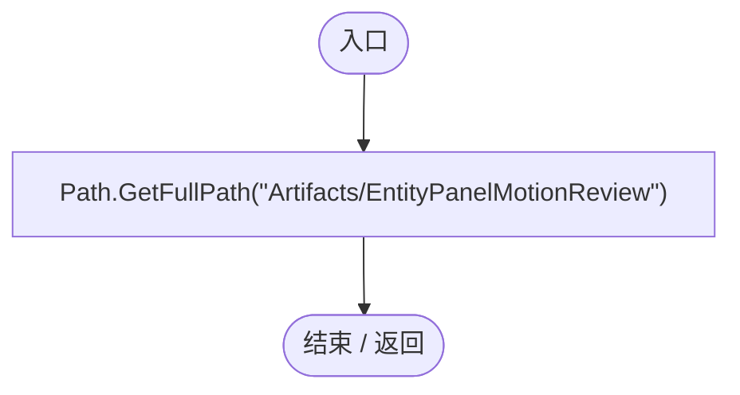

<a id="m49dc755d7e5d6690"></a>

## EntityPanelMotionRegression.ctor · L33

`static EntityPanelMotionRegression()`


### Editor · Roslyn编译器控制流

```mermaid
flowchart TD
  b0(["入口"])
  b1["EditorApplication.update+=()=&gt; { if(_started&#124;&#124;!Application.isPlaying&#124;&#124;!SessionState.GetBool(Key,false)&#124;&#124;Object.FindFirstObjectByType&lt;WorldSessionManager&gt;()==null)return; _started=true;Validate(); };"]
  b2(["结束 / 返回"])
  b0 --> b1
  b1 --> b2

```

项目内调用/回调引用：

- [EntityPanelMotionRegression.回调@36 · L36](c42720484a16e881.md#m698eaaa8dbcf748a)（回调/委托）

<a id="m698eaaa8dbcf748a"></a>

## 回调@36 · L36

`( … => 回调`


### Editor · Roslyn编译器控制流

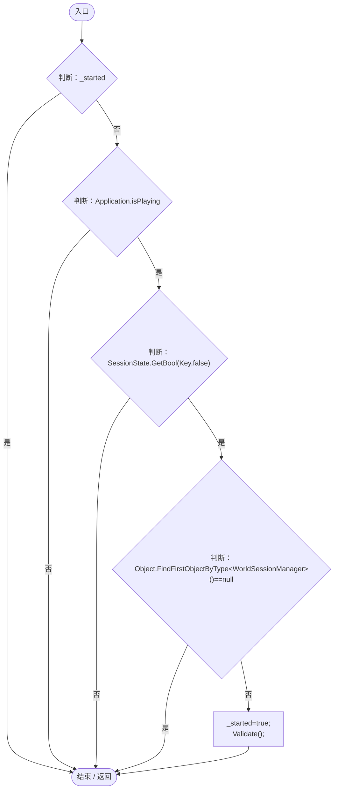

项目内调用/回调引用：

- [EntityPanelMotionRegression.Validate · L51](c42720484a16e881.md#m2e1717c237ba2779)（方法）

<a id="m8901ce850f86cbe5"></a>

## RunBatch · L42

`public static void RunBatch()`


### Editor · Roslyn编译器控制流

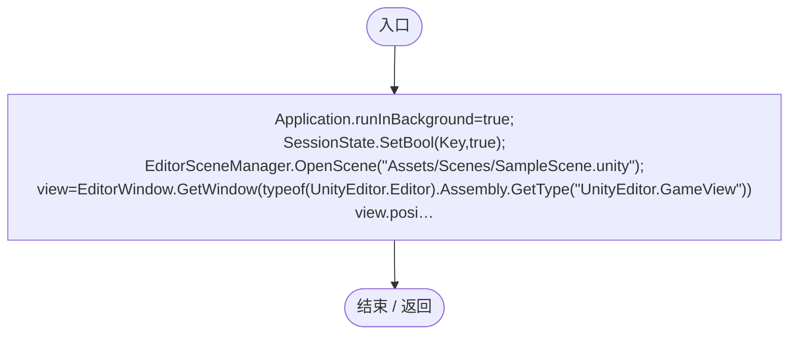

<a id="m64785c89f584de3b"></a>

## RunAllBatch · L49

`public static void RunAllBatch()`


### Editor · Roslyn编译器控制流

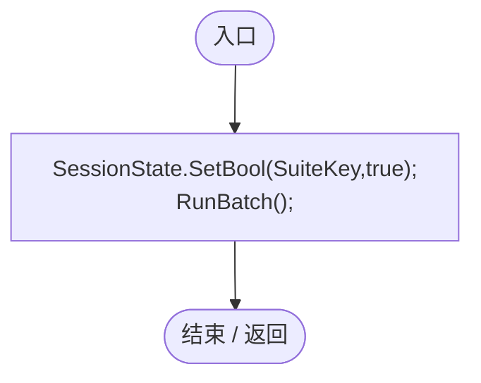

项目内调用/回调引用：

- [EntityPanelMotionRegression.RunBatch · L42](c42720484a16e881.md#m8901ce850f86cbe5)（方法）

<a id="m88985bc05dcd96bf"></a>

## ValidateSuite · L50

`public static void ValidateSuite()`


### Editor · Roslyn编译器控制流

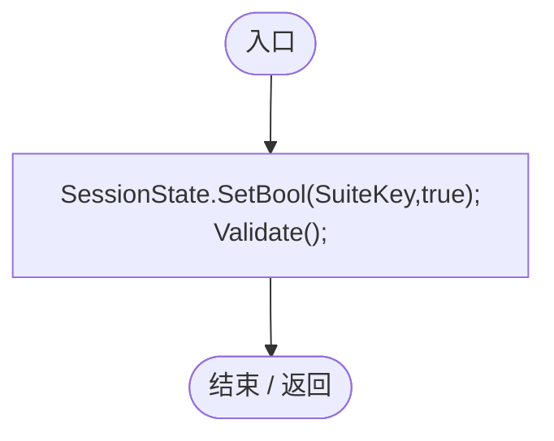

项目内调用/回调引用：

- [EntityPanelMotionRegression.Validate · L51](c42720484a16e881.md#m2e1717c237ba2779)（方法）

<a id="m2e1717c237ba2779"></a>

## Validate · L51

`[MenuItem("Tools/Darwin Park/Validate Entity Panel and Motion")] public static void Validate()`


### Editor · Roslyn编译器控制流

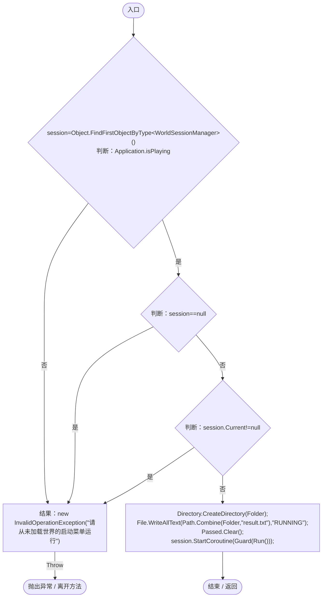

项目内调用/回调引用：

- [WorldSessionManager.Current.get · L21](08741c7b7b9d9344.md#m5d26a5eb846a8504)（访问器）
- [EntityPanelMotionRegression.Guard · L58](c42720484a16e881.md#mcfd1eebc425cf9e8)（方法）
- [EntityPanelMotionRegression.Run · L80](c42720484a16e881.md#mf4b87dd38e20598a)（方法）

<a id="mc92b9e6bcc77908b"></a>

## Check · L57

`private static void Check(bool value,string message)`


### Editor · Roslyn编译器控制流

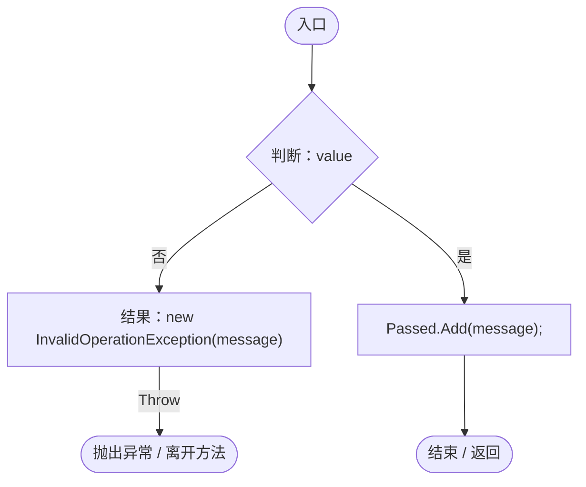

<a id="mcfd1eebc425cf9e8"></a>

## Guard · L58

`private static IEnumerator Guard(IEnumerator run)`


### Editor · Roslyn编译器控制流

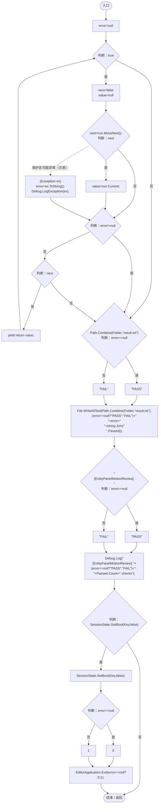

<a id="ma9eff7c811c5929f"></a>

## Spawn · L70

`private static DarwinEntity Spawn(Vector3 point,params (string,float)[] traits)`


### Editor · Roslyn编译器控制流

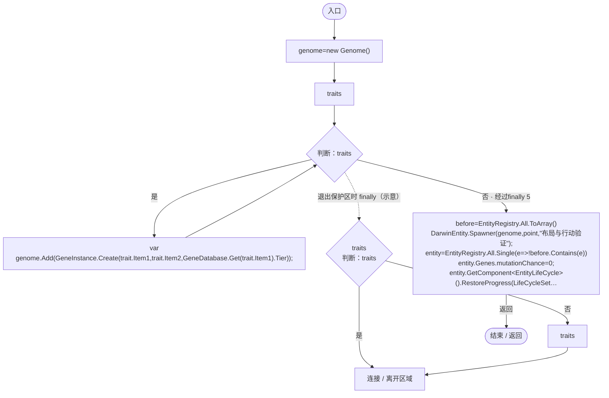

项目内调用/回调引用：

- [Genome.Add · L19](a2ef23f865bc7ee8.md#md9cfdc94b8b8d40f)（方法）
- [GeneInstance.Create · L20](f82e1498d67f5afd.md#m72e94c278de3cf8b)（方法）
- [GeneDatabase.Get · L135](ec0a03483435a863.md#m8f3bbfb35f3ca397)（方法）
- [DarwinEntity.Genes.get · L14](70798dde169f2e8b.md#m622eb1adf401d431)（访问器）
- [EntityLifeCycle.RestoreProgress · L48](9f4138bfbae654b7.md#mfc75121476d49679)（方法）
- [LifeCycleSettings.Load · L16](ace76969fe8f61de.md#mbd2925785484f343)（方法）
- [EntityGeneController.RestoreStageState · L51](7494d53178552f0e.md#m6264213de2a5ca6f)（方法）
- [EntityGeneController.Recalculate · L97](7494d53178552f0e.md#m65ea735c1e0e37a1)（方法）
- [EntityPanelMotionRegression.回调@73 · L73](c42720484a16e881.md#mbde680a2ed18b22d)（回调/委托）

<a id="mbde680a2ed18b22d"></a>

## 回调@73 · L73

`e … => 回调`


### Editor · Roslyn编译器控制流

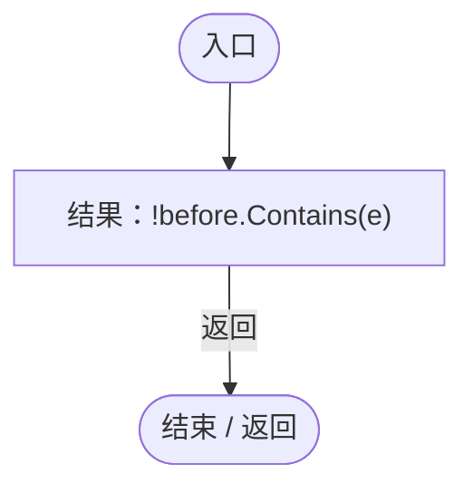

<a id="m2b474feb093be824"></a>

## Size · L76

`private static void Size(DarwinEntity entity,float size)`


### Editor · Roslyn编译器控制流

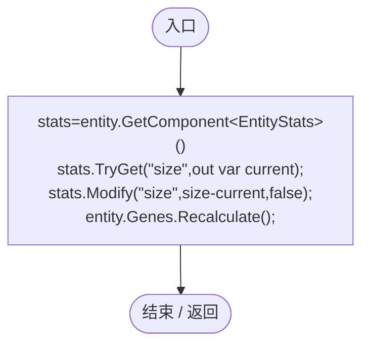

项目内调用/回调引用：

- [EntityStats.TryGet · L90](75aa86a368efdf24.md#m24ee1433e4a70d94)（方法）
- [EntityStats.Modify · L111](75aa86a368efdf24.md#m9c837be197158240)（方法）
- [EntityGeneController.Recalculate · L97](7494d53178552f0e.md#m65ea735c1e0e37a1)（方法）
- [DarwinEntity.Genes.get · L14](70798dde169f2e8b.md#m622eb1adf401d431)（访问器）

<a id="m380ddf8f7b5130f6"></a>

## Capture · L78

`private static IEnumerator Capture(string name)`


### Editor · Roslyn编译器控制流

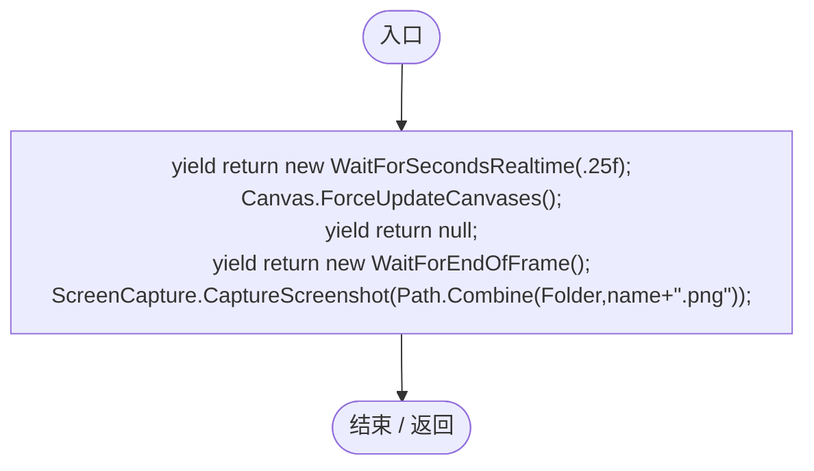

<a id="mf4b87dd38e20598a"></a>

## Run · L80

`private static IEnumerator Run()`


### Editor · Roslyn编译器控制流

```mermaid
flowchart TD
  b0(["入口"])
  b1{"yield return null;<br/>判断：SessionState.GetBool(SuiteKey,false)"}
  b2["new (string path,Action run)[]{(&quot;Artifacts/EntityStateReview/result.txt&quot;,EntityStateRegression.Validate),(&quot;Artifacts/SocialEcologyReview/result.txt&quot;,SocialEcologyRegression.Validate)}"]
  b3{"判断：new (string path,Action run)[]{(&quot;Artifacts/EntityStateReview/result.txt&quot;,EntityStateRegression.Validate),(&quot;Artifacts/SocialEcologyReview/result.txt&quot;,SocialEcologyRegression.Validate)}"}
  b4["var"]
  b5["WorldRuntimeGate.Ready=false;<br/>GameInputGate.Blocked=true;<br/>ServiceLocator.Get&lt;SimulationClock&gt;().Pause();<br/>Directory.CreateDirectory(Path.GetDirectoryName(test.path));<br/>File.WriteAllText(test.path,&quot;RUNNING&quot;);<br/>test.run();<br/>began=EditorApplica…"]
  b6{"判断：File.ReadAllText(test.path)==&quot;RUNNING&quot;"}
  b7{"判断：EditorApplication.timeSinceStartup-began&gt;180"}
  b8["结果：new TimeoutException(test.path)"]
  x8(["抛出异常 / 离开方法"])
  b9["yield return null;"]
  b10["result=File.ReadAllText(test.path)<br/>Check(result.StartsWith(&quot;PASS&quot;),&quot;兼容回归：&quot;+test.path+&quot;\n&quot;+result);<br/>yield return null;"]
  b11{"new (string path,Action run)[]{(&quot;Artifacts/EntityStateReview/result.txt&quot;,EntityStateRegression.Validate),(&quot;Artifacts/SocialEcologyReview/result.txt&quot;,SocialEcologyRegression.Validate)}<br/>判断：new (string path,Action run)[]{(&quot;Artifacts/EntityS…"}
  b12["new (string path,Action run)[]{(&quot;Artifacts/EntityStateReview/result.txt&quot;,EntityStateRegression.Validate),(&quot;Artifacts/SocialEcologyReview/result.txt&quot;,SocialEcologyRegression.Validate)}"]
  b13["连接 / 离开区域"]
  b14["session=Object.FindFirstObjectByType&lt;WorldSessionManager&gt;()<br/>planet=Object.FindFirstObjectByType&lt;PlanetTerrainMeshBuilder&gt;()<br/>clock=ServiceLocator.Get&lt;SimulationClock&gt;()<br/>planet.subdivisions=32;<br/>typeof(WorldSessionManager).GetField(&quot;_initia…"]
  b15{"判断：session.Busy"}
  b16{"判断：EditorApplication.timeSinceStartup-start&gt;100"}
  b17["结果：new TimeoutException(session.Status)"]
  x17(["抛出异常 / 离开方法"])
  b18["yield return null;"]
  b19["Check(session.Current!=null,&quot;隔离测试世界生成成功&quot;);<br/>clock.Pause();<br/>home=Vector3.zero"]
  b20["i=0"]
  b21{"判断：i&lt;192"}
  b22{"y=1-2*(i+.5f)/192<br/>angle=i*2.399963f<br/>dir=new Vector3(Mathf.Sqrt(1-y*y)*Mathf.Cos(angle),y,Mathf.Sqrt(1-y*y)*Mathf.Sin(angle))<br/>point=EcologyQueries.Surface(planet.transform.position+dir*(planet.radius+planet.heightScale))<br/>判断：(point-planet.…"}
  b23["home=point;"]
  b24["i++"]
  b25["Check(home!=Vector3.zero,&quot;找到真实陆地上的物理验证位置&quot;);<br/>actor=Spawn(home,(&quot;gene_growth&quot;,50),(&quot;gene_nutrition&quot;,50),(&quot;gene_reproduction&quot;,20),(&quot;gene_locomotion&quot;,50))<br/>actor.GetComponent&lt;DarwinPark.Entities.Vitals.EntityVitals&gt;().enabled=false;<br/>actor.Get…"]
  b26{"判断：smallSpeed&lt;=LocomotionSettings.Load().maximumMoveSpeed"}
  b27["smallJump&lt;=LocomotionSettings.Load().maximumJumpSpeed"]
  b28["smallSpeed&lt;=LocomotionSettings.Load().maximumMoveSpeed"]
  b29["Check(smallSpeed&lt;=LocomotionSettings.Load().maximumMoveSpeed&amp;&amp;smallJump&lt;=LocomotionSettings.Load().maximumJumpSpeed,&quot;小体型移动与跳跃能力受全局上限约束&quot;);"]
  b30["Size(actor,4);"]
  b31{"判断：actor.Genes.GetAttribute(&quot;moveSpeed&quot;)&lt;smallSpeed"}
  b32["actor.Genes.GetAttribute(&quot;jumpAbility&quot;)&lt;smallJump"]
  b33["actor.Genes.GetAttribute(&quot;moveSpeed&quot;)&lt;smallSpeed"]
  b34["Check(actor.Genes.GetAttribute(&quot;moveSpeed&quot;)&lt;smallSpeed&amp;&amp;actor.Genes.GetAttribute(&quot;jumpAbility&quot;)&lt;smallJump,&quot;大体型同时降低移动和跳跃能力&quot;);"]
  b35["Size(actor,1);<br/>baseSpeed=actor.Genes.Evaluation.Attributes[&quot;moveSpeed&quot;]<br/>baseSense=actor.Genes.Evaluation.Attributes[&quot;senseRange&quot;]<br/>actor.Genes.Genome.Add(GeneInstance.Create(&quot;gene_territory&quot;,50,1));<br/>actor.Genes.Recalculate();"]
  b36{"判断：Mathf.Abs(actor.Genes.Evaluation.Attributes[&quot;moveSpeed&quot;]-baseSpeed)&lt;.001f"}
  b37["Mathf.Abs(actor.Genes.Evaluation.Attributes[&quot;senseRange&quot;]-baseSense)&lt;.001f"]
  b38["Mathf.Abs(actor.Genes.Evaluation.Attributes[&quot;moveSpeed&quot;]-baseSpeed)&lt;.001f"]
  b39["Check(Mathf.Abs(actor.Genes.Evaluation.Attributes[&quot;moveSpeed&quot;]-baseSpeed)&lt;.001f&amp;&amp;Mathf.Abs(actor.Genes.Evaluation.Attributes[&quot;senseRange&quot;]-baseSense)&lt;.001f,&quot;行动与领地共存不重复增加移动和感知属性&quot;);"]
  b40{"判断：GeneDatabase.Get(&quot;gene_territory&quot;).AttributeCurves.Any(c=&gt;c.attributeId==&quot;moveSpeed&quot;)"}
  b41["GeneDatabase.Get(&quot;gene_territory&quot;).AttributeCurves.Any(c=&gt;c.attributeId==&quot;territory_radius&quot;)"]
  b42["!GeneDatabase.Get(&quot;gene_territory&quot;).AttributeCurves.Any(c=&gt;c.attributeId==&quot;moveSpeed&quot;)"]
  b43["Check(!GeneDatabase.Get(&quot;gene_territory&quot;).AttributeCurves.Any(c=&gt;c.attributeId==&quot;moveSpeed&quot;)&amp;&amp;GeneDatabase.Get(&quot;gene_territory&quot;).AttributeCurves.Any(c=&gt;c.attributeId==&quot;territory_radius&quot;),&quot;领地仅展示专属属性并继承共有行动能力&quot;);"]
  b44["territoryGene=actor.Genes.Genome.Genes.Single(g=&gt;g.DefinitionId==&quot;gene_territory&quot;)<br/>territoryGene.Value=0;<br/>actor.Genes.Recalculate();<br/>Check(actor.Genes.Evaluation.Genes.Single(g=&gt;g.Gene==territoryGene).AttributeContributions.Count==0,&quot;失效基…"]
  b45{"判断：actor.Genes.GetAttribute(&quot;moveSpeed&quot;)&gt;0"}
  b46["actor.Genes.GetAttribute(&quot;jumpAbility&quot;)&gt;0"]
  b47["actor.Genes.GetAttribute(&quot;moveSpeed&quot;)&gt;0"]
  b48["Check(actor.Genes.GetAttribute(&quot;moveSpeed&quot;)&gt;0&amp;&amp;actor.Genes.GetAttribute(&quot;jumpAbility&quot;)&gt;0,&quot;只有领地基因时仍有继承的移动和跳跃能力&quot;);"]
  b49["manual=actor.gameObject.AddComponent&lt;EntityManualControl&gt;()<br/>jump=actor.gameObject.AddComponent&lt;EntityJumpMotor&gt;()<br/>manual.BeginControl(planet.transform);<br/>jump.Bind(planet.transform);<br/>up=EcologyQueries.Up(home)<br/>ground=planet.GetComponent&lt;M…"]
  b50{"判断：member.Population.ChallengeLeadership(out _)"}
  b51{"判断：member.Population.DuelRemaining==0"}
  b52["queen.GetComponent&lt;PopulationBehavior&gt;().IsLeader"]
  b53["!member.Population.ChallengeLeadership(out _)&amp;&amp;member.Population.DuelRemaining==0&amp;&amp;queen.GetComponent&lt;PopulationBehavior&gt;().IsLeader"]
  b54["Check(!member.Population.ChallengeLeadership(out _)&amp;&amp;member.Population.DuelRemaining==0&amp;&amp;queen.GetComponent&lt;PopulationBehavior&gt;().IsLeader,&quot;直接调用挑战入口也不能挑战王后或消耗决斗冷却&quot;);"]
  b55["Check(EntityStatePresentation.Current(worker).EndsWith(&quot;（工匠）&quot;),&quot;种群分工以括号附属于实际实体状态&quot;);<br/>inspector=Object.FindFirstObjectByType&lt;GeneInspectorUI&gt;()<br/>inspector.ShowEntityInfo(worker);<br/>yield return null;<br/>Canvas.ForceUpdateCanvases();<br/>panel=(GameO…"]
  b56["panel.GetComponentsInChildren&lt;RectTransform&gt;().Where(t=&gt;t.name.StartsWith(&quot;Block_&quot;))"]
  b57{"判断：panel.GetComponentsInChildren&lt;RectTransform&gt;().Where(t=&gt;t.name.StartsWith(&quot;Block_&quot;))"}
  b58["var"]
  b59["icon=block.Find(&quot;Row1/Color&quot;).GetComponent&lt;Image&gt;()"]
  b60{"判断：icon.sprite!=null"}
  b61{"判断：icon.rectTransform.rect.width&gt;=24"}
  b62["block.rect.height&gt;=70"]
  b63["icon.sprite!=null&amp;&amp;icon.rectTransform.rect.width&gt;=24&amp;&amp;block.rect.height&gt;=70"]
  b64["Check(icon.sprite!=null&amp;&amp;icon.rectTransform.rect.width&gt;=24&amp;&amp;block.rect.height&gt;=70,&quot;图标资源及基因行独立高度：&quot;+block.name);"]
  b65{"判断：block.Find(&quot;Row1&quot;).GetComponent&lt;RectTransform&gt;().rect.height&gt;=28"}
  b66["block.Find(&quot;Row2&quot;).GetComponent&lt;RectTransform&gt;().anchoredPosition.y&lt;=-38"]
  b67["block.Find(&quot;Row1&quot;).GetComponent&lt;RectTransform&gt;().rect.height&gt;=28"]
  b68["Check(block.Find(&quot;Row1&quot;).GetComponent&lt;RectTransform&gt;().rect.height&gt;=28&amp;&amp;block.Find(&quot;Row2&quot;).GetComponent&lt;RectTransform&gt;().anchoredPosition.y&lt;=-38,&quot;标题与数值行不重叠：&quot;+block.name);"]
  b69{"判断：panel.GetComponentsInChildren&lt;RectTransform&gt;().Where(t=&gt;t.name.StartsWith(&quot;Block_&quot;))"}
  b70["panel.GetComponentsInChildren&lt;RectTransform&gt;().Where(t=&gt;t.name.StartsWith(&quot;Block_&quot;))"]
  b71["连接 / 离开区域"]
  b72["yield return Capture(&quot;entity-panel&quot;);<br/>inspector.ShowEntityInfo(actor);<br/>yield return null;<br/>Canvas.ForceUpdateCanvases();<br/>evaluation=actor.Genes.Evaluation.Genes.Single(g=&gt;g.Gene==territoryGene)<br/>typeof(GeneInspectorUI).GetMethod(&quot;ShowGeneT…"]
  b73{"判断：randomLayout.MoveNext()"}
  b74["yield return randomLayout.Current;"]
  b75{"session.SaveNow(false);<br/>saved=WorldSaveStore.Read(WorldSaveStore.FileFor(session.Current.id))<br/>Check(saved.entities.Any(e=&gt;e.ecology?.ant?.role==AntRole.Worker.ToString()),&quot;角色和基因状态继续写入世界存档&quot;);<br/>判断：SessionState.GetBool(SuiteKey,false)"}
  b76["menu=Object.FindFirstObjectByType&lt;GameMainMenu&gt;()<br/>menu.ShowPause();<br/>menu.ReturnToMainMenu();<br/>yield return null;"]
  b77["new (string path,Action run)[]{(&quot;Artifacts/AntColonyReview/result.txt&quot;,AntColonyRegression.Validate)}"]
  b78{"判断：new (string path,Action run)[]{(&quot;Artifacts/AntColonyReview/result.txt&quot;,AntColonyRegression.Validate)}"}
  b79["var"]
  b80["Directory.CreateDirectory(Path.GetDirectoryName(test.path));<br/>File.WriteAllText(test.path,&quot;RUNNING&quot;);<br/>test.run();<br/>began=EditorApplication.timeSinceStartup"]
  b81{"判断：File.ReadAllText(test.path)==&quot;RUNNING&quot;"}
  b82{"判断：EditorApplication.timeSinceStartup-began&gt;180"}
  b83["结果：new TimeoutException(test.path)"]
  x83(["抛出异常 / 离开方法"])
  b84["yield return null;"]
  b85["result=File.ReadAllText(test.path)<br/>Check(result.StartsWith(&quot;PASS&quot;),&quot;兼容回归：&quot;+test.path+&quot;\n&quot;+result);<br/>yield return null;"]
  b86{"new (string path,Action run)[]{(&quot;Artifacts/AntColonyReview/result.txt&quot;,AntColonyRegression.Validate)}<br/>判断：new (string path,Action run)[]{(&quot;Artifacts/AntColonyReview/result.txt&quot;,AntColonyRegression.Validate)}"}
  b87["new (string path,Action run)[]{(&quot;Artifacts/AntColonyReview/result.txt&quot;,AntColonyRegression.Validate)}"]
  b88["连接 / 离开区域"]
  b89["SessionState.SetBool(SuiteKey,false);"]
  b90(["结束 / 返回"])
  b0 --> b1
  b1 -->|"是"| b2
  b1 -->|"否"| b14
  b2 --> b3
  b3 -->|"是"| b4
  b3 -->|"否 · 经过finally 11"| b14
  b4 --> b5
  b5 --> b6
  b6 -->|"是"| b7
  b6 -->|"否"| b10
  b7 -->|"是"| b8
  b7 -->|"否"| b9
  b8 -->|"Throw"| x8
  b9 --> b6
  b10 --> b3
  b11 -->|"否"| b12
  b11 -->|"是"| b13
  b12 --> b13
  b14 --> b15
  b15 -->|"是"| b16
  b15 -->|"否"| b19
  b16 -->|"是"| b17
  b16 -->|"否"| b18
  b17 -->|"Throw"| x17
  b18 --> b15
  b19 --> b20
  b20 --> b21
  b21 -->|"是"| b22
  b21 -->|"否"| b25
  b22 -->|"是"| b23
  b22 -->|"否"| b24
  b23 --> b25
  b24 --> b21
  b25 --> b26
  b26 -->|"是"| b27
  b26 -->|"否"| b28
  b27 --> b29
  b28 --> b29
  b29 --> b30
  b30 --> b31
  b31 -->|"是"| b32
  b31 -->|"否"| b33
  b32 --> b34
  b33 --> b34
  b34 --> b35
  b35 --> b36
  b36 -->|"是"| b37
  b36 -->|"否"| b38
  b37 --> b39
  b38 --> b39
  b39 --> b40
  b40 -->|"否"| b41
  b40 -->|"是"| b42
  b41 --> b43
  b42 --> b43
  b43 --> b44
  b44 --> b45
  b45 -->|"是"| b46
  b45 -->|"否"| b47
  b46 --> b48
  b47 --> b48
  b48 --> b49
  b49 --> b50
  b50 -->|"否"| b51
  b50 -->|"是"| b53
  b51 -->|"是"| b52
  b51 -->|"否"| b53
  b52 --> b54
  b53 --> b54
  b54 --> b55
  b55 --> b56
  b56 --> b57
  b57 -->|"是"| b58
  b57 -->|"否 · 经过finally 69"| b72
  b58 --> b59
  b59 --> b60
  b60 -->|"是"| b61
  b60 -->|"否"| b63
  b61 -->|"是"| b62
  b61 -->|"否"| b63
  b62 --> b64
  b63 --> b64
  b64 --> b65
  b65 -->|"是"| b66
  b65 -->|"否"| b67
  b66 --> b68
  b67 --> b68
  b68 --> b57
  b69 -->|"否"| b70
  b69 -->|"是"| b71
  b70 --> b71
  b72 --> b73
  b73 -->|"是"| b74
  b73 -->|"否"| b75
  b74 --> b73
  b75 -->|"是"| b76
  b75 -->|"否"| b90
  b76 --> b77
  b77 --> b78
  b78 -->|"是"| b79
  b78 -->|"否 · 经过finally 86"| b89
  b79 --> b80
  b80 --> b81
  b81 -->|"是"| b82
  b81 -->|"否"| b85
  b82 -->|"是"| b83
  b82 -->|"否"| b84
  b83 -->|"Throw"| x83
  b84 --> b81
  b85 --> b78
  b86 -->|"否"| b87
  b86 -->|"是"| b88
  b87 --> b88
  b89 --> b90
  b3 -. "退出保护区时 finally（示意）" .-> b11
  b57 -. "退出保护区时 finally（示意）" .-> b69
  b78 -. "退出保护区时 finally（示意）" .-> b86

```

项目内调用/回调引用：

- [GameInputGate.Blocked.set · L8](52955daae7e592ab.md#m578697f6379686f4)（访问器）
- [SimulationClock.Pause · L79](a8f444aec9614b0a.md#m30929d45a885d0f1)（方法）
- [ServiceLocator.Get · L33](f2fdbe9f9ccd93cb.md#m2ae625299520c56d)（方法）
- [EntityPanelMotionRegression.Check · L57](c42720484a16e881.md#mc92b9e6bcc77908b)（方法）
- [PlanetClimateMap.Instance.get · L16](b4e9726c1bcf4c37.md#m3add54a419aeef9f)（访问器）
- [PlanetOreSystem.Instance.get · L8](86b3fbb4d9436121.md#m53f6a6af4b6dc252)（访问器）
- [WorldSessionManager.Create · L41](08741c7b7b9d9344.md#m6aadfeee8b90aacd)（方法）
- [WorldSessionManager.Busy.get · L24](08741c7b7b9d9344.md#m4483e2e4f28f7c85)（访问器）
- [WorldSessionManager.Status.get · L23](08741c7b7b9d9344.md#mc9040fb24bb00a63)（访问器）
- [WorldSessionManager.Current.get · L21](08741c7b7b9d9344.md#m5d26a5eb846a8504)（访问器）
- [EcologyQueries.Surface · L47](bdf7ccc2c9c0452f.md#m2f1f6873ee5fc8df)（方法）
- [PlanetTerrainMeshBuilder.WaterRadius.get · L94](415285cf043354a9.md#m28d8809083881ec1)（访问器）
- [EntityPanelMotionRegression.Spawn · L70](c42720484a16e881.md#ma9eff7c811c5929f)（方法）
- [SimulationClock.SetTimeScale · L81](a8f444aec9614b0a.md#mecaa463a0561aca3)（方法）
- [SimulationClock.Play · L78](a8f444aec9614b0a.md#m7aa9e64b7de60ed0)（方法）
- [EcologyQueries.Distance · L42](bdf7ccc2c9c0452f.md#mba9c3e3c95d0f2dd)（方法）
- [EntityPanelMotionRegression.Size · L76](c42720484a16e881.md#m2b474feb093be824)（方法）
- [EntityGeneController.GetAttribute · L257](7494d53178552f0e.md#m600509f72d274f0c)（方法）
- [DarwinEntity.Genes.get · L14](70798dde169f2e8b.md#m622eb1adf401d431)（访问器）
- [LocomotionSettings.Load · L17](8cce83c7d4563cf0.md#m06b74c04dd63fb4a)（方法）
- [EntityGeneController.Evaluation.get · L18](7494d53178552f0e.md#mc0039c100a31b455)（访问器）
- [Genome.Add · L19](a2ef23f865bc7ee8.md#md9cfdc94b8b8d40f)（方法）
- [GeneInstance.Create · L20](f82e1498d67f5afd.md#m72e94c278de3cf8b)（方法）
- [EntityGeneController.Recalculate · L97](7494d53178552f0e.md#m65ea735c1e0e37a1)（方法）
- [GeneDatabase.Get · L135](ec0a03483435a863.md#m8f3bbfb35f3ca397)（方法）
- [EntityManualControl.BeginControl · L32](a6969896da35e1f0.md#mf0dadf914f9961c7)（方法）
- [EntityJumpMotor.Bind · L20](fa3269c9da0aa692.md#m7322ba5e17678995)（方法）
- [EcologyQueries.Up · L41](bdf7ccc2c9c0452f.md#maca7070196f125fd)（方法）
- [EntityJumpMotor.TryJump · L22](fa3269c9da0aa692.md#m5d4b3420e4d2918e)（方法）
- [EntityManualControl.Release · L37](a6969896da35e1f0.md#m87aa0efacece2c5b)（方法）
- [PopulationBehavior.Advance · L78](21e4f62f75a9a80f.md#m3b1594d99e3bdf28)（方法）
- [AntColonyMember.Assign · L54](baebd85c05598377.md#mda0fe308acecb8f2)（方法）
- [PopulationBehavior.GroupId.get · L20](21e4f62f75a9a80f.md#m5145936fa914ba8c)（访问器）
- [AntColonyMember.Advance · L77](baebd85c05598377.md#m29cff578dd85ff16)（方法）
- [PopulationBehavior.ChallengeLeadership · L125](21e4f62f75a9a80f.md#m5391b2572c2724a5)（方法）
- [AntColonyMember.Population.get · L30](baebd85c05598377.md#m688c2c0dfb5a66d6)（访问器）
- [EntityStatePresentation.Current · L11](cedd13b7a8825ed4.md#mb284f7b351983ca5)（方法）
- [GeneInspectorUI.ShowEntityInfo · L385](924e27c34e7b1f0a.md#mea69a0457b885287)（方法）
- [EntityPanelMotionRegression.Capture · L78](c42720484a16e881.md#m380ddf8f7b5130f6)（方法）
- [GeneInspectorUI.HideEntityInfo · L316](924e27c34e7b1f0a.md#m11944eddcac871c2)（方法）
- [LayoutRandomSpawnRegression.Verify · L23](8995681fbd6854d1.md#mb67782cca7a6e0e6)（方法）
- [WorldSessionManager.SaveNow · L157](08741c7b7b9d9344.md#mbecd8b5c222ba46b)（方法）
- [WorldSaveStore.Read · L72](d67a35e5e3814c15.md#mca362c7675a5800c)（方法）
- [WorldSaveStore.FileFor · L48](d67a35e5e3814c15.md#m419a625e2bcc70f8)（方法）
- [GameMainMenu.ShowPause · L89](a1f1791f9e7a8035.md#m953d85f379a39458)（方法）
- [GameMainMenu.ReturnToMainMenu · L278](a1f1791f9e7a8035.md#m1fdc747e6f1c67d2)（方法）
- [EntityPanelMotionRegression.回调@117 · L117](c42720484a16e881.md#mfcc0b6b5d4b01b79)（回调/委托）
- [EntityPanelMotionRegression.回调@117 · L117](c42720484a16e881.md#m5e3d7a3fe4464fef)（回调/委托）
- [EntityPanelMotionRegression.回调@118 · L118](c42720484a16e881.md#me73822293dfd9280)（回调/委托）
- [EntityPanelMotionRegression.回调@119 · L119](c42720484a16e881.md#mba1520a19bd711d2)（回调/委托）
- [EntityPanelMotionRegression.回调@120 · L120](c42720484a16e881.md#m9d700aeac360fb85)（回调/委托）
- [EntityPanelMotionRegression.回调@139 · L139](c42720484a16e881.md#ma8680af6beb6a751)（回调/委托）
- [EntityPanelMotionRegression.回调@146 · L146](c42720484a16e881.md#m6afb7bc8aac74589)（回调/委托）
- [EntityPanelMotionRegression.回调@157 · L157](c42720484a16e881.md#m4749598a3354a2be)（回调/委托）
- [EntityStateRegression.Validate · L35](cbb314f2877cdcfa.md#m3b72bea1a79f877c)（方法）
- [SocialEcologyRegression.Validate · L40](217494895b1b18ec.md#m1d3596c41e5076f1)（方法）
- [AntColonyRegression.Validate · L36](1314e8c23331e578.md#mae71bea88765ff0b)（方法）

<a id="mfcc0b6b5d4b01b79"></a>

## 回调@117 · L117

`c … => 回调`


### Editor · Roslyn编译器控制流

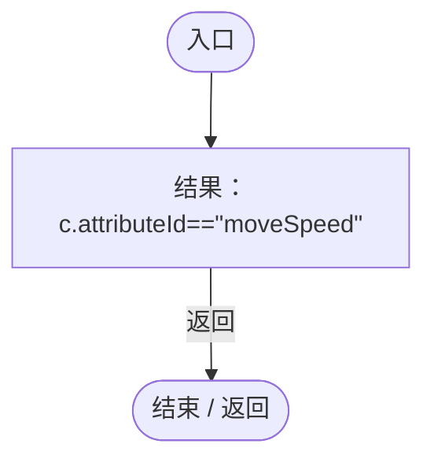

<a id="m5e3d7a3fe4464fef"></a>

## 回调@117 · L117

`c … => 回调`


### Editor · Roslyn编译器控制流


<a id="me73822293dfd9280"></a>

## 回调@118 · L118

`g … => 回调`


### Editor · Roslyn编译器控制流

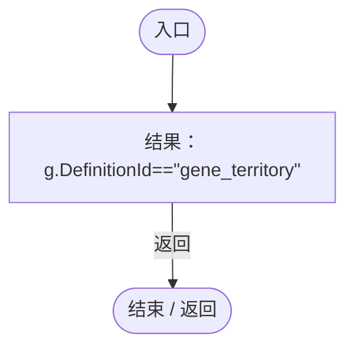

<a id="mba1520a19bd711d2"></a>

## 回调@119 · L119

`g … => 回调`


### Editor · Roslyn编译器控制流

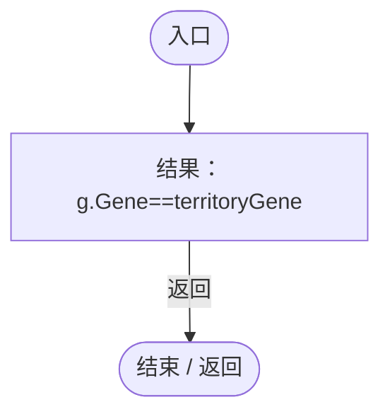

<a id="m9d700aeac360fb85"></a>

## 回调@120 · L120

`g … => 回调`


### Editor · Roslyn编译器控制流

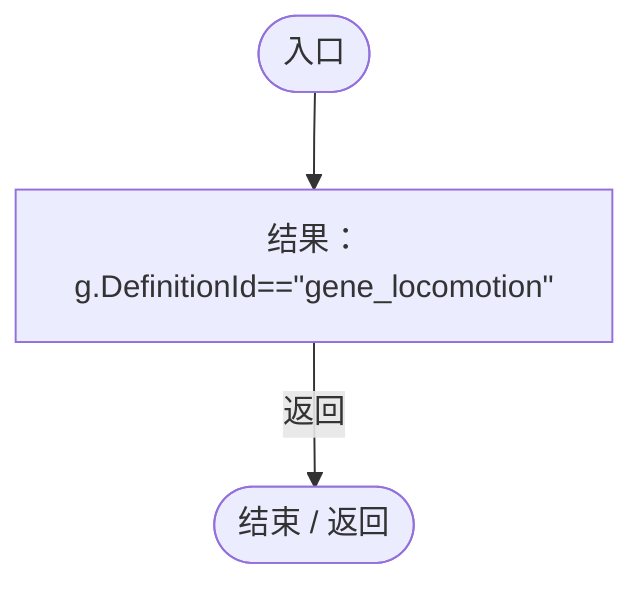

<a id="ma8680af6beb6a751"></a>

## 回调@139 · L139

`t … => 回调`


### Editor · Roslyn编译器控制流


<a id="m6afb7bc8aac74589"></a>

## 回调@146 · L146

`g … => 回调`


### Editor · Roslyn编译器控制流

```mermaid
flowchart TD
  b0(["入口"])
  b1["结果：g.Gene==territoryGene"]
  b2(["结束 / 返回"])
  b0 --> b1
  b1 -->|"返回"| b2

```

<a id="m4749598a3354a2be"></a>

## 回调@157 · L157

`e … => 回调`


### Editor · Roslyn编译器控制流

```mermaid
flowchart TD
  b0(["入口"])
  b1{"e.ecology<br/>判断：e.ecology"}
  b2[".ant"]
  b3{"判断：.ant"}
  b4[".role"]
  b5["e.ecology?.ant?.role"]
  b6["结果：e.ecology?.ant?.role==AntRole.Worker.ToString()"]
  b7(["结束 / 返回"])
  b0 --> b1
  b1 -->|"否"| b2
  b1 -->|"是"| b5
  b2 --> b3
  b3 -->|"否"| b4
  b3 -->|"是"| b5
  b4 --> b6
  b5 --> b6
  b6 -->|"返回"| b7

```
