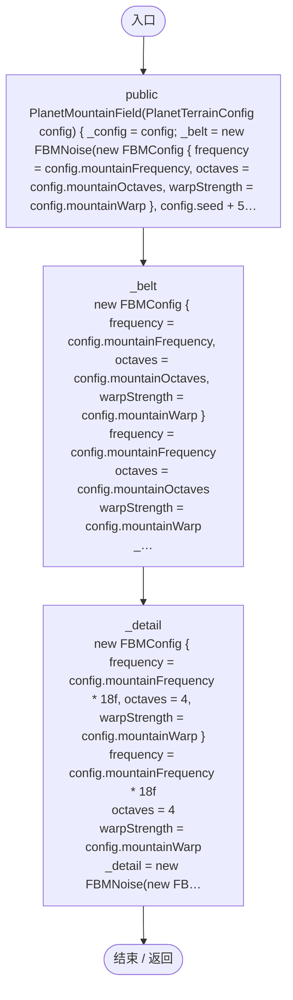
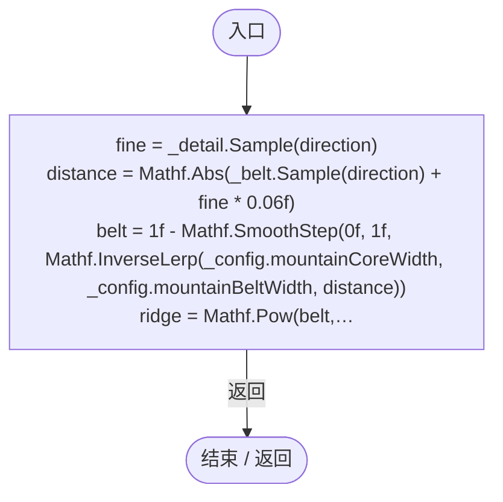

# PlanetMountainField.cs

[返回总索引](../README.md) · `Runtime` · `Assets/DarwinPark/Planet/Terrain/PlanetMountainField.cs`

[源文件](../../../Assets/DarwinPark/Planet/Terrain/PlanetMountainField.cs) · 源码校验：`de6940d554551f295c1a018dbfd39449cc57089f7bde8c133b39b2cd31701d5c`

方法按源文件位置排列。事件/回调引用不表示立即执行；分支与异常说明见总索引。完整源码与可点击关系图请打开离线手册。

## PlanetMountainField.ctor · L11

`public PlanetMountainField(PlanetTerrainConfig config)`

### Editor / Player · Roslyn编译器控制流

项目内调用/回调引用：

- [FBMNoise.FBMNoise.ctor · L12](8e4c1118f3935129.md#m008bcd375f95dd84)（构造函数）

## Sample · L19

`public float Sample(Vector3 direction)`

### Editor / Player · Roslyn编译器控制流

项目内调用/回调引用：

- [FBMNoise.Sample · L24](8e4c1118f3935129.md#m3997a25fbe63e25e)（方法）
