# ColonyFormation.cs

[返回总索引](../README.md) · `Runtime` · `Assets/DarwinPark/Entities/Ecology/ColonyFormation.cs`

[源文件](../../../Assets/DarwinPark/Entities/Ecology/ColonyFormation.cs) · 源码校验：`74163a26798fa095e024f4e59a4c933dcef1d51ab37d4c4a15b8adeedfdb9a64`

方法按源文件位置排列。事件/回调引用不表示立即执行；分支与异常说明见总索引。完整源码与可点击关系图请打开离线手册。

## Settings.get · L16

`get`

### Editor / Player · Roslyn编译器控制流

```mermaid
flowchart TD
  b0(["入口"])
  b1{"判断：_config!=null"}
  b2["结果：_config"]
  b3{"asset=Resources.Load&lt;TextAsset&gt;(&quot;Entities/colony_formation&quot;)<br/>判断：asset==null"}
  b4["结果：new InvalidOperationException(&quot;缺少 Entities/colony_formation&quot;)"]
  x4(["抛出异常 / 离开方法"])
  b5{"value=JsonUtility.FromJson&lt;Config&gt;(asset.text)<br/>判断：value==null"}
  b6{"判断：new[]{value.spacing,value.margin,value.avoidanceRadius,value.avoidanceStrength,value.birthRadiusRatio}.Any(v=&gt;!float.IsFinite(v)&#124;&#124;v&lt;=0)"}
  b7{"判断：value.birthRadiusRatio&gt;=1"}
  b8{"判断：value.birthAttempts&lt;1"}
  b9["结果：new InvalidOperationException(&quot;蚁群队形配置无效&quot;)"]
  x9(["抛出异常 / 离开方法"])
  b10["结果：_config=value"]
  b11(["结束 / 返回"])
  b0 --> b1
  b1 -->|"是"| b2
  b1 -->|"否"| b3
  b2 -->|"返回"| b11
  b3 -->|"是"| b4
  b3 -->|"否"| b5
  b4 -->|"Throw"| x4
  b5 -->|"否"| b6
  b5 -->|"是"| b9
  b6 -->|"否"| b7
  b6 -->|"是"| b9
  b7 -->|"否"| b8
  b7 -->|"是"| b9
  b8 -->|"是"| b9
  b8 -->|"否"| b10
  b9 -->|"Throw"| x9
  b10 -->|"返回"| b11

```

项目内调用/回调引用：

- [ColonyFormation.回调@19 · L19](c65dce2d54e43480.md#ma575c56816e6186b)（回调/委托）

## 回调@19 · L19

`v … => 回调`

### Editor / Player · Roslyn编译器控制流

```mermaid
flowchart TD
  b0(["入口"])
  b1{"判断：float.IsFinite(v)"}
  b2["v&lt;=0"]
  b3["!float.IsFinite(v)"]
  b4["结果：!float.IsFinite(v)&#124;&#124;v&lt;=0"]
  b5(["结束 / 返回"])
  b0 --> b1
  b1 -->|"是"| b2
  b1 -->|"否"| b3
  b2 --> b4
  b3 --> b4
  b4 -->|"返回"| b5

```

## Slot · L24

`private static int Slot(AntColonyMember member)`

### Editor / Player · Roslyn编译器控制流

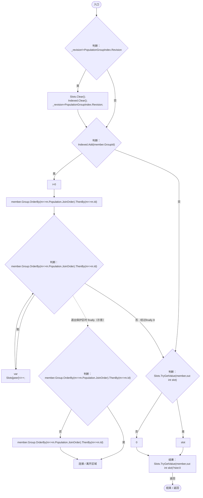

项目内调用/回调引用：

- [PopulationGroupIndex.Revision.get · L19](6bb343d8be5beae5.md#m42c682636166d39b)（访问器）
- [ColonyFormation.回调@27 · L27](c65dce2d54e43480.md#m5a61567a1e966f5f)（回调/委托）
- [ColonyFormation.回调@27 · L27](c65dce2d54e43480.md#ma3cd64f64279ddd4)（回调/委托）

## 回调@27 · L27

`m … => 回调`

### Editor / Player · Roslyn编译器控制流

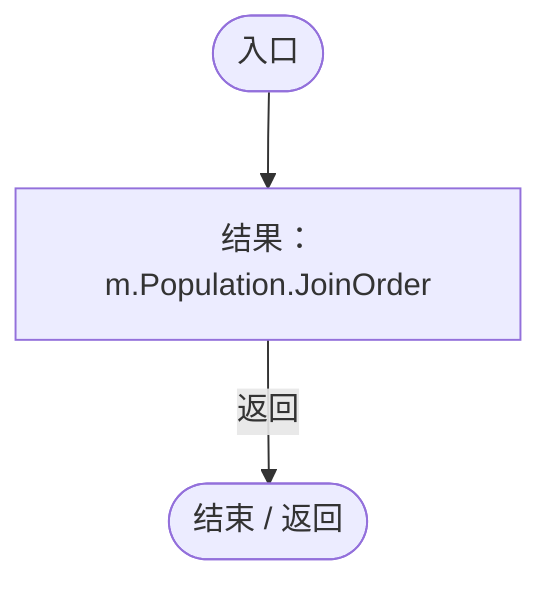

项目内调用/回调引用：

- [PopulationBehavior.JoinOrder.get · L21](21e4f62f75a9a80f.md#m83871a50fb1160fd)（访问器）
- [AntColonyMember.Population.get · L30](baebd85c05598377.md#m688c2c0dfb5a66d6)（访问器）

## 回调@27 · L27

`m … => 回调`

### Editor / Player · Roslyn编译器控制流

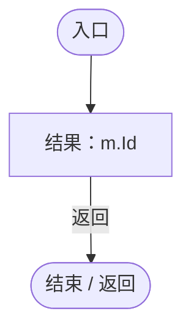

## Offset · L30

`private static Vector3 Offset(Vector3 center,float radius,float angle)`

### Editor / Player · Roslyn编译器控制流

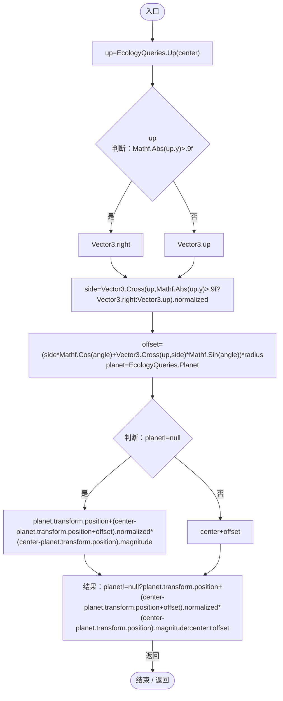

项目内调用/回调引用：

- [EcologyQueries.Up · L41](bdf7ccc2c9c0452f.md#maca7070196f125fd)（方法）

## Home · L36

`public static Vector3 Home(AntColonyMember member,Vector3 center,float radius)`

### Editor / Player · Roslyn编译器控制流

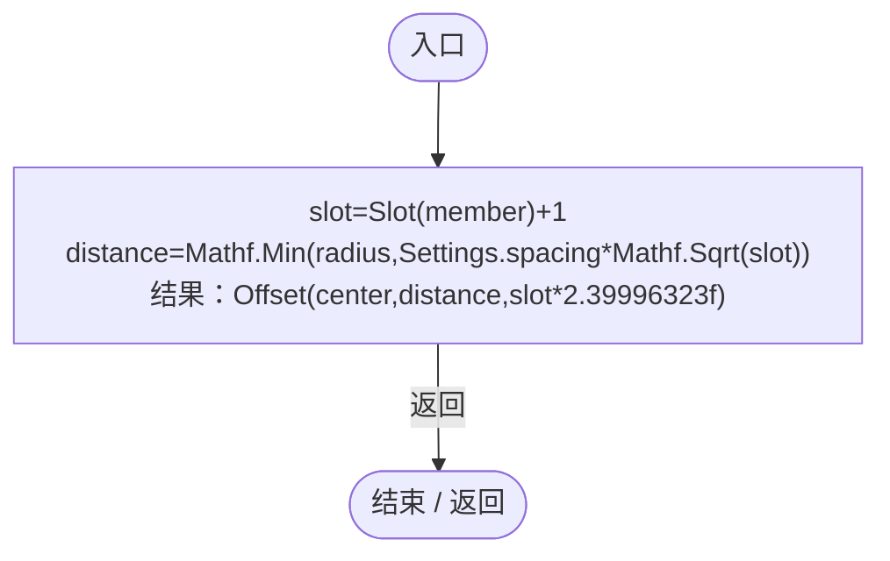

项目内调用/回调引用：

- [ColonyFormation.Slot · L24](c65dce2d54e43480.md#m476e15664ad2b340)（方法）
- [ColonyFormation.Settings.get · L16](c65dce2d54e43480.md#m3acc47bcb2b9b015)（访问器）
- [ColonyFormation.Offset · L30](c65dce2d54e43480.md#m9fb7918b890f8556)（方法）

## BodyRadius · L41

`public static float BodyRadius(DarwinEntity entity)`

### Editor / Player · Roslyn编译器控制流

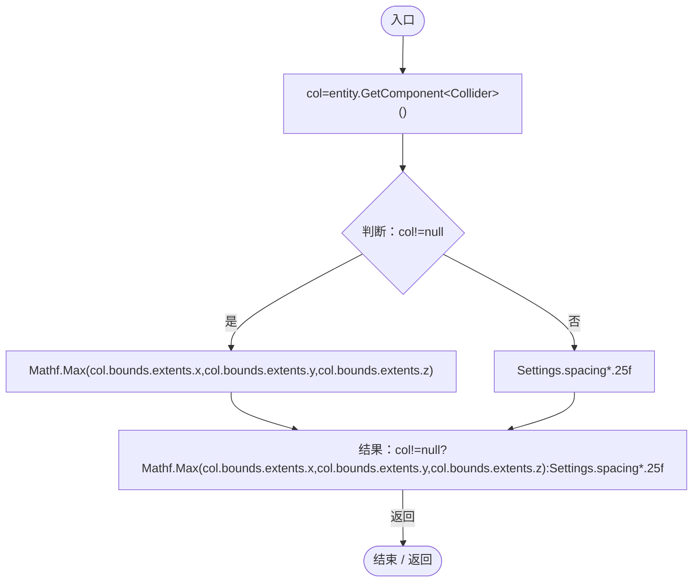

项目内调用/回调引用：

- [ColonyFormation.Settings.get · L16](c65dce2d54e43480.md#m3acc47bcb2b9b015)（访问器）

## Avoid · L43

`public static Vector3 Avoid(EntityGeneController genes,Vector3 desired,float speed)`

### Editor / Player · Roslyn编译器控制流

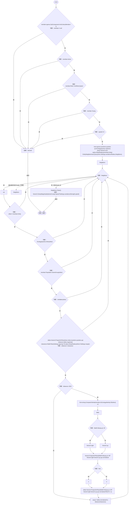

项目内调用/回调引用：

- [AntColonyMember.Role.get · L33](baebd85c05598377.md#mdf6df89f7116c7a3)（访问器）
- [EcologyQueries.Up · L41](bdf7ccc2c9c0452f.md#maca7070196f125fd)（方法）
- [ColonyFormation.BodyRadius · L41](c65dce2d54e43480.md#mc8930f17890efefc)（方法）
- [AntColonyMember.Entity.get · L29](baebd85c05598377.md#m4a0664814e72f13c)（访问器）
- [EntityNeighborhood.Query · L79](e5e24c4aff0395b1.md#mbf802c841f974425)（方法）
- [ColonyFormation.Settings.get · L16](c65dce2d54e43480.md#m3acc47bcb2b9b015)（访问器）
- [EcologyQueries.Alive · L38](bdf7ccc2c9c0452f.md#mb2877c487f449970)（方法）
- [PopulationBehavior.SameGroup · L123](21e4f62f75a9a80f.md#m7a9d850e1d8967d4)（方法）
- [AntColonyMember.Population.get · L30](baebd85c05598377.md#m688c2c0dfb5a66d6)（访问器）
- [ColonyFormation.IsHidden · L57](c65dce2d54e43480.md#m84e2a8df315ea0bf)（方法）
- [EcologyIdentity.Of · L21](bdf7ccc2c9c0452f.md#m1143cf9570a93b72)（方法）

## IsHidden · L57

`private static bool IsHidden(DarwinEntity entity)`

### Editor / Player · Roslyn编译器控制流

```mermaid
flowchart TD
  b0(["入口"])
  b1{"entity.GetComponent&lt;NutritionParasite&gt;()<br/>判断：entity.GetComponent&lt;NutritionParasite&gt;()"}
  b2[".Host"]
  b3["entity.GetComponent&lt;NutritionParasite&gt;()"]
  b4{"判断：entity.GetComponent&lt;NutritionParasite&gt;()?.Host!=null"}
  b5["AntColonyWorker.IsCarried(entity)"]
  b6["entity.GetComponent&lt;NutritionParasite&gt;()?.Host!=null"]
  b7["结果：entity.GetComponent&lt;NutritionParasite&gt;()?.Host!=null&#124;&#124;AntColonyWorker.IsCarried(entity)"]
  b8(["结束 / 返回"])
  b0 --> b1
  b1 -->|"否"| b2
  b1 -->|"是"| b3
  b2 --> b4
  b3 --> b4
  b4 -->|"否"| b5
  b4 -->|"是"| b6
  b5 --> b7
  b6 --> b7
  b7 -->|"返回"| b8

```

项目内调用/回调引用：

- [NutritionParasite.Host.get · L19](4a18785b7c1e1484.md#me3131db9b6e16399)（访问器）
- [AntColonyWorker.IsCarried · L140](8a0cca2020271b6f.md#mf552b19f9aeffe97)（方法）

## TryBirthPosition · L58

`public static bool TryBirthPosition(AntColonyMember queen,out Vector3 point)`

### Editor / Player · Roslyn编译器控制流

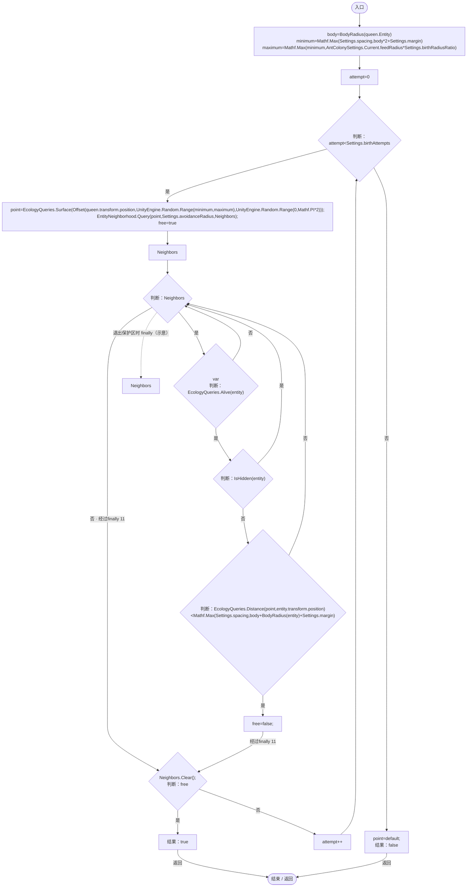

项目内调用/回调引用：

- [ColonyFormation.BodyRadius · L41](c65dce2d54e43480.md#mc8930f17890efefc)（方法）
- [AntColonyMember.Entity.get · L29](baebd85c05598377.md#m4a0664814e72f13c)（访问器）
- [ColonyFormation.Settings.get · L16](c65dce2d54e43480.md#m3acc47bcb2b9b015)（访问器）
- [AntColonySettings.Current.get · L31](cb0a937e97c8fbb3.md#mcd121159f407ccdf)（访问器）
- [EcologyQueries.Surface · L47](bdf7ccc2c9c0452f.md#m2f1f6873ee5fc8df)（方法）
- [ColonyFormation.Offset · L30](c65dce2d54e43480.md#m9fb7918b890f8556)（方法）
- [EntityNeighborhood.Query · L79](e5e24c4aff0395b1.md#mbf802c841f974425)（方法）
- [EcologyQueries.Alive · L38](bdf7ccc2c9c0452f.md#mb2877c487f449970)（方法）
- [ColonyFormation.IsHidden · L57](c65dce2d54e43480.md#m84e2a8df315ea0bf)（方法）
- [EcologyQueries.Distance · L42](bdf7ccc2c9c0452f.md#mba9c3e3c95d0f2dd)（方法）

## Reset · L70

`[RuntimeInitializeOnLoadMethod(RuntimeInitializeLoadType.SubsystemRegistration)] private static void Reset()`

### Editor / Player · Roslyn编译器控制流

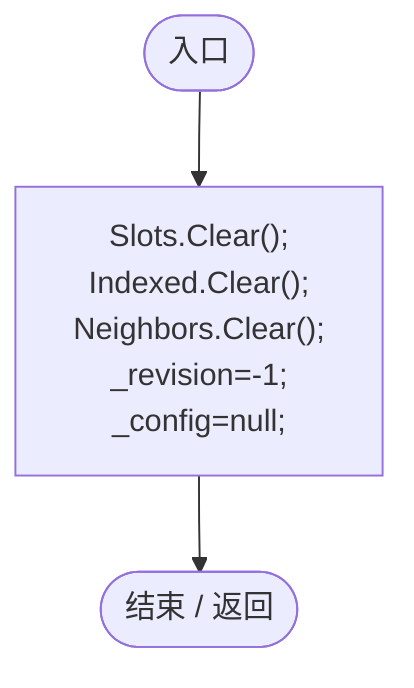
