# StationaryPerformanceRegression.cs

[返回总索引](../README.md) · `Editor` · `Assets/DarwinPark/Editor/StationaryPerformanceRegression.cs`

[源文件](../../../Assets/DarwinPark/Editor/StationaryPerformanceRegression.cs) · 源码校验：`879ebc9352e5ffc2220f7ff60ceb536132f80ba53503f753657df93d8bfdb023`

方法按源文件位置排列。事件/回调引用不表示立即执行；分支与异常说明见总索引。完整源码与可点击关系图请打开离线手册。

<a id="m93435134e7b8e489"></a>

## Folder.get · L29

`private static string Folder`


### Editor · 语法控制结构 / 声明（非CFG）

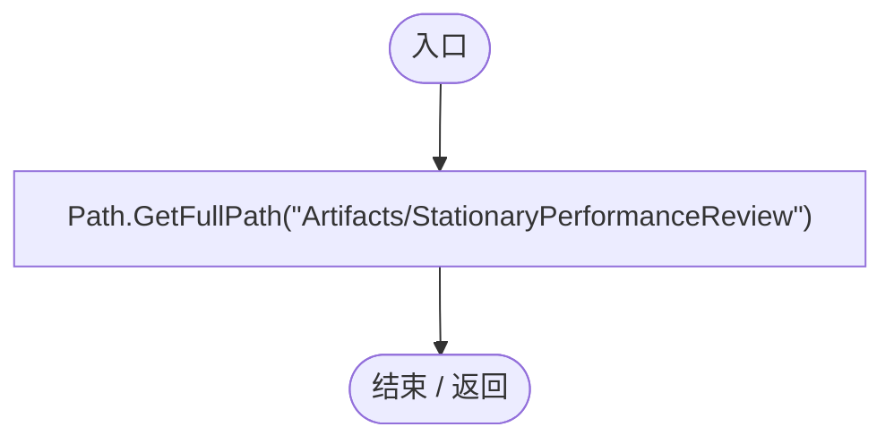

<a id="me1c18b10edccdb01"></a>

## StationaryPerformanceRegression.ctor · L30

`static StationaryPerformanceRegression()`


### Editor · Roslyn编译器控制流

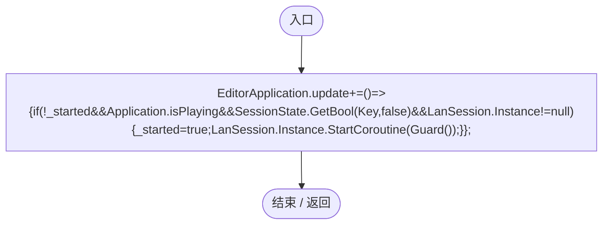

项目内调用/回调引用：

- [StationaryPerformanceRegression.回调@30 · L30](c740ddb4a4340bed.md#md92e40a007ea0096)（回调/委托）

<a id="md92e40a007ea0096"></a>

## 回调@30 · L30

`( … => 回调`


### Editor · Roslyn编译器控制流

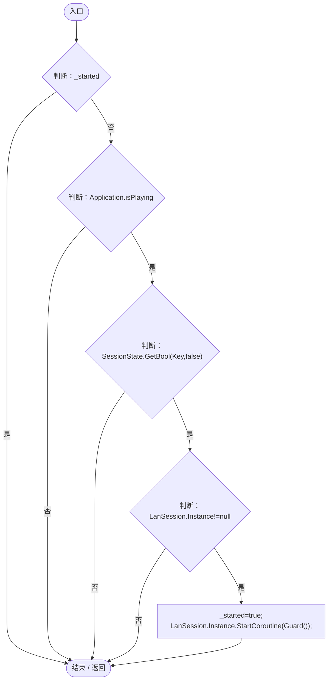

项目内调用/回调引用：

- [LanSession.Instance.get · L23](9fb633eebffe669c.md#mbf83306994878383)（访问器）
- [StationaryPerformanceRegression.Guard · L33](c740ddb4a4340bed.md#m8784e94c3993c890)（方法）

<a id="m88d844b6e05a1b41"></a>

## RunBatch · L31

`public static void RunBatch()`


### Editor · Roslyn编译器控制流

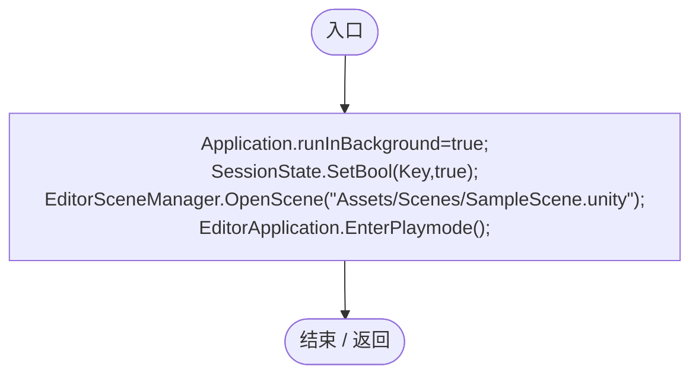

<a id="m7bbbffa0fa07e57f"></a>

## Check · L32

`private static void Check(bool value,string message)`


### Editor · Roslyn编译器控制流

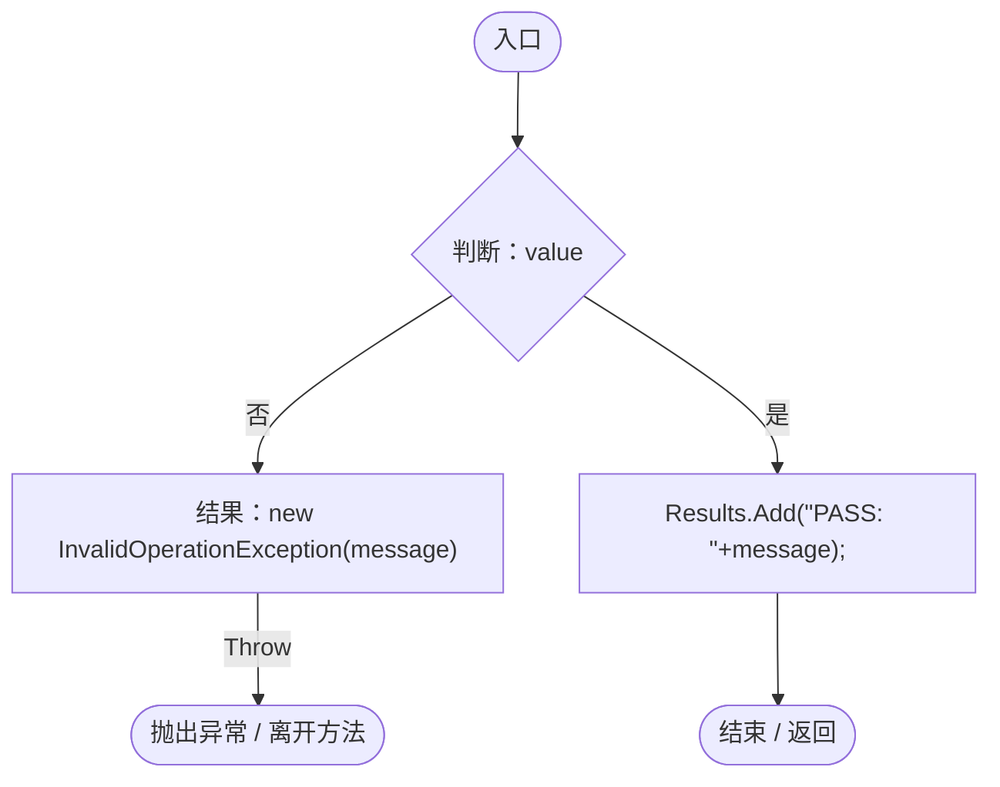

<a id="m8784e94c3993c890"></a>

## Guard · L33

`private static IEnumerator Guard()`


### Editor · Roslyn编译器控制流

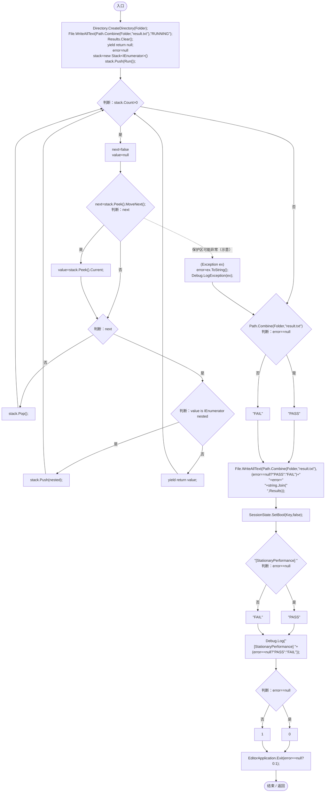

项目内调用/回调引用：

- [StationaryPerformanceRegression.Run · L70](c740ddb4a4340bed.md#m9f9654933a7b704d)（方法）

<a id="mf672b69e6fddf963"></a>

## Spawn · L44

`private static DarwinEntity Spawn(Vector3 point,bool movement=false)`


### Editor · Roslyn编译器控制流

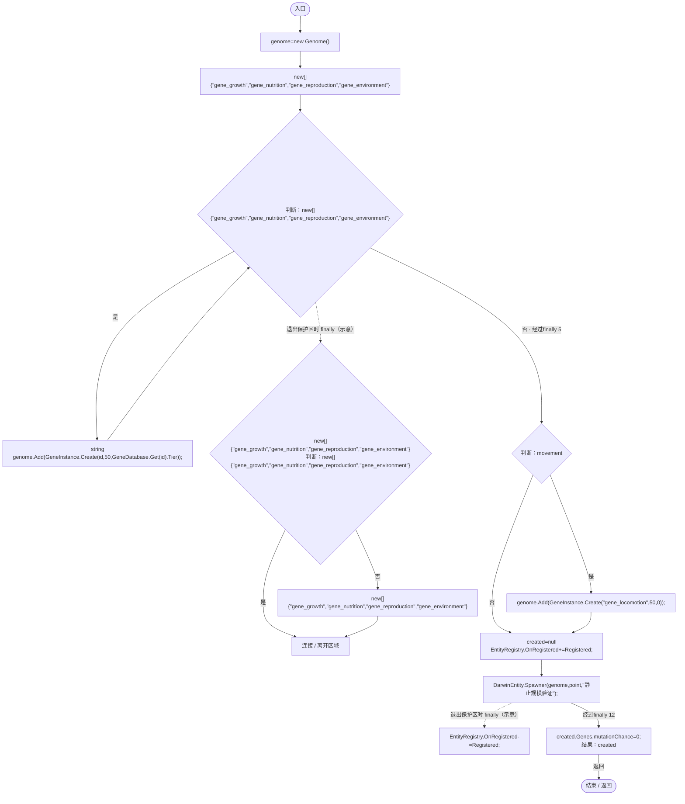

项目内调用/回调引用：

- [Genome.Add · L19](a2ef23f865bc7ee8.md#md9cfdc94b8b8d40f)（方法）
- [GeneInstance.Create · L20](f82e1498d67f5afd.md#m72e94c278de3cf8b)（方法）
- [GeneDatabase.Get · L135](ec0a03483435a863.md#m8f3bbfb35f3ca397)（方法）
- [DarwinEntity.Genes.get · L14](70798dde169f2e8b.md#m622eb1adf401d431)（访问器）
- [StationaryPerformanceRegression.Registered · L48](c740ddb4a4340bed.md#mfce9bc667c71e6a2)（局部函数）

<a id="mfce9bc667c71e6a2"></a>

## Registered · L48

`void Registered(DarwinEntity e)`


### Editor · Roslyn编译器控制流

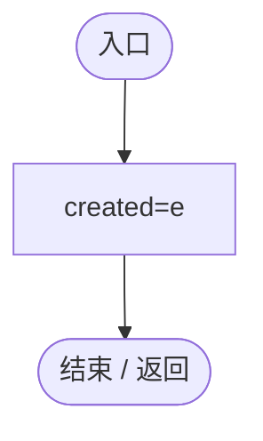

<a id="md0bdfc1a6336cd50"></a>

## Clean · L52

`private static void Clean()`


### Editor · Roslyn编译器控制流

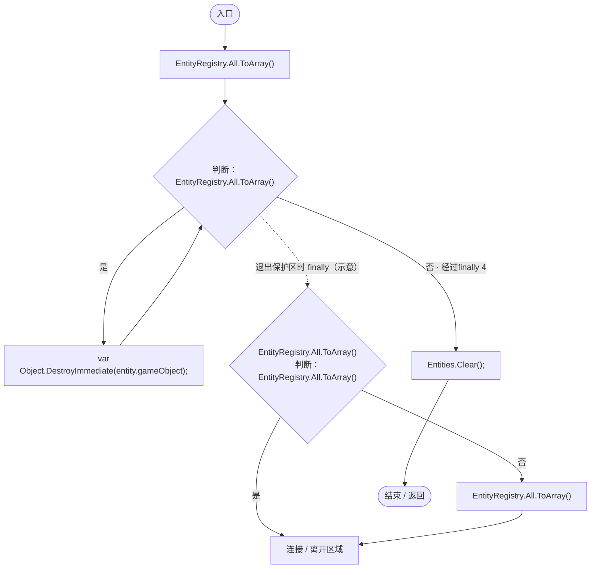

<a id="md1b1871ec0e7164c"></a>

## Spread · L53

`private static Vector3 Spread(int i,int count)`


### Editor · Roslyn编译器控制流

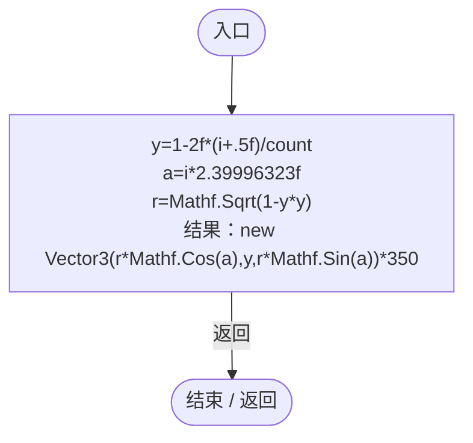

<a id="m78765969b348c5c7"></a>

## Legacy · L55

`private static float Legacy(EntityGeneController genes)`


### Editor · Roslyn编译器控制流

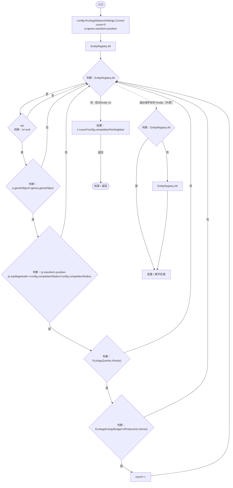

项目内调用/回调引用：

- [EcologyBalanceSettings.Current.get · L29](5a37bc79f15f6238.md#md33d4c4b8f82540b)（访问器）
- [EcologyQueries.Alive · L38](bdf7ccc2c9c0452f.md#mb2877c487f449970)（方法）
- [EcologyEnergyBudget.IsProducer · L24](06a91c8201f26593.md#mcb3499a2649d9648)（方法）
- [DarwinEntity.Genes.get · L14](70798dde169f2e8b.md#m622eb1adf401d431)（访问器）

<a id="m6cfe1c569bff75b8"></a>

## Compare · L61

`private static void Compare(string distribution)`


### Editor · Roslyn编译器控制流

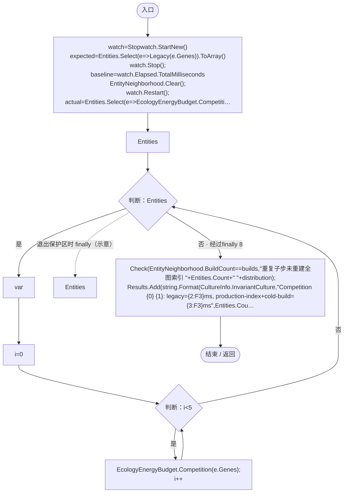

项目内调用/回调引用：

- [EntityNeighborhood.Clear · L90](e5e24c4aff0395b1.md#m2ab6c4a79cc1ce81)（方法）
- [StationaryPerformanceRegression.Check · L32](c740ddb4a4340bed.md#m7bbbffa0fa07e57f)（方法）
- [EntityNeighborhood.BuildCount.get · L20](e5e24c4aff0395b1.md#m08a89e8246fbbdac)（访问器）
- [EcologyEnergyBudget.Competition · L36](06a91c8201f26593.md#m4584847dd198ff8b)（方法）
- [DarwinEntity.Genes.get · L14](70798dde169f2e8b.md#m622eb1adf401d431)（访问器）
- [StationaryPerformanceRegression.回调@63 · L63](c740ddb4a4340bed.md#m42b1e0439e24b577)（回调/委托）
- [StationaryPerformanceRegression.回调@64 · L64](c740ddb4a4340bed.md#ma76c77c80766e6fd)（回调/委托）
- [StationaryPerformanceRegression.回调@65 · L65](c740ddb4a4340bed.md#mc2a5519cc626b523)（回调/委托）
- [StationaryPerformanceRegression.回调@65 · L65](c740ddb4a4340bed.md#mde0cedb69e8ab418)（回调/委托）

<a id="m42b1e0439e24b577"></a>

## 回调@63 · L63

`e … => 回调`


### Editor · Roslyn编译器控制流

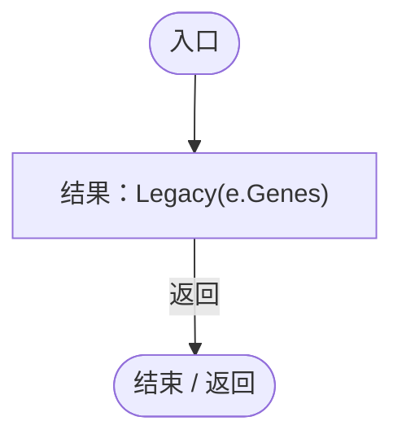

项目内调用/回调引用：

- [StationaryPerformanceRegression.Legacy · L55](c740ddb4a4340bed.md#m78765969b348c5c7)（方法）
- [DarwinEntity.Genes.get · L14](70798dde169f2e8b.md#m622eb1adf401d431)（访问器）

<a id="ma76c77c80766e6fd"></a>

## 回调@64 · L64

`e … => 回调`


### Editor · Roslyn编译器控制流

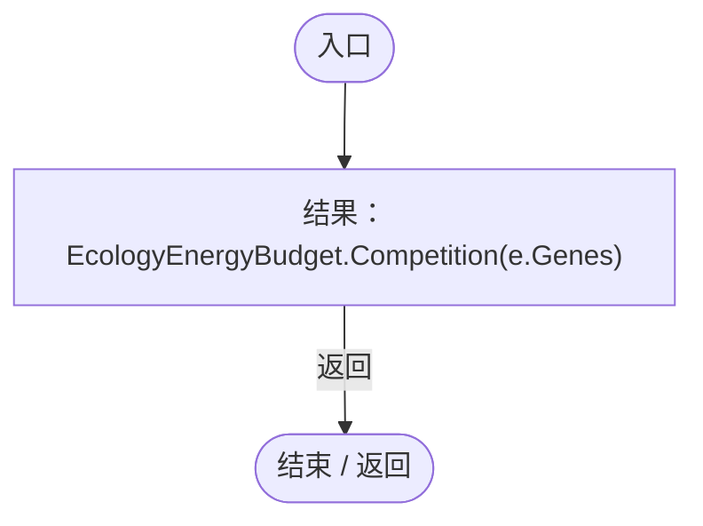

项目内调用/回调引用：

- [EcologyEnergyBudget.Competition · L36](06a91c8201f26593.md#m4584847dd198ff8b)（方法）
- [DarwinEntity.Genes.get · L14](70798dde169f2e8b.md#m622eb1adf401d431)（访问器）

<a id="mc2a5519cc626b523"></a>

## 回调@65 · L65

`( … => 回调`


### Editor · Roslyn编译器控制流

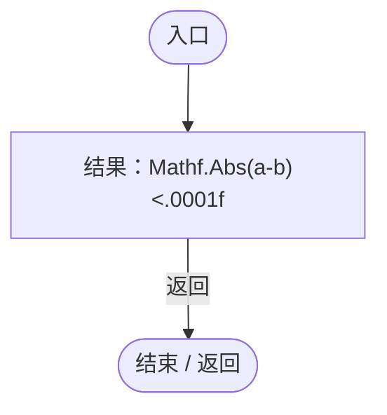

<a id="mde0cedb69e8ab418"></a>

## 回调@65 · L65

`x … => 回调`


### Editor · Roslyn编译器控制流

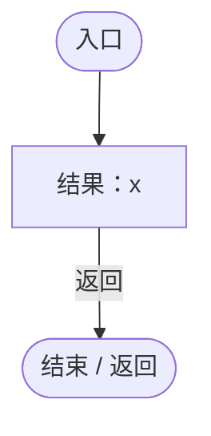

<a id="m9f9654933a7b704d"></a>

## Run · L70

`private static IEnumerator Run()`


### Editor · Roslyn编译器控制流

```mermaid
flowchart TD
  b0(["入口"])
  b1["clock=ServiceLocator.Get&lt;SimulationClock&gt;()<br/>clock.Pause();<br/>budget=new SimulationStepBudget()<br/>first=budget.Consume(10,16,.5f)<br/>delivered=first"]
  b2{"判断：first==.5f"}
  b3["Math.Abs(budget.Pending-159.5)&lt;.0001"]
  b4["first==.5f"]
  b5["Check(first==.5f&amp;&amp;Math.Abs(budget.Pending-159.5)&lt;.0001,&quot;10秒长帧在16倍下只交付0.5秒，其余159.5秒排队&quot;);"]
  b6["i=0"]
  b7{"判断：i&lt;319"}
  b8["delivered+=budget.Consume(0,1,.5f);<br/>i++"]
  b9{"判断：Math.Abs(delivered-160)&lt;.0001"}
  b10["budget.Pending==0"]
  b11["Math.Abs(delivered-160)&lt;.0001"]
  b12["Check(Math.Abs(delivered-160)&lt;.0001&amp;&amp;budget.Pending==0,&quot;排队模拟时间完整交付，无丢弃和额外时间&quot;);"]
  b13["Check(Mathf.Abs(budget.Consume(1f/60,16,.5f)-16f/60)&lt;.00001f,&quot;正常帧保留16倍模拟步长&quot;);<br/>budget.Clear();"]
  b14["new[]{400,800,1600}"]
  b15{"判断：new[]{400,800,1600}"}
  b16["int<br/>Clean();"]
  b17["i=0"]
  b18{"判断：i&lt;count"}
  b19{"e=Spawn(Spread(i,count))<br/>Entities.Add(e);<br/>e.Genes.enabled=false;<br/>e.GetComponent&lt;Rigidbody&gt;().isKinematic=true;<br/>判断：i%32==31"}
  b20["yield return null;"]
  b21["i++"]
  b22{"yield return null;<br/>Compare(&quot;spread&quot;);<br/>判断：count==400"}
  b23["i=0"]
  b24{"判断：i&lt;count"}
  b25["Entities[i].transform.position=new Vector3(i%20*.2f,350,i/20*.2f);<br/>i++"]
  b26["EntityNeighborhood.Clear();<br/>Compare(&quot;dense&quot;);<br/>yield return null;"]
  b27{"new[]{400,800,1600}<br/>判断：new[]{400,800,1600}"}
  b28["new[]{400,800,1600}"]
  b29["连接 / 离开区域"]
  b30["Clean();<br/>a=Spawn(new Vector3(0,350,0))<br/>b=Spawn(new Vector3(1,350,0))<br/>a.Genes.enabled=b.Genes.enabled=false;<br/>together=Legacy(a.Genes)<br/>Check(EcologyEnergyBudget.Competition(a.Genes)==together,&quot;出生后立即计入竞争&quot;);<br/>original=a.Genes.Genome.Genes.Sin…"]
  b31{"判断：hits.Count==1"}
  b32["hits[0]==a"]
  b33["hits.Count==1"]
  b34["Check(hits.Count==1&amp;&amp;hits[0]==a,&quot;局部查询使用真实半径且排除远处实体&quot;);"]
  b35["snapshot=EntitySaveState.Capture(b)<br/>snapshot.position=a.transform.position+Vector3.right;<br/>snapshot.Restore(b);<br/>Check(EcologyEnergyBudget.Competition(a.Genes)==Legacy(a.Genes),&quot;存档恢复位置和营养后同帧缓存正确&quot;);<br/>EntityRegistry.Clear();<br/>EntityNeighborhoo…"]
  b36{"判断：session.Busy"}
  b37["yield return null;"]
  b38{"判断：WorldRuntimeGate.Ready"}
  b39["session.Current!=null"]
  b40["WorldRuntimeGate.Ready"]
  b41["Check(WorldRuntimeGate.Ready&amp;&amp;session.Current!=null,&quot;真实星球生成并进入游戏&quot;);"]
  b42["clock.Pause();<br/>builder=Object.FindFirstObjectByType&lt;PlanetTerrainMeshBuilder&gt;()<br/>surface=builder.GetComponent&lt;MeshCollider&gt;()"]
  b43["i=0"]
  b44{"判断：i&lt;800"}
  b45["tries=0"]
  b46{"direction=UnityEngine.Random.onUnitSphere;<br/>surface.Raycast(new Ray(builder.transform.position+direction*1000,-direction),out hit,2000);<br/>tries++;<br/>判断：tries&lt;100"}
  b47{"判断：hit.collider==null"}
  b48{"判断：(hit.point-builder.transform.position).magnitude&lt;builder.WaterRadius+1"}
  b49{"Check(hit.collider!=null,&quot;落点命中真实地形 &quot;+i);<br/>Entities.Add(Spawn(hit.point+direction*.65f));<br/>判断：i%16==15"}
  b50["yield return null;"]
  b51{"判断：i==399"}
  b52["yield return RuntimeSample(clock,400);"]
  b53["i++"]
  b54["yield return RuntimeSample(clock,800);<br/>clock.Play();<br/>typeof(SimulationClock).GetField(&quot;&lt;GameDeltaTime&gt;k__BackingField&quot;,BindingFlags.NonPublic&#124;BindingFlags.Instance).SetValue(clock,.1f);<br/>watch=Stopwatch.StartNew()"]
  b55["EntityRegistry.All.ToArray()"]
  b56{"判断：EntityRegistry.All.ToArray()"}
  b57["var<br/>e.Genes.AdvanceSimulation(.1f);"]
  b58{"EntityRegistry.All.ToArray()<br/>判断：EntityRegistry.All.ToArray()"}
  b59["EntityRegistry.All.ToArray()"]
  b60["连接 / 离开区域"]
  b61["watch.Stop();<br/>Results.Add(&quot;800 genes 0.1s all: &quot;+watch.Elapsed.TotalMilliseconds.ToString(&quot;F3&quot;)+&quot;ms&quot;);<br/>vitals=typeof(DarwinPark.Entities.Vitals.EntityVitals).GetMethod(&quot;AdvanceVitals&quot;,BindingFlags.NonPublic&#124;BindingFlags.Instance)<br/>watch.R…"]
  b62["EntityRegistry.All.ToArray()"]
  b63{"判断：EntityRegistry.All.ToArray()"}
  b64["var<br/>vitals.Invoke(e.GetComponent&lt;DarwinPark.Entities.Vitals.EntityVitals&gt;(),new object[]{.1f});"]
  b65{"EntityRegistry.All.ToArray()<br/>判断：EntityRegistry.All.ToArray()"}
  b66["EntityRegistry.All.ToArray()"]
  b67["连接 / 离开区域"]
  b68["watch.Stop();<br/>Results.Add(&quot;800 vitals 0.1s all: &quot;+watch.Elapsed.TotalMilliseconds.ToString(&quot;F3&quot;)+&quot;ms&quot;);<br/>environment=typeof(DarwinPark.Entities.Vitals.EntityEnvironmentHazard).GetMethod(&quot;Update&quot;,BindingFlags.NonPublic&#124;BindingFlags.Instanc…"]
  b69["EntityRegistry.All.ToArray()"]
  b70{"判断：EntityRegistry.All.ToArray()"}
  b71["var<br/>environment.Invoke(e.GetComponent&lt;DarwinPark.Entities.Vitals.EntityEnvironmentHazard&gt;(),null);"]
  b72{"EntityRegistry.All.ToArray()<br/>判断：EntityRegistry.All.ToArray()"}
  b73["EntityRegistry.All.ToArray()"]
  b74["连接 / 离开区域"]
  b75["watch.Stop();<br/>Results.Add(&quot;800 environment all: &quot;+watch.Elapsed.TotalMilliseconds.ToString(&quot;F3&quot;)+&quot;ms&quot;);<br/>clock.Pause();<br/>dormant=Entities.FirstOrDefault(e=&gt;e!=null&amp;&amp;e.GetComponent&lt;Rigidbody&gt;().IsSleeping())<br/>Check(dormant!=null,&quot;真实地表的无行动实体进…"]
  b76{"判断：StationaryBodyRest.RemainsAsleep(body,dormant.Genes)"}
  b77["!body.IsSleeping()"]
  b78["!StationaryBodyRest.RemainsAsleep(body,dormant.Genes)"]
  b79["Check(!StationaryBodyRest.RemainsAsleep(body,dormant.Genes)&amp;&amp;!body.IsSleeping(),&quot;获得有效行动基因后恢复物理推进&quot;);"]
  b80["rooted=Entities.First(e=&gt;e!=null&amp;&amp;e!=dormant&amp;&amp;StationaryBodyRest.IsResting(e.GetComponent&lt;Rigidbody&gt;()))<br/>rootedBody=rooted.GetComponent&lt;Rigidbody&gt;()<br/>origin=rootedBody.position<br/>rootedBody.position+=EcologyQueries.Up(origin)*60;<br/>Physics.Sy…"]
  b81{"判断：StationaryBodyRest.RemainsAsleep(rootedBody,rooted.Genes)"}
  b82["!rootedBody.IsSleeping()"]
  b83["!StationaryBodyRest.RemainsAsleep(rootedBody,rooted.Genes)"]
  b84["Check(!StationaryBodyRest.RemainsAsleep(rootedBody,rooted.Genes)&amp;&amp;!rootedBody.IsSleeping(),&quot;休眠实体被传送到高空时恢复地表安全网&quot;);"]
  b85["Check(Entities.Where(e=&gt;e!=null).All(e=&gt;e.GetComponentsInChildren&lt;Light&gt;(true).Length==0),&quot;普通无行动实体不创建闲置泳光&quot;);<br/>Results.Add(&quot;Runtime samples include actual terrain, environment, physics and UI; Editor observations are not release-build FPS …"]
  b86(["结束 / 返回"])
  b0 --> b1
  b1 --> b2
  b2 -->|"是"| b3
  b2 -->|"否"| b4
  b3 --> b5
  b4 --> b5
  b5 --> b6
  b6 --> b7
  b7 -->|"是"| b8
  b7 -->|"否"| b9
  b8 --> b7
  b9 -->|"是"| b10
  b9 -->|"否"| b11
  b10 --> b12
  b11 --> b12
  b12 --> b13
  b13 --> b14
  b14 --> b15
  b15 -->|"是"| b16
  b15 -->|"否 · 经过finally 27"| b30
  b16 --> b17
  b17 --> b18
  b18 -->|"是"| b19
  b18 -->|"否"| b22
  b19 -->|"是"| b20
  b19 -->|"否"| b21
  b20 --> b21
  b21 --> b18
  b22 -->|"是"| b23
  b22 -->|"否"| b15
  b23 --> b24
  b24 -->|"是"| b25
  b24 -->|"否"| b26
  b25 --> b24
  b26 --> b15
  b27 -->|"否"| b28
  b27 -->|"是"| b29
  b28 --> b29
  b30 --> b31
  b31 -->|"是"| b32
  b31 -->|"否"| b33
  b32 --> b34
  b33 --> b34
  b34 --> b35
  b35 --> b36
  b36 -->|"是"| b37
  b36 -->|"否"| b38
  b37 --> b36
  b38 -->|"是"| b39
  b38 -->|"否"| b40
  b39 --> b41
  b40 --> b41
  b41 --> b42
  b42 --> b43
  b43 --> b44
  b44 -->|"是"| b45
  b44 -->|"否"| b54
  b45 --> b46
  b46 -->|"是"| b47
  b46 -->|"否"| b49
  b47 -->|"否"| b48
  b47 -->|"是"| b46
  b48 -->|"否"| b49
  b48 -->|"是"| b46
  b49 -->|"是"| b50
  b49 -->|"否"| b51
  b50 --> b51
  b51 -->|"是"| b52
  b51 -->|"否"| b53
  b52 --> b53
  b53 --> b44
  b54 --> b55
  b55 --> b56
  b56 -->|"是"| b57
  b56 -->|"否 · 经过finally 58"| b61
  b57 --> b56
  b58 -->|"否"| b59
  b58 -->|"是"| b60
  b59 --> b60
  b61 --> b62
  b62 --> b63
  b63 -->|"是"| b64
  b63 -->|"否 · 经过finally 65"| b68
  b64 --> b63
  b65 -->|"否"| b66
  b65 -->|"是"| b67
  b66 --> b67
  b68 --> b69
  b69 --> b70
  b70 -->|"是"| b71
  b70 -->|"否 · 经过finally 72"| b75
  b71 --> b70
  b72 -->|"否"| b73
  b72 -->|"是"| b74
  b73 --> b74
  b75 --> b76
  b76 -->|"否"| b77
  b76 -->|"是"| b78
  b77 --> b79
  b78 --> b79
  b79 --> b80
  b80 --> b81
  b81 -->|"否"| b82
  b81 -->|"是"| b83
  b82 --> b84
  b83 --> b84
  b84 --> b85
  b85 --> b86
  b15 -. "退出保护区时 finally（示意）" .-> b27
  b56 -. "退出保护区时 finally（示意）" .-> b58
  b63 -. "退出保护区时 finally（示意）" .-> b65
  b70 -. "退出保护区时 finally（示意）" .-> b72

```

项目内调用/回调引用：

- [ServiceLocator.Get · L33](f2fdbe9f9ccd93cb.md#m2ae625299520c56d)（方法）
- [SimulationClock.Pause · L79](a8f444aec9614b0a.md#m30929d45a885d0f1)（方法）
- [SimulationStepBudget.Consume · L9](0ec4b354aeb329c1.md#me5418cddb06e3e3b)（方法）
- [StationaryPerformanceRegression.Check · L32](c740ddb4a4340bed.md#m7bbbffa0fa07e57f)（方法）
- [SimulationStepBudget.Pending.get · L8](0ec4b354aeb329c1.md#mbafae1240ee9766b)（访问器）
- [SimulationStepBudget.Clear · L16](0ec4b354aeb329c1.md#m16ff6b64c0b744d1)（方法）
- [StationaryPerformanceRegression.Clean · L52](c740ddb4a4340bed.md#md0bdfc1a6336cd50)（方法）
- [StationaryPerformanceRegression.Spawn · L44](c740ddb4a4340bed.md#mf672b69e6fddf963)（方法）
- [StationaryPerformanceRegression.Spread · L53](c740ddb4a4340bed.md#md1b1871ec0e7164c)（方法）
- [DarwinEntity.Genes.get · L14](70798dde169f2e8b.md#m622eb1adf401d431)（访问器）
- [StationaryPerformanceRegression.Compare · L61](c740ddb4a4340bed.md#m6cfe1c569bff75b8)（方法）
- [EntityNeighborhood.Clear · L90](e5e24c4aff0395b1.md#m2ab6c4a79cc1ce81)（方法）
- [StationaryPerformanceRegression.Legacy · L55](c740ddb4a4340bed.md#m78765969b348c5c7)（方法）
- [EcologyEnergyBudget.Competition · L36](06a91c8201f26593.md#m4584847dd198ff8b)（方法）
- [GeneInstance.Create · L20](f82e1498d67f5afd.md#m72e94c278de3cf8b)（方法）
- [Genome.Add · L19](a2ef23f865bc7ee8.md#md9cfdc94b8b8d40f)（方法）
- [EntityGeneController.Recalculate · L97](7494d53178552f0e.md#m65ea735c1e0e37a1)（方法）
- [GeneBehaviorAuthority.IsPrimary · L10](be83fa896bbe02ae.md#me2fc1f2e16fcd073)（方法）
- [EntityStats.Modify · L111](75aa86a368efdf24.md#m9c837be197158240)（方法）
- [EntityNeighborhood.ObservePosition · L63](e5e24c4aff0395b1.md#m994f4a7ab30bcd1d)（方法）
- [EntityNeighborhood.Query · L79](e5e24c4aff0395b1.md#mbf802c841f974425)（方法）
- [EntitySaveState.Capture · L21](a1ec8fcd9d7d3ddb.md#mc67502b381bc2751)（方法）
- [EntitySaveState.Restore · L31](a1ec8fcd9d7d3ddb.md#m047b691a146deabd)（方法）
- [EntityRegistry.Clear · L37](2093aaf08559c9f2.md#mbc5c3633c74276c3)（方法）
- [WorldSessionManager.Create · L41](08741c7b7b9d9344.md#m6aadfeee8b90aacd)（方法）
- [WorldSessionManager.Busy.get · L24](08741c7b7b9d9344.md#m4483e2e4f28f7c85)（访问器）
- [WorldSessionManager.Current.get · L21](08741c7b7b9d9344.md#m5d26a5eb846a8504)（访问器）
- [PlanetTerrainMeshBuilder.WaterRadius.get · L94](415285cf043354a9.md#m28d8809083881ec1)（访问器）
- [StationaryPerformanceRegression.RuntimeSample · L124](c740ddb4a4340bed.md#m24c7a039d926bf4d)（方法）
- [SimulationClock.Play · L78](a8f444aec9614b0a.md#m7aa9e64b7de60ed0)（方法）
- [EntityGeneController.AdvanceSimulation · L66](7494d53178552f0e.md#m477fb905eeed3e79)（方法）
- [StationaryBodyRest.IsResting · L13](19e6d310d5522440.md#mfc1d49425304ae1a)（方法）
- [StationaryBodyRest.RemainsAsleep · L19](19e6d310d5522440.md#m8ed63efa4f5918b0)（方法）
- [EcologyQueries.Up · L41](bdf7ccc2c9c0452f.md#maca7070196f125fd)（方法）
- [StationaryPerformanceRegression.回调@86 · L86](c740ddb4a4340bed.md#m975678cad4edf968)（回调/委托）
- [StationaryPerformanceRegression.回调@87 · L87](c740ddb4a4340bed.md#m3c56cee5c759afe1)（回调/委托）
- [StationaryPerformanceRegression.回调@93 · L93](c740ddb4a4340bed.md#m3df8351fefd84038)（回调/委托）
- [StationaryPerformanceRegression.回调@114 · L114](c740ddb4a4340bed.md#m32b53da4f6cdc4f0)（回调/委托）
- [StationaryPerformanceRegression.回调@119 · L119](c740ddb4a4340bed.md#mbf0e3eb169af6fbe)（回调/委托）
- [StationaryPerformanceRegression.回调@121 · L121](c740ddb4a4340bed.md#mcc328bae2e8dc73a)（回调/委托）
- [StationaryPerformanceRegression.回调@121 · L121](c740ddb4a4340bed.md#md8b31b6c8269277a)（回调/委托）

<a id="m975678cad4edf968"></a>

## 回调@86 · L86

`g … => 回调`


### Editor · Roslyn编译器控制流

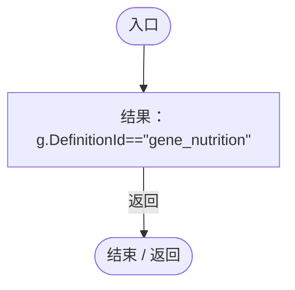

<a id="m3c56cee5c759afe1"></a>

## 回调@87 · L87

`_ … => 回调`


### Editor · Roslyn编译器控制流

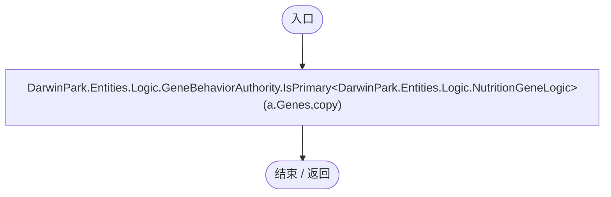

项目内调用/回调引用：

- [GeneBehaviorAuthority.IsPrimary · L10](be83fa896bbe02ae.md#me2fc1f2e16fcd073)（方法）
- [DarwinEntity.Genes.get · L14](70798dde169f2e8b.md#m622eb1adf401d431)（访问器）

<a id="m3df8351fefd84038"></a>

## 回调@93 · L93

`g … => 回调`


### Editor · Roslyn编译器控制流


<a id="m32b53da4f6cdc4f0"></a>

## 回调@114 · L114

`e … => 回调`


### Editor · Roslyn编译器控制流

```mermaid
flowchart TD
  b0(["入口"])
  b1{"判断：e!=null"}
  b2["e.GetComponent&lt;Rigidbody&gt;().IsSleeping()"]
  b3["e!=null"]
  b4["结果：e!=null&amp;&amp;e.GetComponent&lt;Rigidbody&gt;().IsSleeping()"]
  b5(["结束 / 返回"])
  b0 --> b1
  b1 -->|"是"| b2
  b1 -->|"否"| b3
  b2 --> b4
  b3 --> b4
  b4 -->|"返回"| b5

```

<a id="mbf0e3eb169af6fbe"></a>

## 回调@119 · L119

`e … => 回调`


### Editor · Roslyn编译器控制流

```mermaid
flowchart TD
  b0(["入口"])
  b1{"判断：e!=null"}
  b2{"判断：e!=dormant"}
  b3["StationaryBodyRest.IsResting(e.GetComponent&lt;Rigidbody&gt;())"]
  b4["e!=null&amp;&amp;e!=dormant&amp;&amp;StationaryBodyRest.IsResting(e.GetComponent&lt;Rigidbody&gt;())"]
  b5["结果：e!=null&amp;&amp;e!=dormant&amp;&amp;StationaryBodyRest.IsResting(e.GetComponent&lt;Rigidbody&gt;())"]
  b6(["结束 / 返回"])
  b0 --> b1
  b1 -->|"是"| b2
  b1 -->|"否"| b4
  b2 -->|"是"| b3
  b2 -->|"否"| b4
  b3 --> b5
  b4 --> b5
  b5 -->|"返回"| b6

```

项目内调用/回调引用：

- [StationaryBodyRest.IsResting · L13](19e6d310d5522440.md#mfc1d49425304ae1a)（方法）

<a id="mcc328bae2e8dc73a"></a>

## 回调@121 · L121

`e … => 回调`


### Editor · Roslyn编译器控制流

```mermaid
flowchart TD
  b0(["入口"])
  b1["结果：e!=null"]
  b2(["结束 / 返回"])
  b0 --> b1
  b1 -->|"返回"| b2

```

<a id="md8b31b6c8269277a"></a>

## 回调@121 · L121

`e … => 回调`


### Editor · Roslyn编译器控制流

```mermaid
flowchart TD
  b0(["入口"])
  b1["结果：e.GetComponentsInChildren&lt;Light&gt;(true).Length==0"]
  b2(["结束 / 返回"])
  b0 --> b1
  b1 -->|"返回"| b2

```

<a id="m24c7a039d926bf4d"></a>

## RuntimeSample · L124

`private static IEnumerator RuntimeSample(SimulationClock clock,int nominal)`


### Editor · Roslyn编译器控制流

```mermaid
flowchart TD
  b0(["入口"])
  b1["new[]{1,16}"]
  b2{"判断：new[]{1,16}"}
  b3["int"]
  b4["clock.RestoreState(clock.GameTime,scale);<br/>clock.Play();<br/>yield return new WaitForSecondsRealtime(1);<br/>times=new List&lt;double&gt;()<br/>start=EditorApplication.timeSinceStartup<br/>previous=start<br/>gameTime=clock.GameTime"]
  b5{"判断：EditorApplication.timeSinceStartup-start&lt;4"}
  b6["yield return null;<br/>now=EditorApplication.timeSinceStartup<br/>times.Add((now-previous)*1000);<br/>previous=now;"]
  b7["clock.Pause();<br/>times.Sort();<br/>seconds=EditorApplication.timeSinceStartup-start<br/>Results.Add(string.Format(CultureInfo.InvariantCulture,&quot;Actual planet {0} nominal / {1} alive, {2}x: frames={3}, elapsed={4:F2}s, avg={5:F2}ms, p95={6:F2}ms, m…"]
  b8{"判断：times.Count&gt;=5"}
  b9["clock.GameTime&gt;gameTime"]
  b10["times.Count&gt;=5"]
  b11["Check(times.Count&gt;=5&amp;&amp;clock.GameTime&gt;gameTime,&quot;真实星球持续推进，无补算锁死 &quot;+nominal+&quot; / &quot;+scale+&quot;x&quot;);"]
  b12["File.WriteAllLines(Path.Combine(Folder,&quot;progress.txt&quot;),Results);"]
  b13{"new[]{1,16}<br/>判断：new[]{1,16}"}
  b14["new[]{1,16}"]
  b15["连接 / 离开区域"]
  b16(["结束 / 返回"])
  b0 --> b1
  b1 --> b2
  b2 -->|"是"| b3
  b2 -->|"否 · 经过finally 13"| b16
  b3 --> b4
  b4 --> b5
  b5 -->|"是"| b6
  b5 -->|"否"| b7
  b6 --> b5
  b7 --> b8
  b8 -->|"是"| b9
  b8 -->|"否"| b10
  b9 --> b11
  b10 --> b11
  b11 --> b12
  b12 --> b2
  b13 -->|"否"| b14
  b13 -->|"是"| b15
  b14 --> b15
  b2 -. "退出保护区时 finally（示意）" .-> b13

```

项目内调用/回调引用：

- [SimulationClock.RestoreState · L74](a8f444aec9614b0a.md#m8f617e95e1282846)（方法）
- [SimulationClock.GameTime.get · L23](a8f444aec9614b0a.md#m74adfa39a896652f)（访问器）
- [SimulationClock.Play · L78](a8f444aec9614b0a.md#m7aa9e64b7de60ed0)（方法）
- [SimulationClock.Pause · L79](a8f444aec9614b0a.md#m30929d45a885d0f1)（方法）
- [StationaryPerformanceRegression.Check · L32](c740ddb4a4340bed.md#m7bbbffa0fa07e57f)（方法）
- [StationaryPerformanceRegression.回调@132 · L132](c740ddb4a4340bed.md#mb885400064eb865d)（回调/委托）

<a id="mb885400064eb865d"></a>

## 回调@132 · L132

`e … => 回调`


### Editor · Roslyn编译器控制流

```mermaid
flowchart TD
  b0(["入口"])
  b1["结果：e.GetComponent&lt;Rigidbody&gt;().IsSleeping()"]
  b2(["结束 / 返回"])
  b0 --> b1
  b1 -->|"返回"| b2

```
