# ControlsActivityRegression.cs

[返回总索引](../README.md) · `Editor` · `Assets/DarwinPark/Editor/ControlsActivityRegression.cs`

[源文件](../../../Assets/DarwinPark/Editor/ControlsActivityRegression.cs) · 源码校验：`81c5bd1df8876d5560e01ac098d7ee41fc9ece03c0f99cd36e59143806f9a0e6`

方法按源文件位置排列。事件/回调引用不表示立即执行；分支与异常说明见总索引。完整源码与可点击关系图请打开离线手册。

## Folder.get · L29

`private static string Folder`

### Editor · 语法控制结构 / 声明（非CFG）

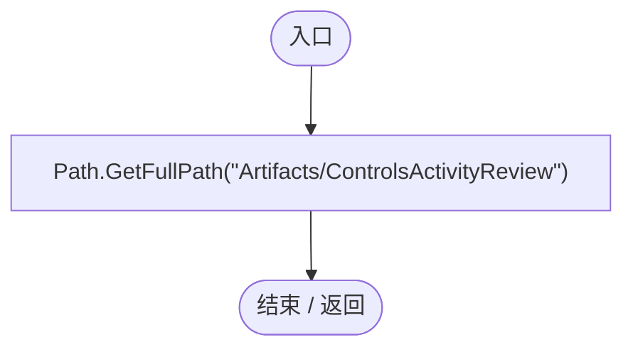

## ControlsActivityRegression.ctor · L30

`static ControlsActivityRegression()`

### Editor · Roslyn编译器控制流

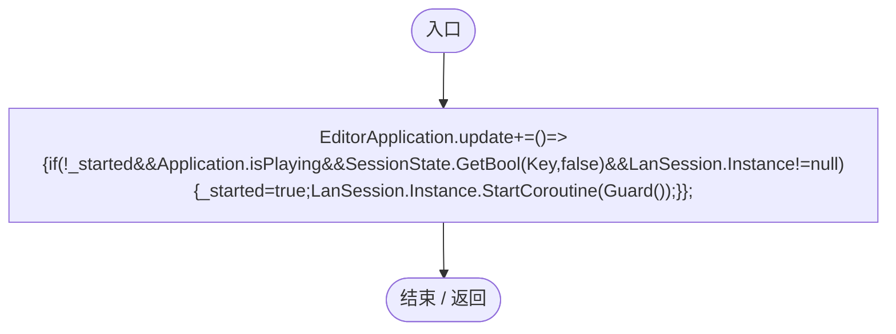

项目内调用/回调引用：

- [ControlsActivityRegression.回调@30 · L30](c94d401ef13df84d.md#m8e91bc81b44a216b)（回调/委托）

## 回调@30 · L30

`( … => 回调`

### Editor · Roslyn编译器控制流

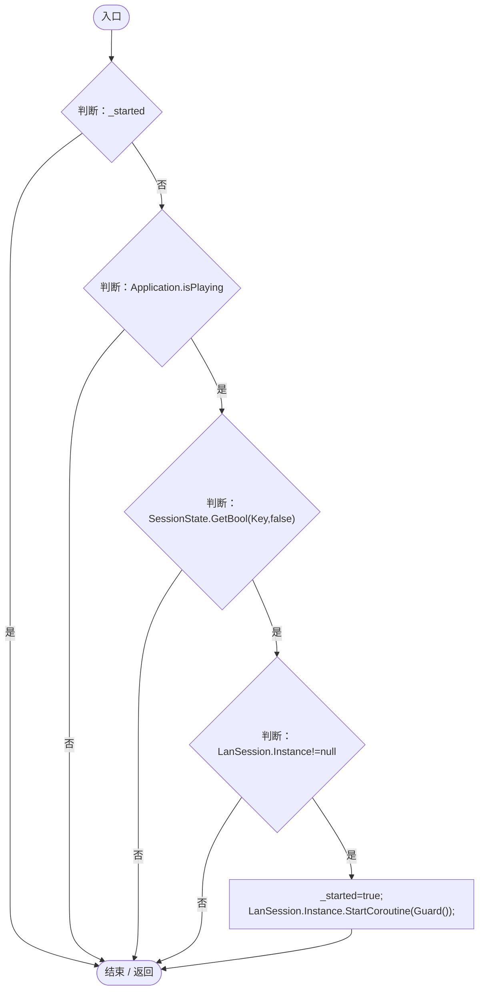

项目内调用/回调引用：

- [LanSession.Instance.get · L23](9fb633eebffe669c.md#mbf83306994878383)（访问器）
- [ControlsActivityRegression.Guard · L33](c94d401ef13df84d.md#ma72d62c38e0cae5c)（方法）

## RunBatch · L31

`public static void RunBatch()`

### Editor · Roslyn编译器控制流

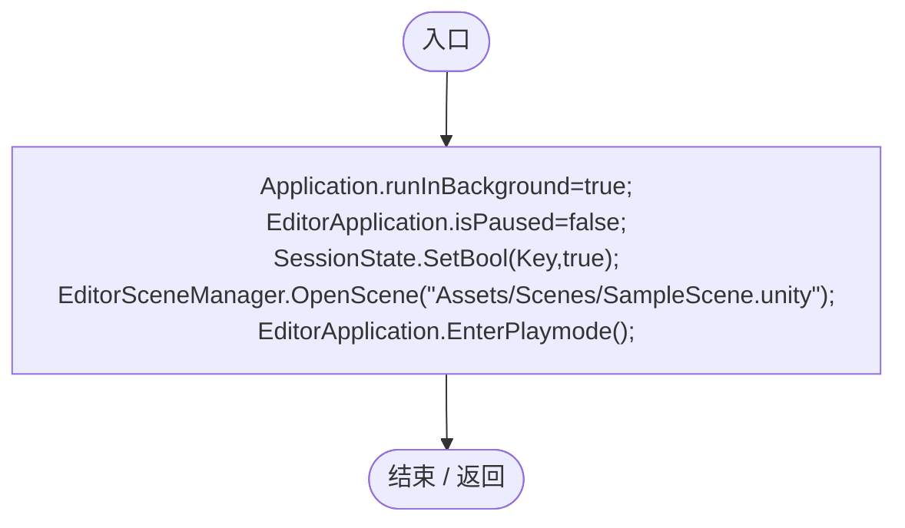

## Check · L32

`private static void Check(bool value,string message)`

### Editor · Roslyn编译器控制流

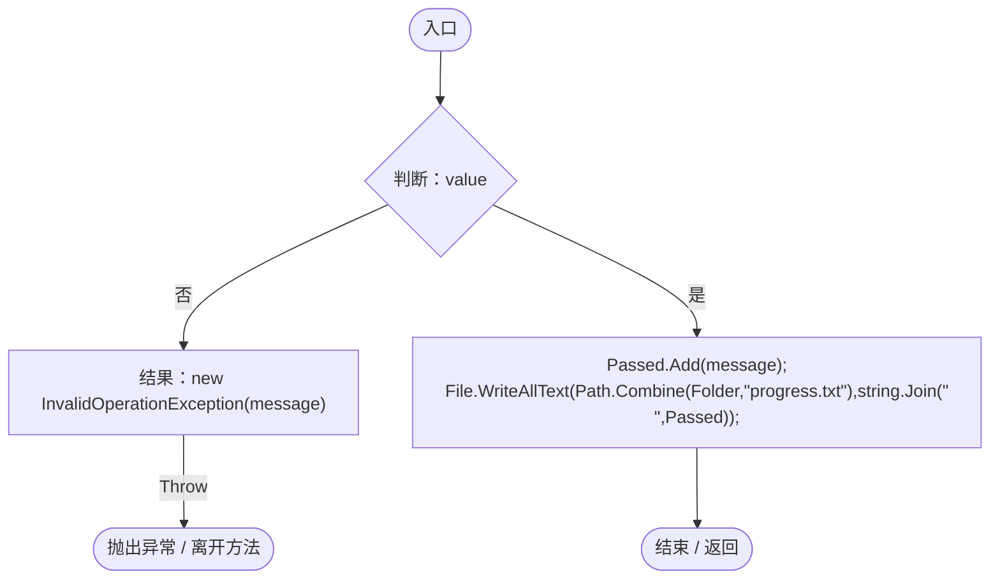

## Guard · L33

`private static IEnumerator Guard()`

### Editor · Roslyn编译器控制流

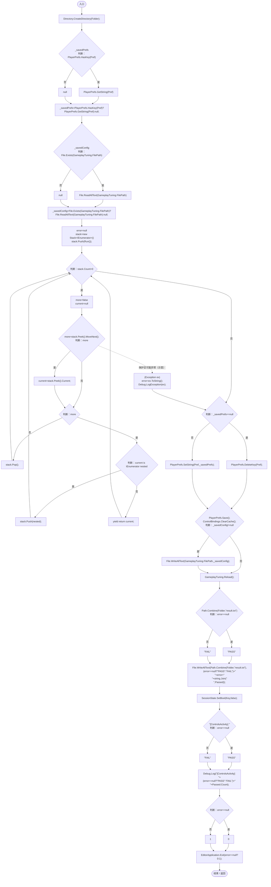

项目内调用/回调引用：

- [ControlsActivityRegression.Run · L52](c94d401ef13df84d.md#m27c020229ae0d0dd)（方法）
- [ControlBindings.ClearCache · L72](b6735f8f133ee3f4.md#me028e7c0de17a4bd)（方法）
- [GameplayTuning.Reload · L31](db546e5713b32d53.md#m10cbcd3bcb0856d1)（方法）

## Spawn · L42

`private static DarwinEntity Spawn(Vector3 point,bool colony=false)`

### Editor · Roslyn编译器控制流

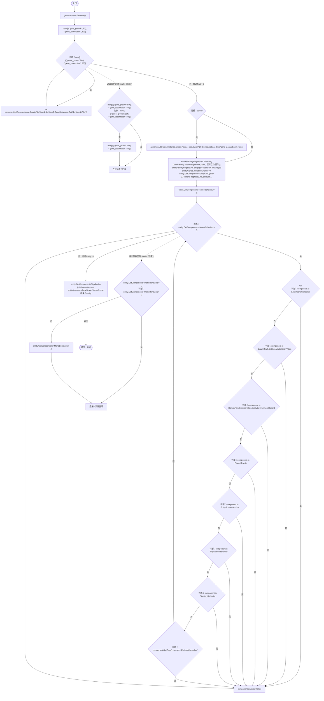

项目内调用/回调引用：

- [Genome.Add · L19](a2ef23f865bc7ee8.md#md9cfdc94b8b8d40f)（方法）
- [GeneInstance.Create · L20](f82e1498d67f5afd.md#m72e94c278de3cf8b)（方法）
- [GeneDatabase.Get · L135](ec0a03483435a863.md#m8f3bbfb35f3ca397)（方法）
- [DarwinEntity.Genes.get · L14](70798dde169f2e8b.md#m622eb1adf401d431)（访问器）
- [EntityLifeCycle.RestoreProgress · L48](9f4138bfbae654b7.md#mfc75121476d49679)（方法）
- [LifeCycleSettings.Load · L16](ace76969fe8f61de.md#mbd2925785484f343)（方法）
- [EntityGeneController.RestoreStageState · L45](7494d53178552f0e.md#m49489af39061f1a1)（方法）
- [EntityGeneController.Recalculate · L90](7494d53178552f0e.md#m93744c8f3039b93c)（方法）
- [ControlsActivityRegression.回调@46 · L46](c94d401ef13df84d.md#mc9abb724203bd1e6)（回调/委托）

## 回调@46 · L46

`e … => 回调`

### Editor · Roslyn编译器控制流

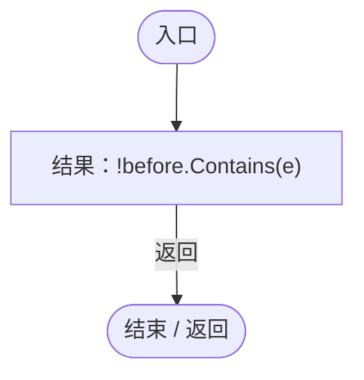

## Capture · L51

`private static IEnumerator Capture(string name)`

### Editor · Roslyn编译器控制流

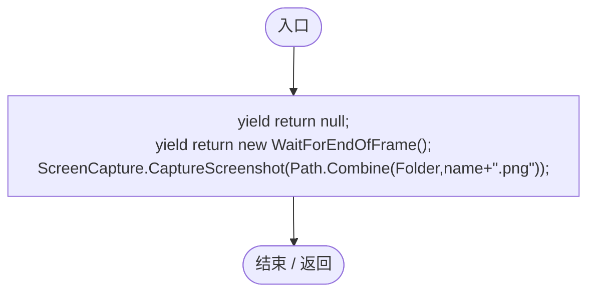

## Run · L52

`private static IEnumerator Run()`

### Editor · Roslyn编译器控制流

```mermaid
flowchart TD
  b0(["入口"])
  b1["yield return null;<br/>ControlBindings.RestoreDefaults();<br/>page=new ControlSettingsPage()"]
  b2{"判断：ControlBindings.Get(ControlAction.Attack)==KeyCode.Mouse0"}
  b3["ControlBindings.Get(ControlAction.Jump)==KeyCode.Space"]
  b4["ControlBindings.Get(ControlAction.Attack)==KeyCode.Mouse0"]
  b5["Check(ControlBindings.Get(ControlAction.Attack)==KeyCode.Mouse0&amp;&amp;ControlBindings.Get(ControlAction.Jump)==KeyCode.Space,&quot;默认按键与原玩法一致&quot;);"]
  b6["Check(!ControlBindings.TryBind(ControlAction.Forward,KeyCode.S,out _),&quot;拒绝同场景冲突按键&quot;);<br/>Check(!ControlBindings.TryBind(ControlAction.Attack,KeyCode.Escape,out _),&quot;Esc保留给菜单&quot;);<br/>page.Begin(ControlAction.Attack);"]
  b7["page<br/>new Event{type=EventType.KeyDown,keyCode=KeyCode.F}<br/>type=EventType.KeyDown<br/>keyCode=KeyCode.F<br/>page.HandleEvent(new Event{type=EventType.KeyDown,keyCode=KeyCode.F});"]
  b8{"判断：page.Waiting.HasValue"}
  b9["ControlBindings.Get(ControlAction.Attack)==KeyCode.F"]
  b10["!page.Waiting.HasValue"]
  b11["Check(!page.Waiting.HasValue&amp;&amp;ControlBindings.Get(ControlAction.Attack)==KeyCode.F,&quot;设置页捕获键盘攻击键&quot;);"]
  b12["page.Begin(ControlAction.Jump);"]
  b13["page<br/>new Event{type=EventType.KeyDown,keyCode=KeyCode.Escape}<br/>type=EventType.KeyDown<br/>keyCode=KeyCode.Escape<br/>page.HandleEvent(new Event{type=EventType.KeyDown,keyCode=KeyCode.Escape});"]
  b14{"判断：page.Waiting.HasValue"}
  b15["ControlBindings.Get(ControlAction.Jump)==KeyCode.Space"]
  b16["!page.Waiting.HasValue"]
  b17["Check(!page.Waiting.HasValue&amp;&amp;ControlBindings.Get(ControlAction.Jump)==KeyCode.Space,&quot;Esc仅取消改键&quot;);"]
  b18["page.Begin(ControlAction.Attack);"]
  b19["page<br/>new Event{type=EventType.MouseDown,button=1}<br/>type=EventType.MouseDown<br/>button=1<br/>page.HandleEvent(new Event{type=EventType.MouseDown,button=1});"]
  b20["Check(ControlBindings.Get(ControlAction.Attack)==KeyCode.Mouse1,&quot;支持鼠标攻击改键&quot;);<br/>ControlBindings.TryBind(ControlAction.Jump,KeyCode.J,out _);<br/>ControlBindings.TryBind(ControlAction.Pause,KeyCode.O,out _);<br/>ControlBindings.ClearCache();<br/>possess…"]
  b21{"判断：possession.jumpKey==KeyCode.J"}
  b22["possession.attackMouseButton==1"]
  b23["possession.jumpKey==KeyCode.J"]
  b24["Check(possession.jumpKey==KeyCode.J&amp;&amp;possession.attackMouseButton==1,&quot;重载偏好后实际操控输入读取新绑定&quot;);"]
  b25["pause=Object.FindFirstObjectByType&lt;SimulationPauseHotkey&gt;()<br/>clock=ServiceLocator.Get&lt;SimulationClock&gt;()<br/>GameInputGate.Blocked=false;"]
  b26{"判断：pause.HandlePauseKey(KeyCode.O,true,false)"}
  b27["!pause.HandlePauseKey(KeyCode.P,true,false)"]
  b28["pause.HandlePauseKey(KeyCode.O,true,false)"]
  b29["Check(pause.HandlePauseKey(KeyCode.O,true,false)&amp;&amp;!pause.HandlePauseKey(KeyCode.P,true,false),&quot;暂停使用新键且旧键失效&quot;);"]
  b30["GameInputGate.Blocked=true;<br/>ControlBindings.RestoreDefaults();"]
  b31{"判断：possession.jumpKey==KeyCode.Space"}
  b32["possession.attackMouseButton==0"]
  b33["possession.jumpKey==KeyCode.Space"]
  b34["Check(possession.jumpKey==KeyCode.Space&amp;&amp;possession.attackMouseButton==0,&quot;恢复默认立即应用实际输入&quot;);"]
  b35["session=Object.FindFirstObjectByType&lt;WorldSessionManager&gt;()<br/>builder=Object.FindFirstObjectByType&lt;PlanetTerrainMeshBuilder&gt;()<br/>builder.subdivisions=20;<br/>typeof(WorldSessionManager).GetField(&quot;_initialTerrain&quot;,Private).SetValue(session,JsonUt…"]
  b36{"判断：session.Busy"}
  b37{"判断：EditorApplication.timeSinceStartup-start&gt;100"}
  b38["结果：new TimeoutException(&quot;生成超时&quot;)"]
  x38(["抛出异常 / 离开方法"])
  b39["yield return null;"]
  b40["Check(session.Current!=null,&quot;实际世界初始化&quot;);<br/>clock.Pause();"]
  b41["EntityRegistry.All.ToArray()"]
  b42{"判断：EntityRegistry.All.ToArray()"}
  b43["var<br/>Object.DestroyImmediate(e.gameObject);"]
  b44{"EntityRegistry.All.ToArray()<br/>判断：EntityRegistry.All.ToArray()"}
  b45["EntityRegistry.All.ToArray()"]
  b46["连接 / 离开区域"]
  b47["ColonyResource.ClearWorld();<br/>menu=Object.FindFirstObjectByType&lt;GameMainMenu&gt;()<br/>root=ServiceLocator.Get&lt;UIRoot&gt;()<br/>Check(root.MainCanvas.transform.Find(&quot;BottomPanel/TabBar/SettingsShortcut&quot;)==null,&quot;底栏误加按钮已移除&quot;);<br/>menu.ShowPause();<br/>typeof(Gam…"]
  b48{"判断：GameInputGate.Blocked"}
  b49["!clock.IsRunning"]
  b50["GameInputGate.Blocked"]
  b51["Check(GameInputGate.Blocked&amp;&amp;!clock.IsRunning,&quot;改键时暂停并屏蔽底层游戏输入&quot;);"]
  b52["yield return Capture(&quot;controls-settings&quot;);<br/>typeof(GameMainMenu).GetMethod(&quot;ReturnFromSettings&quot;,Private).Invoke(menu,null);<br/>Check((string)typeof(GameMainMenu).GetField(&quot;_page&quot;,Private).GetValue(menu)==&quot;pause&quot;,&quot;设置返回原暂停页&quot;);<br/>typeof(GameMainM…"]
  b53{"判断：EcologyQueries.Distance(home,extended)&gt;queen.Radius"}
  b54["ColonyActivityRange.Contains(soldier.Population,extended)"]
  b55["EcologyQueries.Distance(home,extended)&gt;queen.Radius"]
  b56["Check(EcologyQueries.Distance(home,extended)&gt;queen.Radius&amp;&amp;ColonyActivityRange.Contains(soldier.Population,extended),&quot;补给点活动圆扩展到王后圆外&quot;);"]
  b57["Check(!ColonyActivityRange.Contains(soldier.Population,outside),&quot;所有活动圆外的目标被排除&quot;);<br/>target.transform.position=extended;<br/>Check(EcologyMotion.CanHunt(soldier.Genes,target),&quot;士兵可巡猎补给点活动区&quot;);<br/>target.transform.position=outside;<br/>Check(!EcologyMotio…"]
  b58{"判断：terrain.AllowsTarget(extended)"}
  b59["!terrain.AllowsTarget(outside)"]
  b60["terrain.AllowsTarget(extended)"]
  b61["Check(terrain.AllowsTarget(extended)&amp;&amp;!terrain.AllowsTarget(outside),&quot;个人领地判断使用同一活动圆并集&quot;);"]
  b62["saved=queen.Capture()<br/>queen.State.supplyPoints.Clear();<br/>queen.Restore(saved);<br/>Check(ColonyActivityRange.Contains(soldier.Population,extended),&quot;活动中心随原存档字段往返恢复&quot;);<br/>PopulationRangeLayer.SetVisible(true);<br/>yield return null;<br/>yield return new W…"]
  b63{"判断：Mathf.Approximately(EcologyEnergyBudget.Consumption(self.Genes,0,1),baseCost*2)"}
  b64["baseCost&gt;0"]
  b65["Mathf.Approximately(EcologyEnergyBudget.Consumption(self.Genes,0,1),baseCost*2)"]
  b66["Check(Mathf.Approximately(EcologyEnergyBudget.Consumption(self.Genes,0,1),baseCost*2)&amp;&amp;baseCost&gt;0,&quot;外部配置令实际行动饱食消耗翻倍&quot;);"]
  b67["modified.movementMetabolismMultiplier=0;<br/>File.WriteAllText(GameplayTuning.FilePath,JsonUtility.ToJson(modified));<br/>GameplayTuning.Reload();<br/>Check(EcologyEnergyBudget.Consumption(self.Genes,0,1)==0,&quot;零倍率关闭行动消耗且不影响基础参数&quot;);<br/>rejected=false"]
  b68["GameplayTuning.Parse(&quot;{\&quot;version\&quot;:1,\&quot;movementMetabolismMultiplier\&quot;:-1}&quot;);"]
  b69["rejected=true;"]
  b70["Check(rejected,&quot;负数配置被明确拒绝&quot;);<br/>File.WriteAllText(GameplayTuning.FilePath,config);<br/>GameplayTuning.Reload();<br/>Check(Mathf.Approximately(GameplayTuning.Current.movementMetabolismMultiplier,tuning.movementMetabolismMultiplier),&quot;配置恢复后重新加载生效&quot;);<br/>y…"]
  b71(["结束 / 返回"])
  b0 --> b1
  b1 --> b2
  b2 -->|"是"| b3
  b2 -->|"否"| b4
  b3 --> b5
  b4 --> b5
  b5 --> b6
  b6 --> b7
  b7 --> b8
  b8 -->|"否"| b9
  b8 -->|"是"| b10
  b9 --> b11
  b10 --> b11
  b11 --> b12
  b12 --> b13
  b13 --> b14
  b14 -->|"否"| b15
  b14 -->|"是"| b16
  b15 --> b17
  b16 --> b17
  b17 --> b18
  b18 --> b19
  b19 --> b20
  b20 --> b21
  b21 -->|"是"| b22
  b21 -->|"否"| b23
  b22 --> b24
  b23 --> b24
  b24 --> b25
  b25 --> b26
  b26 -->|"是"| b27
  b26 -->|"否"| b28
  b27 --> b29
  b28 --> b29
  b29 --> b30
  b30 --> b31
  b31 -->|"是"| b32
  b31 -->|"否"| b33
  b32 --> b34
  b33 --> b34
  b34 --> b35
  b35 --> b36
  b36 -->|"是"| b37
  b36 -->|"否"| b40
  b37 -->|"是"| b38
  b37 -->|"否"| b39
  b38 -->|"Throw"| x38
  b39 --> b36
  b40 --> b41
  b41 --> b42
  b42 -->|"是"| b43
  b42 -->|"否 · 经过finally 44"| b47
  b43 --> b42
  b44 -->|"否"| b45
  b44 -->|"是"| b46
  b45 --> b46
  b47 --> b48
  b48 -->|"是"| b49
  b48 -->|"否"| b50
  b49 --> b51
  b50 --> b51
  b51 --> b52
  b52 --> b53
  b53 -->|"是"| b54
  b53 -->|"否"| b55
  b54 --> b56
  b55 --> b56
  b56 --> b57
  b57 --> b58
  b58 -->|"是"| b59
  b58 -->|"否"| b60
  b59 --> b61
  b60 --> b61
  b61 --> b62
  b62 --> b63
  b63 -->|"是"| b64
  b63 -->|"否"| b65
  b64 --> b66
  b65 --> b66
  b66 --> b67
  b67 --> b68
  b68 --> b70
  b69 --> b70
  b70 --> b71
  b42 -. "退出保护区时 finally（示意）" .-> b44
  b68 -. "保护区可能异常（示意）" .-> b69

```

项目内调用/回调引用：

- [ControlBindings.RestoreDefaults · L67](b6735f8f133ee3f4.md#m479d8e9c3bd1b890)（方法）
- [ControlsActivityRegression.Check · L32](c94d401ef13df84d.md#mf5a97db6570f5c71)（方法）
- [ControlBindings.Get · L45](b6735f8f133ee3f4.md#mb5707e6e63a56689)（方法）
- [ControlBindings.TryBind · L55](b6735f8f133ee3f4.md#m2724f096eee115f2)（方法）
- [ControlSettingsPage.Begin · L14](110505a600a95d59.md#m62a5c699fcaaadd5)（方法）
- [ControlSettingsPage.HandleEvent · L15](110505a600a95d59.md#m6ee8437eb0993617)（方法）
- [ControlSettingsPage.Waiting.get · L10](110505a600a95d59.md#m2fe9f8e5114b53d5)（访问器）
- [ControlBindings.ClearCache · L72](b6735f8f133ee3f4.md#me028e7c0de17a4bd)（方法）
- [ServiceLocator.Get · L33](f2fdbe9f9ccd93cb.md#m2ae625299520c56d)（方法）
- [GameInputGate.Blocked.set · L8](52955daae7e592ab.md#m578697f6379686f4)（访问器）
- [SimulationPauseHotkey.HandlePauseKey · L37](cc79d402ad5d8117.md#m55d4ba3aff20b57d)（方法）
- [PlanetClimateMap.Instance.get · L16](b4e9726c1bcf4c37.md#m3add54a419aeef9f)（访问器）
- [PlanetOreSystem.Instance.get · L8](86b3fbb4d9436121.md#m53f6a6af4b6dc252)（访问器）
- [WorldSessionManager.Create · L41](08741c7b7b9d9344.md#m6aadfeee8b90aacd)（方法）
- [WorldSessionManager.Busy.get · L24](08741c7b7b9d9344.md#m4483e2e4f28f7c85)（访问器）
- [WorldSessionManager.Current.get · L21](08741c7b7b9d9344.md#m5d26a5eb846a8504)（访问器）
- [SimulationClock.Pause · L79](a8f444aec9614b0a.md#m30929d45a885d0f1)（方法）
- [ColonyResource.ClearWorld · L100](293dbaecfff4b585.md#m634e84088b7cf78c)（方法）
- [UIRoot.MainCanvas.get · L14](9c1421378791f0e0.md#maa2cc9baf1248477)（访问器）
- [GameMainMenu.ShowPause · L89](a1f1791f9e7a8035.md#m953d85f379a39458)（方法）
- [GameInputGate.Blocked.get · L8](52955daae7e592ab.md#m765763b665829633)（访问器）
- [SimulationClock.IsRunning.get · L22](a8f444aec9614b0a.md#m10f4fe307faca0f0)（访问器）
- [ControlsActivityRegression.Capture · L51](c94d401ef13df84d.md#mf990023ca384377a)（方法）
- [ControlsActivityRegression.Spawn · L42](c94d401ef13df84d.md#m2bd5ed753f7940c0)（方法）
- [EntityManualControl.BeginControl · L32](a6969896da35e1f0.md#mf0dadf914f9961c7)（方法）
- [EntityManualControl.SetAim · L27](a6969896da35e1f0.md#m70f09d0090a1fa41)（方法）
- [EntityAttackAim.Pick · L10](2e9dde897281c303.md#m6a55b6280b6e3053)（方法）
- [DarwinEntity.Genes.get · L14](70798dde169f2e8b.md#m622eb1adf401d431)（访问器）
- [EntityGeneController.GetLogic · L184](7494d53178552f0e.md#m4f4e58e1a4abadfc)（方法）
- [EntityStats.TryGet · L90](75aa86a368efdf24.md#m24ee1433e4a70d94)（方法）
- [EntityManualControl.SetInput · L33](a6969896da35e1f0.md#m7c7f5613b3bebc74)（方法）
- [IGeneLogic.OnUpdate · L9](5304fdad773967f8.md#m829188d65276f8e5)（方法）
- [EcologyQueries.Surface · L47](bdf7ccc2c9c0452f.md#m2f1f6873ee5fc8df)（方法）
- [AntColonyMember.Ensure · L51](baebd85c05598377.md#m408f716118716988)（方法）
- [AntColonyMember.Assign · L54](baebd85c05598377.md#mda0fe308acecb8f2)（方法）
- [ColonyActivityRange.Boundary · L38](e8d854132f563257.md#m46a418cd54a2ba04)（方法）
- [ActivityCircle.ActivityCircle.ctor · L10](e8d854132f563257.md#m7ad6684817aa9fd4)（构造函数）
- [AntColonyMember.State.get · L27](baebd85c05598377.md#mc8282e8cc823ceeb)（访问器）
- [EcologyQueries.ToLocal · L39](bdf7ccc2c9c0452f.md#m1a07639eacf3aa47)（方法）
- [ColonyResource.Convert · L78](293dbaecfff4b585.md#m91c734732ae2bc49)（方法）
- [EcologyQueries.Distance · L42](bdf7ccc2c9c0452f.md#mba9c3e3c95d0f2dd)（方法）
- [ColonyActivityRange.Contains · L33](e8d854132f563257.md#m9ee9b6f17791cff5)（方法）
- [AntColonyMember.Population.get · L30](baebd85c05598377.md#m688c2c0dfb5a66d6)（访问器）
- [EcologyMotion.CanHunt · L38](6ed9d0eedb456d32.md#m4271864b37a65a94)（方法）
- [AntColonyMember.Genes.get · L28](baebd85c05598377.md#m3b8445af6c82650a)（访问器）
- [TerritoryBehavior.AllowsTarget · L43](19d504dcdc8bc624.md#mc867b3c025f861d2)（方法）
- [AntColonyMember.Capture · L189](baebd85c05598377.md#mdfb4ace9299cbaf0)（方法）
- [AntColonyMember.Restore · L191](baebd85c05598377.md#m7bfd664ed689f5c9)（方法）
- [PopulationRangeLayer.SetVisible · L18](7ad316e94c5af908.md#m224360ff57b7a890)（方法）
- [AntColonySettings.Current.get · L31](cb0a937e97c8fbb3.md#mcd121159f407ccdf)（访问器）
- [PopulationRangeLayer.ActiveCircleCount.get · L17](7ad316e94c5af908.md#mdf5ce69158592d87)（访问器）
- [ColonyResource.Remove · L99](293dbaecfff4b585.md#m3e346b425034ee3a)（方法）
- [SimulationClock.Play · L78](a8f444aec9614b0a.md#m7aa9e64b7de60ed0)（方法）
- [GameplayTuning.Current.get · L21](db546e5713b32d53.md#m1caba89e7704d239)（访问器）
- [EcologyEnergyBudget.Consumption · L54](06a91c8201f26593.md#m9b329937b5f8ae2d)（方法）
- [GameplayTuning.Parse · L22](db546e5713b32d53.md#madb718db2cbbddee)（方法）
- [GameplayTuning.Reload · L31](db546e5713b32d53.md#m10cbcd3bcb0856d1)（方法）
- [ControlsActivityRegression.回调@86 · L86](c94d401ef13df84d.md#m153c23b0ea996908)（回调/委托）

## 回调@86 · L86

`g … => 回调`

### Editor · Roslyn编译器控制流

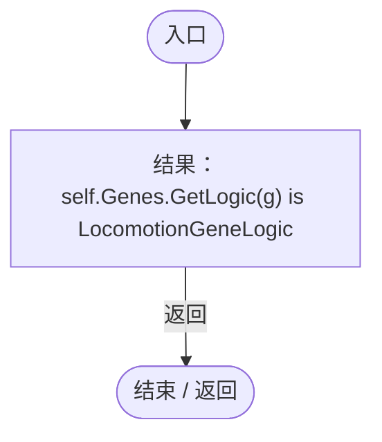

项目内调用/回调引用：

- [EntityGeneController.GetLogic · L184](7494d53178552f0e.md#m4f4e58e1a4abadfc)（方法）
- [DarwinEntity.Genes.get · L14](70798dde169f2e8b.md#m622eb1adf401d431)（访问器）
