# UIVisualTheme.cs

[返回总索引](../README.md) · `Runtime` · `Assets/DarwinPark/Core/UI/UIVisualTheme.cs`

[源文件](../../../Assets/DarwinPark/Core/UI/UIVisualTheme.cs) · 源码校验：`b0569575661486114103e45d76b65204305cf85e4a7a44fd354c186bf4eb2c24`

方法按源文件位置排列。事件/回调引用不表示立即执行；分支与异常说明见总索引。完整源码与可点击关系图请打开离线手册。

## Data.get · L26

`get`

### Editor / Player · Roslyn编译器控制流

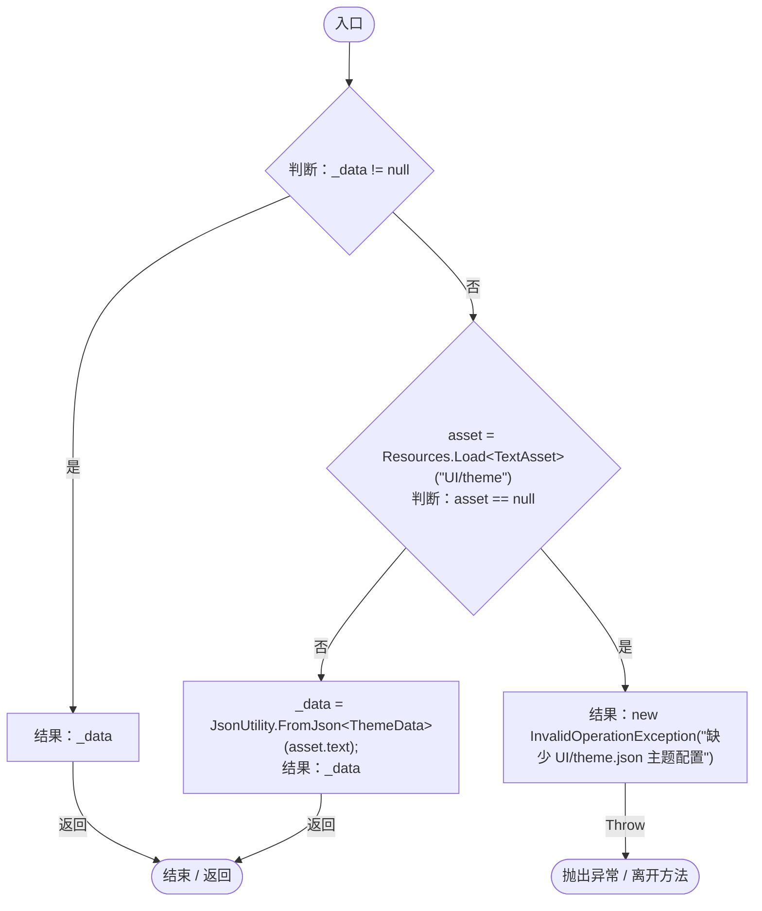

## Parse · L35

`private static Color Parse(string hex)`

### Editor / Player · Roslyn编译器控制流

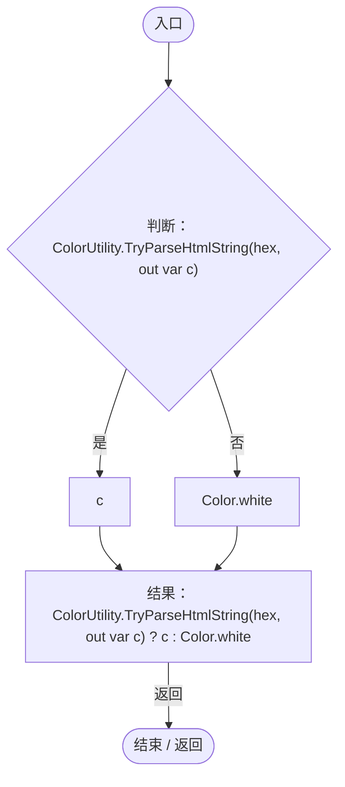

## Accent.get · L36

`public static Color Accent`

### Editor / Player · 语法控制结构 / 声明（非CFG）

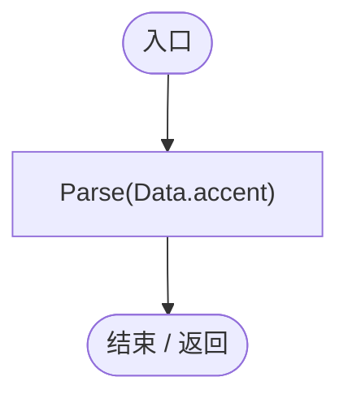

项目内调用/回调引用：

- [UIVisualTheme.Parse · L35](ca525a798a08f966.md#m05013ecd62a9817c)（方法）
- [UIVisualTheme.Data.get · L26](ca525a798a08f966.md#m6c42bdb45a1d9916)（访问器）

## Text.get · L37

`public static Color Text`

### Editor / Player · 语法控制结构 / 声明（非CFG）

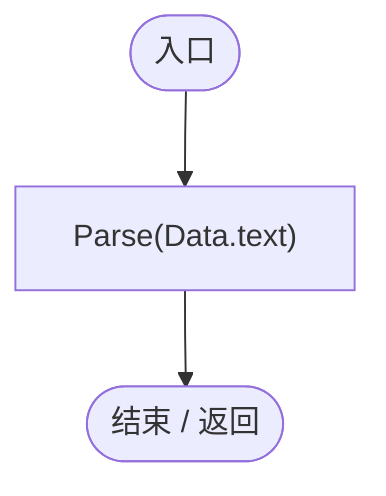

项目内调用/回调引用：

- [UIVisualTheme.Parse · L35](ca525a798a08f966.md#m05013ecd62a9817c)（方法）
- [UIVisualTheme.Data.get · L26](ca525a798a08f966.md#m6c42bdb45a1d9916)（访问器）

## Muted.get · L38

`public static Color Muted`

### Editor / Player · 语法控制结构 / 声明（非CFG）

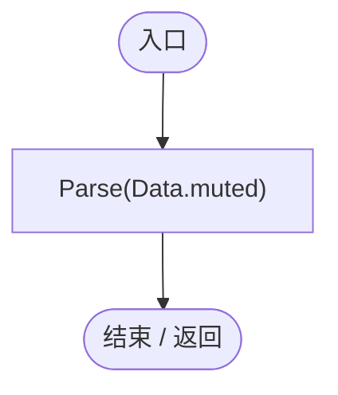

项目内调用/回调引用：

- [UIVisualTheme.Parse · L35](ca525a798a08f966.md#m05013ecd62a9817c)（方法）
- [UIVisualTheme.Data.get · L26](ca525a798a08f966.md#m6c42bdb45a1d9916)（访问器）

## Ink.get · L39

`public static Color Ink`

### Editor / Player · 语法控制结构 / 声明（非CFG）

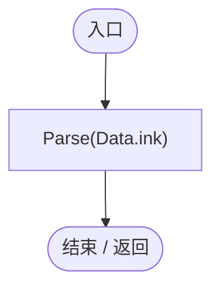

项目内调用/回调引用：

- [UIVisualTheme.Parse · L35](ca525a798a08f966.md#m05013ecd62a9817c)（方法）
- [UIVisualTheme.Data.get · L26](ca525a798a08f966.md#m6c42bdb45a1d9916)（访问器）

## Border.get · L40

`public static Color Border`

### Editor / Player · 语法控制结构 / 声明（非CFG）

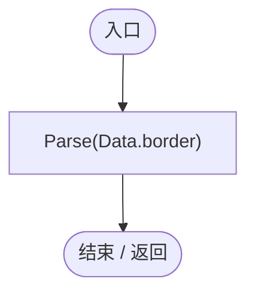

项目内调用/回调引用：

- [UIVisualTheme.Parse · L35](ca525a798a08f966.md#m05013ecd62a9817c)（方法）
- [UIVisualTheme.Data.get · L26](ca525a798a08f966.md#m6c42bdb45a1d9916)（访问器）

## Panel.get · L41

`public static Color Panel`

### Editor / Player · 语法控制结构 / 声明（非CFG）

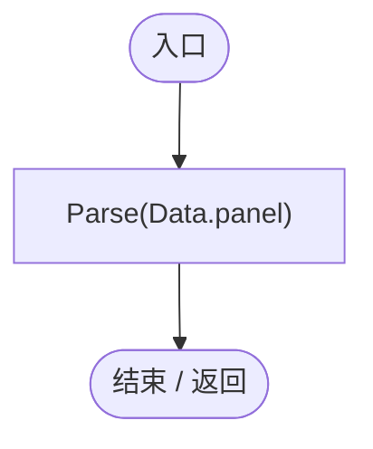

项目内调用/回调引用：

- [UIVisualTheme.Parse · L35](ca525a798a08f966.md#m05013ecd62a9817c)（方法）
- [UIVisualTheme.Data.get · L26](ca525a798a08f966.md#m6c42bdb45a1d9916)（访问器）

## Surface.get · L42

`public static Color Surface`

### Editor / Player · 语法控制结构 / 声明（非CFG）

项目内调用/回调引用：

- [UIVisualTheme.Parse · L35](ca525a798a08f966.md#m05013ecd62a9817c)（方法）
- [UIVisualTheme.Data.get · L26](ca525a798a08f966.md#m6c42bdb45a1d9916)（访问器）

## Danger.get · L43

`public static Color Danger`

### Editor / Player · 语法控制结构 / 声明（非CFG）

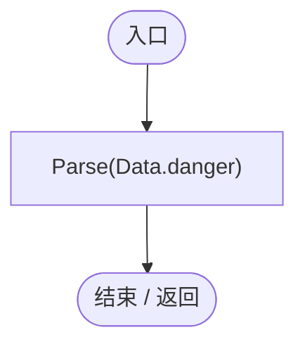

项目内调用/回调引用：

- [UIVisualTheme.Parse · L35](ca525a798a08f966.md#m05013ecd62a9817c)（方法）
- [UIVisualTheme.Data.get · L26](ca525a798a08f966.md#m6c42bdb45a1d9916)（访问器）

## Favorite.get · L44

`public static Color Favorite`

### Editor / Player · 语法控制结构 / 声明（非CFG）

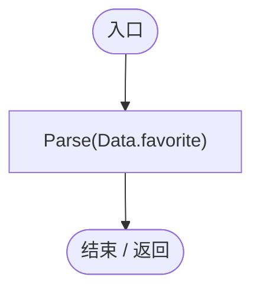

项目内调用/回调引用：

- [UIVisualTheme.Parse · L35](ca525a798a08f966.md#m05013ecd62a9817c)（方法）
- [UIVisualTheme.Data.get · L26](ca525a798a08f966.md#m6c42bdb45a1d9916)（访问器）

## SurfaceSprite · L45

`public static Sprite SurfaceSprite(string name)`

### Editor / Player · Roslyn编译器控制流

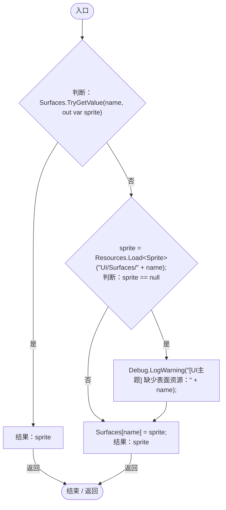

## GeneIcon · L53

`public static string GeneIcon(string id)`

### Editor / Player · Roslyn编译器控制流

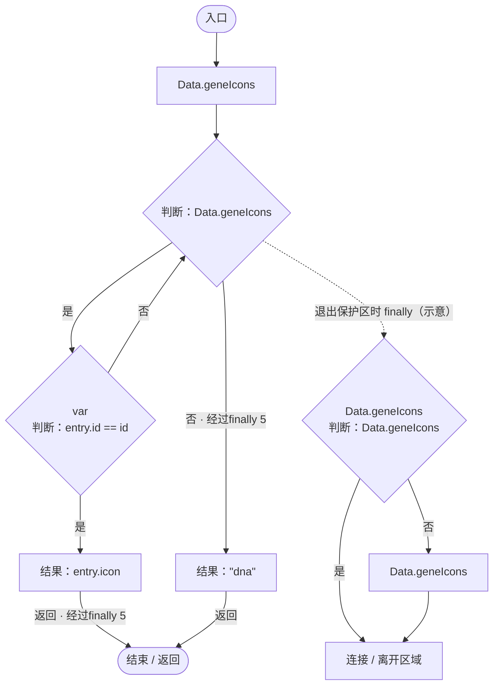

项目内调用/回调引用：

- [UIVisualTheme.Data.get · L26](ca525a798a08f966.md#m6c42bdb45a1d9916)（访问器）

## Paint · L58

`public static void Paint(Image image, string surface = "panel")`

### Editor / Player · Roslyn编译器控制流

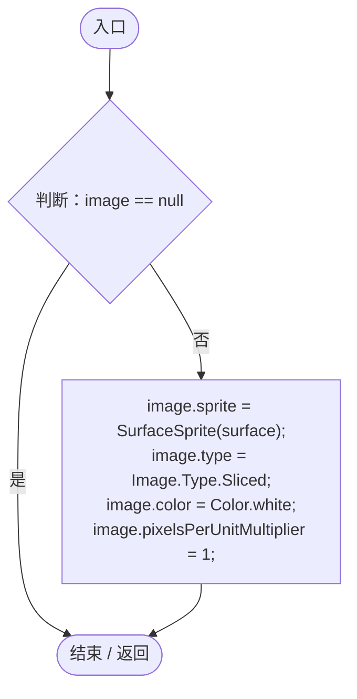

项目内调用/回调引用：

- [UIVisualTheme.SurfaceSprite · L45](ca525a798a08f966.md#md3ae1d7fd207ae2f)（方法）

## StyleButton · L67

`public static void StyleButton(Button button, bool primary = false)`

### Editor / Player · Roslyn编译器控制流

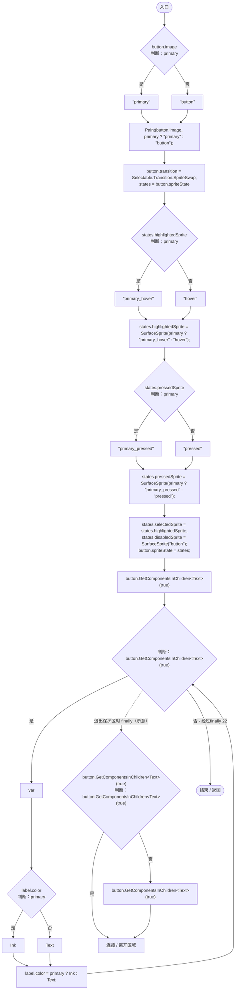

项目内调用/回调引用：

- [UIVisualTheme.Paint · L58](ca525a798a08f966.md#m2d61a6b26ab24980)（方法）
- [UIVisualTheme.SurfaceSprite · L45](ca525a798a08f966.md#md3ae1d7fd207ae2f)（方法）

## AddIcon · L79

`public static Image AddIcon(Transform parent, string id, Vector2 size, Vector2 position, Vector2 anchor)`

### Editor / Player · Roslyn编译器控制流

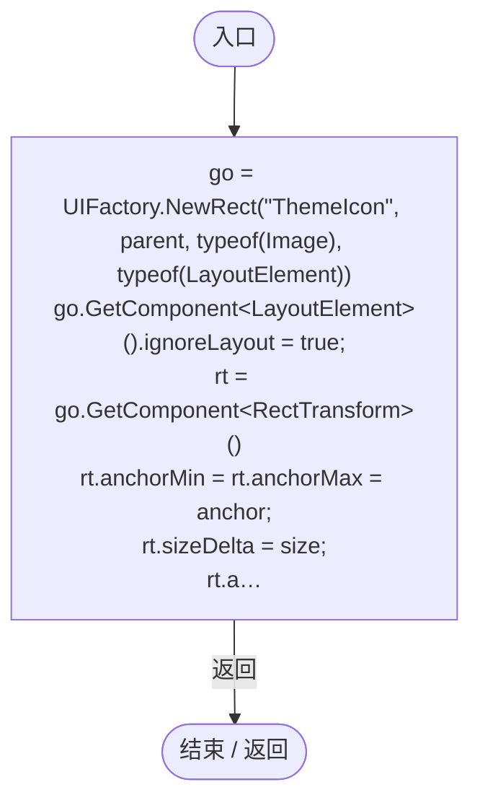

项目内调用/回调引用：

- [UIFactory.NewRect · L33](dd1096a6995423db.md#med612116f3152344)（方法）
- [UIIconRegistry.Get · L38](5e97f4545b48cac2.md#m95da89c0db2bbab9)（方法）
