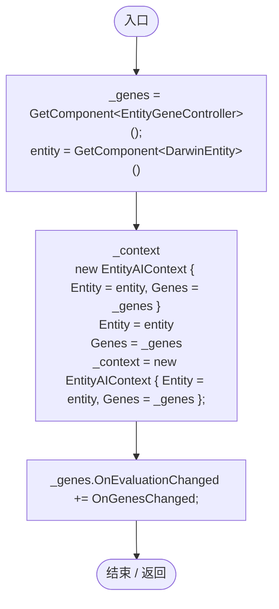
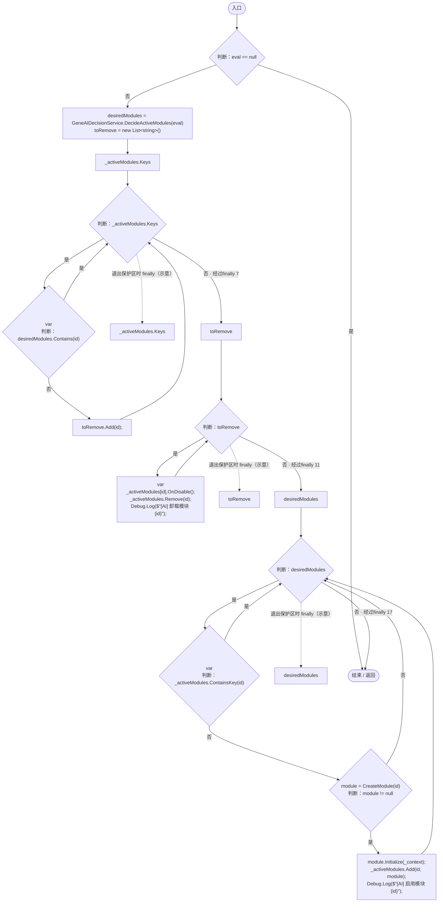
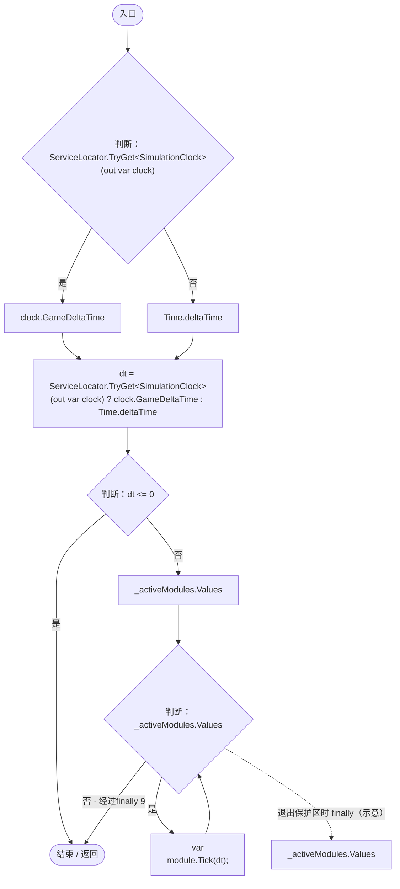
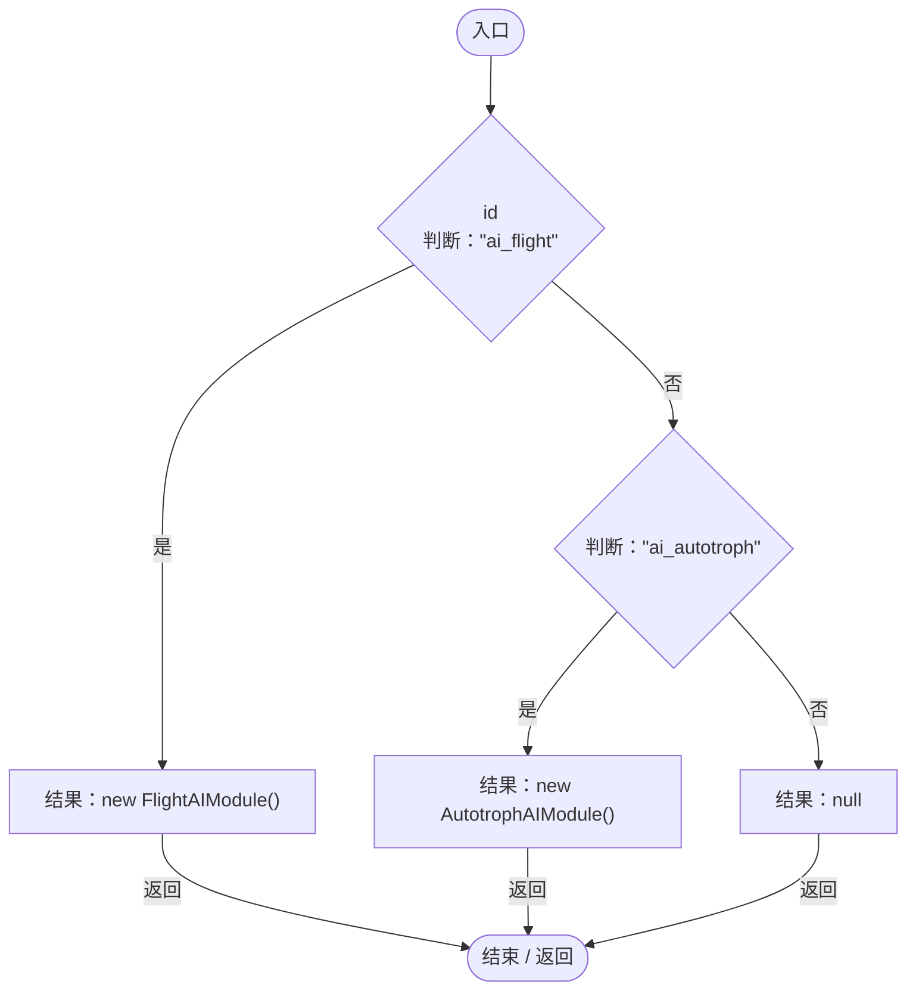

# EntityAIController.cs

[返回总索引](../README.md) · `Runtime` · `Assets/DarwinPark/AI/EntityAIController.cs`

[源文件](../../../Assets/DarwinPark/AI/EntityAIController.cs) · 源码校验：`28ca6698627238191172b31d6ac6a6882eaff5bf4970dc146dea41f46e03cd33`

方法按源文件位置排列。事件/回调引用不表示立即执行；分支与异常说明见总索引。完整源码与可点击关系图请打开离线手册。

## Awake · L17

`private void Awake()`

### Editor / Player · Roslyn编译器控制流

项目内调用/回调引用：

- [EntityAIController.OnGenesChanged · L38](ca7f038c139e16a4.md#ma492e96f0f3078a5)（方法）

## Start · L32

`private void Start()`

### Editor / Player · Roslyn编译器控制流

项目内调用/回调引用：

- [EntityAIController.OnGenesChanged · L38](ca7f038c139e16a4.md#ma492e96f0f3078a5)（方法）
- [EntityGeneController.Evaluation.get · L19](7494d53178552f0e.md#m2cb74e57d810ca42)（访问器）

## OnGenesChanged · L38

`private void OnGenesChanged(GenomeEvaluation eval)`

### Editor / Player · Roslyn编译器控制流

项目内调用/回调引用：

- [GeneAIDecisionService.DecideActiveModules · L9](0f16debe3d1f62f5.md#m13d66ee3c7e5f407)（方法）
- [IGeneAIModule.OnDisable · L8](1d1cab401bb81820.md#m11202d5919e37a4e)（方法）
- [EntityAIController.CreateModule · L88](ca7f038c139e16a4.md#m9ef458d7b5180618)（方法）
- [IGeneAIModule.Initialize · L6](1d1cab401bb81820.md#m935eb53af620e6dd)（方法）

## Update · L76

`private void Update()`

### Editor / Player · Roslyn编译器控制流

项目内调用/回调引用：

- [ServiceLocator.TryGet · L26](f2fdbe9f9ccd93cb.md#m143b24e6d58471b0)（方法）
- [SimulationClock.GameDeltaTime.get · L26](a8f444aec9614b0a.md#me7f11abae18a4f2d)（访问器）
- [IGeneAIModule.Tick · L7](1d1cab401bb81820.md#m969d803d0b1e1394)（方法）

## CreateModule · L88

`private IGeneAIModule CreateModule(string id)`

简单工厂：根据 ID 创建具体的 AI 模块

### Editor / Player · Roslyn编译器控制流

