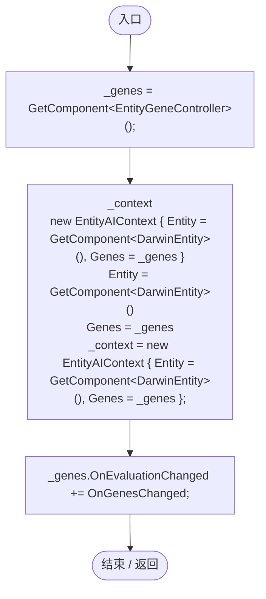
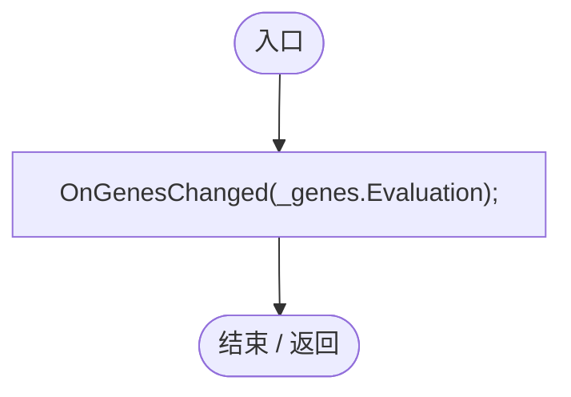
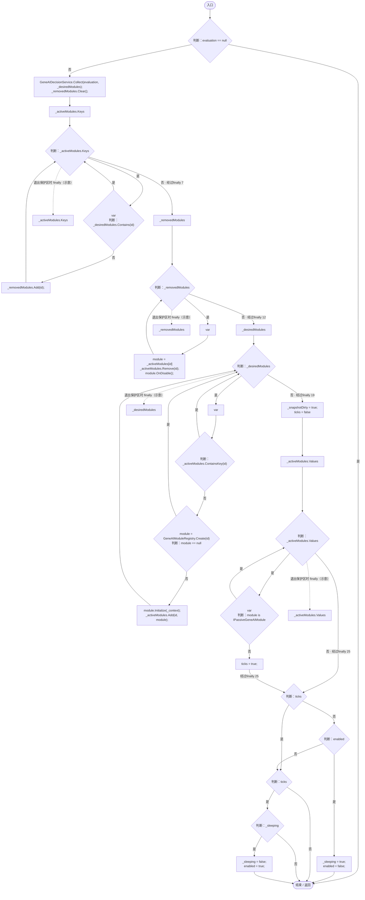
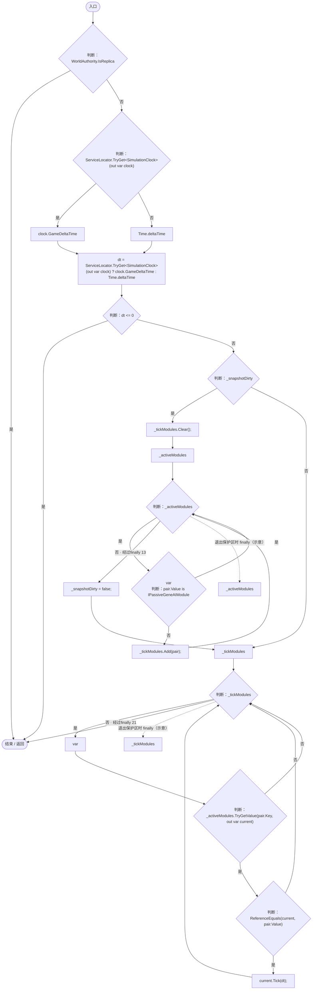
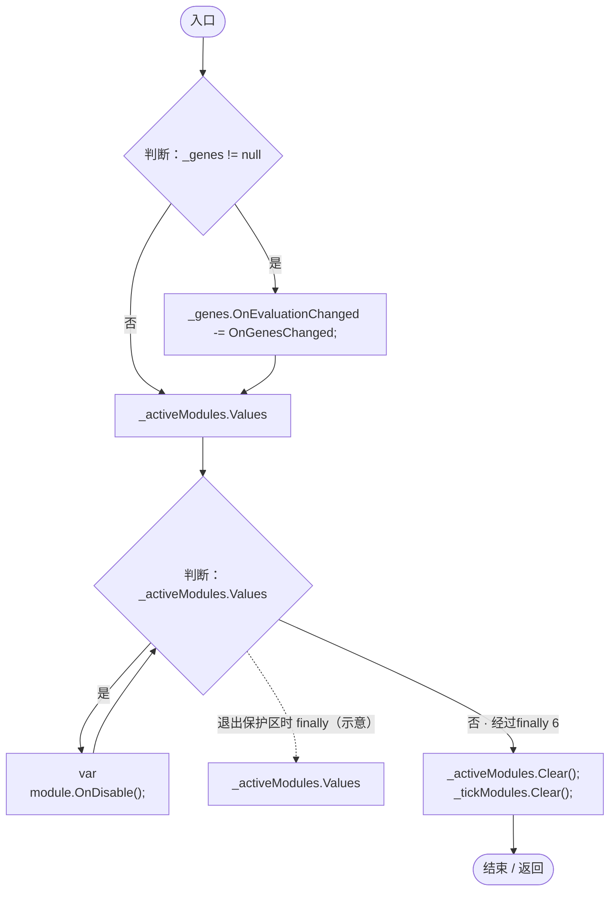

# EntityAIController.cs

[返回总索引](../README.md) · `Runtime` · `Assets/DarwinPark/AI/EntityAIController.cs`

[源文件](../../../Assets/DarwinPark/AI/EntityAIController.cs) · 源码校验：`fc86ad0efd65d1138a8049308c339bb172fedb9785f83204f6a4beae37f5571b`

方法按源文件位置排列。事件/回调引用不表示立即执行；分支与异常说明见总索引。完整源码与可点击关系图请打开离线手册。

## Awake · L20

`private void Awake()`

### Editor / Player · Roslyn编译器控制流

项目内调用/回调引用：

- [EntityAIController.OnGenesChanged · L28](ca7f038c139e16a4.md#m6fb2b40bd1a36f95)（方法）

## Start · L26

`private void Start()`

### Editor / Player · Roslyn编译器控制流

项目内调用/回调引用：

- [EntityAIController.OnGenesChanged · L28](ca7f038c139e16a4.md#m6fb2b40bd1a36f95)（方法）
- [EntityGeneController.Evaluation.get · L18](7494d53178552f0e.md#mc0039c100a31b455)（访问器）

## OnGenesChanged · L28

`private void OnGenesChanged(GenomeEvaluation evaluation)`

### Editor / Player · Roslyn编译器控制流

项目内调用/回调引用：

- [GeneAIDecisionService.Collect · L26](58bd7c2d48df02e1.md#m4adc27b5d1ec883e)（方法）
- [IGeneAIModule.OnDisable · L11](1d1cab401bb81820.md#m86b9146578be701b)（方法）
- [GeneAIModuleRegistry.Create · L17](58bd7c2d48df02e1.md#me23b2681b42c7371)（方法）
- [IGeneAIModule.Initialize · L9](1d1cab401bb81820.md#m870ffaac0a27d013)（方法）

## Update · L53

`private void Update()`

### Editor / Player · Roslyn编译器控制流

项目内调用/回调引用：

- [ServiceLocator.TryGet · L26](f2fdbe9f9ccd93cb.md#m143b24e6d58471b0)（方法）
- [SimulationClock.GameDeltaTime.get · L26](a8f444aec9614b0a.md#me7f11abae18a4f2d)（访问器）
- [IGeneAIModule.Tick · L10](1d1cab401bb81820.md#mf9c0b116b922ed11)（方法）

## OnDestroy · L69

`private void OnDestroy()`

### Editor / Player · Roslyn编译器控制流

项目内调用/回调引用：

- [IGeneAIModule.OnDisable · L11](1d1cab401bb81820.md#m86b9146578be701b)（方法）
- [EntityAIController.OnGenesChanged · L28](ca7f038c139e16a4.md#m6fb2b40bd1a36f95)（方法）
