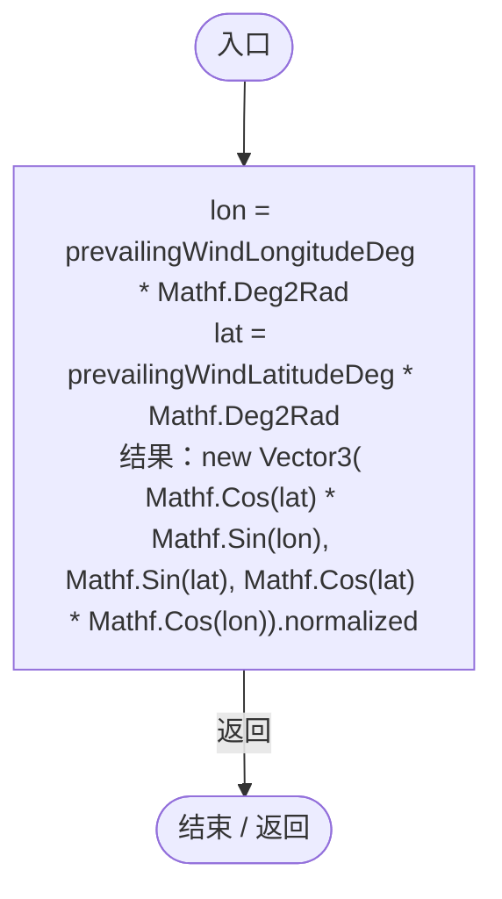
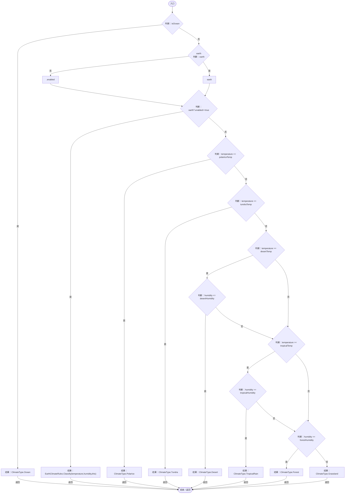

# PlanetClimateConfig.cs

[返回总索引](../README.md) · `Runtime` · `Assets/DarwinPark/Planet/PlanetClimateConfig.cs`

[源文件](../../../Assets/DarwinPark/Planet/PlanetClimateConfig.cs) · 源码校验：`540a34940a2ba07dc3847796ecdc3031bf75e5a0218a3f03276d9c533fb705eb`

方法按源文件位置排列。事件/回调引用不表示立即执行；分支与异常说明见总索引。完整源码与可点击关系图请打开离线手册。

## GetWindDirection · L117

`public Vector3 GetWindDirection()`

### Editor / Player · Roslyn编译器控制流

## Classify · L131

`public ClimateType Classify(float temperature, float humidity, bool isOcean)`

  用于玩法（环境伤害）的离散气候分类。  图层颜色走连续混色，不依赖这里的硬阈值，因此不会产生色块断层。  

### Editor / Player · Roslyn编译器控制流

项目内调用/回调引用：

- [EarthClimateRules.Classify · L21](6a91ff043f0ebb5f.md#mc7bf44d3003f1741)（方法）
