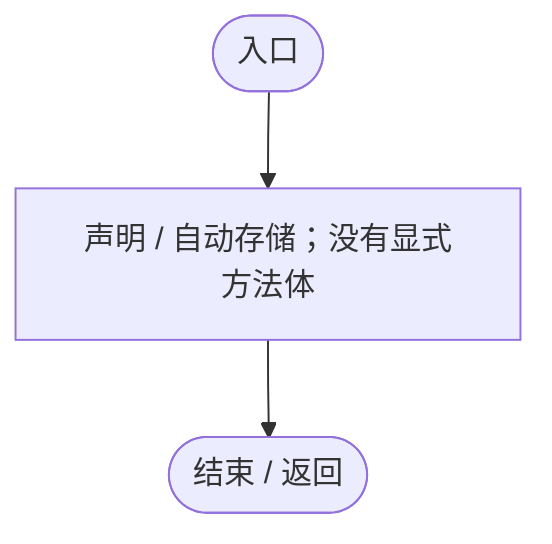
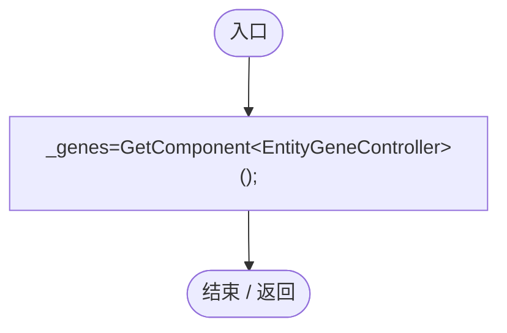
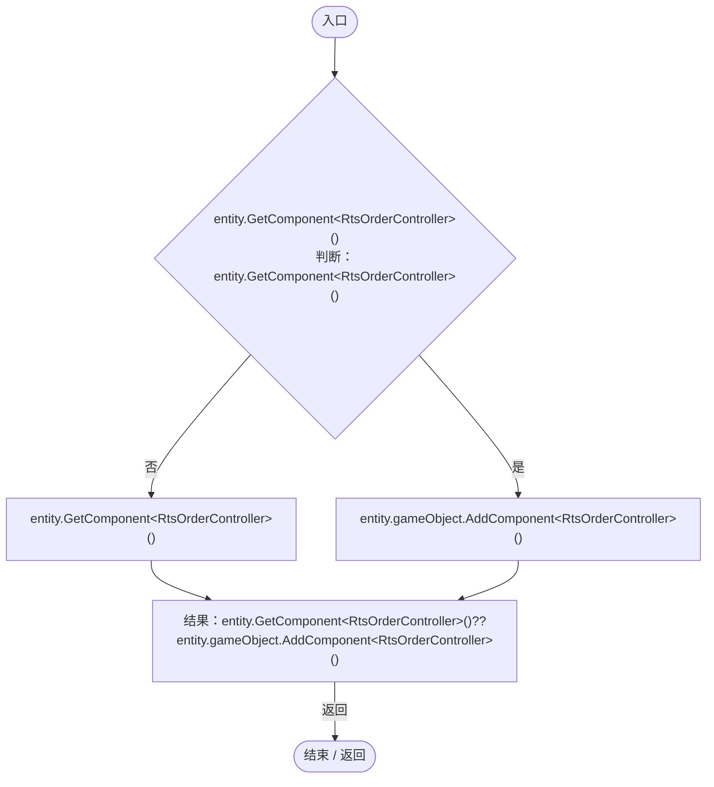
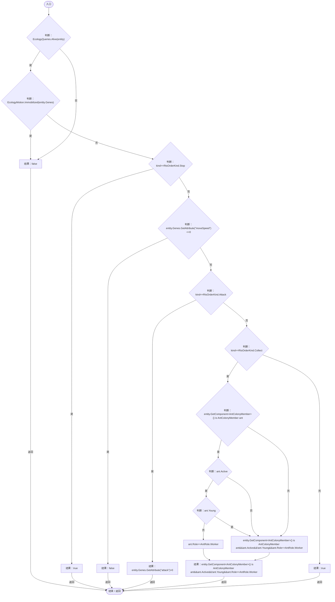
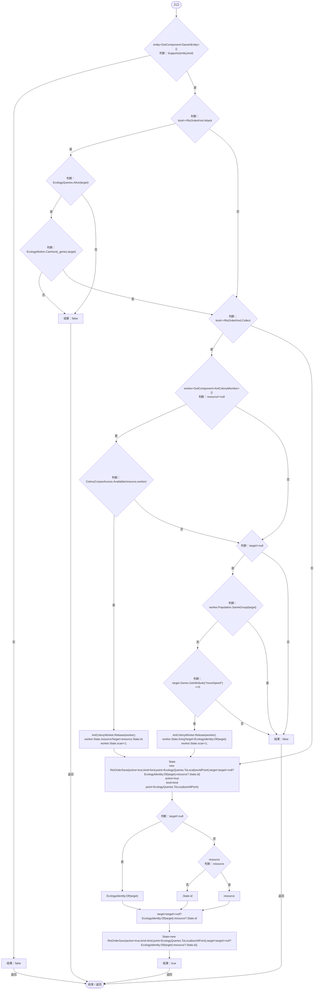
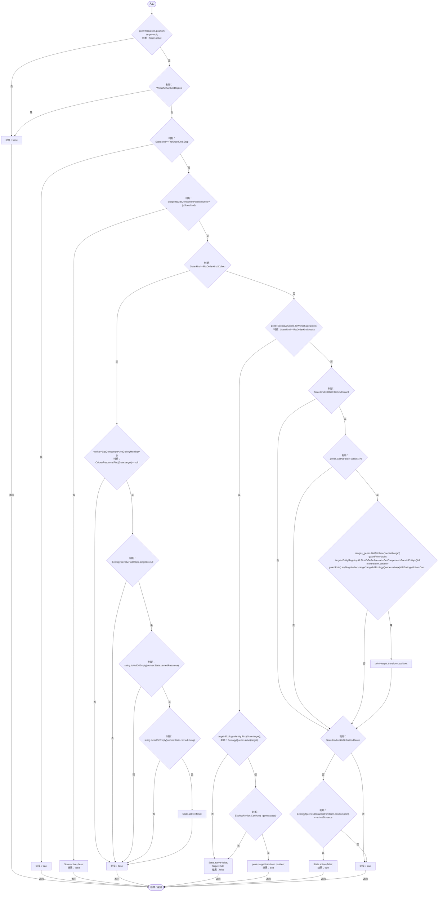
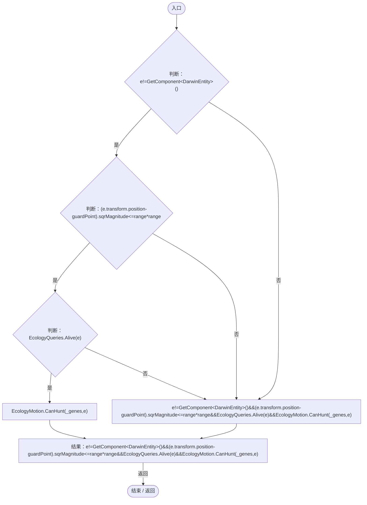
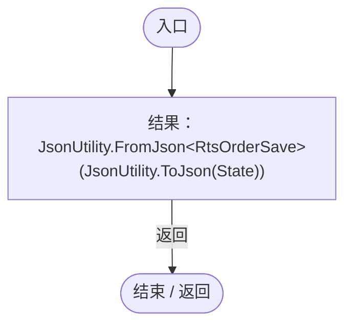
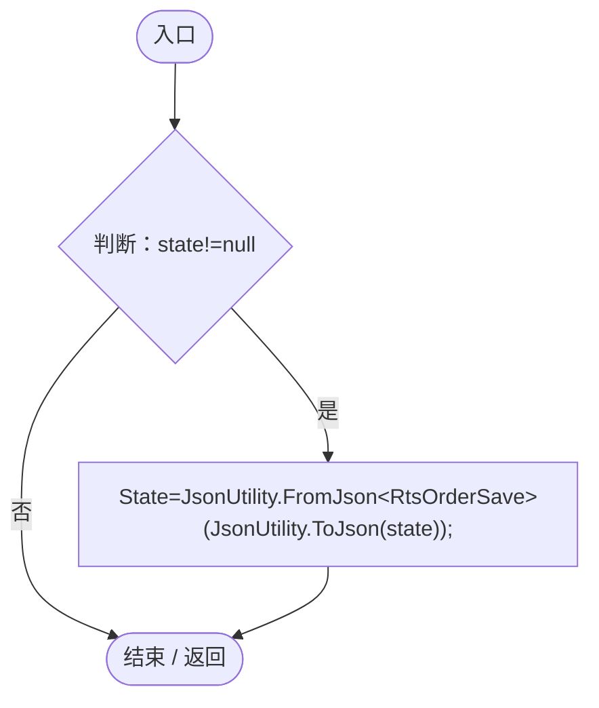

# RtsOrderController.cs

[返回总索引](../README.md) · `Runtime` · `Assets/DarwinPark/Entities/Ecology/RtsOrderController.cs`

[源文件](../../../Assets/DarwinPark/Entities/Ecology/RtsOrderController.cs) · 源码校验：`82c9d9234bdae5456012097bb59877f54035e365c0498f986147def87b93489a`

方法按源文件位置排列。事件/回调引用不表示立即执行；分支与异常说明见总索引。完整源码与可点击关系图请打开离线手册。

## State.get · L15

`get`

### Editor / Player · 语法控制结构 / 声明（非CFG）

## State.set · L15

`private set`

### Editor / Player · 语法控制结构 / 声明（非CFG）

## Awake · L17

`private void Awake()`

### Editor / Player · Roslyn编译器控制流

## Ensure · L18

`public static RtsOrderController Ensure(DarwinEntity entity)`

### Editor / Player · Roslyn编译器控制流

## Supports · L19

`public static bool Supports(DarwinEntity entity,RtsOrderKind kind)`

### Editor / Player · Roslyn编译器控制流

项目内调用/回调引用：

- [EcologyQueries.Alive · L38](bdf7ccc2c9c0452f.md#mb2877c487f449970)（方法）
- [EcologyMotion.Immobilized · L9](6ed9d0eedb456d32.md#mff3eeb8fb207a31e)（方法）
- [DarwinEntity.Genes.get · L14](70798dde169f2e8b.md#m622eb1adf401d431)（访问器）
- [EntityGeneController.GetAttribute · L225](7494d53178552f0e.md#mc707943b1138a009)（方法）
- [AntColonyMember.Role.get · L33](baebd85c05598377.md#mdf6df89f7116c7a3)（访问器）

## Issue · L28

`public bool Issue(RtsOrderKind kind,Vector3 worldPoint,DarwinEntity target=null,ColonyResource resource=null)`

### Editor / Player · Roslyn编译器控制流

项目内调用/回调引用：

- [RtsOrderController.Supports · L19](cac3b6501f41ca35.md#m2aaa5c9fb23c15de)（方法）
- [EcologyQueries.Alive · L38](bdf7ccc2c9c0452f.md#mb2877c487f449970)（方法）
- [EcologyMotion.CanHunt · L38](6ed9d0eedb456d32.md#m4271864b37a65a94)（方法）
- [ColonyCorpseAccess.Available · L6](f6ef68cc68f39eea.md#m8ffa84bc06beaed6)（方法）
- [AntColonyWorker.Release · L125](8a0cca2020271b6f.md#m1d9a49a310c2b22d)（方法）
- [AntColonyMember.State.get · L27](baebd85c05598377.md#mc8282e8cc823ceeb)（访问器）
- [ColonyResource.State.get · L22](293dbaecfff4b585.md#m341a1355f4d657bf)（访问器）
- [PopulationBehavior.SameGroup · L123](21e4f62f75a9a80f.md#m7a9d850e1d8967d4)（方法）
- [AntColonyMember.Population.get · L30](baebd85c05598377.md#m688c2c0dfb5a66d6)（访问器）
- [EntityGeneController.GetAttribute · L225](7494d53178552f0e.md#mc707943b1138a009)（方法）
- [DarwinEntity.Genes.get · L14](70798dde169f2e8b.md#m622eb1adf401d431)（访问器）
- [EcologyIdentity.Of · L21](bdf7ccc2c9c0452f.md#m1143cf9570a93b72)（方法）
- [RtsOrderController.State.set · L15](cac3b6501f41ca35.md#mf3164e690769f155)（访问器）
- [EcologyQueries.ToLocal · L39](bdf7ccc2c9c0452f.md#m1a07639eacf3aa47)（方法）

## Destination · L44

`public bool Destination(out Vector3 point,out DarwinEntity target)`

### Editor / Player · Roslyn编译器控制流

项目内调用/回调引用：

- [RtsOrderController.State.get · L15](cac3b6501f41ca35.md#m04ce57391ec3040d)（访问器）
- [RtsOrderController.Supports · L19](cac3b6501f41ca35.md#m2aaa5c9fb23c15de)（方法）
- [ColonyResource.Find · L26](293dbaecfff4b585.md#m8e52e678f4038a50)（方法）
- [EcologyIdentity.Find · L20](bdf7ccc2c9c0452f.md#m58f756a3ba9ec990)（方法）
- [AntColonyMember.State.get · L27](baebd85c05598377.md#mc8282e8cc823ceeb)（访问器）
- [EcologyQueries.ToWorld · L40](bdf7ccc2c9c0452f.md#m320932c05ccecbf7)（方法）
- [EcologyQueries.Alive · L38](bdf7ccc2c9c0452f.md#mb2877c487f449970)（方法）
- [EcologyMotion.CanHunt · L38](6ed9d0eedb456d32.md#m4271864b37a65a94)（方法）
- [EntityGeneController.GetAttribute · L225](7494d53178552f0e.md#mc707943b1138a009)（方法）
- [EcologyQueries.Distance · L42](bdf7ccc2c9c0452f.md#mba9c3e3c95d0f2dd)（方法）
- [RtsOrderController.回调@57 · L57](cac3b6501f41ca35.md#m44145e5950af652b)（回调/委托）

## 回调@57 · L57

`e … => 回调`

### Editor / Player · Roslyn编译器控制流

项目内调用/回调引用：

- [EcologyQueries.Alive · L38](bdf7ccc2c9c0452f.md#mb2877c487f449970)（方法）
- [EcologyMotion.CanHunt · L38](6ed9d0eedb456d32.md#m4271864b37a65a94)（方法）

## Capture · L63

`public RtsOrderSave Capture()`

### Editor / Player · Roslyn编译器控制流

项目内调用/回调引用：

- [RtsOrderController.State.get · L15](cac3b6501f41ca35.md#m04ce57391ec3040d)（访问器）

## Restore · L64

`public void Restore(RtsOrderSave state)`

### Editor / Player · Roslyn编译器控制流

项目内调用/回调引用：

- [RtsOrderController.State.set · L15](cac3b6501f41ca35.md#mf3164e690769f155)（访问器）
