# AntColonySettings.cs

[返回总索引](../README.md) · `Runtime` · `Assets/DarwinPark/Entities/Ecology/AntColonySettings.cs`

[源文件](../../../Assets/DarwinPark/Entities/Ecology/AntColonySettings.cs) · 源码校验：`0f24206903c4f3c0bcb1af3e7558dda71b907fe0208e143329b0b5eef5faa158`

方法按源文件位置排列。事件/回调引用不表示立即执行；分支与异常说明见总索引。完整源码与可点击关系图请打开离线手册。

## Role.get · L14

`public AntRole Role`

### Editor / Player · 语法控制结构 / 声明（非CFG）

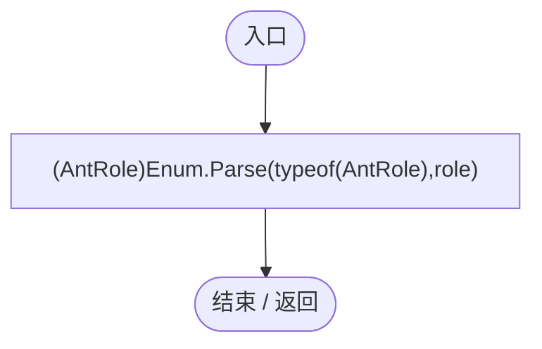

## Current.get · L31

`get`

### Editor / Player · Roslyn编译器控制流

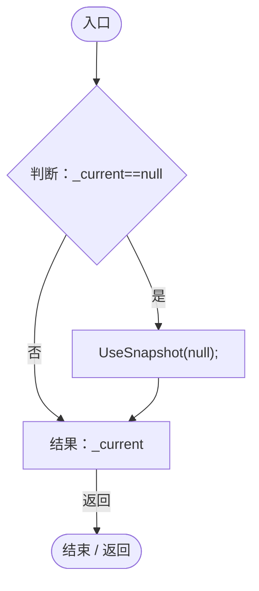

项目内调用/回调引用：

- [AntColonySettings.UseSnapshot · L62](cb0a937e97c8fbb3.md#m50cd0fd034f16b81)（方法）

## CurrentJson.get · L32

`get`

### Editor / Player · Roslyn编译器控制流

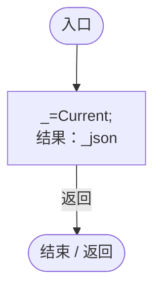

项目内调用/回调引用：

- [AntColonySettings.Current.get · L31](cb0a937e97c8fbb3.md#mcd121159f407ccdf)（访问器）

## ReadConfiguredJson · L33

`public static string ReadConfiguredJson()`

### Editor / Player · Roslyn编译器控制流

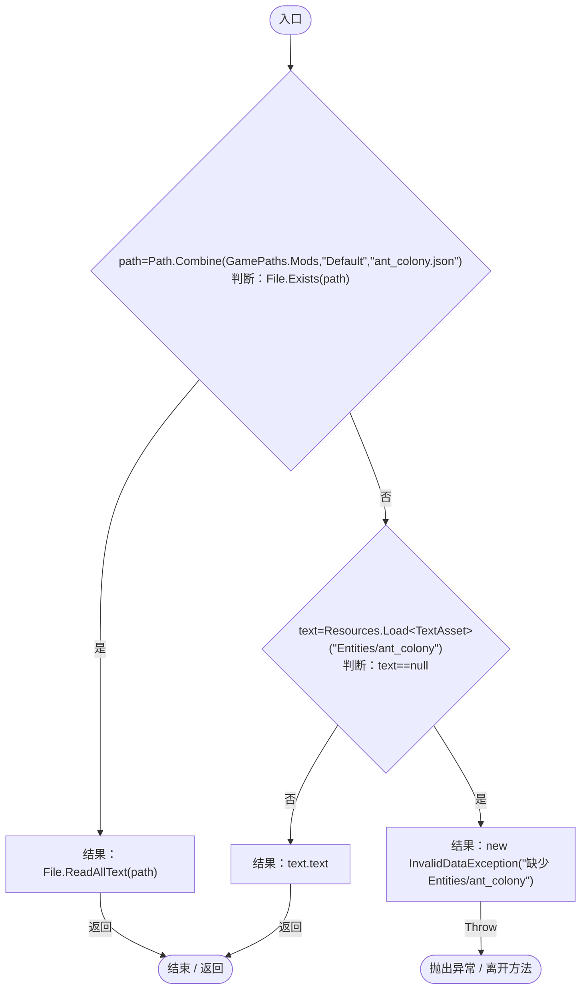

## Parse · L40

`public static AntColonySettings Parse(string json)`

### Editor / Player · Roslyn编译器控制流

```mermaid
flowchart TD
  b0(["入口"])
  b1{"value=JsonUtility.FromJson&lt;AntColonySettings&gt;(json)<br/>判断：value==null"}
  b2{"判断：value.version!=1"}
  b3{"判断：value.roles==null"}
  b4{"判断：value.roles.Length!=5"}
  b5["结果：new InvalidDataException(&quot;蚁群配置版本或分工无效&quot;)"]
  x5(["抛出异常 / 离开方法"])
  b6{"ids=value.roles.Select(r=&gt;r.Role).ToArray()<br/>判断：ids.Distinct().Count()!=5"}
  b7{"判断：ids.Contains(AntRole.None)"}
  b8{"判断：ids.Any(id=&gt;!Enum.IsDefined(typeof(AntRole),id))"}
  b9["结果：new InvalidDataException(&quot;蚁群角色重复或缺失&quot;)"]
  x9(["抛出异常 / 离开方法"])
  b10["value.roles"]
  b11{"判断：value.roles"}
  b12{"var<br/>判断：string.IsNullOrWhiteSpace(rule.label)"}
  b13{"判断：rule.suppressedGenes==null"}
  b14{"判断：new[]{rule.birthWeight,rule.attackMultiplier,rule.moveMultiplier}.Any(n=&gt;float.IsNaN(n)&#124;&#124;float.IsInfinity(n)&#124;&#124;n&lt;0)"}
  b15["结果：new InvalidDataException(&quot;蚁群角色参数无效：&quot;+rule.role)"]
  x15(["抛出异常 / 离开方法"])
  b16{"value.roles<br/>判断：value.roles"}
  b17["value.roles"]
  b18["连接 / 离开区域"]
  b19["typeof(AntColonySettings).GetFields().Where(f=&gt;f.FieldType==typeof(float))"]
  b20{"判断：typeof(AntColonySettings).GetFields().Where(f=&gt;f.FieldType==typeof(float))"}
  b21["var"]
  b22{"number=(float)field.GetValue(value)<br/>判断：float.IsNaN(number)"}
  b23{"判断：float.IsInfinity(number)"}
  b24{"判断：number&lt;0"}
  b25["结果：new InvalidDataException(&quot;蚁群参数必须为非负有限值：&quot;+field.Name)"]
  x25(["抛出异常 / 离开方法"])
  b26{"判断：typeof(AntColonySettings).GetFields().Where(f=&gt;f.FieldType==typeof(float))"}
  b27["typeof(AntColonySettings).GetFields().Where(f=&gt;f.FieldType==typeof(float))"]
  b28["连接 / 离开区域"]
  b29{"判断：value.supplyPointCount&lt;1"}
  b30{"判断：value.minimumReproductives&lt;0"}
  b31{"判断：value.maximumReproductives&lt;value.minimumReproductives"}
  b32{"判断：value.reproductivePopulationThreshold&lt;1"}
  b33{"判断：value.geneSuppression&lt;=0"}
  b34{"判断：value.circleSegments&lt;12"}
  b35{"判断：value.scanInterval&lt;=0"}
  b36{"判断：value.arrivalDistance&lt;=0"}
  b37{"判断：value.colonyRadius&lt;=0"}
  b38{"判断：value.minimumColonyRadius&lt;=0"}
  b39{"判断：value.queenGestationSeconds&lt;=0"}
  b40{"判断：value.feedRate&lt;=0"}
  b41{"判断：value.feedRadius&lt;=0"}
  b42{"判断：value.patrolRestMax&lt;value.patrolRestMin"}
  b43{"判断：value.nurseryDeliveryFraction&gt;1"}
  b44{"判断：value.foundingDistanceRatio&lt;=1"}
  b45{"判断：value.roles.Where(r=&gt;r.Role==AntRole.Soldier&#124;&#124;r.Role==AntRole.Worker).Sum(r=&gt;r.birthWeight)&lt;=0"}
  b46{"判断：ColorUtility.TryParseHtmlString(value.energyColor,out _)"}
  b47["结果：new InvalidDataException(&quot;蚁群半径、计时、比例、分工权重或颜色配置无效&quot;)"]
  x47(["抛出异常 / 离开方法"])
  b48["结果：value"]
  b49(["结束 / 返回"])
  b0 --> b1
  b1 -->|"否"| b2
  b1 -->|"是"| b5
  b2 -->|"否"| b3
  b2 -->|"是"| b5
  b3 -->|"否"| b4
  b3 -->|"是"| b5
  b4 -->|"是"| b5
  b4 -->|"否"| b6
  b5 -->|"Throw"| x5
  b6 -->|"否"| b7
  b6 -->|"是"| b9
  b7 -->|"否"| b8
  b7 -->|"是"| b9
  b8 -->|"是"| b9
  b8 -->|"否"| b10
  b9 -->|"Throw"| x9
  b10 --> b11
  b11 -->|"是"| b12
  b11 -->|"否 · 经过finally 16"| b19
  b12 -->|"否"| b13
  b12 -->|"是"| b15
  b13 -->|"否"| b14
  b13 -->|"是"| b15
  b14 -->|"是"| b15
  b14 -->|"否"| b11
  b15 -->|"Throw"| x15
  b16 -->|"否"| b17
  b16 -->|"是"| b18
  b17 --> b18
  b19 --> b20
  b20 -->|"是"| b21
  b20 -->|"否 · 经过finally 26"| b29
  b21 --> b22
  b22 -->|"否"| b23
  b22 -->|"是"| b25
  b23 -->|"否"| b24
  b23 -->|"是"| b25
  b24 -->|"是"| b25
  b24 -->|"否"| b20
  b25 -->|"Throw"| x25
  b26 -->|"否"| b27
  b26 -->|"是"| b28
  b27 --> b28
  b29 -->|"否"| b30
  b29 -->|"是"| b47
  b30 -->|"否"| b31
  b30 -->|"是"| b47
  b31 -->|"否"| b32
  b31 -->|"是"| b47
  b32 -->|"否"| b33
  b32 -->|"是"| b47
  b33 -->|"否"| b34
  b33 -->|"是"| b47
  b34 -->|"否"| b35
  b34 -->|"是"| b47
  b35 -->|"否"| b36
  b35 -->|"是"| b47
  b36 -->|"否"| b37
  b36 -->|"是"| b47
  b37 -->|"否"| b38
  b37 -->|"是"| b47
  b38 -->|"否"| b39
  b38 -->|"是"| b47
  b39 -->|"否"| b40
  b39 -->|"是"| b47
  b40 -->|"否"| b41
  b40 -->|"是"| b47
  b41 -->|"否"| b42
  b41 -->|"是"| b47
  b42 -->|"否"| b43
  b42 -->|"是"| b47
  b43 -->|"否"| b44
  b43 -->|"是"| b47
  b44 -->|"否"| b45
  b44 -->|"是"| b47
  b45 -->|"否"| b46
  b45 -->|"是"| b47
  b46 -->|"否"| b47
  b46 -->|"是"| b48
  b47 -->|"Throw"| x47
  b48 -->|"返回"| b49
  b11 -. "退出保护区时 finally（示意）" .-> b16
  b20 -. "退出保护区时 finally（示意）" .-> b26

```

项目内调用/回调引用：

- [AntColonySettings.回调@44 · L44](cb0a937e97c8fbb3.md#mff76c258ecb35885)（回调/委托）
- [AntColonySettings.回调@45 · L45](cb0a937e97c8fbb3.md#m816a36b3c2da571f)（回调/委托）
- [AntColonySettings.回调@47 · L47](cb0a937e97c8fbb3.md#m5db5fecf812e6176)（回调/委托）
- [AntColonySettings.回调@49 · L49](cb0a937e97c8fbb3.md#m395732d8aabe5308)（回调/委托）
- [AntColonySettings.回调@51 · L51](cb0a937e97c8fbb3.md#m97aaf6e0febf5540)（回调/委托）
- [AntColonySettings.回调@51 · L51](cb0a937e97c8fbb3.md#m2e72f7c2c6d922bc)（回调/委托）

## 回调@44 · L44

`r … => 回调`

### Editor / Player · Roslyn编译器控制流

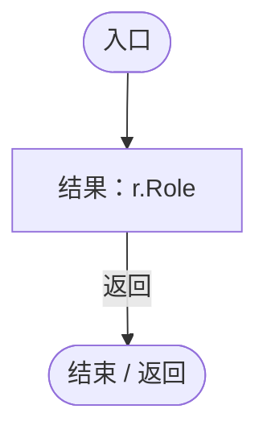

## 回调@45 · L45

`id … => 回调`

### Editor / Player · Roslyn编译器控制流

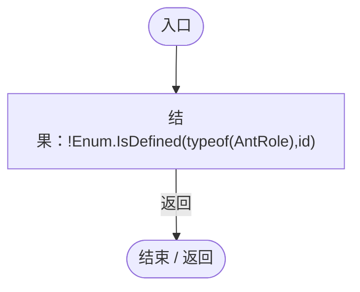

## 回调@47 · L47

`n … => 回调`

### Editor / Player · Roslyn编译器控制流

```mermaid
flowchart TD
  b0(["入口"])
  b1{"判断：float.IsNaN(n)"}
  b2{"判断：float.IsInfinity(n)"}
  b3["n&lt;0"]
  b4["float.IsNaN(n)&#124;&#124;float.IsInfinity(n)&#124;&#124;n&lt;0"]
  b5["结果：float.IsNaN(n)&#124;&#124;float.IsInfinity(n)&#124;&#124;n&lt;0"]
  b6(["结束 / 返回"])
  b0 --> b1
  b1 -->|"否"| b2
  b1 -->|"是"| b4
  b2 -->|"否"| b3
  b2 -->|"是"| b4
  b3 --> b5
  b4 --> b5
  b5 -->|"返回"| b6

```

## 回调@49 · L49

`f … => 回调`

### Editor / Player · Roslyn编译器控制流

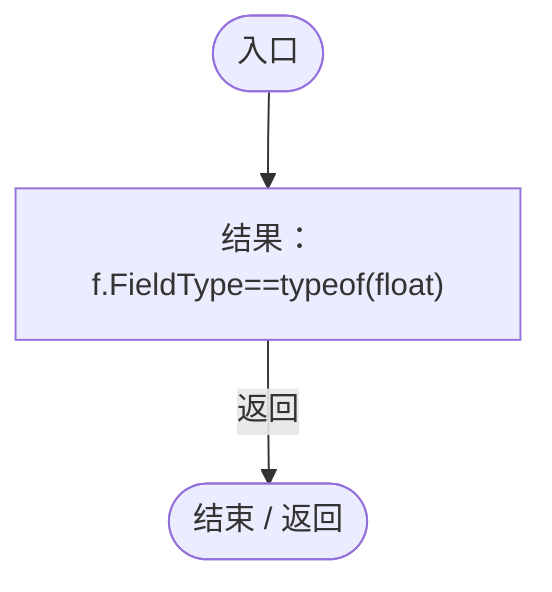

## 回调@51 · L51

`r … => 回调`

### Editor / Player · Roslyn编译器控制流

```mermaid
flowchart TD
  b0(["入口"])
  b1{"判断：r.Role==AntRole.Soldier"}
  b2["r.Role==AntRole.Worker"]
  b3["r.Role==AntRole.Soldier"]
  b4["结果：r.Role==AntRole.Soldier&#124;&#124;r.Role==AntRole.Worker"]
  b5(["结束 / 返回"])
  b0 --> b1
  b1 -->|"否"| b2
  b1 -->|"是"| b3
  b2 --> b4
  b3 --> b4
  b4 -->|"返回"| b5

```

## 回调@51 · L51

`r … => 回调`

### Editor / Player · Roslyn编译器控制流

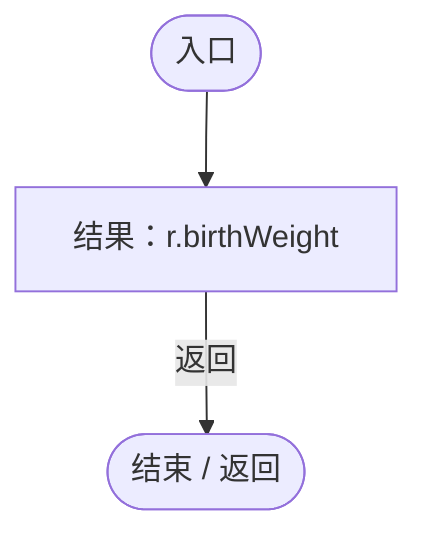

## Rule · L56

`public AntRoleRule Rule(AntRole role)`

### Editor / Player · Roslyn编译器控制流

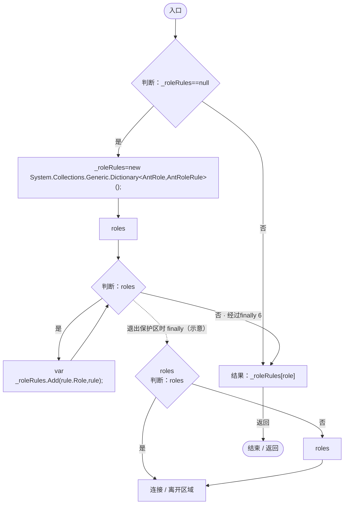

## UseSnapshot · L62

`public static void UseSnapshot(string raw)`

### Editor / Player · Roslyn编译器控制流

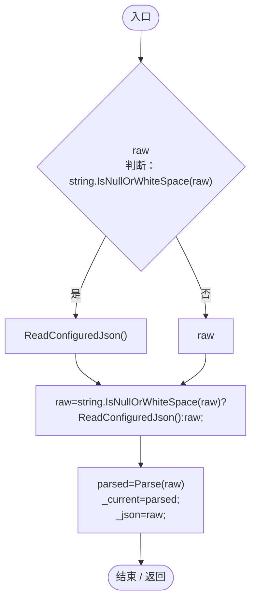

项目内调用/回调引用：

- [AntColonySettings.ReadConfiguredJson · L33](cb0a937e97c8fbb3.md#mb07b1ffda39df5f5)（方法）
- [AntColonySettings.Parse · L40](cb0a937e97c8fbb3.md#mb52d89914d989e58)（方法）

## Clear · L63

`[RuntimeInitializeOnLoadMethod(RuntimeInitializeLoadType.SubsystemRegistration)] public static void Clear()`

### Editor / Player · Roslyn编译器控制流

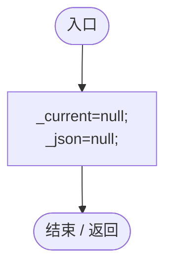
