# RuntimeDiagnosticsUI.cs

[返回总索引](../README.md) · `Runtime` · `Assets/DarwinPark/UI/RuntimeDiagnosticsUI.cs`

[源文件](../../../Assets/DarwinPark/UI/RuntimeDiagnosticsUI.cs) · 源码校验：`a36955b45159f8a527bceed617b2a3521302ecad6701defce79770671e8291a4`

方法按源文件位置排列。事件/回调引用不表示立即执行；分支与异常说明见总索引。完整源码与可点击关系图请打开离线手册。

## Draw · L12

`public static void Draw()`

### Editor / Player · Roslyn编译器控制流

```mermaid
flowchart TD
  b0(["入口"])
  b1{"判断：RuntimeCrashDiagnostics.PreviousAbnormalSessions&gt;0"}
  b2["GUILayout.Label(&quot;发现上次未正常结束的记录，可导出诊断包排查。&quot;,RuntimeMenuTheme.Muted);"]
  b3{"判断：string.IsNullOrEmpty(RuntimeFileLog.Failure)"}
  b4["GUILayout.Label(&quot;文件日志故障：&quot;+RuntimeFileLog.Failure);"]
  b5{"判断：string.IsNullOrEmpty(RuntimeCrashDiagnostics.Failure)"}
  b6["GUILayout.Label(&quot;诊断故障：&quot;+RuntimeCrashDiagnostics.Failure);"]
  b7{"判断：_export!=null"}
  b8["!_export.IsCompleted"]
  b9["_export!=null"]
  b10["busy=_export!=null&amp;&amp;!_export.IsCompleted"]
  b11["previous=GUI.enabled"]
  b12{"GUI.enabled<br/>判断：previous"}
  b13{"判断：busy"}
  b14["!string.IsNullOrEmpty(RuntimeCrashDiagnostics.DirectoryPath)"]
  b15["previous&amp;&amp;!busy&amp;&amp;!string.IsNullOrEmpty(RuntimeCrashDiagnostics.DirectoryPath)"]
  b16["GUI.enabled=previous&amp;&amp;!busy&amp;&amp;!string.IsNullOrEmpty(RuntimeCrashDiagnostics.DirectoryPath);"]
  b17{"判断：busy"}
  b18["&quot;正在导出诊断包…&quot;"]
  b19["&quot;导出诊断包&quot;"]
  b20{"判断：RuntimeMenuTheme.Button(busy?&quot;正在导出诊断包…&quot;:&quot;导出诊断包&quot;,null,false,36)"}
  b21["_export=RuntimeCrashDiagnostics.ExportAsync();"]
  b22["GUI.enabled=previous;"]
  b23{"_export<br/>判断：_export"}
  b24[".IsFaulted"]
  b25["_export"]
  b26{"判断：_export?.IsFaulted==true"}
  b27["&quot;导出失败：&quot;+_export.Exception.GetBaseException().Message<br/>new GUIStyle(RuntimeMenuTheme.Muted){wordWrap=true}<br/>wordWrap=true<br/>GUILayout.Label(&quot;导出失败：&quot;+_export.Exception.GetBaseException().Message,new GUIStyle(RuntimeMenuTheme.Muted){wordWrap=tru…"]
  b28{"_export<br/>判断：_export"}
  b29[".Status"]
  b30["_export"]
  b31{"判断：_export?.Status==TaskStatus.RanToCompletion"}
  b32["&quot;已保存：&quot;+_export.Result<br/>new GUIStyle(RuntimeMenuTheme.Muted){wordWrap=true}<br/>wordWrap=true<br/>GUILayout.Label(&quot;已保存：&quot;+_export.Result,new GUIStyle(RuntimeMenuTheme.Muted){wordWrap=true});"]
  b33(["结束 / 返回"])
  b0 --> b1
  b1 -->|"是"| b2
  b1 -->|"否"| b3
  b2 --> b3
  b3 -->|"否"| b4
  b3 -->|"是"| b5
  b4 --> b5
  b5 -->|"否"| b6
  b5 -->|"是"| b7
  b6 --> b7
  b7 -->|"是"| b8
  b7 -->|"否"| b9
  b8 --> b10
  b9 --> b10
  b10 --> b11
  b11 --> b12
  b12 -->|"是"| b13
  b12 -->|"否"| b15
  b13 -->|"否"| b14
  b13 -->|"是"| b15
  b14 --> b16
  b15 --> b16
  b16 --> b17
  b17 -->|"是"| b18
  b17 -->|"否"| b19
  b18 --> b20
  b19 --> b20
  b20 -->|"是"| b21
  b20 -->|"否"| b22
  b21 --> b22
  b22 --> b23
  b23 -->|"否"| b24
  b23 -->|"是"| b25
  b24 --> b26
  b25 --> b26
  b26 -->|"是"| b27
  b26 -->|"否"| b28
  b27 --> b33
  b28 -->|"否"| b29
  b28 -->|"是"| b30
  b29 --> b31
  b30 --> b31
  b31 -->|"是"| b32
  b31 -->|"否"| b33
  b32 --> b33

```

项目内调用/回调引用：

- [RuntimeMenuTheme.Muted.get · L13](b9d8455882f2a532.md#meeaba271eb4ad2ed)（访问器）
- [RuntimeMenuTheme.Button · L90](b9d8455882f2a532.md#mc7e1580ab0f51b0b)（方法）
- [RuntimeCrashDiagnostics.ExportAsync · L86](b7eea720e09afd0b.md#m136ba9b12f0b873f)（方法）
