# EntityStateRegression.cs

[返回总索引](../README.md) · `Editor` · `Assets/DarwinPark/Editor/EntityStateRegression.cs`

[源文件](../../../Assets/DarwinPark/Editor/EntityStateRegression.cs) · 源码校验：`06ccc9401e9c51fc0808ee431d36d0c56f6ae309ff677b7a0b3eb471a658e20b`

方法按源文件位置排列。事件/回调引用不表示立即执行；分支与异常说明见总索引。完整源码与可点击关系图请打开离线手册。

<a id="m016910d0874e5f5d"></a>

## Folder.get · L27

`private static string Folder`


### Editor · 语法控制结构 / 声明（非CFG）

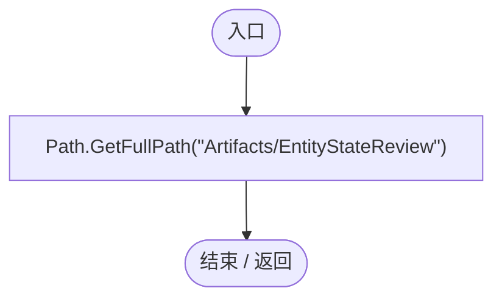

<a id="m4c34e1b500d602d7"></a>

## EntityStateRegression.ctor · L30

`static EntityStateRegression()`

★ 适配：旧回归只提供播放中的菜单入口；自动性能回归必须显式进入播放并等待实际报告，不能把缺少入口当成游戏失败。

### Editor · Roslyn编译器控制流

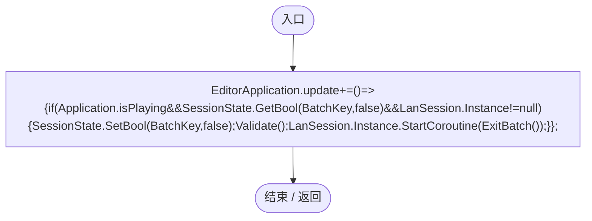

项目内调用/回调引用：

- [EntityStateRegression.回调@30 · L30](cbb314f2877cdcfa.md#m5caf787a482a7d56)（回调/委托）

<a id="m5caf787a482a7d56"></a>

## 回调@30 · L30

`( … => 回调`


### Editor · Roslyn编译器控制流

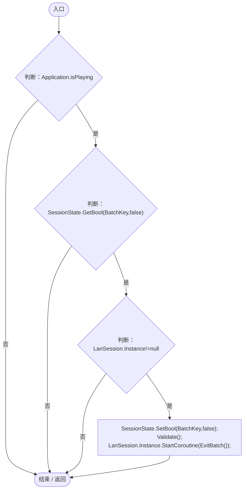

项目内调用/回调引用：

- [LanSession.Instance.get · L23](9fb633eebffe669c.md#mbf83306994878383)（访问器）
- [EntityStateRegression.Validate · L51](cbb314f2877cdcfa.md#meb77f0d53bc8b303)（方法）
- [EntityStateRegression.ExitBatch · L36](cbb314f2877cdcfa.md#m3ec39721ef46887b)（方法）

<a id="m26c74b001a3e3604"></a>

## RunBatch · L31

`public static void RunBatch()`


### Editor · Roslyn编译器控制流

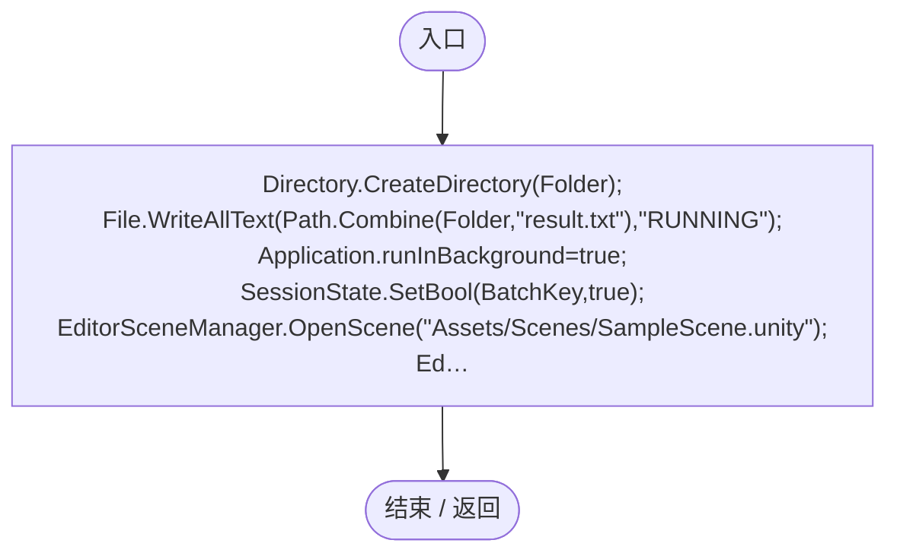

<a id="m3ec39721ef46887b"></a>

## ExitBatch · L36

`private static IEnumerator ExitBatch()`


### Editor · Roslyn编译器控制流

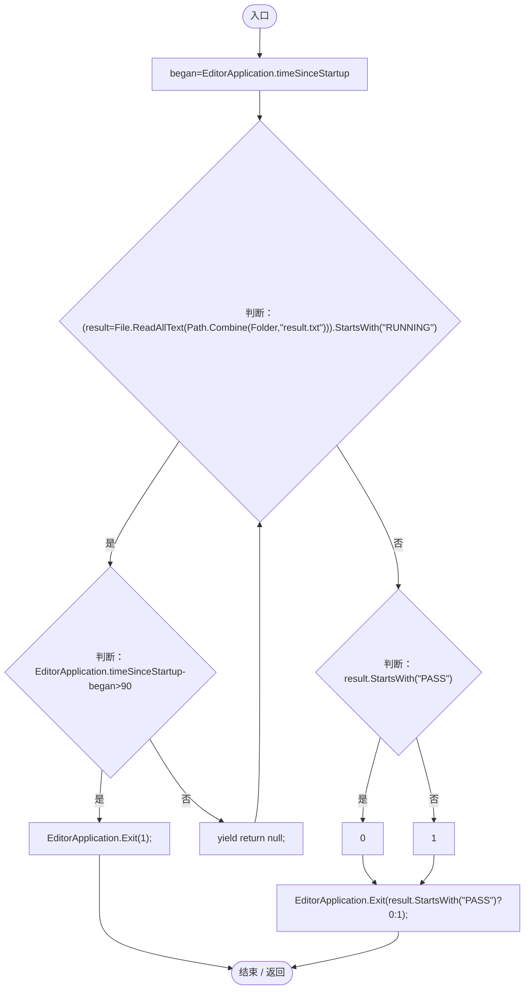

<a id="md030758e4c599692"></a>

## Check · L43

`private static void Check(bool condition,string message)`


### Editor · Roslyn编译器控制流

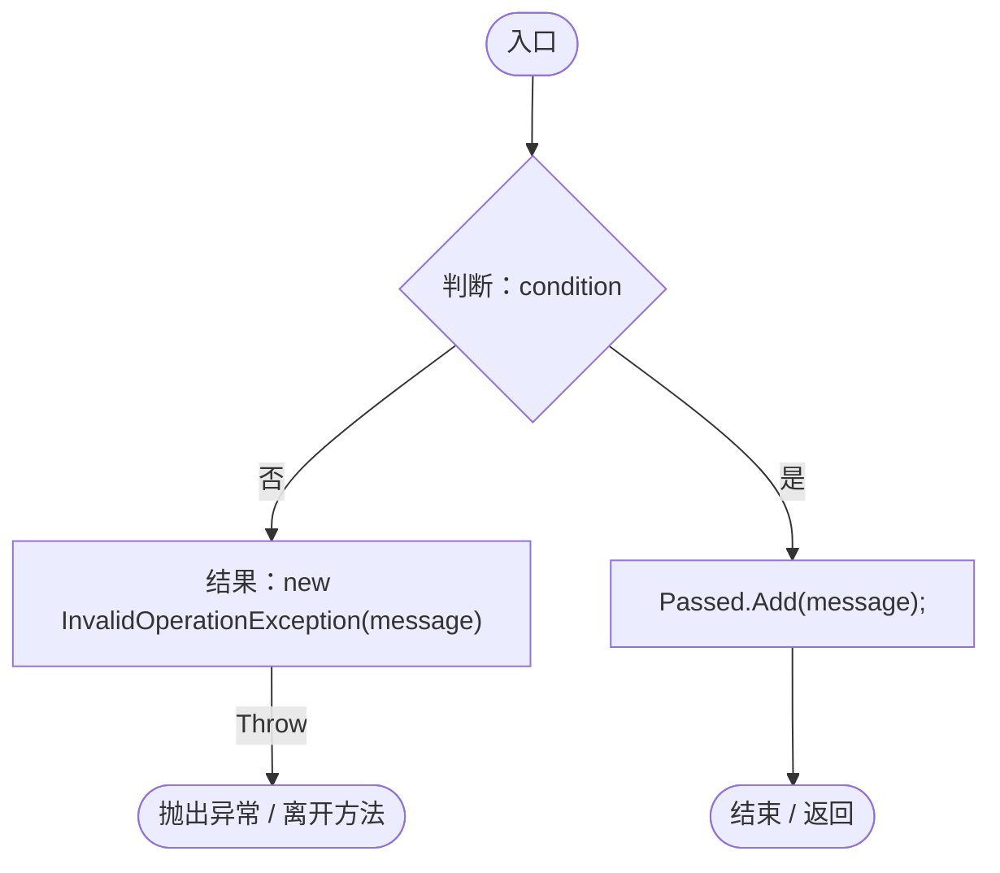

<a id="m99a222067f50298e"></a>

## Spawn · L44

`private static DarwinEntity Spawn(Vector3 point,string gene,float value)`


### Editor · Roslyn编译器控制流

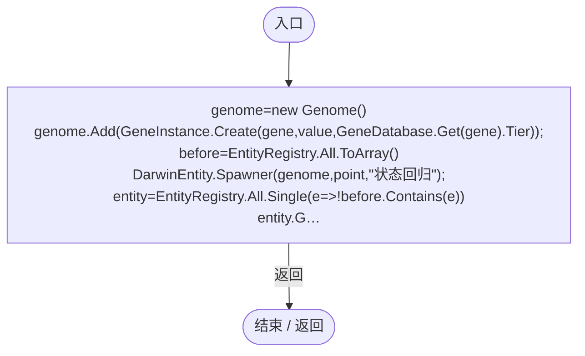

项目内调用/回调引用：

- [Genome.Add · L19](a2ef23f865bc7ee8.md#md9cfdc94b8b8d40f)（方法）
- [GeneInstance.Create · L20](f82e1498d67f5afd.md#m72e94c278de3cf8b)（方法）
- [GeneDatabase.Get · L136](ec0a03483435a863.md#me6a5fefe6c3492f9)（方法）
- [DarwinEntity.Genes.get · L14](70798dde169f2e8b.md#m622eb1adf401d431)（访问器）
- [EntityStateRegression.回调@48 · L48](cbb314f2877cdcfa.md#m90a2ecdb79dcdd9d)（回调/委托）

<a id="m90a2ecdb79dcdd9d"></a>

## 回调@48 · L48

`e … => 回调`


### Editor · Roslyn编译器控制流

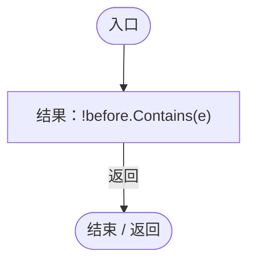

<a id="m6035e51d631cd66a"></a>

## Food · L50

`private static void Food(DarwinEntity entity,float value)`


### Editor · Roslyn编译器控制流

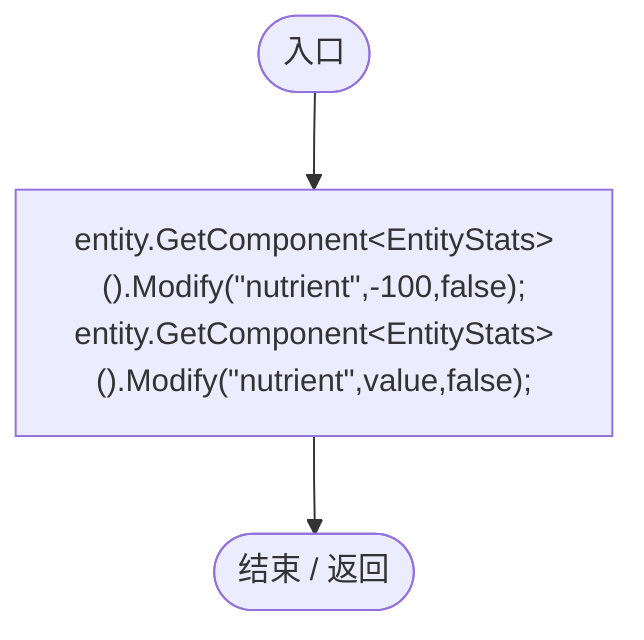

项目内调用/回调引用：

- [EntityStats.Modify · L114](75aa86a368efdf24.md#m375a3812ef990b45)（方法）

<a id="meb77f0d53bc8b303"></a>

## Validate · L51

`[MenuItem("Tools/Darwin Park/Validate Entity States %&F11")] public static void Validate()`


### Editor · Roslyn编译器控制流

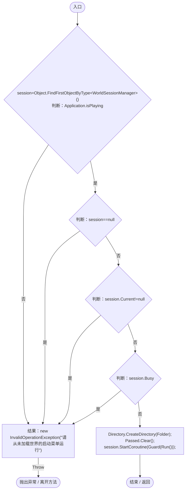

项目内调用/回调引用：

- [WorldSessionManager.Current.get · L21](08741c7b7b9d9344.md#m5d26a5eb846a8504)（访问器）
- [WorldSessionManager.Busy.get · L24](08741c7b7b9d9344.md#m4483e2e4f28f7c85)（访问器）
- [EntityStateRegression.Guard · L58](cbb314f2877cdcfa.md#m330191b1e4328445)（方法）
- [EntityStateRegression.Run · L79](cbb314f2877cdcfa.md#m611cf48bde00abc1)（方法）

<a id="m330191b1e4328445"></a>

## Guard · L58

`private static IEnumerator Guard(IEnumerator operation)`


### Editor · Roslyn编译器控制流

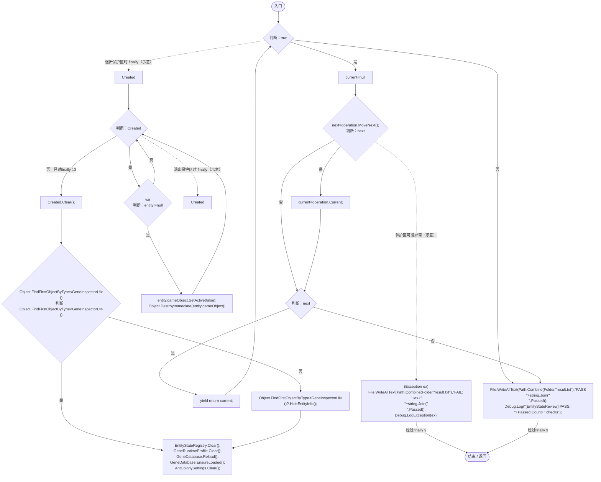

项目内调用/回调引用：

- [GeneInspectorUI.HideEntityInfo · L317](924e27c34e7b1f0a.md#mc9346c30e59e03d7)（方法）
- [EntityStateRegistry.Clear · L55](440408d2db5c7d96.md#m5fc8abc9b81cad68)（方法）
- [GeneRuntimeProfile.Clear · L9](f1a7d6e7b41d5a91.md#m3e3a434df6550039)（方法）
- [GeneDatabase.Reload · L146](ec0a03483435a863.md#mf11496816a817e0e)（方法）
- [GeneDatabase.EnsureLoaded · L12](ec0a03483435a863.md#mc3e6357b9ca440f5)（方法）
- [AntColonySettings.Clear · L63](cb0a937e97c8fbb3.md#m3139fd188f0f2c2b)（方法）

<a id="m611cf48bde00abc1"></a>

## Run · L79

`private static IEnumerator Run()`


### Editor · Roslyn编译器控制流

```mermaid
flowchart TD
  b0(["入口"])
  b1["yield return null;<br/>ServiceLocator.Get&lt;SimulationClock&gt;().Pause();<br/>legacyPolicy=AntColonySettings.Parse(AntColonySettings.CurrentJson)<br/>legacyPolicy.patrolRetaliationOnly=false;<br/>AntColonySettings.UseSnapshot(JsonUtility.ToJson(legacyPolicy…"]
  b2{"判断：registry.Get(registry.defaultStateId)!=null"}
  b3["registry.states.Count&gt;=3"]
  b4["registry.Get(registry.defaultStateId)!=null"]
  b5["Check(registry.Get(registry.defaultStateId)!=null&amp;&amp;registry.states.Count&gt;=3,&quot;默认、巡逻、捕猎状态在注册表中存在&quot;);"]
  b6["actor=Spawn(new Vector3(0,320,0),&quot;gene_territory&quot;,20)<br/>Food(actor,6);<br/>state=actor.GetComponent&lt;EntityStateController&gt;()<br/>territory=actor.GetComponent&lt;TerritoryBehavior&gt;()<br/>territory.Advance(.1f);"]
  b7["PatrolRhythm.Ensure(actor.gameObject)<br/>new PatrolRhythmSave{active=100}<br/>active=100<br/>PatrolRhythm.Ensure(actor.gameObject).Restore(new PatrolRhythmSave{active=100});"]
  b8{"判断：state!=null"}
  b9{"判断：state.Available.Any(s=&gt;s.id==patrol.id)"}
  b10["state.Available.Any(s=&gt;s.id==hunt.id)"]
  b11["state!=null&amp;&amp;state.Available.Any(s=&gt;s.id==patrol.id)&amp;&amp;state.Available.Any(s=&gt;s.id==hunt.id)"]
  b12["Check(state!=null&amp;&amp;state.Available.Any(s=&gt;s.id==patrol.id)&amp;&amp;state.Available.Any(s=&gt;s.id==hunt.id),&quot;有效基因标签安装组件并授予可迁移状态&quot;);"]
  b13["state.Advance(.1f);<br/>Check(state.Current.id==patrol.id,&quot;饱食度 6 且无捕猎者进入巡逻&quot;);"]
  b14{"判断：EcologyMotion.Directive(actor.Genes,out _,out var target,out _)"}
  b15["target==null"]
  b16["EcologyMotion.Directive(actor.Genes,out _,out var target,out _)"]
  b17["Check(EcologyMotion.Directive(actor.Genes,out _,out var target,out _)&amp;&amp;target==null,&quot;巡逻状态产生实际巡逻意图&quot;);"]
  b18["Food(actor,5);<br/>state.Advance(.1f);<br/>Check(state.Current.id==hunt.id,&quot;饱食度等于 5 不满足严格大于条件&quot;);<br/>Food(actor,5.001f);<br/>Check(state.Current.id==patrol.id,&quot;饱食度刚大于 5 恢复巡逻&quot;);<br/>hunter=Spawn(new Vector3(1,320,0),&quot;gene_locomotion&quot;,75)"]
  b19{"判断：state.Current.id==hunt.id"}
  b20["state.DetectedTarget==hunter"]
  b21["state.Current.id==hunt.id"]
  b22["Check(state.Current.id==hunt.id&amp;&amp;state.DetectedTarget==hunter,&quot;巡逻发现行动基因捕猎分支时切到实体捕猎&quot;);"]
  b23{"判断：actor.Genes.Evaluation.Genes.Single().State.StateId==&quot;patrol&quot;"}
  b24["actor.Genes.Genome.Genes.Single().Value==20"]
  b25["actor.Genes.Evaluation.Genes.Single().State.StateId==&quot;patrol&quot;"]
  b26["Check(actor.Genes.Evaluation.Genes.Single().State.StateId==&quot;patrol&quot;&amp;&amp;actor.Genes.Genome.Genes.Single().Value==20,&quot;实体切换不改写领地基因巡逻分支或基因值&quot;);"]
  b27["Check(!NutritionTransfer.CanHuntForFood(actor.Genes),&quot;仅有领地状态不会凭空获得消化取食能力&quot;);<br/>nutrition=NutritionEcologySettings.Current<br/>digestDef=GeneDatabase.Get(nutrition.heterotrophyGene)<br/>digestion=GeneInstance.Create(digestDef.Id,digestDef.States.Sin…"]
  b28{"判断：EcologyMotion.Directive(actor.Genes,out _,out target,out _)"}
  b29["target==hunter"]
  b30["EcologyMotion.Directive(actor.Genes,out _,out target,out _)"]
  b31["Check(EcologyMotion.Directive(actor.Genes,out _,out target,out _)&amp;&amp;target==hunter,&quot;捕猎状态通过实际行动器锁定发现的捕猎者&quot;);"]
  b32["hunter.GetComponent&lt;EntityStats&gt;().TryGet(&quot;health&quot;,out float hp);<br/>actor.Genes.AdvanceSimulation(.1f);<br/>hunter.GetComponent&lt;EntityStats&gt;().TryGet(&quot;health&quot;,out float after);<br/>Check(after&lt;hp,&quot;切换为捕猎后真实近身攻击生效&quot;);<br/>actor.Genes.Genome.Genes.Remove(…"]
  b33{"判断：state.Current.id==registry.defaultStateId"}
  b34["!state.Available.Any(s=&gt;s.id==patrol.id)"]
  b35["state.Current.id==registry.defaultStateId"]
  b36["Check(state.Current.id==registry.defaultStateId&amp;&amp;!state.Available.Any(s=&gt;s.id==patrol.id),&quot;基因禁用后撤销巡逻授权&quot;);"]
  b37["actorGene.Enabled=true;<br/>actor.Genes.Recalculate();<br/>Food(actor,8);<br/>custom=EntityStateRegistry.Parse(originalJson)"]
  b38["custom.states.SelectMany(s=&gt;s.entryAny.Concat(s.transitions.SelectMany(t=&gt;t.any))).SelectMany(r=&gt;r.all).Where(c=&gt;c.kind==&quot;stat&quot;)"]
  b39{"判断：custom.states.SelectMany(s=&gt;s.entryAny.Concat(s.transitions.SelectMany(t=&gt;t.any))).SelectMany(r=&gt;r.all).Where(c=&gt;c.kind==&quot;stat&quot;)"}
  b40["var<br/>condition.value=9;"]
  b41{"判断：custom.states.SelectMany(s=&gt;s.entryAny.Concat(s.transitions.SelectMany(t=&gt;t.any))).SelectMany(r=&gt;r.all).Where(c=&gt;c.kind==&quot;stat&quot;)"}
  b42["custom.states.SelectMany(s=&gt;s.entryAny.Concat(s.transitions.SelectMany(t=&gt;t.any))).SelectMany(r=&gt;r.all).Where(c=&gt;c.kind==&quot;stat&quot;)"]
  b43["连接 / 离开区域"]
  b44["customJson=JsonUtility.ToJson(custom)<br/>EntityStateRegistry.UseSnapshot(customJson);<br/>state.Advance(.1f);<br/>Check(state.Current.Behavior==EntityStateBehavior.Hunt,&quot;只修改 JSON 阈值为 9 即改变行为，运行逻辑没有写死 5&quot;);<br/>form=new GeneValueForm()<br/>form.Load(catalog[…"]
  b45{"判断：upgraded.entityStateTags.Contains(patrol.id)"}
  b46["upgraded.attributeCurves[0].maxValue==123"]
  b47["upgraded.entityStateTags.Contains(patrol.id)"]
  b48["Check(upgraded.entityStateTags.Contains(patrol.id)&amp;&amp;upgraded.attributeCurves[0].maxValue==123,&quot;旧 mods/旧世界只补标签且保留自定义数值&quot;);"]
  b49["legacy.entityStateTagVersion=1;<br/>Check(JsonUtility.FromJson&lt;GeneDefinitionJson&gt;(GeneEntityStateTags.Upgrade(JsonUtility.ToJson(legacy))).entityStateTags.Count==0,&quot;显式空标签不会被旧档迁移重新补回&quot;);<br/>rejected=false<br/>legacy.entityStateTags.Add(&quot;unregistered…"]
  b50["GeneEntityStateTags.Validate(legacy,custom);"]
  b51["rejected=true;"]
  b52["Check(rejected,&quot;未注册标签明确拒绝&quot;);<br/>invalid=EntityStateRegistry.Parse(customJson)<br/>invalid.states[0].behavior=&quot;UnregisteredBehavior&quot;;<br/>rejected=false;"]
  b53["EntityStateRegistry.Parse(JsonUtility.ToJson(invalid));"]
  b54["rejected=true;"]
  b55["Check(rejected,&quot;未注册行为类型明确拒绝&quot;);<br/>inspector=Object.FindFirstObjectByType&lt;GeneInspectorUI&gt;()<br/>inspector.ShowEntityInfo(actor);"]
  b56{"判断：EntityStatePresentation.Current(actor)==hunt.displayName"}
  b57["inspector.GetComponentsInChildren&lt;Text&gt;().Any(t=&gt;t.name==&quot;EntityStateTags&quot;&amp;&amp;t.text.Contains(patrol.displayName))"]
  b58["EntityStatePresentation.Current(actor)==hunt.displayName"]
  b59["Check(EntityStatePresentation.Current(actor)==hunt.displayName&amp;&amp;inspector.GetComponentsInChildren&lt;Text&gt;().Any(t=&gt;t.name==&quot;EntityStateTags&quot;&amp;&amp;t.text.Contains(patrol.displayName)),&quot;实体面板分别展示当前活动与基因实体状态标签&quot;);"]
  b60["new WorldSaveData{id=Guid.NewGuid().ToString(&quot;N&quot;),name=&quot;实体状态回归&quot;,terrainParameters=JsonUtility.ToJson(Object.FindFirstObjectByType&lt;PlanetTerrainMeshBuilder&gt;()),environmentParameters=JsonUtility.ToJson(ServiceLocator.Get&lt;DarwinPark.Environ…"]
  b61["new List&lt;EntitySaveState&gt;{EntitySaveState.Capture(actor)}<br/>EntitySaveState.Capture(actor)<br/>entities=new List&lt;EntitySaveState&gt;{EntitySaveState.Capture(actor)}"]
  b62["data=new WorldSaveData{id=Guid.NewGuid().ToString(&quot;N&quot;),name=&quot;实体状态回归&quot;,terrainParameters=JsonUtility.ToJson(Object.FindFirstObjectByType&lt;PlanetTerrainMeshBuilder&gt;()),environmentParameters=JsonUtility.ToJson(ServiceLocator.Get&lt;DarwinPark.En…"]
  b63["file=Path.Combine(Folder,&quot;roundtrip.json&quot;)<br/>WorldSaveStore.Write(data,file);<br/>read=WorldSaveStore.Read(file)"]
  b64{"判断：read.entityStateRegistry==customJson"}
  b65["read.entities[0].ecology.entityStateId==hunt.id"]
  b66["read.entityStateRegistry==customJson"]
  b67["Check(read.entityStateRegistry==customJson&amp;&amp;read.entities[0].ecology.entityStateId==hunt.id,&quot;世界规则快照与实体活动状态成对写盘读取&quot;);"]
  b68["actor.gameObject.SetActive(false);<br/>restored=Spawn(read.entities[0].position,&quot;gene_territory&quot;,20)<br/>read.entities[0].Restore(restored);<br/>Check(restored.GetComponent&lt;EntityStateController&gt;().Current.id==hunt.id,&quot;实体读档立即保留捕猎状态&quot;);<br/>exported=Path.…"]
  b69{"判断：File.Exists(Path.Combine(exported,&quot;entity_states.json&quot;))"}
  b70["EntityStateRegistry.Parse(File.ReadAllText(Path.Combine(exported,&quot;entity_states.json&quot;))).states.Single(s=&gt;s.id==patrol.id).entryAny[0].all[0].value==9"]
  b71["File.Exists(Path.Combine(exported,&quot;entity_states.json&quot;))"]
  b72["Check(File.Exists(Path.Combine(exported,&quot;entity_states.json&quot;))&amp;&amp;EntityStateRegistry.Parse(File.ReadAllText(Path.Combine(exported,&quot;entity_states.json&quot;))).states.Single(s=&gt;s.id==patrol.id).entryAny[0].all[0].value==9,&quot;工具导出基因和注册表保持相同阈值&quot;);"]
  b73["EntityStateRegistry.UseSnapshot(originalJson);<br/>restored.GetComponent&lt;EntityStateController&gt;().Advance(.1f);<br/>Check(restored.GetComponent&lt;EntityStateController&gt;().Current.id==patrol.id,&quot;阈值恢复后按当前数据重新决策&quot;);<br/>read.entityStateRegistry=null;<br/>read…"]
  b74["extended.states<br/>new EntityStateDefinition{id=&quot;rest_for_test&quot;,displayName=&quot;测试休息&quot;,behavior=&quot;None&quot;,priority=100}<br/>id=&quot;rest_for_test&quot;<br/>displayName=&quot;测试休息&quot;<br/>behavior=&quot;None&quot;<br/>priority=100<br/>extended.states.Add(new EntityStateDefinition{id=&quot;rest_for_t…"]
  b75["EntityStateRegistry.UseSnapshot(JsonUtility.ToJson(extended));<br/>def=restored.Genes.Evaluation.Genes.Single().Definition<br/>tags=new List&lt;string&gt;(def.EntityStateTags)<br/>def.EntityStateTags.Add(&quot;rest_for_test&quot;);<br/>EntityStateController.Rebind(rest…"]
  b76(["结束 / 返回"])
  b0 --> b1
  b1 --> b2
  b2 -->|"是"| b3
  b2 -->|"否"| b4
  b3 --> b5
  b4 --> b5
  b5 --> b6
  b6 --> b7
  b7 --> b8
  b8 -->|"是"| b9
  b8 -->|"否"| b11
  b9 -->|"是"| b10
  b9 -->|"否"| b11
  b10 --> b12
  b11 --> b12
  b12 --> b13
  b13 --> b14
  b14 -->|"是"| b15
  b14 -->|"否"| b16
  b15 --> b17
  b16 --> b17
  b17 --> b18
  b18 --> b19
  b19 -->|"是"| b20
  b19 -->|"否"| b21
  b20 --> b22
  b21 --> b22
  b22 --> b23
  b23 -->|"是"| b24
  b23 -->|"否"| b25
  b24 --> b26
  b25 --> b26
  b26 --> b27
  b27 --> b28
  b28 -->|"是"| b29
  b28 -->|"否"| b30
  b29 --> b31
  b30 --> b31
  b31 --> b32
  b32 --> b33
  b33 -->|"是"| b34
  b33 -->|"否"| b35
  b34 --> b36
  b35 --> b36
  b36 --> b37
  b37 --> b38
  b38 --> b39
  b39 -->|"是"| b40
  b39 -->|"否 · 经过finally 41"| b44
  b40 --> b39
  b41 -->|"否"| b42
  b41 -->|"是"| b43
  b42 --> b43
  b44 --> b45
  b45 -->|"是"| b46
  b45 -->|"否"| b47
  b46 --> b48
  b47 --> b48
  b48 --> b49
  b49 --> b50
  b50 --> b52
  b51 --> b52
  b52 --> b53
  b53 --> b55
  b54 --> b55
  b55 --> b56
  b56 -->|"是"| b57
  b56 -->|"否"| b58
  b57 --> b59
  b58 --> b59
  b59 --> b60
  b60 --> b61
  b61 --> b62
  b62 --> b63
  b63 --> b64
  b64 -->|"是"| b65
  b64 -->|"否"| b66
  b65 --> b67
  b66 --> b67
  b67 --> b68
  b68 --> b69
  b69 -->|"是"| b70
  b69 -->|"否"| b71
  b70 --> b72
  b71 --> b72
  b72 --> b73
  b73 --> b74
  b74 --> b75
  b75 --> b76
  b39 -. "退出保护区时 finally（示意）" .-> b41
  b50 -. "保护区可能异常（示意）" .-> b51
  b53 -. "保护区可能异常（示意）" .-> b54

```

项目内调用/回调引用：

- [SimulationClock.Pause · L79](a8f444aec9614b0a.md#m30929d45a885d0f1)（方法）
- [ServiceLocator.Get · L33](f2fdbe9f9ccd93cb.md#m2ae625299520c56d)（方法）
- [AntColonySettings.Parse · L40](cb0a937e97c8fbb3.md#mb52d89914d989e58)（方法）
- [AntColonySettings.CurrentJson.get · L32](cb0a937e97c8fbb3.md#maa4463e90fdc2684)（访问器）
- [AntColonySettings.UseSnapshot · L62](cb0a937e97c8fbb3.md#m50cd0fd034f16b81)（方法）
- [GeneTreeStorage.ReadCatalog · L30](a885bad0d7dedee8.md#mf739dce11969ef23)（方法）
- [GeneDatabase.Reload · L146](ec0a03483435a863.md#mf11496816a817e0e)（方法）
- [GeneDatabase.EnsureLoaded · L12](ec0a03483435a863.md#mc3e6357b9ca440f5)（方法）
- [EntityStateRegistry.Current.get · L41](440408d2db5c7d96.md#m61b7aa1a54b9a56c)（访问器）
- [EntityStateRegistry.CurrentJson.get · L43](440408d2db5c7d96.md#m32449837062f8705)（访问器）
- [EntityStateRegression.Check · L43](cbb314f2877cdcfa.md#md030758e4c599692)（方法）
- [EntityStateDocument.Get · L32](440408d2db5c7d96.md#m52cb41ccf0c9d3c9)（方法）
- [EntityStateRegression.Spawn · L44](cbb314f2877cdcfa.md#m99a222067f50298e)（方法）
- [EntityStateRegression.Food · L50](cbb314f2877cdcfa.md#m6035e51d631cd66a)（方法）
- [TerritoryBehavior.Advance · L24](19d504dcdc8bc624.md#m08bf00c6d2c8c51a)（方法）
- [PatrolRhythm.Restore · L36](f55940fd5773d413.md#m66eb6fa23f369cda)（方法）
- [PatrolRhythm.Ensure · L14](f55940fd5773d413.md#mfe51a369852bf3eb)（方法）
- [EntityStateController.Advance · L43](0f8869eb7018091e.md#mfaff58408788d0ab)（方法）
- [EcologyMotion.Directive · L12](6ed9d0eedb456d32.md#m9d6872b8c4a43080)（方法）
- [DarwinEntity.Genes.get · L14](70798dde169f2e8b.md#m622eb1adf401d431)（访问器）
- [EntityStateController.DetectedTarget.get · L18](0f8869eb7018091e.md#m6dbfcf4ac4cb049a)（访问器）
- [EntityGeneController.Evaluation.get · L20](7494d53178552f0e.md#mf275f100ea21601a)（访问器）
- [NutritionTransfer.CanHuntForFood · L28](081d3b8ff683e442.md#m2cbdf5db3ea5d5c3)（方法）
- [NutritionEcologySettings.Current.get · L19](846a17351dbd6aa4.md#mb3eb930022e314f3)（访问器）
- [GeneDatabase.Get · L136](ec0a03483435a863.md#me6a5fefe6c3492f9)（方法）
- [GeneInstance.Create · L20](f82e1498d67f5afd.md#m72e94c278de3cf8b)（方法）
- [Genome.Add · L19](a2ef23f865bc7ee8.md#md9cfdc94b8b8d40f)（方法）
- [EntityGeneController.Recalculate · L120](7494d53178552f0e.md#m7bf63f9a1482db3c)（方法）
- [EntityStats.TryGet · L93](75aa86a368efdf24.md#m03cef847022eee28)（方法）
- [EntityGeneController.AdvanceSimulation · L75](7494d53178552f0e.md#m6e94486f8bf79c01)（方法）
- [EntityStats.Modify · L114](75aa86a368efdf24.md#m375a3812ef990b45)（方法）
- [EntityStateRegistry.Parse · L57](440408d2db5c7d96.md#m4543a04396bcbc54)（方法）
- [EntityStateRegistry.UseSnapshot · L52](440408d2db5c7d96.md#m6013e583cbf33e79)（方法）
- [GeneValueForm.Load · L16](1a57b2a63a2f76d5.md#m3e1d8f0799dda5fd)（方法）
- [GeneValueForm.Export · L38](1a57b2a63a2f76d5.md#m733739ea591391d9)（方法）
- [GeneEntityStateTags.Upgrade · L11](d87d75eb0b331d5c.md#m2462e83f788e9dea)（方法）
- [GeneEntityStateTags.Validate · L24](d87d75eb0b331d5c.md#m07abded73ee4a80f)（方法）
- [GeneInspectorUI.ShowEntityInfo · L387](924e27c34e7b1f0a.md#mfbae827fa8eb1ff1)（方法）
- [EntityStatePresentation.Current · L11](cedd13b7a8825ed4.md#mb284f7b351983ca5)（方法）
- [GeneTreeStorage.Load · L56](a885bad0d7dedee8.md#mb7b2bb500297e5d5)（方法）
- [EntitySaveState.Capture · L22](a1ec8fcd9d7d3ddb.md#md994065ded6697b7)（方法）
- [WorldSaveStore.Write · L132](d67a35e5e3814c15.md#m5e217a350c4883f7)（方法）
- [WorldSaveStore.Read · L74](d67a35e5e3814c15.md#mde52fadbe0185af1)（方法）
- [EntitySaveState.Restore · L32](a1ec8fcd9d7d3ddb.md#md1cca8b8dd3628a4)（方法）
- [GeneTreeStorage.SaveTo · L100](a885bad0d7dedee8.md#maa795acf9a4622f6)（方法）
- [EntityStateController.Rebind · L24](0f8869eb7018091e.md#mc9a8aa9d76f7d46e)（方法）
- [EntityStateController.Restore · L107](0f8869eb7018091e.md#m7a40a097ad98b909)（方法）
- [EntityStateRegression.回调@86 · L86](cbb314f2877cdcfa.md#me85dbbc3187b5901)（回调/委托）
- [EntityStateRegression.回调@87 · L87](cbb314f2877cdcfa.md#me6c6cc606b278c30)（回调/委托）
- [EntityStateRegression.回调@93 · L93](cbb314f2877cdcfa.md#m1fe512af8d93a6a7)（回调/委托）
- [EntityStateRegression.回调@93 · L93](cbb314f2877cdcfa.md#m0f827902d3604f2e)（回调/委托）
- [EntityStateRegression.回调@104 · L104](cbb314f2877cdcfa.md#mf8781a8371c3a503)（回调/委托）
- [EntityStateRegression.回调@117 · L117](cbb314f2877cdcfa.md#m903b960f89459568)（回调/委托）
- [EntityStateRegression.回调@119 · L119](cbb314f2877cdcfa.md#m5df65a764ebd970c)（回调/委托）
- [EntityStateRegression.回调@119 · L119](cbb314f2877cdcfa.md#m752dbe5c49717ba1)（回调/委托）
- [EntityStateRegression.回调@119 · L119](cbb314f2877cdcfa.md#m0cea104adfeab784)（回调/委托）
- [EntityStateRegression.回调@130 · L130](cbb314f2877cdcfa.md#m38fd4ebfb3fedc97)（回调/委托）
- [EntityStateRegression.回调@132 · L132](cbb314f2877cdcfa.md#m719a5b9e2afcf0cc)（回调/委托）
- [EntityStateRegression.回调@138 · L138](cbb314f2877cdcfa.md#m566853f0fe624219)（回调/委托）

<a id="me85dbbc3187b5901"></a>

## 回调@86 · L86

`s … => 回调`


### Editor · Roslyn编译器控制流

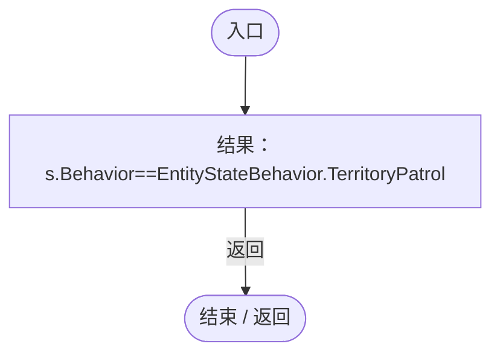

<a id="me6c6cc606b278c30"></a>

## 回调@87 · L87

`s … => 回调`


### Editor · Roslyn编译器控制流

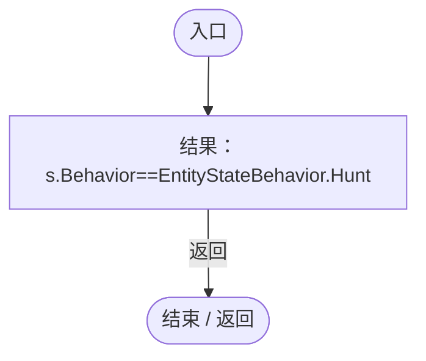

<a id="m1fe512af8d93a6a7"></a>

## 回调@93 · L93

`s … => 回调`


### Editor · Roslyn编译器控制流

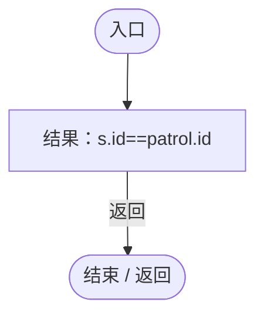

<a id="m0f827902d3604f2e"></a>

## 回调@93 · L93

`s … => 回调`


### Editor · Roslyn编译器控制流

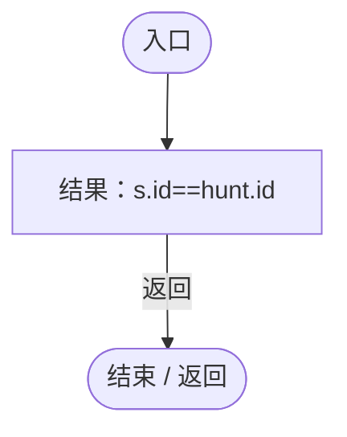

<a id="mf8781a8371c3a503"></a>

## 回调@104 · L104

`s … => 回调`


### Editor · Roslyn编译器控制流

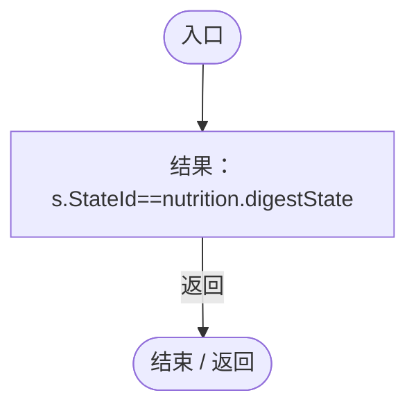

<a id="m903b960f89459568"></a>

## 回调@117 · L117

`s … => 回调`


### Editor · Roslyn编译器控制流


<a id="m5df65a764ebd970c"></a>

## 回调@119 · L119

`s … => 回调`


### Editor · Roslyn编译器控制流

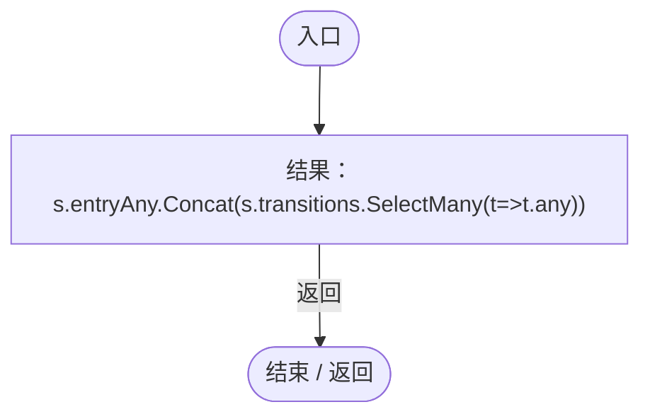

项目内调用/回调引用：

- [EntityStateRegression.回调@119 · L119](cbb314f2877cdcfa.md#m60afb1c6650d9dd5)（回调/委托）

<a id="m60afb1c6650d9dd5"></a>

## 回调@119 · L119

`t … => 回调`


### Editor · Roslyn编译器控制流

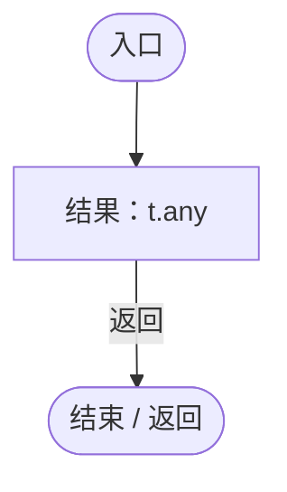

<a id="m752dbe5c49717ba1"></a>

## 回调@119 · L119

`r … => 回调`


### Editor · Roslyn编译器控制流

```mermaid
flowchart TD
  b0(["入口"])
  b1["结果：r.all"]
  b2(["结束 / 返回"])
  b0 --> b1
  b1 -->|"返回"| b2

```

<a id="m0cea104adfeab784"></a>

## 回调@119 · L119

`c … => 回调`


### Editor · Roslyn编译器控制流

```mermaid
flowchart TD
  b0(["入口"])
  b1["结果：c.kind==&quot;stat&quot;"]
  b2(["结束 / 返回"])
  b0 --> b1
  b1 -->|"返回"| b2

```

<a id="m38fd4ebfb3fedc97"></a>

## 回调@130 · L130

`t … => 回调`


### Editor · Roslyn编译器控制流

```mermaid
flowchart TD
  b0(["入口"])
  b1{"判断：t.name==&quot;EntityStateTags&quot;"}
  b2["t.text.Contains(patrol.displayName)"]
  b3["t.name==&quot;EntityStateTags&quot;"]
  b4["结果：t.name==&quot;EntityStateTags&quot;&amp;&amp;t.text.Contains(patrol.displayName)"]
  b5(["结束 / 返回"])
  b0 --> b1
  b1 -->|"是"| b2
  b1 -->|"否"| b3
  b2 --> b4
  b3 --> b4
  b4 -->|"返回"| b5

```

<a id="m719a5b9e2afcf0cc"></a>

## 回调@132 · L132

`d … => 回调`


### Editor · Roslyn编译器控制流

```mermaid
flowchart TD
  b0(["入口"])
  b1["new SavedGeneDefinition{id=d.Key,json=d.Value}<br/>id=d.Key<br/>json=d.Value<br/>结果：new SavedGeneDefinition{id=d.Key,json=d.Value}"]
  b2(["结束 / 返回"])
  b0 --> b1
  b1 -->|"返回"| b2

```

<a id="m566853f0fe624219"></a>

## 回调@138 · L138

`s … => 回调`


### Editor · Roslyn编译器控制流

```mermaid
flowchart TD
  b0(["入口"])
  b1["结果：s.id==patrol.id"]
  b2(["结束 / 返回"])
  b0 --> b1
  b1 -->|"返回"| b2

```
