# EntityStateRegression.cs

[返回总索引](../README.md) · `Editor` · `Assets/DarwinPark/Editor/EntityStateRegression.cs`

[源文件](../../../Assets/DarwinPark/Editor/EntityStateRegression.cs) · 源码校验：`5b85e9fbc2234918fd08c5b32392bae9ec37743c80c2703a855cc4e7bdbe9bd0`

方法按源文件位置排列。事件/回调引用不表示立即执行；分支与异常说明见总索引。完整源码与可点击关系图请打开离线手册。

## Folder.get · L26

`private static string Folder`

### Editor · 语法控制结构 / 声明（非CFG）

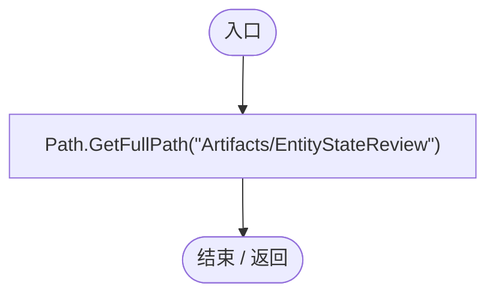

## Check · L27

`private static void Check(bool condition,string message)`

### Editor · Roslyn编译器控制流

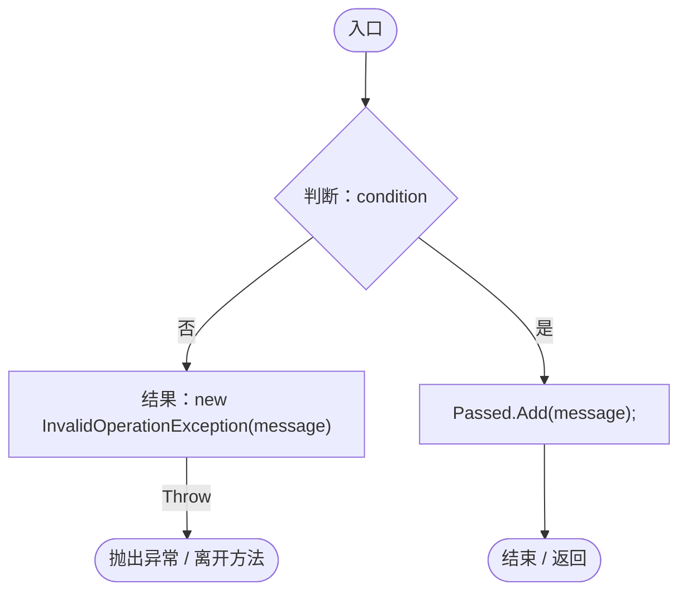

## Spawn · L28

`private static DarwinEntity Spawn(Vector3 point,string gene,float value)`

### Editor · Roslyn编译器控制流

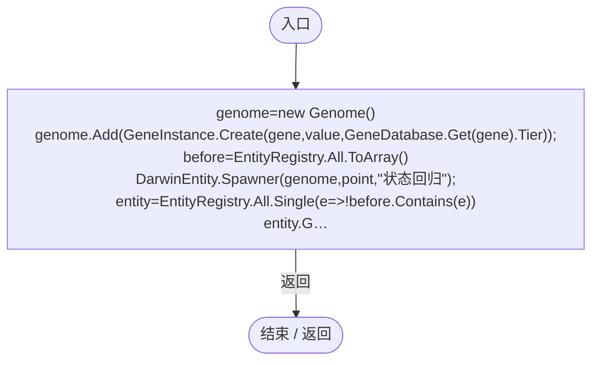

项目内调用/回调引用：

- [Genome.Add · L19](a2ef23f865bc7ee8.md#md9cfdc94b8b8d40f)（方法）
- [GeneInstance.Create · L20](f82e1498d67f5afd.md#m72e94c278de3cf8b)（方法）
- [GeneDatabase.Get · L135](ec0a03483435a863.md#m8f3bbfb35f3ca397)（方法）
- [DarwinEntity.Genes.get · L14](70798dde169f2e8b.md#m622eb1adf401d431)（访问器）
- [EntityStateRegression.回调@32 · L32](cbb314f2877cdcfa.md#m9e0cf1ebd8f13a93)（回调/委托）

## 回调@32 · L32

`e … => 回调`

### Editor · Roslyn编译器控制流

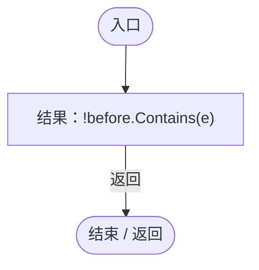

## Food · L34

`private static void Food(DarwinEntity entity,float value)`

### Editor · Roslyn编译器控制流

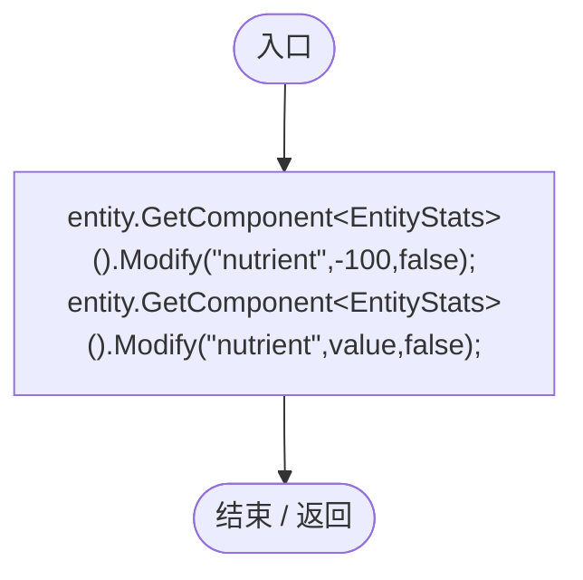

项目内调用/回调引用：

- [EntityStats.Modify · L111](75aa86a368efdf24.md#m9c837be197158240)（方法）

## Validate · L35

`[MenuItem("Tools/Darwin Park/Validate Entity States %&F11")] public static void Validate()`

### Editor · Roslyn编译器控制流

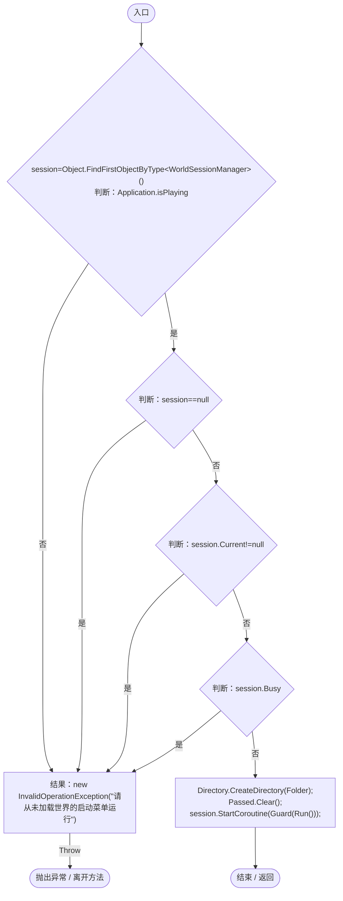

项目内调用/回调引用：

- [WorldSessionManager.Current.get · L21](08741c7b7b9d9344.md#m5d26a5eb846a8504)（访问器）
- [WorldSessionManager.Busy.get · L24](08741c7b7b9d9344.md#m4483e2e4f28f7c85)（访问器）
- [EntityStateRegression.Guard · L42](cbb314f2877cdcfa.md#mbafe88f2f3ad2d01)（方法）
- [EntityStateRegression.Run · L63](cbb314f2877cdcfa.md#me948e5f94ac3ee07)（方法）

## Guard · L42

`private static IEnumerator Guard(IEnumerator operation)`

### Editor · Roslyn编译器控制流

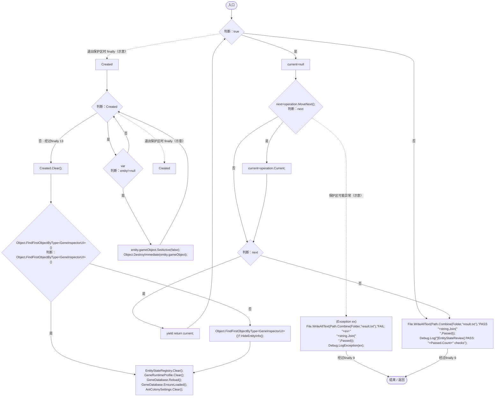

项目内调用/回调引用：

- [GeneInspectorUI.HideEntityInfo · L316](924e27c34e7b1f0a.md#m11944eddcac871c2)（方法）
- [EntityStateRegistry.Clear · L55](440408d2db5c7d96.md#m5fc8abc9b81cad68)（方法）
- [GeneRuntimeProfile.Clear · L9](f1a7d6e7b41d5a91.md#m3e3a434df6550039)（方法）
- [GeneDatabase.Reload · L145](ec0a03483435a863.md#mbf775d68c402c10e)（方法）
- [GeneDatabase.EnsureLoaded · L12](ec0a03483435a863.md#mc3e6357b9ca440f5)（方法）
- [AntColonySettings.Clear · L63](cb0a937e97c8fbb3.md#m3139fd188f0f2c2b)（方法）

## Run · L63

`private static IEnumerator Run()`

### Editor · Roslyn编译器控制流

```mermaid
flowchart TD
  b0(["入口"])
  b1["yield return null;<br/>ServiceLocator.Get&lt;SimulationClock&gt;().Pause();<br/>legacyPolicy=AntColonySettings.Parse(AntColonySettings.CurrentJson)<br/>legacyPolicy.patrolRetaliationOnly=false;<br/>AntColonySettings.UseSnapshot(JsonUtility.ToJson(legacyPolicy…"]
  b2{"判断：registry.Get(registry.defaultStateId)!=null"}
  b3["registry.states.Count&gt;=3"]
  b4["registry.Get(registry.defaultStateId)!=null"]
  b5["Check(registry.Get(registry.defaultStateId)!=null&amp;&amp;registry.states.Count&gt;=3,&quot;默认、巡逻、捕猎状态在注册表中存在&quot;);"]
  b6["actor=Spawn(new Vector3(0,320,0),&quot;gene_territory&quot;,20)<br/>Food(actor,6);<br/>state=actor.GetComponent&lt;EntityStateController&gt;()<br/>territory=actor.GetComponent&lt;TerritoryBehavior&gt;()<br/>territory.Advance(.1f);"]
  b7["PatrolRhythm.Ensure(actor.gameObject)<br/>new PatrolRhythmSave{active=100}<br/>active=100<br/>PatrolRhythm.Ensure(actor.gameObject).Restore(new PatrolRhythmSave{active=100});"]
  b8{"判断：state!=null"}
  b9{"判断：state.Available.Any(s=&gt;s.id==patrol.id)"}
  b10["state.Available.Any(s=&gt;s.id==hunt.id)"]
  b11["state!=null&amp;&amp;state.Available.Any(s=&gt;s.id==patrol.id)&amp;&amp;state.Available.Any(s=&gt;s.id==hunt.id)"]
  b12["Check(state!=null&amp;&amp;state.Available.Any(s=&gt;s.id==patrol.id)&amp;&amp;state.Available.Any(s=&gt;s.id==hunt.id),&quot;有效基因标签安装组件并授予可迁移状态&quot;);"]
  b13["state.Advance(.1f);<br/>Check(state.Current.id==patrol.id,&quot;饱食度 6 且无捕猎者进入巡逻&quot;);"]
  b14{"判断：EcologyMotion.Directive(actor.Genes,out _,out var target,out _)"}
  b15["target==null"]
  b16["EcologyMotion.Directive(actor.Genes,out _,out var target,out _)"]
  b17["Check(EcologyMotion.Directive(actor.Genes,out _,out var target,out _)&amp;&amp;target==null,&quot;巡逻状态产生实际巡逻意图&quot;);"]
  b18["Food(actor,5);<br/>state.Advance(.1f);<br/>Check(state.Current.id==hunt.id,&quot;饱食度等于 5 不满足严格大于条件&quot;);<br/>Food(actor,5.001f);<br/>Check(state.Current.id==patrol.id,&quot;饱食度刚大于 5 恢复巡逻&quot;);<br/>hunter=Spawn(new Vector3(1,320,0),&quot;gene_locomotion&quot;,75)"]
  b19{"判断：state.Current.id==hunt.id"}
  b20["state.DetectedTarget==hunter"]
  b21["state.Current.id==hunt.id"]
  b22["Check(state.Current.id==hunt.id&amp;&amp;state.DetectedTarget==hunter,&quot;巡逻发现行动基因捕猎分支时切到实体捕猎&quot;);"]
  b23{"判断：actor.Genes.Evaluation.Genes.Single().State.StateId==&quot;patrol&quot;"}
  b24["actor.Genes.Genome.Genes.Single().Value==20"]
  b25["actor.Genes.Evaluation.Genes.Single().State.StateId==&quot;patrol&quot;"]
  b26["Check(actor.Genes.Evaluation.Genes.Single().State.StateId==&quot;patrol&quot;&amp;&amp;actor.Genes.Genome.Genes.Single().Value==20,&quot;实体切换不改写领地基因巡逻分支或基因值&quot;);"]
  b27{"判断：EcologyMotion.Directive(actor.Genes,out _,out target,out _)"}
  b28["target==hunter"]
  b29["EcologyMotion.Directive(actor.Genes,out _,out target,out _)"]
  b30["Check(EcologyMotion.Directive(actor.Genes,out _,out target,out _)&amp;&amp;target==hunter,&quot;捕猎状态通过实际行动器锁定发现的捕猎者&quot;);"]
  b31["hunter.GetComponent&lt;EntityStats&gt;().TryGet(&quot;health&quot;,out float hp);<br/>actor.Genes.AdvanceSimulation(.1f);<br/>hunter.GetComponent&lt;EntityStats&gt;().TryGet(&quot;health&quot;,out float after);<br/>Check(after&lt;hp,&quot;切换为捕猎后真实近身攻击生效&quot;);<br/>hunterGene=hunter.Genes.Genome.G…"]
  b32{"判断：state.Current.id==registry.defaultStateId"}
  b33["!state.Available.Any(s=&gt;s.id==patrol.id)"]
  b34["state.Current.id==registry.defaultStateId"]
  b35["Check(state.Current.id==registry.defaultStateId&amp;&amp;!state.Available.Any(s=&gt;s.id==patrol.id),&quot;基因禁用后撤销巡逻授权&quot;);"]
  b36["actorGene.Enabled=true;<br/>actor.Genes.Recalculate();<br/>Food(actor,8);<br/>custom=EntityStateRegistry.Parse(originalJson)"]
  b37["custom.states.SelectMany(s=&gt;s.entryAny.Concat(s.transitions.SelectMany(t=&gt;t.any))).SelectMany(r=&gt;r.all).Where(c=&gt;c.kind==&quot;stat&quot;)"]
  b38{"判断：custom.states.SelectMany(s=&gt;s.entryAny.Concat(s.transitions.SelectMany(t=&gt;t.any))).SelectMany(r=&gt;r.all).Where(c=&gt;c.kind==&quot;stat&quot;)"}
  b39["var<br/>condition.value=9;"]
  b40{"判断：custom.states.SelectMany(s=&gt;s.entryAny.Concat(s.transitions.SelectMany(t=&gt;t.any))).SelectMany(r=&gt;r.all).Where(c=&gt;c.kind==&quot;stat&quot;)"}
  b41["custom.states.SelectMany(s=&gt;s.entryAny.Concat(s.transitions.SelectMany(t=&gt;t.any))).SelectMany(r=&gt;r.all).Where(c=&gt;c.kind==&quot;stat&quot;)"]
  b42["连接 / 离开区域"]
  b43["customJson=JsonUtility.ToJson(custom)<br/>EntityStateRegistry.UseSnapshot(customJson);<br/>state.Advance(.1f);<br/>Check(state.Current.Behavior==EntityStateBehavior.Hunt,&quot;只修改 JSON 阈值为 9 即改变行为，运行逻辑没有写死 5&quot;);<br/>form=new GeneValueForm()<br/>form.Load(catalog[…"]
  b44{"判断：upgraded.entityStateTags.Contains(patrol.id)"}
  b45["upgraded.attributeCurves[0].maxValue==123"]
  b46["upgraded.entityStateTags.Contains(patrol.id)"]
  b47["Check(upgraded.entityStateTags.Contains(patrol.id)&amp;&amp;upgraded.attributeCurves[0].maxValue==123,&quot;旧 mods/旧世界只补标签且保留自定义数值&quot;);"]
  b48["legacy.entityStateTagVersion=1;<br/>Check(JsonUtility.FromJson&lt;GeneDefinitionJson&gt;(GeneEntityStateTags.Upgrade(JsonUtility.ToJson(legacy))).entityStateTags.Count==0,&quot;显式空标签不会被旧档迁移重新补回&quot;);<br/>rejected=false<br/>legacy.entityStateTags.Add(&quot;unregistered…"]
  b49["GeneEntityStateTags.Validate(legacy,custom);"]
  b50["rejected=true;"]
  b51["Check(rejected,&quot;未注册标签明确拒绝&quot;);<br/>invalid=EntityStateRegistry.Parse(customJson)<br/>invalid.states[0].behavior=&quot;UnregisteredBehavior&quot;;<br/>rejected=false;"]
  b52["EntityStateRegistry.Parse(JsonUtility.ToJson(invalid));"]
  b53["rejected=true;"]
  b54["Check(rejected,&quot;未注册行为类型明确拒绝&quot;);<br/>inspector=Object.FindFirstObjectByType&lt;GeneInspectorUI&gt;()<br/>inspector.ShowEntityInfo(actor);"]
  b55{"判断：EntityStatePresentation.Current(actor)==hunt.displayName"}
  b56["inspector.GetComponentsInChildren&lt;Text&gt;().Any(t=&gt;t.name==&quot;EntityStateTags&quot;&amp;&amp;t.text.Contains(patrol.displayName))"]
  b57["EntityStatePresentation.Current(actor)==hunt.displayName"]
  b58["Check(EntityStatePresentation.Current(actor)==hunt.displayName&amp;&amp;inspector.GetComponentsInChildren&lt;Text&gt;().Any(t=&gt;t.name==&quot;EntityStateTags&quot;&amp;&amp;t.text.Contains(patrol.displayName)),&quot;实体面板分别展示当前活动与基因实体状态标签&quot;);"]
  b59["new WorldSaveData{id=Guid.NewGuid().ToString(&quot;N&quot;),name=&quot;实体状态回归&quot;,terrainParameters=JsonUtility.ToJson(Object.FindFirstObjectByType&lt;PlanetTerrainMeshBuilder&gt;()),environmentParameters=JsonUtility.ToJson(ServiceLocator.Get&lt;DarwinPark.Environ…"]
  b60["new List&lt;EntitySaveState&gt;{EntitySaveState.Capture(actor)}<br/>EntitySaveState.Capture(actor)<br/>entities=new List&lt;EntitySaveState&gt;{EntitySaveState.Capture(actor)}"]
  b61["data=new WorldSaveData{id=Guid.NewGuid().ToString(&quot;N&quot;),name=&quot;实体状态回归&quot;,terrainParameters=JsonUtility.ToJson(Object.FindFirstObjectByType&lt;PlanetTerrainMeshBuilder&gt;()),environmentParameters=JsonUtility.ToJson(ServiceLocator.Get&lt;DarwinPark.En…"]
  b62["file=Path.Combine(Folder,&quot;roundtrip.json&quot;)<br/>WorldSaveStore.Write(data,file);<br/>read=WorldSaveStore.Read(file)"]
  b63{"判断：read.entityStateRegistry==customJson"}
  b64["read.entities[0].ecology.entityStateId==hunt.id"]
  b65["read.entityStateRegistry==customJson"]
  b66["Check(read.entityStateRegistry==customJson&amp;&amp;read.entities[0].ecology.entityStateId==hunt.id,&quot;世界规则快照与实体活动状态成对写盘读取&quot;);"]
  b67["actor.gameObject.SetActive(false);<br/>restored=Spawn(read.entities[0].position,&quot;gene_territory&quot;,20)<br/>read.entities[0].Restore(restored);<br/>Check(restored.GetComponent&lt;EntityStateController&gt;().Current.id==hunt.id,&quot;实体读档立即保留捕猎状态&quot;);<br/>exported=Path.…"]
  b68{"判断：File.Exists(Path.Combine(exported,&quot;entity_states.json&quot;))"}
  b69["EntityStateRegistry.Parse(File.ReadAllText(Path.Combine(exported,&quot;entity_states.json&quot;))).states.Single(s=&gt;s.id==patrol.id).entryAny[0].all[0].value==9"]
  b70["File.Exists(Path.Combine(exported,&quot;entity_states.json&quot;))"]
  b71["Check(File.Exists(Path.Combine(exported,&quot;entity_states.json&quot;))&amp;&amp;EntityStateRegistry.Parse(File.ReadAllText(Path.Combine(exported,&quot;entity_states.json&quot;))).states.Single(s=&gt;s.id==patrol.id).entryAny[0].all[0].value==9,&quot;工具导出基因和注册表保持相同阈值&quot;);"]
  b72["EntityStateRegistry.UseSnapshot(originalJson);<br/>restored.GetComponent&lt;EntityStateController&gt;().Advance(.1f);<br/>Check(restored.GetComponent&lt;EntityStateController&gt;().Current.id==patrol.id,&quot;阈值恢复后按当前数据重新决策&quot;);<br/>read.entityStateRegistry=null;<br/>read…"]
  b73["extended.states<br/>new EntityStateDefinition{id=&quot;rest_for_test&quot;,displayName=&quot;测试休息&quot;,behavior=&quot;None&quot;,priority=100}<br/>id=&quot;rest_for_test&quot;<br/>displayName=&quot;测试休息&quot;<br/>behavior=&quot;None&quot;<br/>priority=100<br/>extended.states.Add(new EntityStateDefinition{id=&quot;rest_for_t…"]
  b74["EntityStateRegistry.UseSnapshot(JsonUtility.ToJson(extended));<br/>def=restored.Genes.Evaluation.Genes.Single().Definition<br/>tags=new List&lt;string&gt;(def.EntityStateTags)<br/>def.EntityStateTags.Add(&quot;rest_for_test&quot;);<br/>EntityStateController.Rebind(rest…"]
  b75(["结束 / 返回"])
  b0 --> b1
  b1 --> b2
  b2 -->|"是"| b3
  b2 -->|"否"| b4
  b3 --> b5
  b4 --> b5
  b5 --> b6
  b6 --> b7
  b7 --> b8
  b8 -->|"是"| b9
  b8 -->|"否"| b11
  b9 -->|"是"| b10
  b9 -->|"否"| b11
  b10 --> b12
  b11 --> b12
  b12 --> b13
  b13 --> b14
  b14 -->|"是"| b15
  b14 -->|"否"| b16
  b15 --> b17
  b16 --> b17
  b17 --> b18
  b18 --> b19
  b19 -->|"是"| b20
  b19 -->|"否"| b21
  b20 --> b22
  b21 --> b22
  b22 --> b23
  b23 -->|"是"| b24
  b23 -->|"否"| b25
  b24 --> b26
  b25 --> b26
  b26 --> b27
  b27 -->|"是"| b28
  b27 -->|"否"| b29
  b28 --> b30
  b29 --> b30
  b30 --> b31
  b31 --> b32
  b32 -->|"是"| b33
  b32 -->|"否"| b34
  b33 --> b35
  b34 --> b35
  b35 --> b36
  b36 --> b37
  b37 --> b38
  b38 -->|"是"| b39
  b38 -->|"否 · 经过finally 40"| b43
  b39 --> b38
  b40 -->|"否"| b41
  b40 -->|"是"| b42
  b41 --> b42
  b43 --> b44
  b44 -->|"是"| b45
  b44 -->|"否"| b46
  b45 --> b47
  b46 --> b47
  b47 --> b48
  b48 --> b49
  b49 --> b51
  b50 --> b51
  b51 --> b52
  b52 --> b54
  b53 --> b54
  b54 --> b55
  b55 -->|"是"| b56
  b55 -->|"否"| b57
  b56 --> b58
  b57 --> b58
  b58 --> b59
  b59 --> b60
  b60 --> b61
  b61 --> b62
  b62 --> b63
  b63 -->|"是"| b64
  b63 -->|"否"| b65
  b64 --> b66
  b65 --> b66
  b66 --> b67
  b67 --> b68
  b68 -->|"是"| b69
  b68 -->|"否"| b70
  b69 --> b71
  b70 --> b71
  b71 --> b72
  b72 --> b73
  b73 --> b74
  b74 --> b75
  b38 -. "退出保护区时 finally（示意）" .-> b40
  b49 -. "保护区可能异常（示意）" .-> b50
  b52 -. "保护区可能异常（示意）" .-> b53

```

项目内调用/回调引用：

- [SimulationClock.Pause · L79](a8f444aec9614b0a.md#m30929d45a885d0f1)（方法）
- [ServiceLocator.Get · L33](f2fdbe9f9ccd93cb.md#m2ae625299520c56d)（方法）
- [AntColonySettings.Parse · L40](cb0a937e97c8fbb3.md#mb52d89914d989e58)（方法）
- [AntColonySettings.CurrentJson.get · L32](cb0a937e97c8fbb3.md#maa4463e90fdc2684)（访问器）
- [AntColonySettings.UseSnapshot · L62](cb0a937e97c8fbb3.md#m50cd0fd034f16b81)（方法）
- [GeneTreeStorage.ReadCatalog · L27](a885bad0d7dedee8.md#m89083f320ec287c0)（方法）
- [GeneDatabase.Reload · L145](ec0a03483435a863.md#mbf775d68c402c10e)（方法）
- [GeneDatabase.EnsureLoaded · L12](ec0a03483435a863.md#mc3e6357b9ca440f5)（方法）
- [EntityStateRegistry.Current.get · L41](440408d2db5c7d96.md#m61b7aa1a54b9a56c)（访问器）
- [EntityStateRegistry.CurrentJson.get · L43](440408d2db5c7d96.md#m32449837062f8705)（访问器）
- [EntityStateRegression.Check · L27](cbb314f2877cdcfa.md#m179c1a45aee10507)（方法）
- [EntityStateDocument.Get · L32](440408d2db5c7d96.md#m52cb41ccf0c9d3c9)（方法）
- [EntityStateRegression.Spawn · L28](cbb314f2877cdcfa.md#m89b2a8dd21f677cb)（方法）
- [EntityStateRegression.Food · L34](cbb314f2877cdcfa.md#m8496a9114ed684a2)（方法）
- [TerritoryBehavior.Advance · L23](19d504dcdc8bc624.md#me9363af362e5c02e)（方法）
- [PatrolRhythm.Restore · L35](f55940fd5773d413.md#md5ed7e3a5cd3b705)（方法）
- [PatrolRhythm.Ensure · L13](f55940fd5773d413.md#m47ee8c1a397958a4)（方法）
- [EntityStateController.Advance · L41](0f8869eb7018091e.md#mffbdbb199029dbf3)（方法）
- [EcologyMotion.Directive · L10](6ed9d0eedb456d32.md#m1305a80f2f4f99b2)（方法）
- [DarwinEntity.Genes.get · L14](70798dde169f2e8b.md#m622eb1adf401d431)（访问器）
- [EntityStateController.DetectedTarget.get · L16](0f8869eb7018091e.md#m2d23280359000fb2)（访问器）
- [EntityGeneController.Evaluation.get · L19](7494d53178552f0e.md#m2cb74e57d810ca42)（访问器）
- [EntityStats.TryGet · L90](75aa86a368efdf24.md#m24ee1433e4a70d94)（方法）
- [EntityGeneController.AdvanceSimulation · L60](7494d53178552f0e.md#m10b24df798096cab)（方法）
- [EntityGeneController.Recalculate · L90](7494d53178552f0e.md#m93744c8f3039b93c)（方法）
- [EntityStats.Modify · L111](75aa86a368efdf24.md#m9c837be197158240)（方法）
- [EntityStateRegistry.Parse · L57](440408d2db5c7d96.md#m4543a04396bcbc54)（方法）
- [EntityStateRegistry.UseSnapshot · L52](440408d2db5c7d96.md#m6013e583cbf33e79)（方法）
- [GeneValueForm.Load · L16](1a57b2a63a2f76d5.md#m3e1d8f0799dda5fd)（方法）
- [GeneValueForm.Export · L38](1a57b2a63a2f76d5.md#m733739ea591391d9)（方法）
- [GeneEntityStateTags.Upgrade · L11](d87d75eb0b331d5c.md#m2462e83f788e9dea)（方法）
- [GeneEntityStateTags.Validate · L24](d87d75eb0b331d5c.md#m07abded73ee4a80f)（方法）
- [GeneInspectorUI.ShowEntityInfo · L385](924e27c34e7b1f0a.md#mea69a0457b885287)（方法）
- [EntityStatePresentation.Current · L11](cedd13b7a8825ed4.md#mb284f7b351983ca5)（方法）
- [GeneTreeStorage.Load · L53](a885bad0d7dedee8.md#m60e52e1c6f841f94)（方法）
- [EntitySaveState.Capture · L21](a1ec8fcd9d7d3ddb.md#mc67502b381bc2751)（方法）
- [WorldSaveStore.Write · L117](d67a35e5e3814c15.md#m793b97a7ba7d2029)（方法）
- [WorldSaveStore.Read · L72](d67a35e5e3814c15.md#mca362c7675a5800c)（方法）
- [EntitySaveState.Restore · L31](a1ec8fcd9d7d3ddb.md#m047b691a146deabd)（方法）
- [GeneTreeStorage.SaveTo · L96](a885bad0d7dedee8.md#m44f80bc754af0f5a)（方法）
- [EntityStateController.Rebind · L22](0f8869eb7018091e.md#m40a5ae44229a22cf)（方法）
- [EntityStateController.Restore · L100](0f8869eb7018091e.md#m5c730db919104ae6)（方法）
- [EntityStateRegression.回调@70 · L70](cbb314f2877cdcfa.md#m92084cbce0768382)（回调/委托）
- [EntityStateRegression.回调@71 · L71](cbb314f2877cdcfa.md#mbd5758518b63afb4)（回调/委托）
- [EntityStateRegression.回调@77 · L77](cbb314f2877cdcfa.md#me15df24f88f07164)（回调/委托）
- [EntityStateRegression.回调@77 · L77](cbb314f2877cdcfa.md#m0d31299b25971f56)（回调/委托）
- [EntityStateRegression.回调@95 · L95](cbb314f2877cdcfa.md#m0f50ee46387eec72)（回调/委托）
- [EntityStateRegression.回调@97 · L97](cbb314f2877cdcfa.md#m3c8a20c4eafd5ec5)（回调/委托）
- [EntityStateRegression.回调@97 · L97](cbb314f2877cdcfa.md#m4aa5050ab14930db)（回调/委托）
- [EntityStateRegression.回调@97 · L97](cbb314f2877cdcfa.md#mb762cc62b85fc5dc)（回调/委托）
- [EntityStateRegression.回调@108 · L108](cbb314f2877cdcfa.md#m58e647273b8d2d64)（回调/委托）
- [EntityStateRegression.回调@110 · L110](cbb314f2877cdcfa.md#m5e9934235f304f65)（回调/委托）
- [EntityStateRegression.回调@116 · L116](cbb314f2877cdcfa.md#m7ca33b107f5ea765)（回调/委托）

## 回调@70 · L70

`s … => 回调`

### Editor · Roslyn编译器控制流

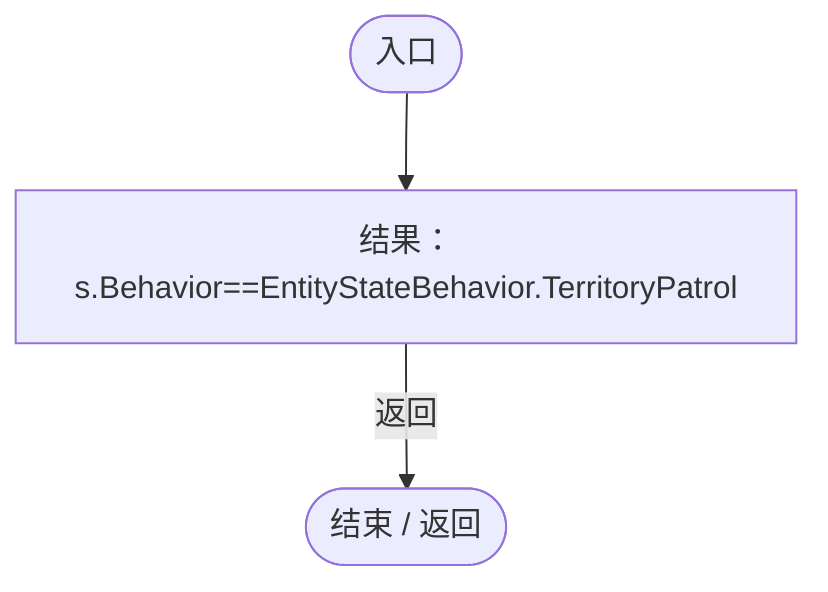

## 回调@71 · L71

`s … => 回调`

### Editor · Roslyn编译器控制流

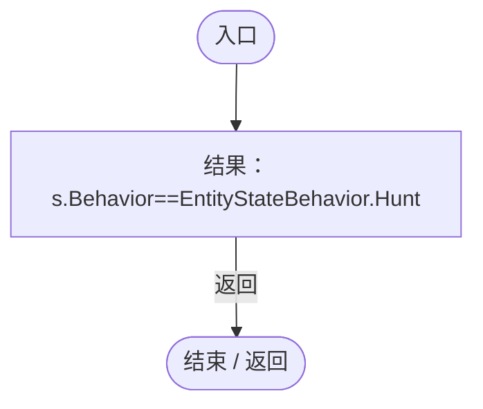

## 回调@77 · L77

`s … => 回调`

### Editor · Roslyn编译器控制流

## 回调@77 · L77

`s … => 回调`

### Editor · Roslyn编译器控制流

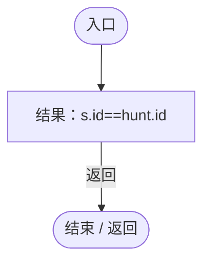

## 回调@95 · L95

`s … => 回调`

### Editor · Roslyn编译器控制流

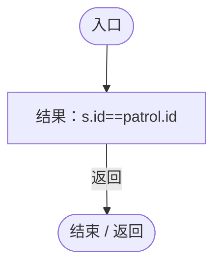

## 回调@97 · L97

`s … => 回调`

### Editor · Roslyn编译器控制流

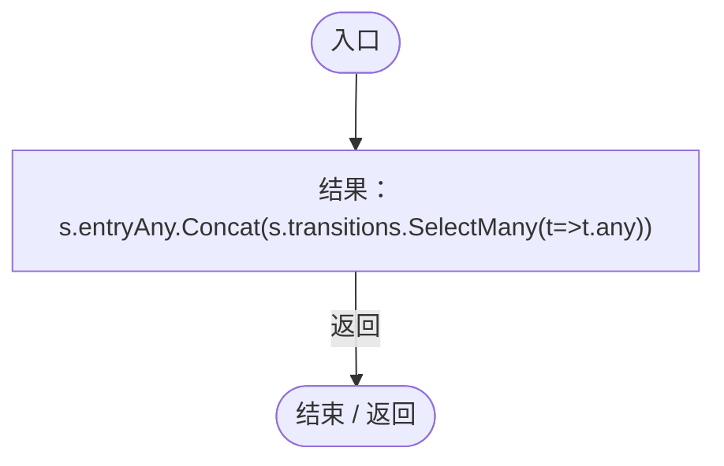

项目内调用/回调引用：

- [EntityStateRegression.回调@97 · L97](cbb314f2877cdcfa.md#m4ca938c9a535f996)（回调/委托）

## 回调@97 · L97

`t … => 回调`

### Editor · Roslyn编译器控制流

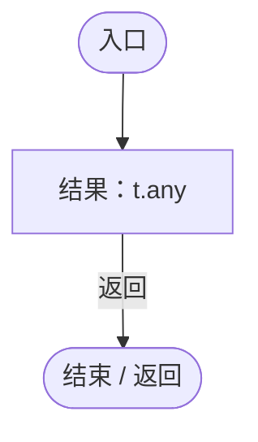

## 回调@97 · L97

`r … => 回调`

### Editor · Roslyn编译器控制流

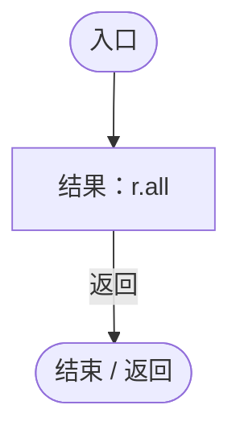

## 回调@97 · L97

`c … => 回调`

### Editor · Roslyn编译器控制流

## 回调@108 · L108

`t … => 回调`

### Editor · Roslyn编译器控制流

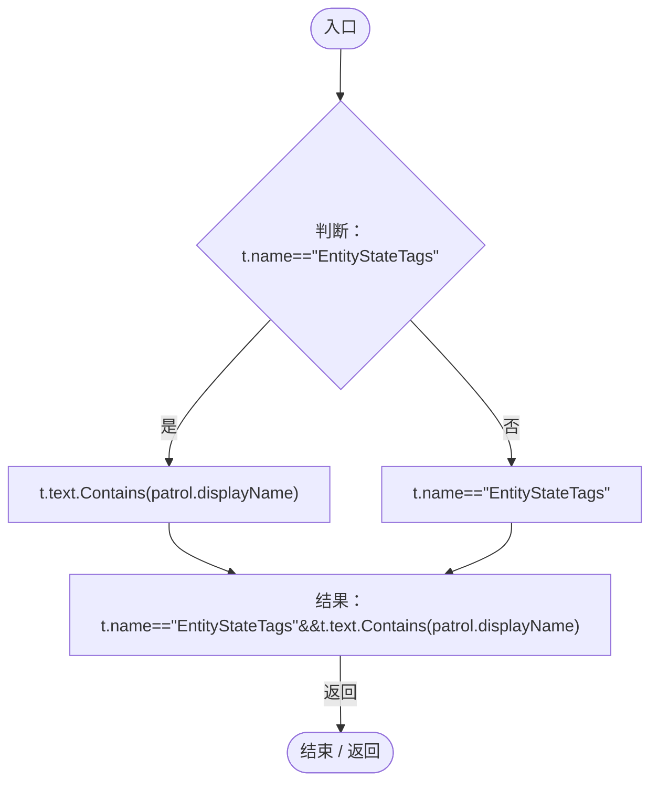

## 回调@110 · L110

`d … => 回调`

### Editor · Roslyn编译器控制流

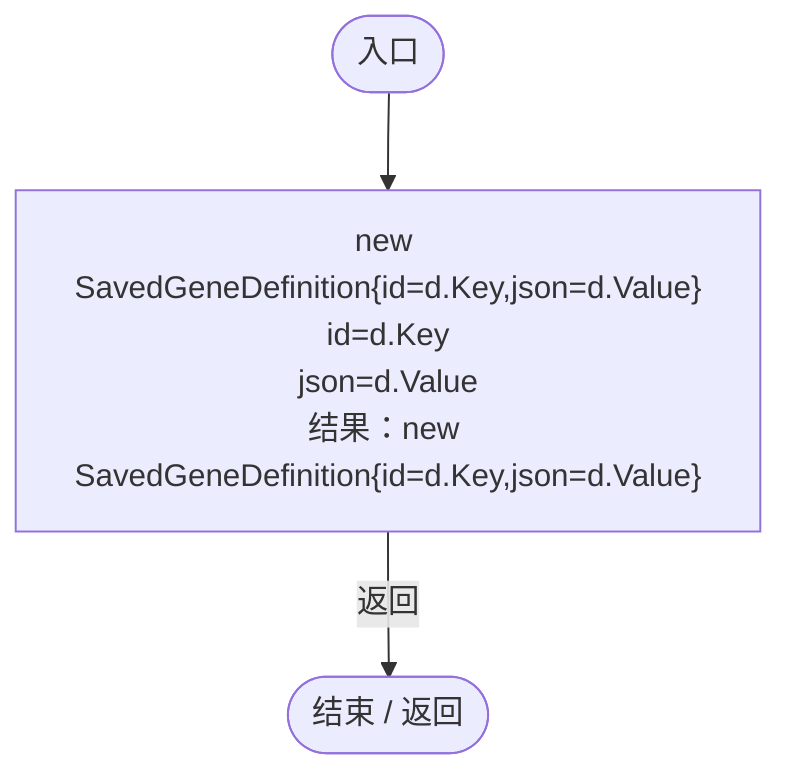

## 回调@116 · L116

`s … => 回调`

### Editor · Roslyn编译器控制流

