# GeneAttributeInheritance.cs

[返回总索引](../README.md) · `Runtime` · `Assets/DarwinPark/Genetics/GeneAttributeInheritance.cs`

[源文件](../../../Assets/DarwinPark/Genetics/GeneAttributeInheritance.cs) · 源码校验：`b20d418a30c36d6fbc028a6a5fc5f93318a458fc6712eae311568691e938dcb0`

方法按源文件位置排列。事件/回调引用不表示立即执行；分支与异常说明见总索引。完整源码与可点击关系图请打开离线手册。

<a id="ma579d903bfc7580d"></a>

## Applies · L13

`public static bool Applies(GeneDefinition definition)`


### Editor / Player · Roslyn编译器控制流

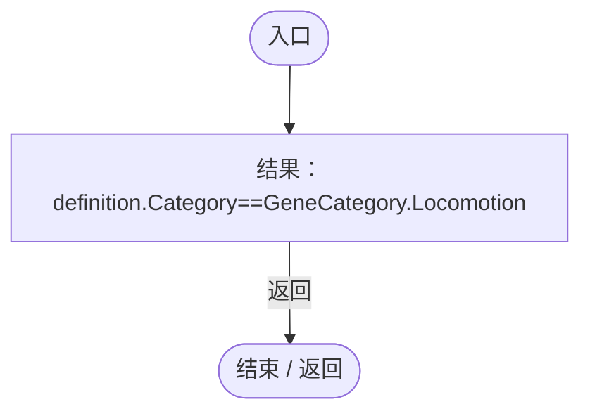

<a id="m6845f79005d13ac9"></a>

## Lineage · L14

`public static IEnumerable<GeneDefinition> Lineage(GeneDefinition definition)`


### Editor / Player · Roslyn编译器控制流

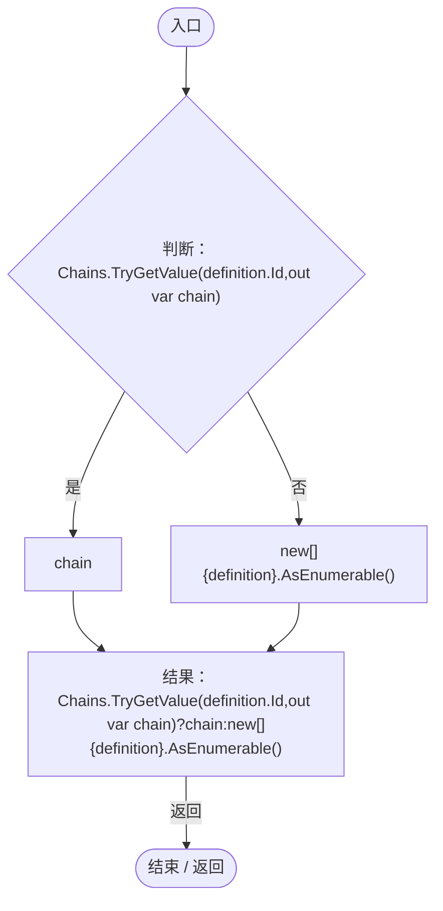

<a id="m9242f311b1323506"></a>

## Prepare · L15

`public static void Prepare(IReadOnlyDictionary<string,GeneDefinition> definitions)`


### Editor / Player · Roslyn编译器控制流

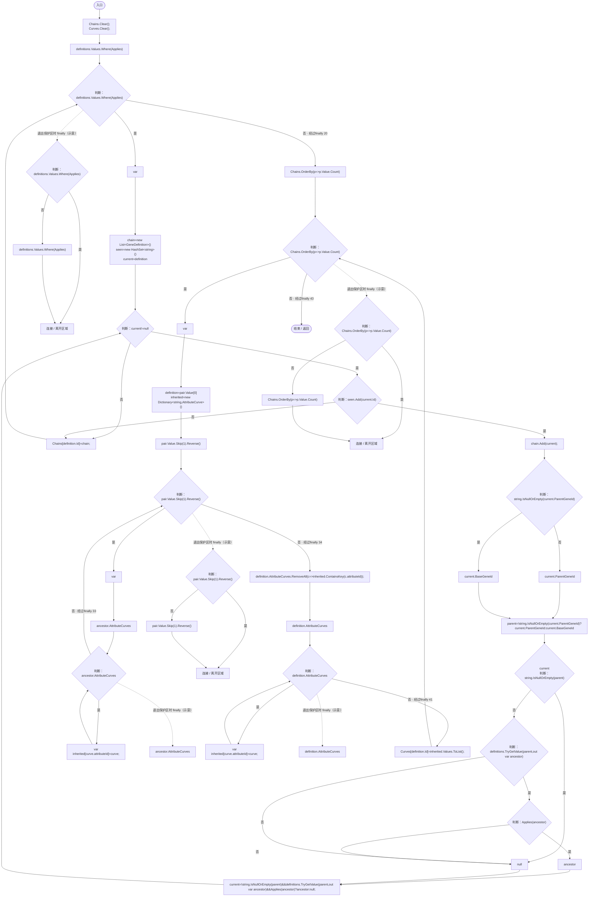

项目内调用/回调引用：

- [GeneAttributeInheritance.Applies · L13](cbba0870e05d6571.md#ma579d903bfc7580d)（方法）
- [GeneAttributeInheritance.回调@29 · L29](cbba0870e05d6571.md#m8c10d6a9606c7183)（回调/委托）
- [GeneAttributeInheritance.回调@33 · L33](cbba0870e05d6571.md#m1006686b44cac67c)（回调/委托）

<a id="m8c10d6a9606c7183"></a>

## 回调@29 · L29

`p … => 回调`


### Editor / Player · Roslyn编译器控制流

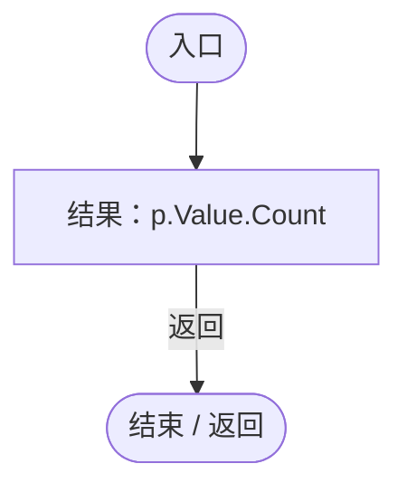

<a id="m1006686b44cac67c"></a>

## 回调@33 · L33

`c … => 回调`


### Editor / Player · Roslyn编译器控制流

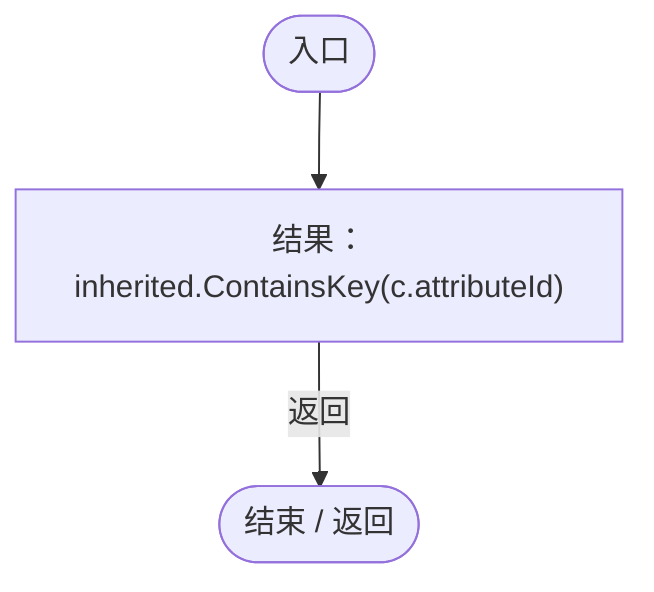

<a id="m996d03d00c1b46a1"></a>

## Effective · L38

`private static IEnumerable<AttributeCurve> Effective(GeneDefinition definition)`


### Editor / Player · Roslyn编译器控制流

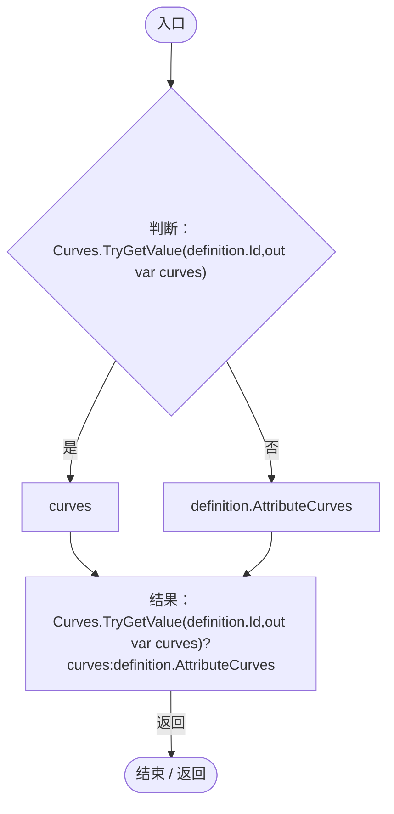

<a id="m94b9ccbc18db141d"></a>

## Accumulate · L39

`public static Dictionary<string,float> Accumulate(List<GeneEvaluation> genes)`


### Editor / Player · Roslyn编译器控制流

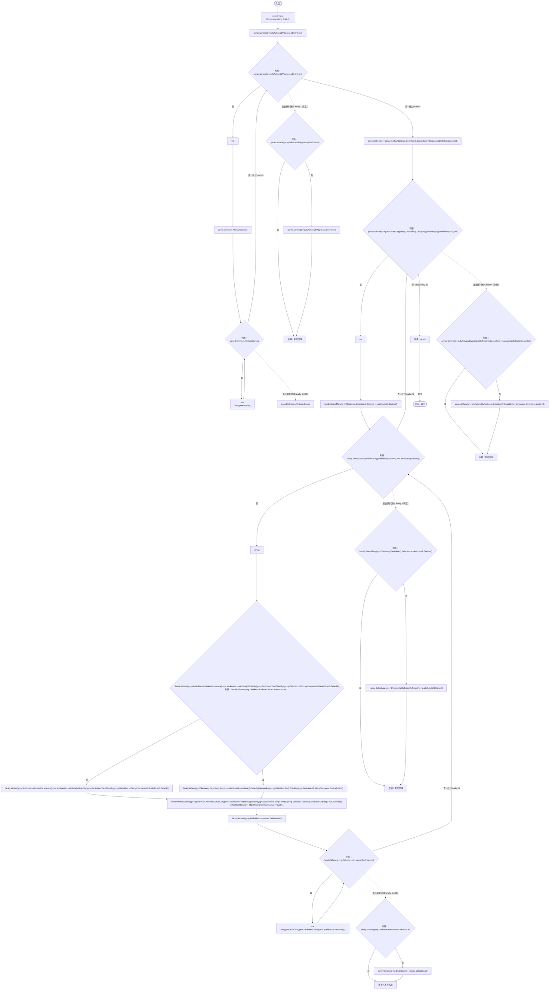

项目内调用/回调引用：

- [GeneAttributeInheritance.Add · L42](cbba0870e05d6571.md#m13682a869ea04a3e)（局部函数）
- [GeneAttributeInheritance.Effective · L38](cbba0870e05d6571.md#m996d03d00c1b46a1)（方法）
- [GeneAttributeInheritance.回调@48 · L48](cbba0870e05d6571.md#m400603ad4288bae0)（回调/委托）
- [GeneAttributeInheritance.回调@49 · L49](cbba0870e05d6571.md#m3ab99caef42844d0)（回调/委托）
- [GeneAttributeInheritance.回调@49 · L49](cbba0870e05d6571.md#m5a684d3cdc8d3b45)（回调/委托）
- [GeneAttributeInheritance.回调@51 · L51](cbba0870e05d6571.md#mbc69817a29d782a0)（回调/委托）
- [GeneAttributeInheritance.回调@51 · L51](cbba0870e05d6571.md#m7e7293f8e3111d32)（回调/委托）
- [GeneAttributeInheritance.回调@53 · L53](cbba0870e05d6571.md#m91cee9bb4a32b892)（回调/委托）
- [GeneAttributeInheritance.回调@53 · L53](cbba0870e05d6571.md#mba8968de73e80452)（回调/委托）
- [GeneAttributeInheritance.回调@53 · L53](cbba0870e05d6571.md#mbeb8bc5686fef55a)（回调/委托）
- [GeneAttributeInheritance.回调@54 · L54](cbba0870e05d6571.md#m19cfcc2bdaa076b4)（回调/委托）
- [GeneAttributeInheritance.回调@54 · L54](cbba0870e05d6571.md#m28690001669e4142)（回调/委托）
- [GeneAttributeInheritance.回调@54 · L54](cbba0870e05d6571.md#me8c05fc3fd048d2d)（回调/委托）
- [GeneAttributeInheritance.回调@56 · L56](cbba0870e05d6571.md#m78b25d239d80264f)（回调/委托）
- [GeneAttributeInheritance.回调@56 · L56](cbba0870e05d6571.md#mb5914d43854821d5)（回调/委托）

<a id="m13682a869ea04a3e"></a>

## Add · L42

`void Add(GeneEvaluation gene,AttributeCurve curve)`


### Editor / Player · Roslyn编译器控制流

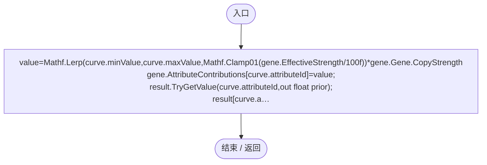

<a id="m400603ad4288bae0"></a>

## 回调@48 · L48

`g … => 回调`


### Editor / Player · Roslyn编译器控制流

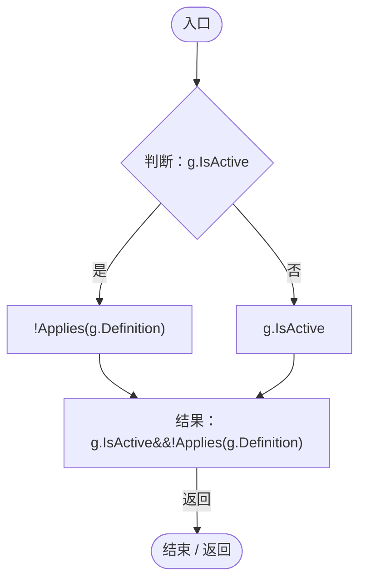

项目内调用/回调引用：

- [GeneAttributeInheritance.Applies · L13](cbba0870e05d6571.md#ma579d903bfc7580d)（方法）

<a id="m3ab99caef42844d0"></a>

## 回调@49 · L49

`g … => 回调`


### Editor / Player · Roslyn编译器控制流


项目内调用/回调引用：

- [GeneAttributeInheritance.Applies · L13](cbba0870e05d6571.md#ma579d903bfc7580d)（方法）

<a id="m5a684d3cdc8d3b45"></a>

## 回调@49 · L49

`g … => 回调`


### Editor / Player · Roslyn编译器控制流

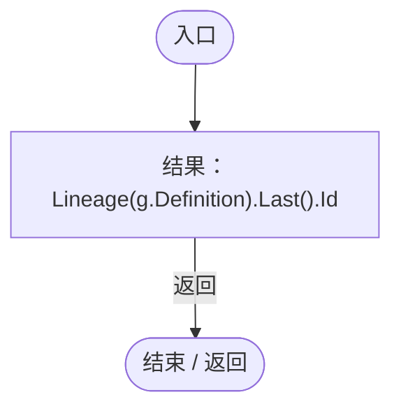

项目内调用/回调引用：

- [GeneAttributeInheritance.Lineage · L14](cbba0870e05d6571.md#m6845f79005d13ac9)（方法）

<a id="mbc69817a29d782a0"></a>

## 回调@51 · L51

`g … => 回调`


### Editor / Player · Roslyn编译器控制流

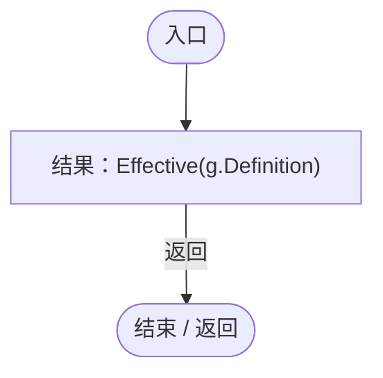

项目内调用/回调引用：

- [GeneAttributeInheritance.Effective · L38](cbba0870e05d6571.md#m996d03d00c1b46a1)（方法）

<a id="m7e7293f8e3111d32"></a>

## 回调@51 · L51

`c … => 回调`


### Editor / Player · Roslyn编译器控制流

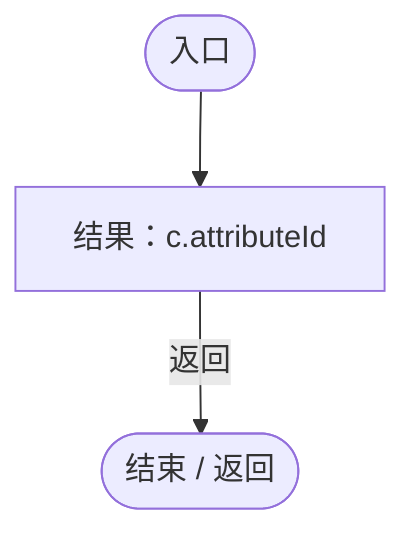

<a id="m91cee9bb4a32b892"></a>

## 回调@53 · L53

`g … => 回调`


### Editor / Player · Roslyn编译器控制流

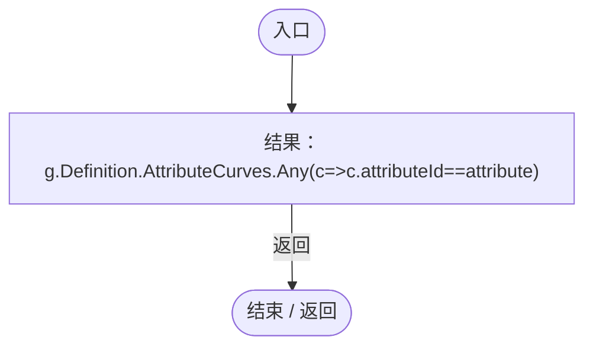

项目内调用/回调引用：

- [GeneAttributeInheritance.回调@53 · L53](cbba0870e05d6571.md#m14cb42cdde557f57)（回调/委托）

<a id="m14cb42cdde557f57"></a>

## 回调@53 · L53

`c … => 回调`


### Editor / Player · Roslyn编译器控制流

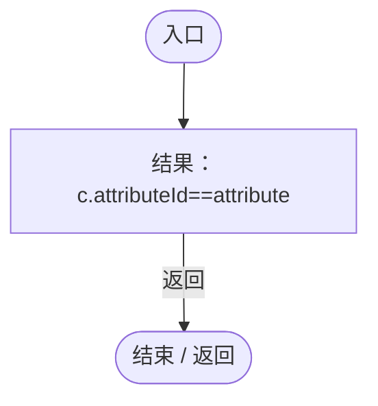

<a id="mba8968de73e80452"></a>

## 回调@53 · L53

`g … => 回调`


### Editor / Player · Roslyn编译器控制流


<a id="mbeb8bc5686fef55a"></a>

## 回调@53 · L53

`g … => 回调`


### Editor / Player · Roslyn编译器控制流

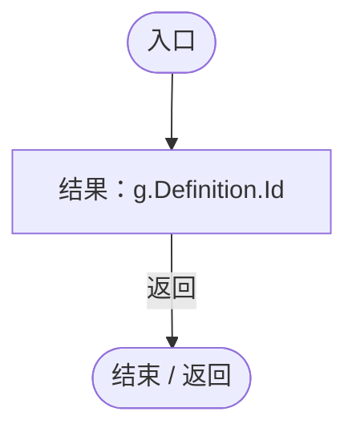

<a id="m19cfcc2bdaa076b4"></a>

## 回调@54 · L54

`g … => 回调`


### Editor / Player · Roslyn编译器控制流

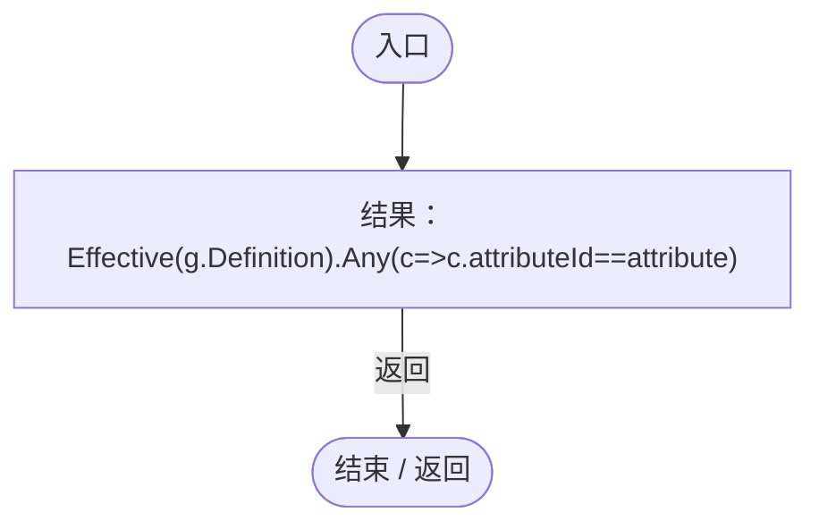

项目内调用/回调引用：

- [GeneAttributeInheritance.Effective · L38](cbba0870e05d6571.md#m996d03d00c1b46a1)（方法）
- [GeneAttributeInheritance.回调@54 · L54](cbba0870e05d6571.md#m0cafcfe04303713b)（回调/委托）

<a id="m0cafcfe04303713b"></a>

## 回调@54 · L54

`c … => 回调`


### Editor / Player · Roslyn编译器控制流


<a id="m28690001669e4142"></a>

## 回调@54 · L54

`g … => 回调`


### Editor / Player · Roslyn编译器控制流

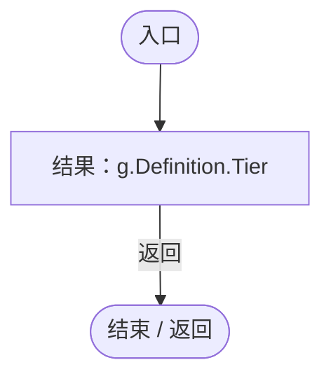

<a id="me8c05fc3fd048d2d"></a>

## 回调@54 · L54

`g … => 回调`


### Editor / Player · Roslyn编译器控制流

```mermaid
flowchart TD
  b0(["入口"])
  b1["结果：g.Definition.Id"]
  b2(["结束 / 返回"])
  b0 --> b1
  b1 -->|"返回"| b2

```

<a id="m78b25d239d80264f"></a>

## 回调@56 · L56

`g … => 回调`


### Editor / Player · Roslyn编译器控制流

```mermaid
flowchart TD
  b0(["入口"])
  b1["结果：g.Definition.Id==owner.Definition.Id"]
  b2(["结束 / 返回"])
  b0 --> b1
  b1 -->|"返回"| b2

```

<a id="mb5914d43854821d5"></a>

## 回调@56 · L56

`c … => 回调`


### Editor / Player · Roslyn编译器控制流

```mermaid
flowchart TD
  b0(["入口"])
  b1["结果：c.attributeId==attribute"]
  b2(["结束 / 返回"])
  b0 --> b1
  b1 -->|"返回"| b2

```
