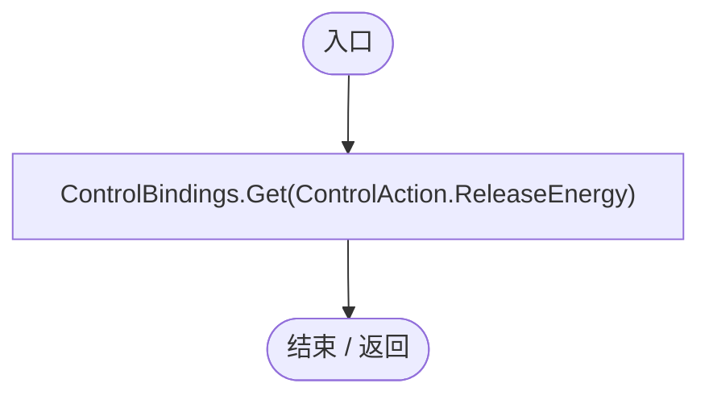
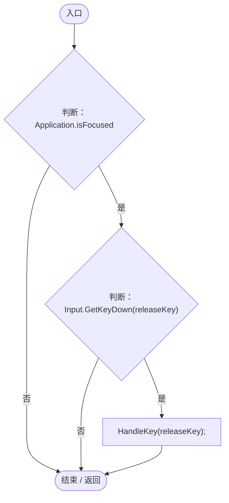
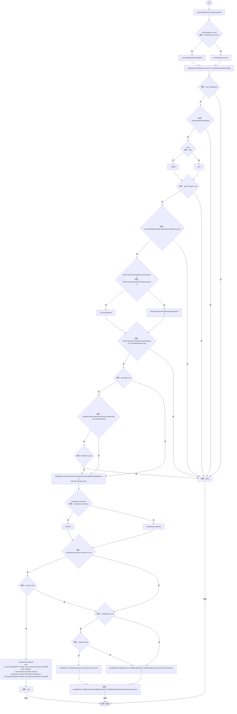

# EnergyBlockInput.cs

[返回总索引](../README.md) · `Runtime` · `Assets/DarwinPark/UI/EnergyBlockInput.cs`

[源文件](../../../Assets/DarwinPark/UI/EnergyBlockInput.cs) · 源码校验：`bdaa9812f733d3d1978f61e31b689cc042ddafc8c98e22df7f881ccc15fe8f76`

方法按源文件位置排列。事件/回调引用不表示立即执行；分支与异常说明见总索引。完整源码与可点击关系图请打开离线手册。

## releaseKey.get · L13

`public KeyCode releaseKey`

★ 适配：改键后的能力输入与释放鼠标门控共用设置配置。

### Editor / Player · 语法控制结构 / 声明（非CFG）

项目内调用/回调引用：

- [ControlBindings.Get · L45](b6735f8f133ee3f4.md#mb5707e6e63a56689)（方法）

## Update · L14

`private void Update()`

### Editor / Player · Roslyn编译器控制流

项目内调用/回调引用：

- [EnergyBlockInput.HandleKey · L15](cbc301144604182a.md#m53f5b1a382b8417d)（方法）

## HandleKey · L15

`public bool HandleKey(KeyCode key)`

### Editor / Player · Roslyn编译器控制流

项目内调用/回调引用：

- [EntityViewController.Instance.get · L15](0ad0345f83229ef0.md#mb3b8144b56e80842)（访问器）
- [GameInputGate.Blocked.get · L8](52955daae7e592ab.md#m765763b665829633)（访问器）
- [EntityViewController.Target.get · L16](0ad0345f83229ef0.md#m87ca090092a884ab)（访问器）
- [ControlBindings.Held · L46](b6735f8f133ee3f4.md#md4244ab88aa8af27)（方法）
- [EntityPossessionInput.CursorReleased.get · L18](4c12d3ae76941d37.md#m4c0ff7787f8b0aa3)（访问器）
- [LanSession.Instance.get · L23](9fb633eebffe669c.md#mbf83306994878383)（访问器）
- [LanSession.SendCommand · L90](9fb633eebffe669c.md#me286a0c67c4d8ecd)（方法）
- [EnergyBlockMetabolism.TryRelease · L44](123c1bf82bdb8ea2.md#m2dd3e56588515232)（方法）
