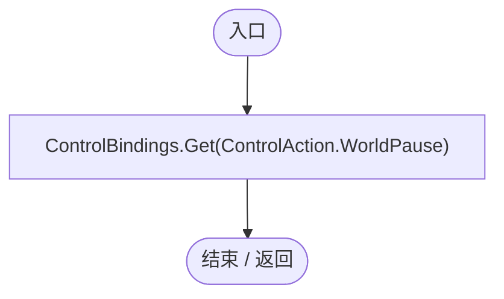
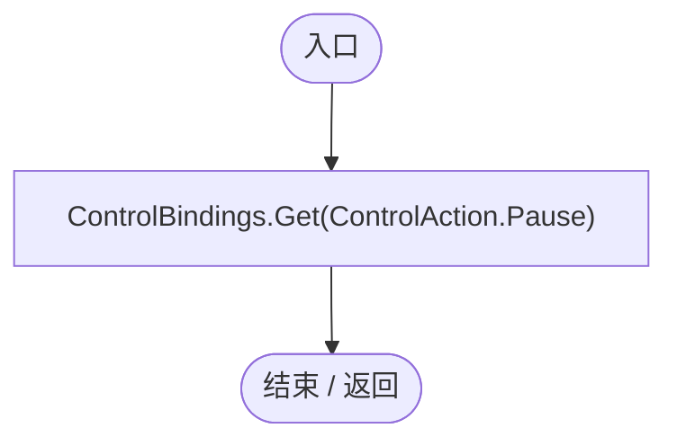
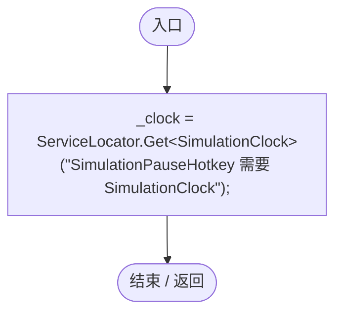
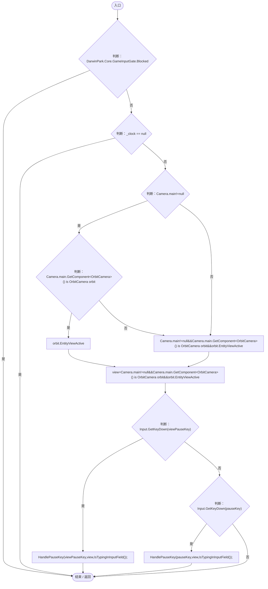
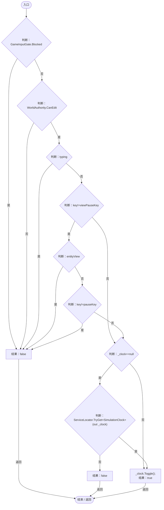
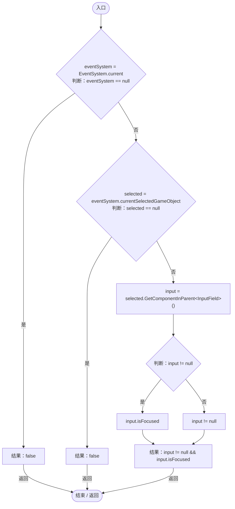

# SimulationPauseHotkey.cs

[返回总索引](../README.md) · `Runtime` · `Assets/DarwinPark/Core/Time/SimulationPauseHotkey.cs`

[源文件](../../../Assets/DarwinPark/Core/Time/SimulationPauseHotkey.cs) · 源码校验：`4d43c0d097873056d4347eddad0dfd54ffcfa1f53d0f21f28a8c5310fba8ef09`

方法按源文件位置排列。事件/回调引用不表示立即执行；分支与异常说明见总索引。完整源码与可点击关系图请打开离线手册。

## pauseKey.get · L14

`[Header("热键")] // ★ 适配：世界暂停与通用暂停分开绑定，实体跳跃不会同时暂停。 public KeyCode pauseKey`

### Editor / Player · 语法控制结构 / 声明（非CFG）

项目内调用/回调引用：

- [ControlBindings.Get · L45](b6735f8f133ee3f4.md#mb5707e6e63a56689)（方法）

## viewPauseKey.get · L17

`public KeyCode viewPauseKey`

### Editor / Player · 语法控制结构 / 声明（非CFG）

项目内调用/回调引用：

- [ControlBindings.Get · L45](b6735f8f133ee3f4.md#mb5707e6e63a56689)（方法）

## Start · L21

`private void Start()`

### Editor / Player · Roslyn编译器控制流

项目内调用/回调引用：

- [ServiceLocator.Get · L33](f2fdbe9f9ccd93cb.md#m2ae625299520c56d)（方法）

## Update · L26

`private void Update()`

### Editor / Player · Roslyn编译器控制流

项目内调用/回调引用：

- [GameInputGate.Blocked.get · L8](52955daae7e592ab.md#m765763b665829633)（访问器）
- [OrbitCamera.EntityViewActive.get · L39](42eb429559b42bcb.md#m4b320edff61e06a5)（访问器）
- [SimulationPauseHotkey.HandlePauseKey · L37](cc79d402ad5d8117.md#m55d4ba3aff20b57d)（方法）
- [SimulationPauseHotkey.IsTypingInInputField · L44](cc79d402ad5d8117.md#mca9f434bbd215ef4)（方法）

## HandlePauseKey · L37

`public bool HandlePauseKey(KeyCode key,bool entityView,bool typing)`

### Editor / Player · Roslyn编译器控制流

项目内调用/回调引用：

- [GameInputGate.Blocked.get · L8](52955daae7e592ab.md#m765763b665829633)（访问器）
- [ServiceLocator.TryGet · L26](f2fdbe9f9ccd93cb.md#m143b24e6d58471b0)（方法）
- [SimulationClock.Toggle · L80](a8f444aec9614b0a.md#m2d6d7d27573d58b8)（方法）

## IsTypingInInputField · L44

`private bool IsTypingInInputField()`

### Editor / Player · Roslyn编译器控制流

